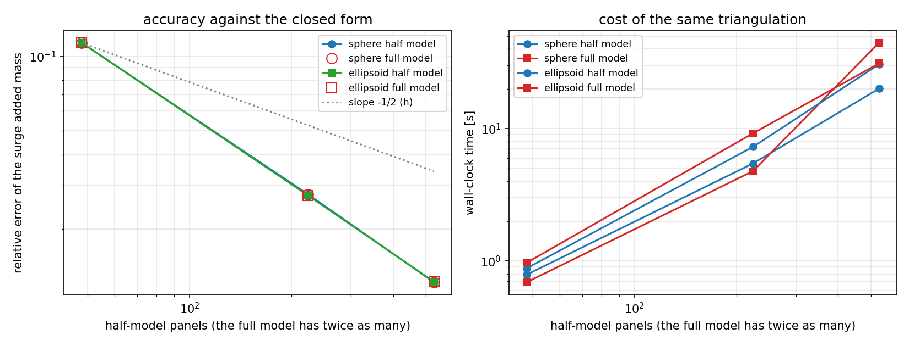

# Symmetry-plane (half-model) reduction for the 3-D BEM Laplace solver

Generated by `python -m tensorbem.benchmarks.half_model_symmetry --report`;
every number below is inserted from the JSON record
(`docs/half_model_symmetry/results.json`), none is transcribed by hand.

## 1. Case: what is being verified

The exterior Neumann problem for a centred triaxial ellipsoid `(x/a)^2 + (y/b)^2 + (z/c)^2 = 1` in an unbounded ideal fluid. The body is symmetric about `x = 0`, so the tangential half `x >= 0` is meshed and the mesh is mirrored and welded back to form the full model. Both models use constant triangular panels, centroid collocation, exact self-panel polar integration, Duffy quadrature elsewhere and exact solid angles for the double layer; the only difference is that the half model carries one unknown per panel pair.

| case | semi-axes | quadrature order | rigid modes | parities |
|---|---|---|---|---|
| sphere | (1, 1, 1) | 8 | surge, sway, heave, roll, pitch, yaw | surge: -1, sway: +1, heave: +1, roll: +1, pitch: -1, yaw: -1 |
| ellipsoid | (1, 0.6, 0.4) | 8 | surge, sway, heave, roll, pitch, yaw | surge: -1, sway: +1, heave: +1, roll: +1, pitch: -1, yaw: -1 |

## 2. Method

For a mode potential obeying `phi(R x) = p phi(x)` with reflection `R` in the plane `x = 0`, the hidden half carries density `p q` and potential `p u`. Folding the image half into the collocation rows gives

```
(1/2 I - H_half - p H_image) u_half = (S_half + p S_image) q_half
A_ij = -rho (1 + p_i p_j) * sum_{half} phi_j n_i dS
```

so only an `n x n` system is assembled and solved per parity class (one solve block for the three even modes, one for the three odd ones). No kernel is re-derived: the image panels are the reflected triangles handed to the same quadrature and solid-angle routines, which is why the half model is expected to be *exactly* the full model on the same triangulation.

## 3. Results

### 3.1 sphere

| n_phi x n_theta | half panels | full panels | surge err (half) | sway err | heave err | involution rel diff | kappa (half even/odd) | kappa (full) | half s | full s |
|---|---|---|---|---|---|---|---|---|---|---|
| 4 x 8 | 48 | 96 | 1.137e-01 | 1.136e-01 | 6.731e-02 | 2.273e-16 | 2.221 / 1.438 | 2.222 | 0.79 | 0.69 |
| 8 x 16 | 224 | 448 | 2.761e-02 | 2.760e-02 | 2.178e-02 | 4.335e-16 | 2.134 / 1.396 | 2.135 | 5.45 | 4.77 |
| 12 x 24 | 528 | 1056 | 1.214e-02 | 1.214e-02 | 1.047e-02 | 4.286e-16 | 2.108 / 1.378 | 2.108 | 20.03 | 44.53 |

Observed order in half panel count (translation modes): surge: n/a, 0.92, 0.96, sway: n/a, 0.92, 0.96, heave: n/a, 0.73, 0.85.

Exact diagonal (closed form): surge = 2.094395, sway = 2.094395, heave = 2.094395, roll = 0.000000, pitch = 0.000000, yaw = 0.000000.
At the finest level the half model gives surge = 2.068962, sway = 2.068970, heave = 2.072463, roll = 0.000436, pitch = 0.000424, yaw = 0.000108; maximum off-parity entry = 0.0e+00 (exact zeros), largest relative residual = 5.2e-16, closed-mesh volume error = 1.98%.

### 3.2 ellipsoid

| n_phi x n_theta | half panels | full panels | surge err (half) | sway err | heave err | involution rel diff | kappa (half even/odd) | kappa (full) | half s | full s |
|---|---|---|---|---|---|---|---|---|---|---|
| 4 x 8 | 48 | 96 | 1.137e-01 | 1.040e-01 | 5.011e-02 | 5.616e-16 | 2.693 / 2.146 | 2.693 | 0.88 | 0.97 |
| 8 x 16 | 224 | 448 | 2.732e-02 | 2.525e-02 | 1.831e-02 | 2.174e-16 | 2.362 / 1.931 | 2.362 | 7.28 | 9.22 |
| 12 x 24 | 528 | 1056 | 1.220e-02 | 1.121e-02 | 8.861e-03 | 4.710e-17 | 2.266 / 1.853 | 2.266 | 30.57 | 31.07 |

Observed order in half panel count (translation modes): surge: n/a, 0.93, 0.94, sway: n/a, 0.92, 0.95, heave: n/a, 0.65, 0.85.

Exact diagonal (closed form): surge = 0.202126, sway = 0.481835, heave = 1.040493, roll = 0.014274, pitch = 0.108970, yaw = 0.030201.
At the finest level the half model gives surge = 0.199661, sway = 0.476435, heave = 1.031273, roll = 0.014209, pitch = 0.107401, yaw = 0.029405; maximum off-parity entry = 0.0e+00 (exact zeros), largest relative residual = 4.7e-16, closed-mesh volume error = 1.98%.



Left: added-mass error of the surge mode against the closed form as the half mesh is refined; the half and full curves lie on top of each other because they solve the same discrete problem. Right: wall-clock time of the two paths at the same triangulation.

## 4. Error judgement against the benchmark

| key quantity | reference | value (finest level) | relative error | below 3 %? |
|---|---|---|---|---|
| sphere surge added mass | 2.094395 | 2.068962 | 1.214e-02 | **yes** |
| sphere sway added mass | 2.094395 | 2.068970 | 1.214e-02 | **yes** |
| sphere heave added mass | 2.094395 | 2.072463 | 1.047e-02 | **yes** |
| ellipsoid surge added mass | 0.202126 | 0.199661 | 1.220e-02 | **yes** |
| ellipsoid sway added mass | 0.481835 | 0.476435 | 1.121e-02 | **yes** |
| ellipsoid heave added mass | 1.040493 | 1.031273 | 8.861e-03 | **yes** |
| half vs full involution (worst level) | 0 | 5.6e-16 | roundoff | **yes** |
| mode-coupled entries (opposite parity) | 0 | 0.0e+00 | exact | **yes** |

The finite-level errors above are *discretisation* errors of the constant-panel formulation, which the half model inherits unchanged; the reduction itself introduces no additional error, as the roundoff-level involution column shows.

## 5. Notes, pitfalls and scope

* The parity is a property of the *mode*, not of the geometry: surge, pitch and yaw are odd, sway, heave and roll are even. Mixing them up gives a plausible-looking but wrong added mass, so the implementation derives the fold from `MODE_PARITIES` and returns the opposite-parity entries as exact zeros.
* Cost, stated exactly: the half model halves the unknowns (`n` against `2n`), quarters the assembled entries and divides the dense-LU work by eight. It also assembles twice, once per parity class. At the panel counts measured here the Python-level assembly loop dominates, so the wall-clock columns come out nearly equal (see the table above); the `8x` figure is the solve-only cost model, not a measured speedup at these sizes.
* The closed-mesh volume deficit in the tables is the inscribed-polyhedron error of the baseline mesh, not an error of the reduction: the half and full models see the same facets.
* `center` of the rotational modes must lie in the symmetry plane; the constructor rejects anything else instead of silently returning a wrong tensor.
* Scope: unbounded-fluid exterior Neumann problems only. The free-surface solvers have no half-model path, and one symmetry plane is supported (no quarter models).
* The welded reproduction of the full mesh is what makes the involution exact; comparing a half mesh against an independently generated full mesh (for example an icosphere) would mix the mesh difference into the comparison.

