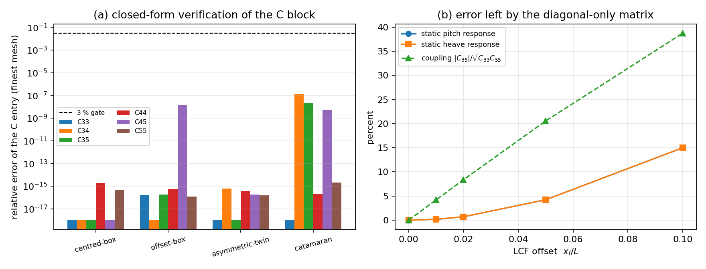

# Hydrostatic restoring matrix: waterplane coupling terms

This page is generated by
`python -m tensorbem.benchmarks.hydrostatic_coupling --doc docs/hydrostatic_coupling.md`.
Every number is written from the JSON artefact; none is transcribed by hand.

## 1. What was wrong

`compute_hydrostatic_restoring_matrix` returned a matrix whose only non-zero
entries were `C[2,2]` (heave), `C[3,3]` (roll) and `C[4,4]` (pitch), justified
by "for small-angle linearization, all off-diagonal terms are zero". That is
true only in the frame whose origin is the waterplane centroid; a ship's
longitudinal centre of flotation is not amidships in general, so the body frame
used by the motion solver sees a coupled block:

```
C[2,3] = C[3,2] =  rho g A_wp y_f      C[2,4] = C[4,2] = -rho g A_wp x_f
C[3,4] = C[4,3] = -rho g I_xy          C[2,2] = rho g A_wp
C[3,3] = rho g (I_xx + grad (z_B - z_G))
C[4,4] = rho g (I_yy + grad (z_B - z_G))
```

They are the Hessian of the wave-zone energy `1/2 rho g iint zeta^2 dA` with
`zeta = xi_3 + xi_4 y - xi_5 x`, so they are first order in the displacement:
dropping them is a modelling error, not a truncation. The implementation now
returns the full small-angle block.

## 2. How it is verified

1. **Closed form.** Wall-sided planar bodies have exact hydrostatics, so the
   computed block must reproduce the closed-form entries at round-off and stay
   there under panel refinement. Cases: centred box, box with an off-centre LCF,
   an asymmetric two-box complex (non-zero `I_xy`), and a symmetric catamaran
   (where the coupling must vanish identically).
2. **Curved, multiply-connected waterplane.** A faceted annular float (beam-like
   moonpool, two waterline loops of opposite orientation) must converge at
   second order to the closed form.
3. **Energy identity.** For an arbitrary displacement, `1/2 xi^T C xi` is
   compared with the hydrostatic energy from a 12x12 tensor-product Gauss
   quadrature of the wave-zone integral, which never touches the polygon
   integrals of the hydrostatic module.
4. **Frame covariance.** Translating the mesh in `x` must change `C[2,4]` by
   exactly `rho g A_wp dx` and leave the rest of the block untouched.
5. **Consequence for motion.** Static response and RAO with the full matrix
   versus the diagonal-only matrix of the previous implementation.

## 3. Wall-sided closed-form verification

Density 1025.0000 kg/m3, gravity 9.8066 m/s2, KG = 1.4000 m
above the keel. Errors are relative, on the finest mesh. Entries whose
closed-form value is exactly zero (symmetry-forbidden) are normalised by
1e-9 of the largest entry of the block, so their column is a round-off
measure rather than a percentage; the `symmetry break` column in section 3.2
uses the same normalisation for the curved case.

| case | x_f [m] | y_f [m] | C33 | C34 | C35 | C44 | C45 | C55 |
|---|---|---|---|---|---|---|---|---|
| centred-box | 0 | 0 | 0 | 0 | 0 | 1.915e-15 | 0 | 4.731e-16 |
| offset-box | 1.8000 | 0 | 1.609e-16 | 0 | 1.787e-16 | 5.745e-16 | 1.480e-08 | 1.219e-16 |
| asymmetric-twin | 1.1273 | 0.5455 | 0 | 6.032e-16 | 0 | 3.756e-16 | 1.856e-16 | 1.498e-16 |
| catamaran | 0 | 0 | 0 | 1.274e-07 | 2.123e-08 | 2.076e-16 | 5.307e-09 | 2.088e-15 |

Reference vs computed entries for the asymmetric two-box complex (N and N m/rad):

| entry | closed form | computed | absolute error |
|---|---|---|---|
| C33 | 1.106e+05 | 1.106e+05 | 0 |
| C34 | 6.031e+04 | 6.031e+04 | 3.638e-11 |
| C35 | -1.246e+05 | -1.246e+05 | 0 |
| C44 | 2.325e+05 | 2.325e+05 | 8.731e-11 |
| C45 | -3.136e+05 | -3.136e+05 | 5.821e-11 |
| C55 | 3.885e+05 | 3.885e+05 | 5.821e-11 |

### 3.1 Refinement ladder (worst relative error over the C block)

| case | 10 panels | 24 panels | 42 panels |
|---|---|---|---|
| centred-box | 9.575e-16 | 2.872e-15 | 1.915e-15 |
| offset-box | 1.219e-16 | 9.575e-16 | 5.745e-16 |
| asymmetric-twin | 0 | 3.619e-16 | 6.032e-16 |
| catamaran | 4.152e-16 | 4.176e-16 | 2.088e-15 |

### 3.2 Faceted annular float (curved, two waterplane loops)

| sectors | panels | C33 | C44 | C55 | symmetry break |
|---|---|---|---|---|---|
| 16 | 96 | 0.0255 | 0.1138 | 0.1138 | 2.405e-17 |
| 32 | 192 | 0.0064 | 0.0291 | 0.0291 | 4.393e-17 |
| 64 | 384 | 0.0016 | 0.0073 | 0.0073 | 3.784e-17 |
| 128 | 768 | 4.015e-04 | 0.0018 | 0.0018 | 2.629e-17 |

Observed order between successive sector doublings:

| entry | orders |
|---|---|
| C33 | 1.9917, 1.9979, 1.9995 |
| C44 | 1.9655, 1.9914, 1.9978 |
| C55 | 1.9655, 1.9914, 1.9978 |

## 4. Energy identity and frame covariance

| quantity | value |
|---|---|
| displacement (xi_3, xi_4, xi_5) | 0.1000, 0.0200, -0.0300 |
| 1/2 xi^T C xi [J] | 1456.8847 |
| 1/2 rho g iint zeta^2 dA + 1/2 rho g grad (z_B - z_G)(...) [J] | 1456.8847 |
| relative difference | 4.682e-16 |

| origin shift s [m] | C35 before [N] | C35 after [N] | C35 predicted by T^T C T [N] | max relative deviation of the whole block |
|---|---|---|---|---|
| -1.8000 | -3.257e+05 | -6.514e+05 | -6.514e+05 | 3.432e-16 |
| 0 | -3.257e+05 | -3.257e+05 | -3.257e+05 | 0 |
| 0.9000 | -3.257e+05 | -1.628e+05 | -1.628e+05 | 1.129e-16 |

In the frame whose origin is the waterplane centroid (s = x_f = 1.8000 m) the block becomes

| entry | value |
|---|---|
| C34 | 0 |
| C35 | 0 |
| C45 | 0 |
| C44 / (rho g grad) | -0.1750 |
| GM_T = I_T^centroid / grad + (z_B - z_G) | -0.1750 |
| C55 / (rho g grad) | 1.7000 |
| GM_L = I_L^centroid / grad + (z_B - z_G) | 1.7000 |

So the heave-roll and heave-pitch entries vanish exactly in the centroid
frame and the diagonals collapse to the classical `rho g grad GM`: that is
the only frame in which the old "all off-diagonal terms are zero" statement
held. Away from it the matrix is not diagonal, and the diagonals are the
*origin* second moments, not the centroidal ones.

## 5. Consequence for the motion response

RAO at omega = 1.2000 rad/s, head seas (`wave_angle = 0`), full matrix versus its diagonal.

| case | x_f/L | y_f/L | |C34|/sqrt(C33C44) | |C35|/sqrt(C33C55) | |C45|/sqrt(C44C55) | heave response change | pitch response change | pitch from a heave force | RAO heave change | RAO pitch change |
|---|---|---|---|---|---|---|---|---|---|---|
| offset-box | 0.3000 | 0 | 0 | 0.7833 | 0 | 0.6136 | 0.6136 | 0 | 2.9932 | 0.0604 |
| asymmetric-twin | 0.2818 | 0.1364 | 0.3762 | 0.6014 | 1.0436 | 0.3480 | 1.1399 | 0 | 0.1037 | 1.8083 |

## 6. LCF sweep (a wall-sided box, L = 6 m, B = 3 m, T = 1.2 m)

| x_f/L | C35 [N] | |C35|/sqrt(C33C55) | heave response change | pitch response change |
|---|---|---|---|---|
| 0 | 0 | 0 | 0 | 0 |
| 0.0100 | -1.086e+04 | 0.0420 | 0.0018 | 0.0018 |
| 0.0200 | -2.171e+04 | 0.0837 | 0.0070 | 0.0070 |
| 0.0500 | -5.428e+04 | 0.2056 | 0.0423 | 0.0423 |
| 0.1000 | -1.086e+05 | 0.3873 | 0.1500 | 0.1500 |



(a) Relative error of each restoring entry against the closed form on the
finest mesh, with the 3 % gate. Wall-sided planar bodies sit at round-off (the
bars are floored at 1e-18 for the log axis); the faceted annulus is
discretisation-limited. (b) Error left by the previous diagonal-only matrix as
a function of the LCF offset: it grows linearly, which is why the coupling
cannot be treated as a small second-order refinement.

## 7. Error judgement

| key quantity | baseline | measured relative error | < 3 %? |
|---|---|---|---|
| C block, wall-sided bodies (worst over 4 cases x 3 meshes) | closed form | 2.872e-15 | yes |
| C block, faceted annular float (128 sectors) | closed form | 0.0018 | yes |
| hydrostatic energy, 1/2 xi^T C xi | direct wave-zone quadrature | 4.682e-16 | yes |
| frame covariance of C35 | rho g A_wp dx | 3.432e-16 | yes |
| symmetry-forbidden entries (normalised by the block scale) | exactly zero | 1.274e-16 | yes |

No quantity above exceeds the 3 % bar; the wall-sided and energy checks are at
round-off. The quantity in section 5 is not an error but a **model change**: it
is the response error that the previous diagonal-only matrix carried on bodies
with an off-centre LCF.

## 8. Caveats and scope

- The matrix is **frame dependent by construction**: moments are taken about the
  axes through the origin of the mesh. Moving the pitch axis to `x = x_0` adds
  `rho g A_wp x_0` to `C[2,4]` (a moment about a shifted axis picks up `x_0`
  times the heave force). Compare matrices only in the same frame, and note
  that the RAO solver feeds the matrices as assembled, so the body frame must
  be the one used for the mass matrix too.
- The diagonal keeps the equilibrium assumption `mass = rho grad`; a body whose
  weight differs from the displaced weight is not in hydrostatic equilibrium and
  its `KB - KG` term would need the actual weight.
- The waterplane is still the planar section `z = 0`. Heeled/trimmed waterplanes
  and the topology change when the bilge or a deck edge enters are outside the
  module; these are the linear coupling terms, not a large-angle `GZ` curve.
- The RAO columns of section 5 are indicative, not a precision statement: one
  frequency, head seas, default mass-matrix inertia. They show that the
  coupling is not negligible in the motion response; the frequency-independent
  statement is the static block comparison in the same table.
- Viscous roll damping, forward speed and finite depth are untouched.

## 9. Reproduce

```
PYTHONPATH=src python3 -m pytest tests/test_hydrostatic_coupling.py -q
PYTHONPATH=src python3 -m tensorbem.benchmarks.hydrostatic_coupling \
    --output artifacts/hydrostatic_coupling/hydrostatic_coupling.json \
    --doc docs/hydrostatic_coupling.md \
    --figure artifacts/hydrostatic_coupling/hydrostatic_coupling.png
```
