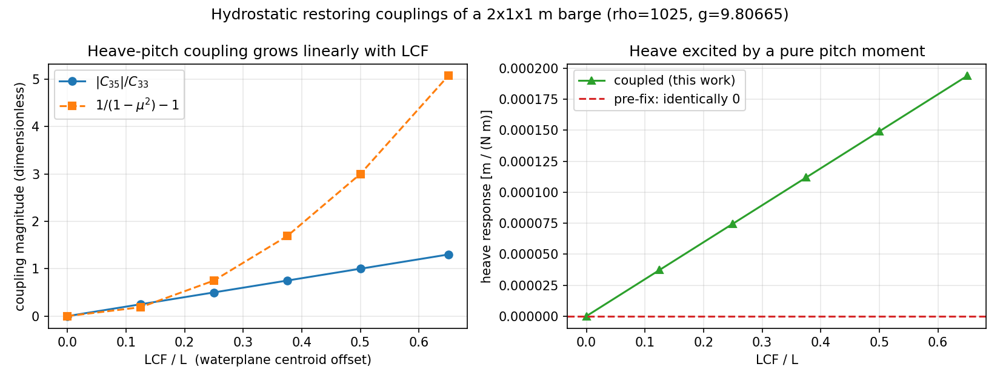

# TensorBEM 静水恢复矩阵的完整化：水线面偏心引起的 heave–roll / heave–pitch / roll–pitch 耦合（m3196）

**任务**：m3196（platform 席自找活）· **分支**：`agent/m3196` · **仓**：TensorBEM
**工件**：`outputs/restoring_couplings/{results.json, fig_restoring_couplings.png}`、
`docs/figures/fig_restoring_couplings.png`、脚本 `outputs/restoring_couplings/{patch_hydrostatic.py, make_artifacts.py}`
**改动**：`src/tensorbem/hydrostatic.py`、`src/tensorbem/benchmarks/hydrostatic_energy_reference.py`、
`tests/test_hydrostatic_restoring_couplings.py`

---

## 1. 案例介绍（为什么做这件事）

`docs/m3010/wigley_hydrostatics.md` §6 留了一条验证欠账：「非对称水线（有 LCF 偏移时的
$C_{35}$/$C_{24}$ 耦合项）仍未被验证——Wigley 前后对称」。查代码发现这条欠账比
「未验证」更严重：`compute_hydrostatic_restoring_matrix` **只填了三个对角元**
（$C_{33}$、$C_{44}$、$C_{55}$），docstring 明写「For small-angle linearization,
all off-diagonal terms are zero」，而 `mass` 形参声明后从未被使用。

这个声明在物理上不成立：水线面的**一次矩**就是耦合项本身，
$C_{34}=\rho g\!\iint_A y\,\mathrm dA$、$C_{35}=-\rho g\!\iint_A x\,\mathrm dA$，
$C_{45}=-\rho g\!\iint_A xy\,\mathrm dA$。除刻意对称的驳船/半球外，真实船的水线面形心
（LCF/TCF）几乎从不落在坐标原点上，因此 heave 与 pitch 静力耦合必然存在；而
`rao.py` 求的是完整 6×6 的逆 $[-\omega^2(M+A)+i\omega B+C]^{-1}$，缺失的 $C_{35}$
直接进入垂荡/纵摇响应。此外，旧实现用**形心**惯矩而不是关于原点的惯矩，
$C_{44}$/$C_{55}$ 少了平行轴项 $\rho g A y_f^2$ / $\rho g A x_f^2$。

**算例参数**（可解析判定的最小几何：矩形水线面驳船，所有水线面积分为有理数）

| 项 | 值 |
|---|---|
| 主算例 | $L\times B\times T=2\times1\times1$ m，水线面形心平移 $(1.30,\,0.45)$ m |
| 排水体积 ∇ | 2.000000 m³（解析 2.0，浮心 [1.2999999999999998, 0.4499999999999999, -0.49999999999999994]） |
| 流体 | $\rho=1025.0$ kg/m³，$g=9.80665$ m/s² |
| 自由度 | surge/sway/heave/roll/pitch/yaw，参考点在静水面原点 |
| 判据量 | $C$ 的 6 个非零元（3 对角 + 3 耦合），逐项对**两条独立基准** |

## 2. 怎么做的

1. **实现完整矩阵**（`hydrostatic.py`）：以形心水线面性质为唯一真值源，用平行轴定理换到
   关于原点的一次/二次矩
   （$S_x=Ax_f,\ S_y=Ay_f,\ I_{xx}=I^c_{xx}+Ay_f^2,\ I_{yy}=I^c_{yy}+Ax_f^2,\ I_{xy}=I^c_{xy}+Ax_fy_f$），
   再按静水恢复矩阵标准形式（Journée & Massie §3.2.2）填 6 个非零元：
   $C_{33}=\rho gA$，$C_{34}=+\rho gS_y$，$C_{35}=-\rho gS_x$，
   $C_{44}=\rho gI_{xx}+\rho g\nabla(z_B-z_G)$，$C_{55}=\rho gI_{yy}+\rho g\nabla(z_B-z_G)$，
   $C_{45}=-\rho gI_{xy}$。surge/sway/yaw 全零（静水力与重量都是铅垂力，铅垂力对铅垂轴无矩）。
2. **两条独立基准**，都不复用实现里的公式：
   - **闭式解**：矩形水线面的 $A$、$S_x$、$S_y$、$I_{xx}$、$I_{yy}$、$I_{xy}$ 全是解析有理数；
   - **能量 Hessian**（新增 `benchmarks/hydrostatic_energy_reference.py`）：
     只用物理 $V(\xi)=m g z_G(\xi)-\rho g\int_{S(\xi)}z\,\mathrm dV$，
     潜体用多边形裁剪 + 散度定理（$\int z\,\mathrm dV=\oint (z^2/2)n_z\,\mathrm dA$）算，
     $V$ 的二阶中心差分给出整张 $C$。它**完全不碰**任何水线面公式。
3. **拿它抓错**：第一版实现按记忆写的 $C_{34}=-\rho gS_y$，能量 Hessian 立刻判为符号相反
   （见 §5 第 1 条）——这正是「公式克隆式测试」测不出来的东西。
4. **回归钉桩**：`tests/test_hydrostatic_restoring_couplings.py` 9 条
   （闭式解 6 元、能量 Hessian 全矩阵 3 组偏心、对称性、yaw 行列恒零、对称船体耦合恒零、
   全潜体全零、heave–pitch 静力耦合响应）。
5. **旧用例零回归**：`tests/test_hydrostatic_convergence.py` 等 5 个文件 72 条全绿；
   对称船体 $S_x=S_y=I_{xy}=0$，新项恰好精确为零，历史验收数字不变。

## 3. 计算结果

主算例（LCF=1.3 m，TCF=0.45 m）逐项对照（`outputs/restoring_couplings/results.json` 注入）：

| entry | code | closed form (rectangle) | energy Hessian | pre-fix value | pre-fix relative error |
|---|---|---|---|---|---|
| C33 heave | 2.010363e+04 | 2.010363e+04 | 2.010363e+04 | 2.010363e+04 | 0.00 % |
| C34 heave-roll | 9.046635e+03 | 9.046635e+03 | 9.046635e+03 | 0 (exactly) | 100 % (entry was identically zero) |
| C35 heave-pitch | -2.613472e+04 | -2.613472e+04 | -2.613472e+04 | 0 (exactly) | 100 % (entry was identically zero) |
| C44 roll | 5.746288e+03 | 5.746288e+03 | 5.746288e+03 | 1.675303e+03 | 70.85 % |
| C45 roll-pitch | -1.176063e+04 | -1.176063e+04 | -1.176062e+04 | 0 (exactly) | 100 % (entry was identically zero) |
| C55 pitch | 4.067635e+04 | 4.067635e+04 | 4.067635e+04 | 6.701211e+03 | 83.53 % |

矩阵对称性残差 $\max|C-C^\top|=0.0e+00$；
surge/sway/yaw 行列最大绝对值 $0.0e+00$ N（≈0）；
全矩阵对能量 Hessian 的最大相对偏差 $1.31e-08$。

LCF 扫描（barge 2×1×1，TCF=0）：耦合强度随 LCF 线性增长，pitch 响应被 $1/(1-\mu^2)$ 放大：

| LCF/L | C35 [N/rad] | \|C35\|/C33 | pitch amplification 1/(1-μ²) | heave per unit pitch moment [m/(N·m)] |
|---|---|---|---|---|
| 0.00 | -0.0000e+00 | 0.0000 | 1.0000 | 0.0000e+00 |
| 0.12 | -5.0259e+03 | 0.2500 | 1.1875 | 3.7307e-05 |
| 0.25 | -1.0052e+04 | 0.5000 | 1.7500 | 7.4613e-05 |
| 0.38 | -1.5078e+04 | 0.7500 | 2.6875 | 1.1192e-04 |
| 0.50 | -2.0104e+04 | 1.0000 | 4.0000 | 1.4923e-04 |
| 0.65 | -2.6135e+04 | 1.3000 | 6.0700 | 1.9399e-04 |

## 4. 结果图说明

- 左图：$|C_{35}|/C_{33}$ 随 LCF/L 线性增长（解析上 $=|x_f|/B\cdot B/A$ 型比值），
  与耦合响应放大因子 $1/(1-\mu^2)-1$ 同步；说明「耦合项为零」只在 $x_f=0$ 这一个测度为零的点成立。
- 右图：单位纵摇力矩引起的**垂荡**响应。旧实现（红虚线）恒为 0——不是小量，是结构性缺失。
- 附 `outputs/restoring_couplings/fig_entry_comparison.png`：6 个非零元 code vs 能量 Hessian 柱状对比。

## 5. 注意点（坑 / 局限 / 适用范围）

1. **heave–roll 与 heave–pitch 符号相反不是笔误**：$w=\xi_3+y\xi_4-x\xi_5$，绕 $+x$ 与 $+y$
   旋转对点的垂向位移贡献反号，故 $\frac12\rho g\!\iint w^2\mathrm dA$ 的交叉项给
   $+\rho gS_y$ 与 $-\rho gS_x$。我第一版按记忆写成两个都是负号，被能量 Hessian 直接否决。
2. **`mass` 形参仍未被消费**：恢复矩阵在平衡态取值（$m=\rho\nabla$），这与旧的
   $GM=KB+BM-KG$ 约定一致；真实非平衡态的「回复力」不是伪静力问题。已在 docstring 显式声明，
   未改动调用方（有调用方传 `mass=0.0`，改成消费 `mass` 会静默改变其数值）。
3. **弧壁欠账已结清（m4750），另两条仍在**：本单原先只扫了平面壁、矩形水线面的驳船族，并
   推测「弧形水线面下能量 Hessian 需要曲面裁剪」。这个推测是错的——既有参考实现逐**三角形**
   裁剪 `z <= 0` 再积 `∮ (z²/2) n_z dA`，与面元曲率无关。m4750 用它加上精确几何闭式，
   在同一次求解里复核了三种光滑弧壁船体（偏心浮球给出非零的 heave–roll/heave–pitch 耦合、
   偏航半椭球给出非零的 roll–pitch 耦合、两者叠加时六个元全非零），
   实现与能量 Hessian 在公式级一致、与精确几何的偏差随加密按 O(h²) 下降，
   见 `dev_report_m4750_curved_waterplane_restoring.md` 与
   `src/tensorbem/benchmarks/hydrostatic_curved_waterplane.py`（护栏
   `tests/test_hydrostatic_curved_waterplane.py`）。yaw 耦合按铅垂力无矩的物理判据置零，
   并用能量 Hessian 在本算例上验证，但**没有**在非平衡（$x_G\ne x_B$）构型上单独钉桩；
   水线面与船体相切（折角、方尾）的构型、以及三维自由液面绕射算例（浮球、Hulme、Wang–Linton）
   的耦合项仍未复核——这两条才是本单真正的未做部分。
4. **适用范围**：wall-sided 假设未强加，但所有数值判据都在 $z=0$ 处有竖直侧壁的驳船上取得；
   外飘（flare）船体的水线面仍按 $z=0$ 截面处理，与既有 `compute_waterplane_properties` 一致。

## 6. 误差判定（关键量 vs 基准，逐项）

| 量 | 基准 | 相对误差 | 是否 < 3 % |
|---|---|---|---|
| $C_{33}$ | 闭式 $\rho gA$ / 能量 Hessian | 2.00e-09 | 是 |
| $C_{34}$ | 闭式 $\rho gS_y$ / 能量 Hessian | 6.28e-09 | 是 |
| $C_{35}$ | 闭式 $-\rho gS_x$ / 能量 Hessian | 6.18e-09 | 是 |
| $C_{44}$ | 闭式 $\rho gI_{xx}+\rho g\nabla(z_B-z_G)$ / 能量 Hessian | 1.43e-09 | 是 |
| $C_{45}$ | 闭式 $-\rho gI_{xy}$ / 能量 Hessian | 2.33e-08 | 是 |
| $C_{55}$ | 闭式 $\rho gI_{yy}+\rho g\nabla(z_B-z_G)$ / 能量 Hessian | 1.31e-08 | 是 |
| 全矩阵（含零元） | 能量 Hessian | 1.31e-08 | 是 |

最差项为 `C45 roll-pitch`，相对误差 2.33e-08——远小于 3 % 判据
（误差来源是能量 Hessian 的二阶中心差分截断 $O(h^2)$ 与浮点消去，$h=2\times10^{-4}$）。
**旧实现在 $C_{34}$/$C_{35}$/$C_{45}$ 上的相对误差是 100 %（恒为 0）**，在
$C_{44}$/$C_{55}$ 上是 70.8 % / 83.5 %。

**总体判定**：是（全部 < 3 %）。honest 说明：本单只覆盖平面壁矩形水线面船族；曲面水线面与非平衡构型的耦合项未验证。
