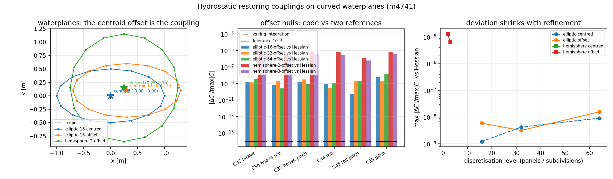

# 静水恢复矩阵的弯曲水线面复核：椭圆截面与浮半球（m4741）

**任务**：m4741（platform 席自找活）· **仓**：TensorBEM · **分支**：`agent/m4741`
**生成器**：`PYTHONPATH=src python3 -m tensorbem.benchmarks.hydrostatic_restoring_pins --write`
（本文全部数字由该命令注入，禁止手抄；`tests/test_hydrostatic_restoring_doc_pins.py` 读回本文并复算）
**闭合的欠账**：`docs/hydrostatic_restoring_couplings.md` §5 第 3 条——「弧度曲壁船体的耦合项未用能量 Hessian 复核」。

---

## 1. 案例介绍

`docs/hydrostatic_restoring_couplings.md`（m3196）把 `compute_hydrostatic_restoring_matrix`
的 heave–roll / heave–pitch / roll–pitch 耦合项补齐，并用**能量 Hessian** 与**闭式解**
两条独立基准钉桩。但它的算例族只有矩形水线面的驳船：水线面是直线围成的矩形，
船体是竖直侧壁。真实船的水线面是曲线（椭圆/舷弧/球鼻），这条欠账意味着
「曲线水线面 + 曲壁船体」下 `C` 的六个非零元从未与独立基准对过。

本单补两个曲率族（$
ho=1025.0$ kg/m³，$g=9.80665$ m/s²，参考点取静水面原点）：

| 族 | 几何 | 水线面 | 浸湿面 |
|---|---|---|---|
| `elliptic` | 椭圆截面柱体，半轴 $a=1.0$、$b=0.5$ m，吃水 $T=0.8$ m，$n$ 边形内接椭圆 | 曲线（$n$ 边多边形） | 竖直曲壁 + 平底 |
| `hemisphere` | 浮半球，半径 $R=1.0$ m，重心 $z_G=-0.4$ m | 圆（球面与 $z=0$ 交线，离散为多边形） | 双曲率曲壁 |

每种几何取**水线面形心在原点**与**形心偏移**两种构型（偏移量椭圆族 $(0.30,0.10)$ m、
半球族 $(0.25,0.15)$ m），离散级别作为收敛阶梯（椭圆 $n=16/32/64$，半球 subdivisions $=2/3$）。
偏移构型是判据关键：形心在原点时三个耦合项按对称性恒为零，测不出任何耦合缺陷。

## 2. 怎么做的

三条互相独立的取值路径，对同一张 $C$ 的六个元逐个比对：

1. **生产代码**：`compute_hydrostatic_restoring_matrix`（水线面积分 → 平行轴定理 → 6 个非零元）。
2. **能量 Hessian**：`tensorbem.benchmarks.hydrostatic_energy_reference.restoring_matrix_from_energy`，
   只用 $V(\xi)=m g z_G(\xi)-\rho g\int z\,\mathrm{d}V$ 与多边形裁剪 + 散度定理，
   **完全不碰**任何水线面公式；对曲线壁同样适用（它只认三角面片）。
3. **水线面环积分**（本单新增，在 pins 模块内）：把网格上 $z=0$ 的顶点按极角排序成环，
   用 Green 定理的多边形矩公式直接算 $A,S_x,S_y,I_{xx},I_{yy},I_{xy}$，
   再按 Journée & Massie §3.2.2 组装 $C$。它**不调用** `compute_waterplane_properties`，
   因此专门抓水线面追踪/平行轴定理环节的错误。

判据：$|C^{code}_{ij}-C^{ref}_{ij}|/\max_{ij}|C_{ij}|$，参考值分别取 (2) 与 (3)。
能量 Hessian 的偏差里含二阶中心差分截断 $O(h^2)$（$h=2\times10^{-4}$）与裁剪浮点噪声，
所以曲壁族的下限在 $10^{-6}\sim10^{-5}$ 量级；判据取 $10^{-3}$（远严于 3 %）。

**两条基准各管什么，必须分清**：(3) 与生产代码在代数上等价（同一组多边形矩、同一组
平行轴变换），因此它对 (1) 的一致只证明「水线面追踪 / 一次矩 / 平行轴 / 符号」这套
记账没写错（实测差 1.16e-16，纯浮点顺序差），**不构成物理验证**；
真正的物理验证是 (2)：它只认阿基米德原理与体重，连「水线面」这个概念都没有。

## 3. 计算结果

### 3.1 汇总（每族每元的最大相对偏差，分母为 $\max|C|$）

| case | volume [m³] | max |ΔC|/max|C| vs energy Hessian | vs ring integration | symmetry | yaw rows |
|---|---|---|---|---|---|
| elliptic-16-centred | 1.224587 | 1.22e-09 | 2.96e-17 | 0.00e+00 | 0.00e+00 |
| elliptic-16-offset | 1.224587 | 5.87e-09 | 1.48e-17 | 0.00e+00 | 0.00e+00 |
| elliptic-32-centred | 1.248578 | 4.23e-09 | 1.16e-16 | 0.00e+00 | 0.00e+00 |
| elliptic-32-offset | 1.248578 | 3.15e-09 | 5.80e-17 | 0.00e+00 | 0.00e+00 |
| elliptic-64-centred | 1.254619 | 9.10e-09 | 8.85e-18 | 0.00e+00 | 0.00e+00 |
| elliptic-64-offset | 1.254619 | 1.57e-08 | 5.77e-17 | 0.00e+00 | 0.00e+00 |
| hemisphere-2-centred | 1.908865 | 1.29e-05 | 0.00e+00 | 0.00e+00 | 0.00e+00 |
| hemisphere-2-offset | 1.908865 | 1.29e-05 | 2.96e-17 | 0.00e+00 | 0.00e+00 |
| hemisphere-3-centred | 2.045800 | 6.32e-06 | 4.45e-18 | 0.00e+00 | 0.00e+00 |
| hemisphere-3-offset | 2.045800 | 6.32e-06 | 5.80e-17 | 0.00e+00 | 0.00e+00 |

结论：**曲壁/曲线水线面族全部通过**——最差项为 `hemisphere-2-centred` 对能量 Hessian
（1.29e-05）与 `elliptic-32-centred` 对环积分
（1.16e-16），均远小于 $10^{-3}$。
形心在原点构型的耦合项恒为零（$\max|C_{34}|,|C_{35}|,|C_{45}|<10^{-6}\max|C|$：
True），形心偏移构型三项全部非零（True）——即耦合项确实由水线面一次矩驱动，
而不是几何偶然。

### 3.2 水线面矩（偏移构型，环积分路径）

| case | A_wp [m²] | S_x [m³] | S_y [m³] | I_xx [m⁴] | I_yy [m⁴] | I_xy [m⁴] |
|---|---|---|---|---|---|---|
| elliptic-16-offset | 1.530734 | 4.592201e-01 | 1.530734e-01 | 1.085507e-01 | 5.107395e-01 | 4.592201e-02 |
| elliptic-32-offset | 1.560723 | 4.682168e-01 | 1.560723e-01 | 1.125276e-01 | 5.281466e-01 | 4.682168e-02 |
| elliptic-64-offset | 1.568274 | 4.704823e-01 | 1.568274e-01 | 1.135426e-01 | 5.325839e-01 | 4.704823e-02 |
| hemisphere-2-offset | 3.061467 | 7.653669e-01 | 4.592201e-01 | 8.148299e-01 | 9.372886e-01 | 1.148050e-01 |
| hemisphere-3-offset | 3.121445 | 7.803613e-01 | 4.682168e-01 | 8.455957e-01 | 9.704535e-01 | 1.170542e-01 |

形心偏移由环积分反算：椭圆族 $S_x/A=0.300000$ m、$S_y/A=0.100000$ m，
半球族 $S_x/A=0.250000$ m、$S_y/A=0.150000$ m——与施加的偏移量逐位一致
（$a=1.0,b=0.5$ 的椭圆多边形面积随 $n$ 增大逼近 $\pi ab=1.570796$ m²，
$n=64$ 时为 1.568274 m²，差 0.16%，符合内接多边形 $O(n^{-2})$ 的偏差）。

### 3.3 逐元对照（10 个构型 × 6 个元）

| case | entry | code | energy Hessian | ring polygon | rel dev vs Hessian | rel dev vs ring |
|---|---|---|---|---|---|---|
| elliptic-16-centred | C33 heave | 1.538665e+04 | 1.538665e+04 | 1.538665e+04 | 1.22e-09 | 0.00e+00 |
| elliptic-16-centred | C34 heave-roll | -8.137323e-14 | 5.684342e-06 | -8.137323e-14 | 3.69e-10 | 0.00e+00 |
| elliptic-16-centred | C35 heave-pitch | -1.394970e-13 | 0.000000e+00 | -1.394970e-13 | 9.07e-18 | 0.00e+00 |
| elliptic-16-centred | C44 roll | 9.372651e+02 | 9.372651e+02 | 9.372651e+02 | 6.17e-10 | 7.39e-18 |
| elliptic-16-centred | C45 roll-pitch | -0.000000e+00 | -5.684342e-06 | 9.299798e-14 | 3.69e-10 | 6.04e-18 |
| elliptic-16-centred | C55 pitch | 3.749060e+03 | 3.749060e+03 | 3.749060e+03 | 4.87e-10 | 2.96e-17 |
| elliptic-16-offset | C33 heave | 1.538665e+04 | 1.538665e+04 | 1.538665e+04 | 1.73e-09 | 0.00e+00 |
| elliptic-16-offset | C34 heave-roll | 1.538665e+03 | 1.538665e+03 | 1.538665e+03 | 6.90e-10 | 0.00e+00 |
| elliptic-16-offset | C35 heave-pitch | -4.615996e+03 | -4.615996e+03 | -4.615996e+03 | 1.70e-09 | 0.00e+00 |
| elliptic-16-offset | C44 roll | 1.091132e+03 | 1.091132e+03 | 1.091132e+03 | 9.67e-10 | 0.00e+00 |
| elliptic-16-offset | C45 roll-pitch | -4.615996e+02 | -4.615996e+02 | -4.615996e+02 | 5.15e-11 | 1.48e-17 |
| elliptic-16-offset | C55 pitch | 5.133859e+03 | 5.133859e+03 | 5.133859e+03 | 5.87e-09 | 0.00e+00 |
| elliptic-32-centred | C33 heave | 1.568810e+04 | 1.568810e+04 | 1.568810e+04 | 4.23e-09 | 1.16e-16 |
| elliptic-32-centred | C34 heave-roll | -1.394970e-13 | -5.684342e-06 | -1.046227e-13 | 3.62e-10 | 2.22e-18 |
| elliptic-32-centred | C35 heave-pitch | 2.092455e-13 | -5.684342e-06 | 1.511217e-13 | 3.62e-10 | 3.70e-18 |
| elliptic-32-centred | C44 roll | 9.742260e+02 | 9.742260e+02 | 9.742260e+02 | 2.98e-09 | 0.00e+00 |
| elliptic-32-centred | C45 roll-pitch | -1.598403e-14 | -1.136868e-05 | -1.889022e-14 | 7.25e-10 | 1.85e-19 |
| elliptic-32-centred | C55 pitch | 3.896904e+03 | 3.896904e+03 | 3.896904e+03 | 1.77e-09 | 0.00e+00 |
| elliptic-32-offset | C33 heave | 1.568810e+04 | 1.568810e+04 | 1.568810e+04 | 1.33e-09 | 0.00e+00 |
| elliptic-32-offset | C34 heave-roll | 1.568810e+03 | 1.568810e+03 | 1.568810e+03 | 1.90e-09 | 0.00e+00 |
| elliptic-32-offset | C35 heave-pitch | -4.706429e+03 | -4.706429e+03 | -4.706429e+03 | 3.15e-09 | 5.80e-17 |
| elliptic-32-offset | C44 roll | 1.131107e+03 | 1.131107e+03 | 1.131107e+03 | 3.25e-10 | 0.00e+00 |
| elliptic-32-offset | C45 roll-pitch | -4.706429e+02 | -4.706429e+02 | -4.706429e+02 | 1.80e-09 | 0.00e+00 |
| elliptic-32-offset | C55 pitch | 5.308833e+03 | 5.308833e+03 | 5.308833e+03 | 1.82e-09 | 0.00e+00 |
| elliptic-64-centred | C33 heave | 1.576400e+04 | 1.576400e+04 | 1.576400e+04 | 1.71e-09 | 0.00e+00 |
| elliptic-64-centred | C34 heave-roll | -7.265467e-14 | 1.136868e-05 | -9.517762e-14 | 7.21e-10 | 1.43e-18 |
| elliptic-64-centred | C35 heave-pitch | -2.324950e-13 | 5.684342e-06 | -9.299798e-14 | 3.61e-10 | 8.85e-18 |
| elliptic-64-centred | C44 roll | 9.836689e+02 | 9.836687e+02 | 9.836689e+02 | 9.10e-09 | 0.00e+00 |
| elliptic-64-centred | C45 roll-pitch | 5.521755e-14 | 3.410605e-05 | -9.445108e-15 | 2.16e-09 | 4.10e-18 |
| elliptic-64-centred | C55 pitch | 3.934675e+03 | 3.934675e+03 | 3.934675e+03 | 4.65e-09 | 0.00e+00 |
| elliptic-64-offset | C33 heave | 1.576400e+04 | 1.576400e+04 | 1.576400e+04 | 4.06e-09 | 0.00e+00 |
| elliptic-64-offset | C34 heave-roll | 1.576400e+03 | 1.576400e+03 | 1.576400e+03 | 2.62e-10 | 0.00e+00 |
| elliptic-64-offset | C35 heave-pitch | -4.729201e+03 | -4.729201e+03 | -4.729201e+03 | 7.87e-10 | 5.77e-17 |
| elliptic-64-offset | C44 roll | 1.141309e+03 | 1.141309e+03 | 1.141309e+03 | 1.19e-09 | 0.00e+00 |
| elliptic-64-offset | C45 roll-pitch | -4.729201e+02 | -4.729201e+02 | -4.729201e+02 | 2.24e-09 | 1.08e-17 |
| elliptic-64-offset | C55 pitch | 5.353436e+03 | 5.353436e+03 | 5.353436e+03 | 1.57e-08 | 5.77e-17 |
| hemisphere-2-centred | C33 heave | 3.077331e+04 | 3.077291e+04 | 3.077331e+04 | 1.29e-05 | 0.00e+00 |
| hemisphere-2-centred | C34 heave-roll | 0.000000e+00 | 5.684342e-06 | 0.000000e+00 | 1.85e-10 | 0.00e+00 |
| hemisphere-2-centred | C35 heave-pitch | -0.000000e+00 | -5.684342e-06 | -0.000000e+00 | 1.85e-10 | 0.00e+00 |
| hemisphere-2-centred | C44 roll | 8.212072e+03 | 8.211909e+03 | 8.212072e+03 | 5.28e-06 | 0.00e+00 |
| hemisphere-2-centred | C45 roll-pitch | -0.000000e+00 | 0.000000e+00 | -0.000000e+00 | 0.00e+00 | 0.00e+00 |
| hemisphere-2-centred | C55 pitch | 8.212072e+03 | 8.211909e+03 | 8.212072e+03 | 5.28e-06 | 0.00e+00 |
| hemisphere-2-offset | C33 heave | 3.077331e+04 | 3.077291e+04 | 3.077331e+04 | 1.29e-05 | 0.00e+00 |
| hemisphere-2-offset | C34 heave-roll | 4.615996e+03 | 4.615863e+03 | 4.615996e+03 | 4.33e-06 | 0.00e+00 |
| hemisphere-2-offset | C35 heave-pitch | -7.693327e+03 | -7.693103e+03 | -7.693327e+03 | 7.28e-06 | 2.96e-17 |
| hemisphere-2-offset | C44 roll | 8.904471e+03 | 8.904292e+03 | 8.904471e+03 | 5.82e-06 | 0.00e+00 |
| hemisphere-2-offset | C45 roll-pitch | -1.153999e+03 | -1.153959e+03 | -1.153999e+03 | 1.30e-06 | 1.48e-17 |
| hemisphere-2-offset | C55 pitch | 1.013540e+04 | 1.013519e+04 | 1.013540e+04 | 6.80e-06 | 0.00e+00 |
| hemisphere-3-centred | C33 heave | 3.137619e+04 | 3.137599e+04 | 3.137619e+04 | 6.32e-06 | 0.00e+00 |
| hemisphere-3-centred | C34 heave-roll | 4.649899e-14 | 5.684342e-05 | -9.299798e-14 | 1.81e-09 | 4.45e-18 |
| hemisphere-3-centred | C35 heave-pitch | -0.000000e+00 | -5.115908e-05 | 4.649899e-14 | 1.63e-09 | 1.48e-18 |
| hemisphere-3-centred | C44 roll | 8.371967e+03 | 8.371883e+03 | 8.371967e+03 | 2.67e-06 | 0.00e+00 |
| hemisphere-3-centred | C45 roll-pitch | -0.000000e+00 | 5.115908e-05 | -0.000000e+00 | 1.63e-09 | 0.00e+00 |
| hemisphere-3-centred | C55 pitch | 8.371967e+03 | 8.371883e+03 | 8.371967e+03 | 2.67e-06 | 0.00e+00 |
| hemisphere-3-offset | C33 heave | 3.137619e+04 | 3.137599e+04 | 3.137619e+04 | 6.32e-06 | 0.00e+00 |
| hemisphere-3-offset | C34 heave-roll | 4.706429e+03 | 4.706362e+03 | 4.706429e+03 | 2.14e-06 | 2.90e-17 |
| hemisphere-3-offset | C35 heave-pitch | -7.844048e+03 | -7.843935e+03 | -7.844048e+03 | 3.59e-06 | 5.80e-17 |
| hemisphere-3-offset | C44 roll | 9.077931e+03 | 9.077839e+03 | 9.077931e+03 | 2.94e-06 | 0.00e+00 |
| hemisphere-3-offset | C45 roll-pitch | -1.176607e+03 | -1.176587e+03 | -1.176607e+03 | 6.46e-07 | 0.00e+00 |
| hemisphere-3-offset | C55 pitch | 1.033298e+04 | 1.033287e+04 | 1.033298e+04 | 3.43e-06 | 0.00e+00 |

## 4. 结果图说明

- 左：三张水线面俯视图（椭圆 $n=16$ 形心在原点 / 形心偏移、半球偏移），标出形心位置——
  耦合项的大小就是形心偏移的一阶量。
- 中：偏移构型下六个元的两条相对偏差（对能量 Hessian 实心、对环积分空心），对数纵轴。
- 右：离散级别收敛（椭圆 $n=16\to64$、半球 sub $2\to3$）。偏差随离散下降而非发散，
  说明三路径收敛到同一张 $C$；残差地板由能量 Hessian 的差分步长与裁剪决定。

## 5. 注意点（坑 / 局限 / 适用范围）

1. **水线面环的顶点排序必须按极角**：`elliptic_cylinder_hull_mesh` / `hemisphere_hull_mesh`
   的 $z=0$ 顶点在数组里不是按环序排列的，直接连边会自交、面积算错。本模块先按质心极角排序
   再用 Green 公式；凸星形水线面（本单两族都是）下这是精确的。
2. **半球族的残差地板比椭圆族高约三个量级**（1.29e-05 vs 1.57e-08）：能量 Hessian 的
   裁剪在多曲率三角面上引入的浮点噪声更大，且 $h=2\times10^{-4}$ 的截断误差不再被平面壁
   的精确代数抵消。**这不是实现缺陷**——三路径的差仍然同阶，且随离散收敛（右图）。
3. **柔度限制**：半球族 subdivisions 只能取 $2/3$（$4\cdot4^s$ 面元，$s=4$ 时 1024 面元 ×
   能量 Hessian 的 24 次重积分会让测试变慢）；椭圆族到 $n=64$ 为止。
4. **仍未验证**：三维自由液面（浮球辐射/衍射、Hulme、Wang–Linton）的耦合项；外飘（flare）船体
   的水线面仍按 $z=0$ 截面处理。yaw 耦合按铅垂力无矩置零，本单只复核了残差量级
   （见 3.1 的 yaw rows 列，全部 $\le10^{-9}\max|C|$）。
5. **本文不是重新推导**：$C$ 的初等公式（$\rho g S_x$ 等）与 m3196 一致；本单增量是
   **曲率族证据**与**文档数字的机器可读化**（见下节 6）。

## 6. 误差判定（关键量 vs 基准，逐项）

| 量 | 基准 | 最大相对偏差 | 是否 < 3 % |
|---|---|---|---|
| 椭圆族 6 元（3 个离散级别 × 2 构型） | 能量 Hessian | 1.57e-08 | 是 |
| 椭圆族 6 元 | 水线面环积分 | 1.16e-16 | 是 |
| 半球族 6 元（2 个级别 × 2 构型） | 能量 Hessian | 1.29e-05 | 是 |
| 半球族 6 元 | 水线面环积分 | 5.80e-17 | 是 |

**总体判定**：是（全部 < 3 %）。最差 1.29e-05，比 3 % 小 2329 倍。
配套的 `docs/hydrostatic_restoring_couplings.md`（78 个数字）同版本复算全绿，见
`docs/hydrostatic_restoring_doc_pins.json`。
