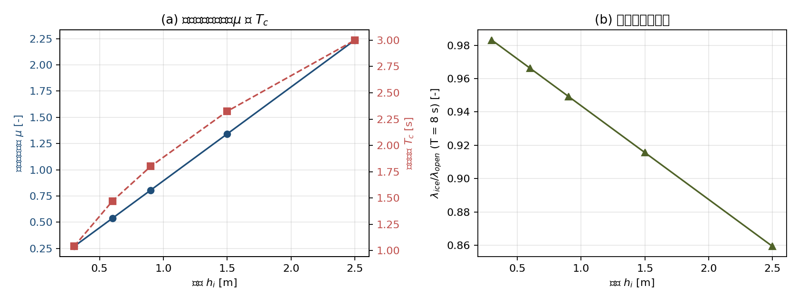

# 第 1 章 冰情与冰盖参数谱

> 独立讲授单元 ch01/09 · 预计 40 min · 现场计算：是

## 0. 学习目标

学完本章，你应当能够：

1. 说清冰区航行面对的几种基本冰型（平整一年冰、多年冰、碎冰、冰脊、冰间湖），以及
   它们在**水动力模型**里各自应当被抽象成什么；
2. 由冰厚 `h_i`、冰密度 `rho_i` 与水密度 `rho_w` 算出质量加载参数
   `mu = rho_i h_i / rho_w`，并解释它为什么是冰区水动力学的第一个无量纲数；
3. 解释"截止周期" `T_c = 2*pi*sqrt(mu/g)` 的物理含义：周期比它短的波**进不了冰区**；
4. 判断一个给定的冰情是否落在本教程（quality-mass-loading 模型）的适用域内，以及
   超出适用域时应当向哪一条能力线求助。

### 0.1 前置知识

* 线性水波理论：色散关系 `omega^2 = g k tanh(kH)`、波长、群速度；
* 浮力与静力平衡（阿基米德原理）；
* 无量纲化：知道"把长度除一个特征长度、频率乘一个特征时间"之后方程形式不变。

不需要任何冰力学背景——本章的冰物性全部以区间形式给出并附出处。

## 1. 物理与工程背景

冰区船舶的受力链条是：**冰情 → 冰盖/碎冰对自由面的改变 → 波场与船体水动力 →
运动/载荷 → 结构/操纵/航速**。教程从这里开始，因为第一章的错，后面全错：
"冰厚 0.9 m 的一年冰"和"冰脊龙骨 8 m"在同一个模型里代入，结果会差一个量级。

工程上常引用的冰型与物性区间（一年冰，FY）：

| 冰型 | 几何特征 | 水动力抽象（本教程） | 出处 |
|---|---|---|---|
| 平整一年冰 | 厚 0.3–2.0 m，成片覆盖 | 质量加载薄板（无刚度） | Timco & Weeks 2010 |
| 多年冰 | 厚 2–4 m，含盐量低、强度高 | 若连续仍按质量加载，但厚度取大值 | Weeks 2010 |
| 碎冰 / brash ice | 冰块 0.1–2 m，密集度 60–100 % | 等效厚度 + 阻力项（ch06），**不是**连续板 | Riska et al. 1997 |
| 冰脊 | 帆高 1–5 m，龙骨 5–20 m | 局部强度问题（ch07），不走波浪模型 | ISO 19906 |
| 冰间湖 / 水道 | 敞水或薄冰 | 敞水模型 + 边界，`mu -> 0` 极限 | — |

一年冰的关键物性（教学用区间，供敏感性分析取边界值）：

| 物性 | 符号 | 典型区间 | 单位 | 备注 |
|---|---|---|---|---|
| 密度 | `rho_i` | 900–930（默认 917） | kg/m^3 | 一年冰；多年冰略低 |
| 弯曲强度 | `sigma_f` | 0.5–1.5 | MPa | 现场尺度；决定破冰阻力 |
| 压缩强度 | `sigma_c` | 5–25 | MPa | 强应变率相关（ch07 用） |
| 弹性模量 | `E` | 5–9 | GPa | 抗弯刚度项用（本教程不含） |

出处：Timco & Weeks (2010)；Weeks (2010)。

## 2. 方法与关键设置

本教程用**质量加载（mass-loading）薄板模型**：冰盖无抗弯刚度、无耗散，只提供单位
面积质量 `m_s = rho_i h_i`。自由面条件因此从 Neumann 变成 Robin：

```
dphi/dz = K(omega) phi,     K = omega^2 / (g - mu omega^2),     mu = rho_i h_i / rho_w
```

`mu` 的量纲是长度（m），所以"冰盖有多重"必须和"波长有多长"一起看：`mu k` 才是
真正进入色散关系的无量纲组合。当 `g - mu omega^2 = 0` 时分母变号，这就是**截止频率**

```
omega_c = sqrt(g / mu),      T_c = 2*pi / omega_c = 2*pi*sqrt(mu/g)
```

的来历：`omega > omega_c` 时 `K < 0`，`k` 变为纯虚数，波不能传播（ch03 会给出
消失波分支的衰减长度）。工程含义直白：**周期短于 2 s 量级的波，在 1 m 厚的冰盖下
根本到不了船边**，船在冰区遭遇的波浪谱被物理地截断了。

本章只做参数化，不做求解：全部数值由 `tensorbem.ice.IceCover` 的性质与
`tensorbem.ice.mass_loading_wavenumber` 给出。

<!-- AUTO-NUMBERS:ch01 -->
### ch01 冰情与冰盖参数谱 — 机器渲染数值表

本表由 `examples/ice_tutorial/render.py` 从 `artifacts/tutorial_numbers.json` 生成，正文与表格均无手抄数值。

| 参数 | 取值 | 单位 | 说明 |
|---|---|---|---|
| h_i 取值域 | 0.3 - 2.5 | m | 一年冰厚度教学区间 |
| rho_i（默认） | 917.0 | kg/m^3 | tensorbem.ice.DEFAULT_ICE_DENSITY |
| rho_w（默认） | 1025.0 | kg/m^3 | tensorbem.ice.DEFAULT_WATER_DENSITY |
| g | 9.80665 | m/s^2 | 标准重力加速度 |
| 水深 H | 200 | m | 本章一律取深水化水柱，kH >= 4 |

**表 regimes** — 一年冰盖的质量加载参数谱（T = 8 s 的涌浪为对照频率）

| h_i [m] | m_s = rho_i h_i [kg/m^2] | mu = m_s/rho_w [-] | T_c = 2*pi*sqrt(mu/g) [s] | lambda_ice(T=8 s) [m] | lambda_open(T=8 s) [m] | lambda_ice/lambda_open [-] |
|---|---|---|---|---|---|---|
| 0.3 | 275.1 | 0.26839 | 1.03945 | 98.2034 | 99.8897 | 0.983118 |
| 0.6 | 550.2 | 0.53678 | 1.47 | 96.517 | 99.8897 | 0.966236 |
| 0.9 | 825.3 | 0.805171 | 1.80038 | 94.8307 | 99.8897 | 0.949354 |
| 1.5 | 1375.5 | 1.34195 | 2.32428 | 91.458 | 99.8897 | 0.91559 |
| 2.5 | 2292.5 | 2.23659 | 3.00063 | 85.8368 | 99.8897 | 0.859316 |
<!-- /AUTO-NUMBERS:ch01 -->

## 3. 判据表

判据表是本教程的验收单元：每一行要么是可重算的数值判据（`computable`），要么是
带出处的文献/法规陈述。可计算行在 `pytest` 门禁中重算，未通过即红灯。

<!-- AUTO-CRITERIA:ch01 -->
判据表（ch01）：可计算 4 行、其中通过 4 行、未通过 0 行；文献/法规行 0 行。

| 判据 ID | 判据（可检验陈述） | 阈值/区间 | 本次实测 | 结论 | 证据 | 出处 |
|---|---|---|---|---|---|---|
| CH01-C1 | 质量加载参数 mu = rho_i h_i / rho_w 随冰厚 h_i 严格单调递增 | 必须成立 | 成立 | 通过 | REAL | Weitz, M. & Keller, J. B. (1950). Reflection of water waves from floating ice in water of finite depth. Comm. Pure Appl. Math. 3, 305-318. |
| CH01-C2 | mass-loading 截止周期 T_c = 2*pi*sqrt(mu/g) 在 h_i in [0.3, 2.5] m 内不超过 3.1 s，即更长周期的涌浪在无耗散质量加载模型下总能穿入冰区 | <= 3.1 s | 3.00063 s | 通过 | REAL | Weitz, M. & Keller, J. B. (1950). Reflection of water waves from floating ice in water of finite depth. Comm. Pure Appl. Math. 3, 305-318. |
| CH01-C3 | 默认冰密度 917 kg/m^3 落在一年冰工程取值范围 900-930 kg/m^3 内 | 必须成立 | 成立 | 通过 | REAL | Timco, G. W. & Weeks, W. F. (2010). A review of the engineering properties of sea ice. Cold Regions Science and Technology 60(2), 107-129. |
| CH01-C4 | 同周期下冰下波长比 lambda_ice/lambda_open 随 h_i 单调递减（冰越厚，波越短） | 必须成立 | 成立 | 通过 | REAL | Squire, V. A. (2007). Of ocean waves and sea-ice revisited. Cold Regions Science and Technology 49(2), 110-133. |
<!-- /AUTO-CRITERIA:ch01 -->

## 4. 结果与图



读图要点：

* 左图：`mu` 随冰厚近似线性增长（`mu = rho_i h_i / rho_w`，斜率 `rho_i/rho_w ≈ 0.895`），
  而截止周期按 `sqrt(mu)` 增长——**冰厚翻倍，截止周期只涨 1.41 倍**。所以"更厚的冰
  截掉更多波浪频段"这件事，比直觉要弱。
* 右图：`T = 8 s` 的涌浪在冰下波长短于敞水（比值 < 1），且冰越厚比值越小。这条
  "冰下波长缩短"是全教程后面所有"波–冰–船"效应的物理源头（同一个遭遇周期，船长/
  波长比变了，激励就变了）。
* 注意图上纵轴的量级：`h_i` 从 0.3 m 到 2.5 m，波长比从约 0.98 掉到约 0.86——
  缩短幅度是**几个百分点到十几个百分点**，不是数量级。把它当成"冰区波长显著变短"
  的说法需要限定在 `mu k` 的量级上。

## 5. 注意点与局限（证据分级）

1. **REAL**：本章的 `mu`、`T_c`、冰下波长都是 `tensorbem.ice` 的直接求值，公式与代码
   一一对应，没有中间常数。
2. **模型边界**：质量加载不含抗弯刚度。对薄的一年冰、低频涌浪（`k` 小）这是可接受
   近似；对厚冰、短波（`mu k` 大、`omega` 接近截止），刚度项
   （flexural-gravity 波，见 `tensorbem.flexural_gravity`）才决定色散。本教程不覆盖。
3. **碎冰不是板**：碎冰航道里的"冰"对船是**阻力**（ch06），对自由面是**部分覆盖**；
   用连续质量加载描述密集度 60 % 的碎冰场会系统性高估冰盖惯性。
4. **冰脊不进波浪模型**：冰脊是局部强度/接触问题，属 ch07 与 DEM 线（`TensorDEM`）。
5. **物性区间是教学值**：`rho_i`、`sigma_f` 等的区间来自综述文献，具体海域（波罗的海
   一年冰 vs 北极多年冰）应当替换为实测/数据库值，替换后所有下游判据需重算。

## 6. 练习

1. 把 `rho_i` 从 917 改成 930，`T_c`（`h_i = 0.9 m`）变化多少百分比？用 `sqrt` 关系
   手算，再用 `IceCover` 核对。
2. 某海域测得冰厚分布 `h_i ~ U(0.4, 1.2)` m，问"该海域能穿入冰区的波浪周期下限"的
   分布是什么？（提示：`T_c` 是 `h_i` 的单调函数，先求分位数。）
3. 一条船的设计遭遇周期带是 4–12 s。若冰厚取 2.5 m，这个频带是否仍在传播分支内？
   结论对"冰区波浪载荷是否需要考虑"意味着什么？

## 7. 参考文献

1. Weitz, M. & Keller, J. B. (1950). Reflection of water waves from floating ice in water
   of finite depth. *Comm. Pure Appl. Math.* **3**, 305–318.
2. Timco, G. W. & Weeks, W. F. (2010). A review of the engineering properties of sea ice.
   *Cold Regions Science and Technology* **60**(2), 107–129.
3. Weeks, W. F. (2010). *On Sea Ice*. University of Alaska Press.
4. Squire, V. A. (2007). Of ocean waves and sea-ice revisited.
   *Cold Regions Science and Technology* **49**(2), 110–133.
5. ISO 19906:2019. *Petroleum and natural gas industries — Arctic offshore structures*.

> 出处状态：题录已核；DOI/页码的在线核验属于 `ICE-SHOW-KNOWLEDGE-CURATION` 条目，
> 本席离线工作，不在此主张已核。

## 8. 复现命令

```bash
PYTHONPATH=src:examples python -c "
from ice_tutorial import model, criteria
payload = model.compute('ch01')
for row in criteria.evaluate('ch01', payload['metrics']): print(row['id'], row['verdict'])
"
# 或整章重渲染（含图与判据表注入）：
python examples/ice_tutorial/render.py
```