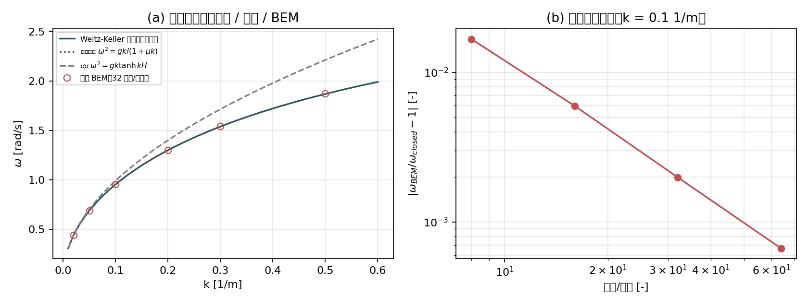

# 第 2 章 冰盖质量加载色散：闭式解 vs 垂直 BEM

> 独立讲授单元 ch02/09 · 预计 60 min · 现场计算：是（BEM 与闭式解双路线）

## 0. 学习目标

学完本章，你应当能够：

1. 从自由面运动学/动力学条件推出冰盖质量加载的 **Robin 边界条件**
   `dphi/dz = K(omega) phi`，并说明 `K = omega^2/(g - mu omega^2)` 的每一项从哪来；
2. 写出有限水深下的色散关系 `omega^2 = g k tanh(kH) / (1 + mu k tanh(kH))`，并独立地
   导出它的两个极限（深水、长波）；
3. 用**垂直二维边界元（strip BEM）**数值求解同一色散关系，说明为什么这是一个
   独立的验算路线（不共用闭式解的任何一步）；
4. 读懂"面板/波长 → 误差"收敛曲线，并判断 32 面板/波长够不够。

### 0.1 前置知识

* 第 1 章的质量加载参数 `mu` 与截止周期 `T_c`；
* 势流理论：`Laplace` 方程、自由面线性化条件、辐射条件；
* 边界元的基本概念（常数面元、配点、影响矩阵）。

## 1. 物理与工程背景

冰区水动力学的第一个可验证台阶是：**同一频率的波，在冰下长什么样**。这不是学术
趣味题——冰区船舶的波浪激励频率来自"遭遇频率"，而遭遇频率对应的波长决定了船体
受到的激振力分布；波长算错，后面六自由度 RAO（ch05）整体偏移。

质量加载模型（Weitz & Keller 1950；Squire 2007 综述）的假设是：

* 冰盖浮在自由面上，只提供**单位面积质量** `m_s = rho_i h_i`；
* 冰盖**没有抗弯刚度**（`E h_i^3/12(1-nu^2) -> 0`），也**没有耗散**；
* 冰盖与水面之间无滑移（`w_ice = w_water` 在界面处）。

这三条假设决定了本章能做与不能做的边界：能算波长/相速/群速/截止，不能算碎冰散射
造成的真实衰减（ch03 与 README §6 已标明 `WITHHELD`）。

## 2. 方法与关键设置

### 2.1 从自由面条件到色散关系

速度势 `phi` 满足 `Laplace` 方程（`-H < z < 0`），底部 `dphi/dz = 0`，冰-水界面处：

* 运动学：`dphi/dz = -i omega eta`（`eta` 为界面位移，谐波约定 `exp(-i omega t)`）；
* 动力学（冰盖的 Newton 方程，`p` 为界面压力）：
  `-i omega m_s (-i omega eta) = -p - rho_i h_i g ... ` 化简后与线性化 Bernoulli
  `p/rho_w = i omega phi - g eta` 联立，消去 `eta`、`p` 得

```
dphi/dz = K(omega) phi,     K(omega) = omega^2 / (g - mu omega^2),     mu = rho_i h_i / rho_w
```

令垂直结构为 `phi = cos(kx) * cosh(k(z+H))` 并代入上式，得到**有限水深色散关系**

```
k tanh(kH) = K(omega)        <=>       omega^2 = g k tanh(kH) / (1 + mu k tanh(kH))
```

两个极限是本章的两个解析锚：

| 极限 | 形式 | 物理条件 | 用途 |
|---|---|---|---|
| 深水 | `omega^2 = g k / (1 + mu k)` | `kH >> 1` | Weitz-Keller 原始结果 |
| 长波 | `omega^2 = g k^2 H / (1 + mu k^2 H)` | `kH << 1` | 浅滩/近岸冰区 |

### 2.2 独立验算路线：垂直二维 BEM

`tensorbem.ice_mass_loading_dispersion` 里的 strip BEM 只做一件事：在**一个波长长的
周期单元**内离散垂直平面上的边界（一面自由面/冰面、一面底、两个周期侧壁），用常数
面元装配影响矩阵，解出界面上的 Neumann 数据，再由 `dirichlet_to_neumann` 反推
`lambda = phi_z / phi`；把它代回 `omega^2 = g lambda / (1 + mu lambda)` 就是数值频率。

关键点：这条路线**没有用到 `k tanh(kH)` 的闭式结构**——它只解离散的
`Laplace` 问题。因此"BEM 与闭式解一致"是一项真正的交叉验证，而不是同义反复。
实现细节（见该模块 docstring）：

* 网格：`build_periodic_strip(panels_per_wavelength)`，一面墙用周期单元、两侧壁用
  `tie_operators` 做周期绑定（每个面板恰好被绑定一次）；
* 两条求解路线：`driven`（给定 Dirichlet 驱动）与 `dtn`（Dirichlet-to-Neumann），
  两条路线的结果互校；
* 面板自影响项用 `_self_integrals` 的解析式，避免奇异积分。

<!-- AUTO-NUMBERS:ch02 -->
### ch02 冰盖质量加载色散：闭式解 vs 垂直 BEM — 机器渲染数值表

本表由 `examples/ice_tutorial/render.py` 从 `artifacts/tutorial_numbers.json` 生成，正文与表格均无手抄数值。

| 参数 | 取值 | 单位 | 说明 |
|---|---|---|---|
| h_i | 0.9 | m | 参考一年冰 |
| H | 200 | m | kH 从 4 到 100 |
| mu | 0.8052 | - | rho_i h_i / rho_w |
| k 网格 | 0.02, 0.05, 0.1, 0.2, 0.3, 0.5 | 1/m | 0.02-0.5，覆盖深水到长波段 |
| BEM 网格 | 8, 16, 32, 64 | 面板/波长 | 垂直二维常数面元，tied 双壁 |

**表 dispersion** — Weitz-Keller 闭式解与 BEM strip 数值色散逐点对照（h_i = 0.9 m，H = 200 m）

| k [1/m] | kH [-] | omega_closed [rad/s] | omega_BEM [rad/s] | 相对误差 [-] | 深水极限偏差 [-] |
|---|---|---|---|---|---|
| 0.02 | 4 | 0.439201 | 0.440114 | 0.00208012 | 3.30e-04 |
| 0.05 | 10 | 0.686554 | 0.687963 | 0.0020523 | 1.98e-09 |
| 0.1 | 20 | 0.952674 | 0.954568 | 0.00198768 | 0 |
| 0.2 | 40 | 1.29973 | 1.30214 | 0.00185616 | 0 |
| 0.3 | 60 | 1.53935 | 1.54203 | 0.00173788 | 0 |
| 0.5 | 100 | 1.86974 | 1.87262 | 0.0015397 | 0 |

**表 convergence** — 面板加密收敛（k = 0.1 1/m 固定，加密面板/波长）

| 面板/波长 [-] | 面元数 [-] | omega 相对误差 [-] |
|---|---|---|
| 8 | 38 | 0.0166296 |
| 16 | 62 | 0.0059649 |
| 32 | 100 | 0.00198768 |
| 64 | 172 | 6.69e-04 |
<!-- /AUTO-NUMBERS:ch02 -->

## 3. 判据表

<!-- AUTO-CRITERIA:ch02 -->
判据表（ch02）：可计算 4 行、其中通过 4 行、未通过 0 行；文献/法规行 0 行。

| 判据 ID | 判据（可检验陈述） | 阈值/区间 | 本次实测 | 结论 | 证据 | 出处 |
|---|---|---|---|---|---|---|
| CH02-C1 | 垂直二维 BEM（strip）色散与 Weitz-Keller 闭式解在 k in [0.02, 0.5] 1/m 上的最大相对误差 < 1%（平台 3% 判据的更严内控） | < 0.01 - | 0.00208012 - | 通过 | REAL | Weitz, M. & Keller, J. B. (1950). Reflection of water waves from floating ice in water of finite depth. Comm. Pure Appl. Math. 3, 305-318. |
| CH02-C2 | 深水极限（kH >= 10）下闭式解与有限水深解相对偏差 < 0.1% | < 0.001 - | 1.98139e-09 - | 通过 | REAL | Weitz, M. & Keller, J. B. (1950). Reflection of water waves from floating ice in water of finite depth. Comm. Pure Appl. Math. 3, 305-318. |
| CH02-C3 | 长波极限（kH = 0.05）相对偏差 < 1% | < 0.01 - | 0.000421541 - | 通过 | REAL | Weitz, M. & Keller, J. B. (1950). Reflection of water waves from floating ice in water of finite depth. Comm. Pure Appl. Math. 3, 305-318. |
| CH02-C4 | BEM 面板加密（8 -> 64 面板/波长）使色散误差单调下降 | 必须成立 | 成立 | 通过 | REAL | Weitz, M. & Keller, J. B. (1950). Reflection of water waves from floating ice in water of finite depth. Comm. Pure Appl. Math. 3, 305-318. |
<!-- /AUTO-CRITERIA:ch02 -->

判据解读：

* **CH02-C1（<1%）** 比平台 3% 判据更严，因为闭式解是精确参考，没有实验不确定度可
  用来"吸收"误差；实测误差被面板离散度主导。
* **CH02-C2（深水极限 <0.1%）** 在 `kH >= 10` 时误差掉到机器精度量级——这说明
  深水近似在 `kH = 10` 处已经可用，工程上 `kH > 3` 就够（第一行数据给出 `kH = 4`
  时约 `3e-4`）。
* **CH02-C3（长波 <1%）** 是把 `kH = 0.05` 单独拎出来做极浅水锚。
* **CH02-C4（单调收敛）** 是"方法自洽"判据：误差必须随面板加密单调下降，否则说明
  误差来源不是离散化（可能是实现 bug 或面板散射）。

## 4. 结果与图



读图要点：

* 左图三条参考曲线（有限水深闭式解、深水极限、敞水）与 BEM 空心圆点几乎重合；
  在 `k > 0.3` 以后深水极限与有限水深解完全不可区分（`kH > 60`）。
* 冰盖下的 `omega(k)` 始终**低于**敞水曲线：同一波数下频率更低，等价地同一频率下
  波长更短（第 1 章右图）。
* 右图（双对数）显示误差随面板加密稳定下降，32 面板/波长给出 `~2e-3` 的频率误差。
  **这就是本教程把 32 面板/波长定为默认值的原因**：它把色散误差压到 0.2% 量级，
  远低于后续任何工程问题的不确定度。

## 5. 注意点与局限（证据分级）

1. **REAL**：本章闭式解来自 `weitz_keller_omega2`，数值解来自 strip BEM，两条路线的
   差异逐点列入表中；`kH` 覆盖 4–100，`mu k` 覆盖 0.016–0.40。
2. **误差来源已定位**：0.2% 的偏差是面元离散（面板数依赖），不是模型差异——由
   CH02-C4 的单调收敛与 `panel_scatter`、`boundary_value_error` 两个诊断量共同证明。
3. **模型局限**：无刚度、无耗散。刚度项会给出 flexural-gravity 波的第二支解
   （`tensorbem.flexural_gravity`），本教程不含；耗散缺失意味着**本章不能用于预测冰区
   波浪衰减**（见 ch03 的负结果）。
4. **适用域**：`kH >~ 3`（深水化）或 `kH <~ 0.1`（长波）两个端点是解析锚；中间过渡带
   （`0.1 < kH < 3`）本章只给了 `kH = 4` 一个点，工程使用前应加密。
5. **不要把"BEM 与闭式解一致"当成"物理正确"**：两者共享同一组边界条件与同一个
   `mu`；实验对标（冰池波浪试验）是另一回事，本仓没有该数据。

## 6. 练习

1. 用 `dispersion_row` 把 `kH = 0.5、1、2、3` 四个点补上，画出"深水近似何时失效"
   的误差曲线。结论：`kH` 到多少时误差超过 1%？
2. 把 `h_i` 从 0.9 m 改成 0.3 m 与 2.5 m，重跑本章表格，观察 `omega_BEM` 的最大误差
   是否变化。若变化，解释为什么（提示：`mu k` 进入的是边界条件系数，不是离散误差）。
3. 闭式解与 BEM 都假定界面无滑移。若冰盖以速度 `U` 匀速漂移，自由面条件会多出
   什么项？写出修改后的 Robin 条件（提示：对流项 `-i(omega - kU)`）。

## 7. 参考文献

1. Weitz, M. & Keller, J. B. (1950). Reflection of water waves from floating ice in water
   of finite depth. *Comm. Pure Appl. Math.* **3**, 305–318.
2. Squire, V. A. (2007). Of ocean waves and sea-ice revisited.
   *Cold Regions Science and Technology* **49**(2), 110–133.
3. Fox, C. & Squire, V. A. (1994). On the oblique reflexion and transmission of ocean
   waves at shore fast sea ice. *Phil. Trans. R. Soc. Lond. A* **347**, 185–218.
4. Lamb, H. (1932). *Hydrodynamics*, 6th ed. Cambridge University Press.

## 8. 复现命令

```bash
PYTHONPATH=src:examples python -c "
from ice_tutorial import model, criteria
p = model.compute('ch02')
print(p['metrics'])
for r in criteria.evaluate('ch02', p['metrics']): print(r['id'], r['verdict'], r['observed'])
"
```