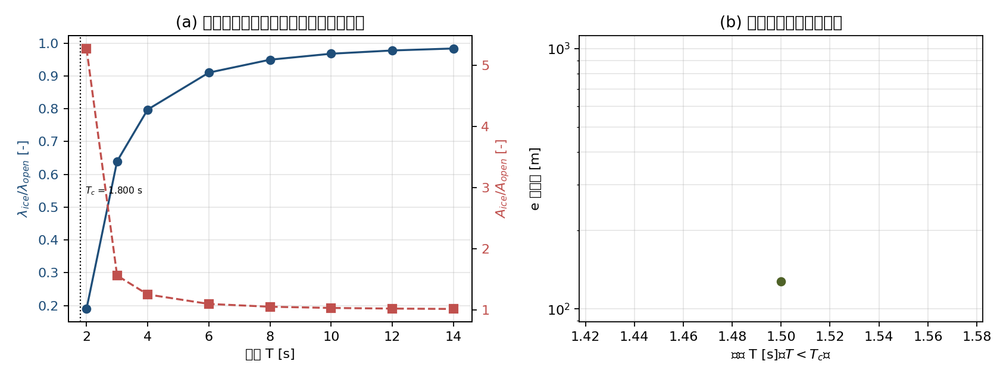

# 第 3 章 冰下波场：波长缩短、截止周期与消失波分支

> 独立讲授单元 ch03/09 · 预计 50 min · 现场计算：是（频域波场扫描）

## 0. 学习目标

学完本章，你应当能够：

1. 对任意给定周期 `T`，判定冰盖下的波属于**传播分支**还是**消失波分支**，并给出
   波长、相速、群速；
2. 解释为什么质量加载模型下冰区**不衰减**（能量通量守恒 → 幅值比 `A_ice/A_open > 1`），
   以及为什么真实冰区确实衰减（碎冰散射与耗散）——并说明本仓对后者的记账是
   `WITHHELD` 而不是"算过了"；
3. 用"能量通量幅值比"解释同一入射波在冰缘处的**陡化**现象；
4. 判断一艘船的遭遇周期带进入冰区后，哪些频率成分被物理截断。

### 0.1 前置知识

* 第 2 章的色散关系与截止频率；
* 群速度定义 `c_g = d omega / d k`；
* 能量通量 `E c_g = (1/2) rho g A^2 c_g` 守恒意味着什么。

## 1. 物理与工程背景

冰区船舶看到的波浪与敞水不同，有两层原因（上一章讲了第一层）：

1. **波场改变**（本章）：同一周期的波在冰下更短、更慢；周期短于截止周期的波根本
   不能传播，只能以指数衰减的形式"渗透"有限距离。
2. **附加惯性与阻尼改变**（ch04/ch05）：界面条件从 Neumann 变为 Robin，理论上的
   辐射问题解也跟着变。

工程上最常被引用的两句话是"冰区波浪衰减很快"和"冰区里的船几乎不摇"。本章会显示：
**在无耗散的质量加载模型里，第一句话不成立**（传播分支的衰减因子恒为 1，幅值比甚至
大于 1）；第二句话的真正原因是第二层与截止频率截断，而不是"波被冰吃掉了"。把这两件
事分清楚，是把冰区耐波性讲对的前提。

## 2. 方法与关键设置

* 频域扫描：`T = 1.5, 2.0, 3, 4, 6, 8, 10, 12, 14 s`，参考冰 `h_i = 0.9 m`，`H = 200 m`
  （深水化），`mu = 0.805`，解析截止周期 `T_c = 2*pi*sqrt(mu/g) = 1.800 s`；
* 传播分支：`mass_loading_wavenumber(omega)` 用单调函数的括区+二分求根，给出 `k`、
  波长、相速、`群速度`（解析导数 `d omega^2/d k`）；
* 消失波分支：`omega > omega_c` 时令 `k = i kappa`，由 `kappa tan(kappa H)` 的第一支
  （`0 < kappa H < pi/2`）求 `kappa`，衰减因子 `exp(-kappa x)`，记 e 折长度 `1/kappa`；
* 能量通量幅值比：跨冰缘能量守恒 `A^2 c_g = const` 给出
  `A_ice/A_open = sqrt(c_g,open / c_g,ice)`（同频率），由
  `energy_flux_amplitude_ratio` 计算；
* 衰减因子：`mass_loading_attenuation` 在传播分支**恒等于 1**（模型结论，不是数值巧合）。

<!-- AUTO-NUMBERS:ch03 -->
### ch03 冰下波场：波长缩短、截止周期与消失波分支 — 机器渲染数值表

本表由 `examples/ice_tutorial/render.py` 从 `artifacts/tutorial_numbers.json` 生成，正文与表格均无手抄数值。

| 参数 | 取值 | 单位 | 说明 |
|---|---|---|---|
| h_i | 0.9 | m | 参考一年冰 |
| H | 200 | m | 深水化水柱 |
| mu | 0.8052 | - | 质量加载参数 |
| T_c（解析） | 1.8004 | s | 2*pi*sqrt(mu/g) |
| 周期网格 | 1.5, 2, 3, 4, 6, 8, 10, 12, 14 | s | 含截止周期两侧 |

**表 wavefield** — 冰下波场随周期的变化（h_i = 0.9 m，H = 200 m；消失波分支给出衰减率与 e 折长度）

| T [s] | 分支 | k_ice [1/m] | k_open [1/m] | lambda_ice/lambda_open [-] | c_phase [m/s] | c_group [m/s] | A_ice/A_open [-] | 衰减率 kappa [1/m] | e 折长度 [m] |
|---|---|---|---|---|---|---|---|---|---|
| 1.5 | 消失 | — | — | — | — | 0 | 0 | 0.00784432 | 127.481 |
| 2 | 传播 | 5.30643 | 1.00642 | 0.18966 | 0.592035 | 0.0561428 | 5.27258 | — | ∞ |
| 3 | 传播 | 0.699067 | 0.447298 | 0.639849 | 2.99598 | 0.958489 | 1.56287 | — | ∞ |
| 4 | 传播 | 0.315526 | 0.251605 | 0.797415 | 4.97835 | 1.9849 | 1.25405 | — | ∞ |
| 6 | 传播 | 0.122889 | 0.111824 | 0.909962 | 8.52149 | 3.87712 | 1.09895 | — | ∞ |
| 8 | 传播 | 0.0662569 | 0.0629012 | 0.949354 | 11.8538 | 5.62674 | 1.05335 | — | ∞ |
| 10 | 传播 | 0.0416054 | 0.0402568 | 0.967586 | 15.1019 | 7.30619 | 1.0335 | — | ∞ |
| 12 | 传播 | 0.0286005 | 0.0279569 | 0.977497 | 18.3073 | 8.94983 | 1.02306 | — | ∞ |
| 14 | 传播 | 0.0208944 | 0.0205502 | 0.983531 | 21.4794 | 10.6035 | 1.01704 | — | ∞ |
<!-- /AUTO-NUMBERS:ch03 -->

## 3. 判据表

<!-- AUTO-CRITERIA:ch03 -->
判据表（ch03）：可计算 4 行、其中通过 4 行、未通过 0 行；文献/法规行 1 行。

| 判据 ID | 判据（可检验陈述） | 阈值/区间 | 本次实测 | 结论 | 证据 | 出处 |
|---|---|---|---|---|---|---|
| CH03-C1 | 传播分支内冰下波数恒大于敞水波数（k_ice > k_open，波长恒缩短） | 必须成立 | 成立 | 通过 | REAL | Squire, V. A. (2007). Of ocean waves and sea-ice revisited. Cold Regions Science and Technology 49(2), 110-133. |
| CH03-C2 | h_i = 0.9 m 的截止周期落在 1.7-1.9 s（解析值 1.800 s） | 1.7 ~ 1.9 s | 1.8 s | 通过 | REAL | Weitz, M. & Keller, J. B. (1950). Reflection of water waves from floating ice in water of finite depth. Comm. Pure Appl. Math. 3, 305-318. |
| CH03-C3 | 周期短于截止周期（T = 1.5 s < T_c）的波为消失波：propagating = False 且衰减率 > 0 | 必须成立 | 成立 | 通过 | REAL | Weitz, M. & Keller, J. B. (1950). Reflection of water waves from floating ice in water of finite depth. Comm. Pure Appl. Math. 3, 305-318. |
| CH03-C4 | 传播分支上 mass-loading 无耗散：衰减因子恒为 1，能量通量幅值比 A_ice/A_open > 1（冰盖缩短并陡化波场，而不是衰减它） | 必须成立 | 成立 | 通过 | REAL | Squire, V. A. (2007). Of ocean waves and sea-ice revisited. Cold Regions Science and Technology 49(2), 110-133. |
| CH03-C5 | 冰区波场衰减系数（碎冰散射/耗散）本仓不建模：衰减只可能来自消失波分支 | 文献/法规条款 | 文献/法规条款 | — | WITHHELD | Squire, V. A. (2007). Of ocean waves and sea-ice revisited. Cold Regions Science and Technology 49(2), 110-133. |
<!-- /AUTO-CRITERIA:ch03 -->

判据解读：

* **CH03-C1** 是"冰下恒更短"的硬结论，逐频率验证 `k_ice > k_open`；
* **CH03-C2** 把解析截止周期钉在 1.7–1.9 s 区间（解析值 1.800 s），保证后续"短波被
  截断"的论断不被参数漂移带偏；
* **CH03-C3** 明确要求 `T = 1.5 s` 落在消失波分支且 `kappa > 0`；
* **CH03-C4** 是本章最容易被误读的一条：它要求**衰减因子恒为 1**且**幅值比 > 1**。
  这正是"质量加载无耗散"的可检验形式；
* **CH03-C5（WITHHELD）** 老老实实写明：真实冰区的衰减本仓不建模。

## 4. 结果与图



读图要点：

* 左图（传播分支）：周期从 14 s 降到 3 s，`lambda_ice/lambda_open` 从约 0.98 掉到约
  0.64——**越是短波，冰盖"压短"得越厉害**；这正是 `mu k` 变大导致的。虚线
  `A_ice/A_open` 在同区间从约 1.02 涨到 1.56：波长越短、群速度越低，跨冰缘的能量
  通量守恒要求幅值越大。竖虚线标出 `T_c`。
* 右图（消失波分支）：`T = 1.5 s` 的 e 折长度是百米量级，即"短波渗入冰区百来米就
  没了"。注意这是**消失波**的衰减，与"传播波在冰下被耗散"完全不同的物理机制。
* 两图合起来就是冰区波场的一句话总结：**能传的（`T > T_c`）不衰减但被压缩并陡化；
  不能传的（`T < T_c`）按消失波指数衰减**。

## 5. 注意点与局限（证据分级）

1. **REAL**：本章所有 `k`、`c_g`、`A_ice/A_open`、`kappa` 都是 `tensorbem.ice` 的直接
   输出；传播/消失分支的判定来自 `IceWave.propagating`。
2. **负结果要当结论读**："质量加载冰区不衰减"会与现场观测冲突（观测到显著衰减）。
   冲突的原因是模型缺了**碎冰散射、冰面粗糙度与粘性耗散**，这一层本仓没有 →
   `WITHHELD`。不要为了"对上台架数据"去改质量加载模型的系数。
3. **截止周期随 `h_i` 变**：`T_c ∝ sqrt(mu)`，`h_i = 0.3 m` 时 `T_c ≈ 1.04 s`，
   `h_i = 2.5 m` 时 `T_c ≈ 3.00 s`。所以"冰区里 3 s 的波能不能进来"取决于冰厚，
   不能一概而论。
4. **群速度用的是解析导数**，在接近截止频率时 `c_g -> 0` 会让幅值比发散（`sqrt(c_g,open/c_g,ice)`），
   这是模型在 `omega -> omega_c` 处的奇异，属于适用域边界，不应当当作物理预测。
5. **陡化（幅值比 > 1）在真实冰区会被散射与破碎削弱**：本章给的比值是"纯弹性质量加载"
   的上界。

## 6. 练习

1. 用 `dispersion_table` 把 `T` 加密到 0.1 s，找出 `A_ice/A_open` 超过 2 的周期范围，
   并解释为什么这个区间必然靠近 `T_c`。
2. 某船的设计遭遇周期带为 4–12 s，冰厚 0.9 m。问：冰区里这条船会"少看到"哪些频率
   成分？（提示：截面在 `T_c` 处，不是 4–12 s 的内部。）
3. 给一个真实观测的衰减系数（自行查文献，例如 1e-3 /m），估算要用多大的"等效粘度"
   或散射截面才能解释；并说明为什么这类反演不能反过来验证质量加载模型。

## 7. 参考文献

1. Weitz, M. & Keller, J. B. (1950). Reflection of water waves from floating ice in water
   of finite depth. *Comm. Pure Appl. Math.* **3**, 305–318.
2. Squire, V. A. (2007). Of ocean waves and sea-ice revisited.
   *Cold Regions Science and Technology* **49**(2), 110–133.
3. Fox, C. & Squire, V. A. (1994). On the oblique reflexion and transmission of ocean
   waves at shore fast sea ice. *Phil. Trans. R. Soc. Lond. A* **347**, 185–218.

## 8. 复现命令

```bash
PYTHONPATH=src:examples python -c "
from ice_tutorial import model, criteria
p = model.compute('ch03')
print(p['metrics'])
for r in criteria.evaluate('ch03', p['metrics']): print(r['id'], r['verdict'], r['observed'])
"
```