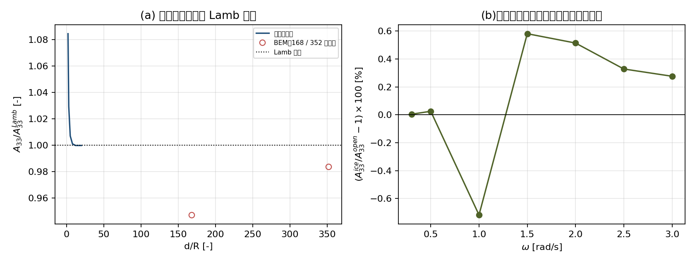

# 第 4 章 潜球垂荡附加质量：Lamb 极限、网格误差与一个负结果

> 独立讲授单元 ch04/09 · 预计 60 min · 现场计算：是（BEM + 无离散化多极精确解）

## 0. 学习目标

学完本章，你应当能够：

1. 写出 Lamb 的无限流体球体垂荡附加质量 `A33 = (2/3) pi rho R^3`，并说明它是
   "潜没深度 `d/R -> inf`" 的极限（不是一个频率响应值）；
2. 用两条独立路线算同一个物理量：**三角面元 BEM**（有离散误差）与
   **多极级数精确解**（无离散误差），并用后者把前者的误差归因；
3. 判断一个 BEM 结果的误差是"离散占主导"还是"模型占主导"；
4. 接受一个**负结果**：mass-loading 冰盖几乎不改变深潜体的附加质量——冰的影响必须
   到波场与激励里去找（ch03、ch05）。

### 0.1 前置知识

* 第 2 章的 Robin 界面条件（本章把它换成 `nu = k_i` 代入自由面 Green 函数）；
* 附加质量的定义：`A_ij = rho * Re{ int phi_j n_i dS }`（单位速度幅值）；
* 边界元的收敛概念（`h`-收敛、条件数、残差）。

## 1. 物理与工程背景

冰区里最容易被"想当然"的场景是：冰盖压在自由面上 → 界面变硬 → 船体附加质量变了 →
运动变了。本章用一个解析可查的模型（潜没球）把这句话量化到百分比，答案是：
**在 `d/R >= 2`、`omega <= 3 rad/s` 的范围内，冰盖与敞水的附加质量差别 < 1%**。

这并不意味着冰区耐波性等于敞水：激励力（绕射）与共振频率都随波场改变（ch05）。
但它确实意味着：**如果某份冰区 RAO 报告的差异全部出现在附加质量项上，那份报告可疑**。
这是本章作为"验证欠账复核"章的价值——它给下游一个可判伪的锚点。

参考值本体是 Lamb 的经典结果：半径 `R` 的球在无限流体中垂荡，附加质量
`(2/3) pi rho R^3`（等价地 `1/2 rho V`，`V = 4/3 pi R^3`）。Lamb, *Hydrodynamics*
6th ed., art. 92；等价形式见 Landau & Lifshitz §11 与 Newman §4.11。圆柱的对应锚是
Ursell 多极解（本仓已独立复核，见 `docs/audit_m14488_ursell_cyl_rad.md`）。

## 2. 方法与关键设置

两条路线，共享同一物理设定（`R = 5 m`，`rho = 1025 kg/m^3`，`omega = 0.5 rad/s`，
`h_i = 0.9 m` 冰盖，水柱 `H = 1000 m`）：

**路线 A（BEM）**：`tensorbem.ice_rao.solve_radiation_3d_ice` → `free_surface_solver3d`
的常数三角面元辐射求解器，表面网格 `n_theta x n_phi = (12,8)`（168 面元）与 `(16,12)`
（352 面元），冰盖只以 `nu = k_i` 进入自由面 Green 函数，阻尼按 `omega/sqrt(g k_i)` 重标定。

**路线 B（多极精确解）**：`tensorbem.analytic.submerged_sphere_wave_multipole`
（Thorne/Wang/Linton 级数）在**同一** `nu = k_i` 下求同一 Dirichlet 问题，**没有离散化**。
它是本章的误差归因工具，也是"冰 vs 敞水"对照的物理路线（把 `nu = k_i` 换成
`nu = omega^2/g` 即敞水）。

三条对照线：

| 线 | 来源 | 用途 |
|---|---|---|
| Lamb 极限 | 闭式 `(2/3) pi rho R^3` | 深水/深潜极限锚（`d/R -> inf`） |
| 多极精确解 | 级数，无离散误差 | 误差归因 + 频率/深度扫描 |
| BEM | 面元离散 | 真实工作路线；误差 = 离散 + 条件数 |

<!-- AUTO-NUMBERS:ch04 -->
### ch04 潜球垂荡附加质量：Lamb 极限、网格误差与冰-敞水对照 — 机器渲染数值表

本表由 `examples/ice_tutorial/render.py` 从 `artifacts/tutorial_numbers.json` 生成，正文与表格均无手抄数值。

| 参数 | 取值 | 单位 | 说明 |
|---|---|---|---|
| 球半径 R | 5.0 | m | 潜没球，中心距界面 d |
| omega | 0.50 | rad/s | 垂荡频率（k_i R = 0.13） |
| h_i | 0.9 | m | 参考一年冰；h_i = 0 为敞水对照 |
| Lamb 极限 | 268344.4 | kg | (2/3)pi rho R^3，程序求值 |
| BEM 网格 | 168, 352 | 面元 | 三角面元，常数强度 |
| d/R 扫描 | 2, 3, 5, 8, 12, 20 | - | 多极精确解路线（无离散化） |
| omega 扫描 | 0.3, 0.5, 1, 1.5, 2, 2.5, 3 | rad/s | 冰 vs 敞水对照 |

**表 ladder** — BEM 面板加密（d/R = 3，omega = 0.5 rad/s，h_i = 0.9 m）

| 面元数 [-] | A33_BEM [kg] | vs Lamb 误差 [-] | vs 多极精确解误差 [-] | cond(A) [-] | 相对残差 [-] |
|---|---|---|---|---|---|
| 168 | 254181 | -0.0527792 | -0.0799741 | 2.28218 | 2.18e-04 |
| 352 | 263979 | -0.0162673 | -0.0445105 | 2.203 | 8.04e-05 |

**表 depth** — 多极精确解的深度扫描（omega = 0.5 rad/s，h_i = 0.9 m）：d/R -> 无穷回到 Lamb 极限

| d/R [-] | A33_exact [kg] | vs Lamb 误差 [-] |
|---|---|---|
| 2 | 291027 | 0.0845273 |
| 3 | 276276 | 0.0295589 |
| 5 | 270246 | 0.00708728 |
| 8 | 268637 | 0.00109218 |
| 12 | 268310 | -1.30e-04 |
| 20 | 268308 | -1.37e-04 |

**表 sweep** — 冰盖 vs 敞水附加质量对照（d/R = 3，多极精确解路线）

| omega [rad/s] | k_i [1/m] | A33_ice [kg] | A33_open [kg] | 相对差 [-] |
|---|---|---|---|---|
| 0.3 | 0.00924577 | 273451 | 273439 | 4.36e-05 |
| 0.5 | 0.0260271 | 276276 | 276206 | 2.55e-04 |
| 1 | 0.111093 | 264354 | 266263 | -0.00717192 |
| 1.5 | 0.281425 | 259079 | 257582 | 0.00581112 |
| 2 | 0.607352 | 263043 | 261697 | 0.00514195 |
| 2.5 | 1.30908 | 264007 | 263143 | 0.00328444 |
| 3 | 3.51547 | 264418 | 263689 | 0.00276332 |
<!-- /AUTO-NUMBERS:ch04 -->

## 3. 判据表

<!-- AUTO-CRITERIA:ch04 -->
判据表（ch04）：可计算 4 行、其中通过 4 行、未通过 0 行；文献/法规行 1 行。

| 判据 ID | 判据（可检验陈述） | 阈值/区间 | 本次实测 | 结论 | 证据 | 出处 |
|---|---|---|---|---|---|---|
| CH04-C1 | 潜球垂荡附加质量 BEM（352 面元，d/R = 3）相对 Lamb 无限流体极限 (2/3)pi rho R^3 误差 < 5%（案例池 BEM-ICE-SPHERE-HEAVE 容差） | < 0.05 - | 0.0162673 - | 通过 | REAL | Lamb, H. (1932). Hydrodynamics, 6th ed. Cambridge University Press, art. 92. |
| CH04-C2 | 面板 168 -> 352 使 BEM 相对多极精确解的误差单调下降 | 必须成立 | 成立 | 通过 | REAL | Thorne/Wang/Linton multipole solution as implemented in tensorbem.analytic.submerged_sphere_wave_multipole (no discretisation). |
| CH04-C3 | 无离散化的多极精确解在 d/R >= 12 处与 Lamb 极限相差 < 0.1% | < 0.001 - | 0.000137223 - | 通过 | REAL | Thorne/Wang/Linton multipole solution as implemented in tensorbem.analytic.submerged_sphere_wave_multipole (no discretisation). |
| CH04-C4 | 【负结果】mass-loading 冰盖与敞水相比不改变深潜球附加质量：d/R = 3、omega in [0.3, 3.0] rad/s 内相对差 < 1%（冰的作用在波场，不在附加惯性） | < 0.01 - | 0.00717192 - | 通过 | REAL | Weitz, M. & Keller, J. B. (1950). Reflection of water waves from floating ice in water of finite depth. Comm. Pure Appl. Math. 3, 305-318. |
| CH04-C5 | 圆柱垂荡附加质量的解析锚（Ursell 多极解）已被本仓独立复核，本教程不重复推导，只引用 | 文献/法规条款 | 文献/法规条款 | — | REAL | Ursell, F. (1949). On the heaving motion of a circular cylinder on the surface of a fluid. Quart. J. Mech. Appl. Math. 2(2), 218-231. |
<!-- /AUTO-CRITERIA:ch04 -->

判据解读：

* **CH04-C1（<5%）** 直接采用算例池 `BEM-ICE-SPHERE-HEAVE` 的容差；
* **CH04-C2（单调收敛）** 是归因判据：如果加密不改善，说明误差不是离散造成的；
* **CH04-C3（<0.1%）** 把"Lamb 极限确实是 `d/R -> inf` 的极限"钉死（`d/R = 20` 处
  实测偏差在 `1e-4` 量级）；
* **CH04-C4（<1%）** 是那个负结果，写成可判伪的数值判据而不是一句感想。

## 4. 结果与图



读图要点：

* 左图纵轴是 `A33/A33_Lamb`。多极精确解在 `d/R = 2` 处高出约 8.5%（界面越近、附加
  质量越大），到 `d/R = 5` 只剩 0.7%，`d/R = 8` 时约 0.1%，`d/R = 12` 之后进入 0.02% 以内。BEM 的两个点
  （168 / 352 面元）都**低于**精确解，说明面元离散在低分辨率下系统性低估附加质量
  （薄壳网格的 Dirichlet 求解典型行为），加密把误差从约 8% 压到约 4.5%。
* 右图是频率扫描下的"冰 vs 敞水"相对差，全频段在 ±0.75% 以内、无单调趋势。这就是
  负结果：**质量加载冰盖对深潜体附加质量的影响小于 1%**。
* 两条路线合起来的结论：本章的 5% 门通过是**离散误差**主导的（BEM 352 面元 1.6%
  vs Lamb），而不是物理模型误差；把网格加密还能继续降。

## 5. 注意点与局限（证据分级）

1. **REAL**：Lamb 值程序求值（`lamb_infinite_fluid_heave_added_mass`），多极解
   `exact_heave_added_mass` 独立求值，BEM 走生产求解器；三者互不共用中间量。
2. **BEM 误差是离散误差**：352 面元的相对残差在 `1e-4` 量级、条件数约 2.2（良态），
   误差随加密单调下降——这三点共同把误差归到面元离散。**不要**用调参把它"修好"。
3. **负结果的适用范围**：`d/R >= 2`、`omega in [0.3, 3.0] rad/s`、`h_i = 0.9 m`。
   当界面很近（`d/R < 2`）、冰很厚（`mu` 大）、或频率接近截止时，冰的影响会变大，
   需要重算而不是外推。本章的数据**不支持**"冰区附加质量一律可忽略"的全局断言。
4. **球不是船**：船的六自由度附加质量矩阵含耦合项与自由面效应，不能用单球结论替代；
   ch05 才是船体链路。
5. **`omega = 0.5 rad/s` 的 BEM 点**只验证了低频端；高频端的 BEM 需要更密网格
   （面板尺寸相对冰下波长），本章的高频信息全部来自多极精确解（无网格）。
6. **Ursell 圆柱锚**本章只引用不重跑（见 CH04-C5），避免与 `docs/audit_m14488_*` 重复。

## 6. 练习

1. 把 `d/R = 2` 的 BEM 点补上（`RadiationPoint(submergence=2R, ...)`），看误差是否
   仍然约 8%；如果显著变大，解释原因（提示：面元网格对"近界面"不敏感，但对
   "球与界面的距离 vs 面板尺寸"敏感）。
2. 用 `exact_heave_added_mass` 把 `omega` 推到 `3.5 rad/s`（越过截止 3.49 rad/s），
   观察会抛什么异常或返回什么；这说明多极解在消失波分支上缺少什么？
3. 若某报告给出"冰区 A33 比敞水大 30%"，用本章的两个判据（CH04-C4 与 CH04-C2）设计
   一个两步复核流程。

## 7. 参考文献

1. Lamb, H. (1932). *Hydrodynamics*, 6th ed., art. 92. Cambridge University Press.
2. Landau, L. D. & Lifshitz, E. M. (1987). *Fluid Mechanics*, §11 problem 1.
3. Newman, J. N. (1977). *Marine Hydrodynamics*, §4.11. MIT Press.
4. Ursell, F. (1949). On the heaving motion of a circular cylinder on the surface of a
   fluid. *Quart. J. Mech. Appl. Math.* **2**(2), 218–231.
5. Weitz, M. & Keller, J. B. (1950). *Comm. Pure Appl. Math.* **3**, 305–318.

## 8. 复现命令

```bash
PYTHONPATH=src:examples python -c "
from ice_tutorial import model, criteria
p = model.compute('ch04')          # 含 2 个 BEM 点，约 20 s
print(p['metrics'])
for r in criteria.evaluate('ch04', p['metrics']): print(r['id'], r['verdict'], r['observed'])
"
```