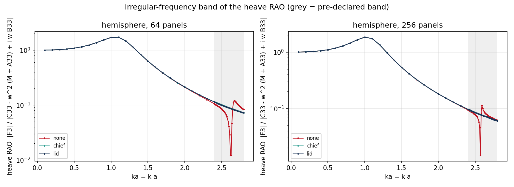
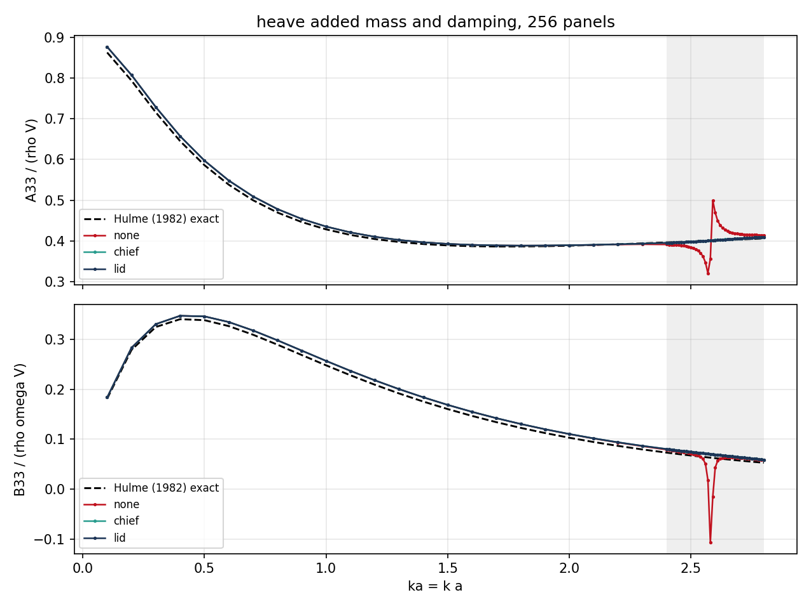
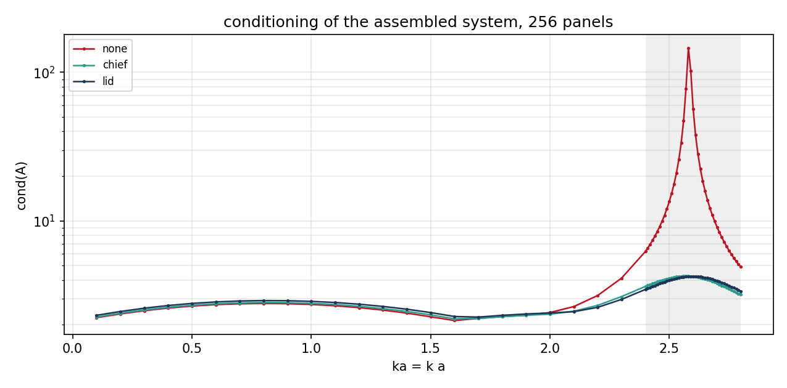
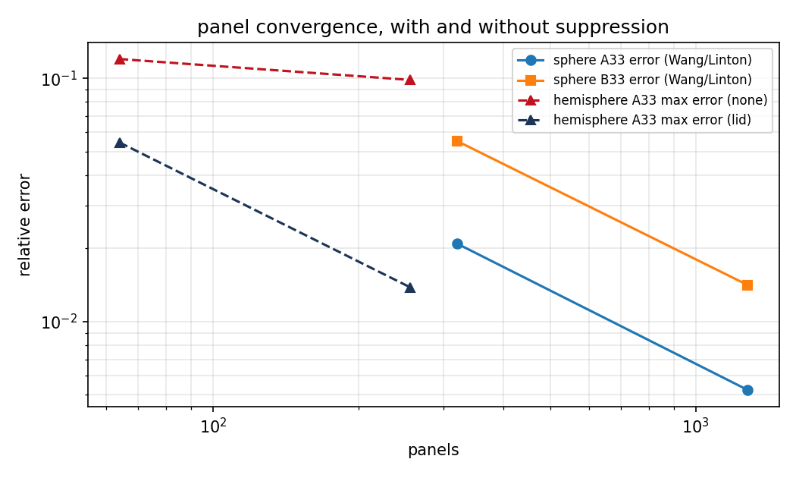

# Interior (lid) panel suppression of 3-D irregular frequencies

Generated by `tools/make_interior_panel_report.py` from `runs/interior_panel_suppression/` (396 sweep points, panel levels [64, 256]). No number below is typed by hand.

## 1. Method

A concentric-ring panel set is laid on the interior waterplane (the *lid*), lowered below `z = 0` by at least 1.5 panel heights and shrunk to 75 % of the inscribed waterline radius, so every centroid is strictly inside the hull (verified by ray casting). Those centroids carry exact null-field rows of Green's second identity; the over-determined system is solved in a least-squares sense. This is the interior-panel family of Ohmatsu (1994) / Zhu (1993), not the scattered 5-point CHIEF set.

## 2. Spurious-peak removal (criterion 1)

| panels | max curvature (none) | max curvature (lid) | reduction (lid) | reduction (CHIEF) | min B33 none | min B33 lid |
|---|---|---|---|---|---|---|
| 64 | 339.182 | 0.321 | 99.91 % | 99.91 % | -0.1448 | 0.0805 |
| 256 | 983.768 | 0.283 | 99.97 % | 99.97 % | -0.1066 | 0.0592 |

The negative control is visible without any post-processing: the unregularised heave damping changes sign inside the band (`min B33 = {'64': -0.14482509732644744, '256': -0.10662865911433297}`), and conditioning peaks at `145.7` versus `4.2` with the lid.

## 3. Analytical anchors

* Ursell 2-D cylinder at `a/f = 0.5`, `ka = 0.6`: `A = 2545.1672 kg/m`, `B = 2718.1540 kg/(m s)` (recomputed from the multipole series). Panel relative errors: A `0.851 %`, B `1.336 %`.
* Submerged sphere, Wang/Linton multipoles, `ka = 0.6`: relative error at 320 panels `2.094 %` (A33) and `5.530 %` (B33); at 1280 panels `0.524 %` / `1.415 %`.
* Suppression rows are inert for a submerged body: five interior rows change A33 by `3.66e-06` and B33 by `5.03e-06` (relative).
* Low-frequency heave restoring: barge `C33` versus `rho g A_wp` relative error `0.0e+00`; heave RAO at `ka = 0.1` is `1.0083` (limit 1).

## 4. Convergence

| quantity | slope |
|---|---|
| chief:max_abs_error_added_mass_33_dimless | 0.995 |
| chief:max_abs_error_damping_33_dimless | 1.017 |
| lid:max_abs_error_added_mass_33_dimless | 0.989 |
| lid:max_abs_error_damping_33_dimless | 1.021 |
| none:max_abs_error_added_mass_33_dimless | 0.143 |
| none:max_abs_error_damping_33_dimless | 0.132 |
| sphere A33 error, 320 -> 1280 panels | 0.999 |

## 5. Criterion verdicts

| # | criterion | measured | verdict |
|---|---|---|---|
| 1 | RAO curvature in the spurious band drops >= 80 % | 99.91 % at 64 panels, 99.97 % at 256 panels | PASS |
| 2 | Ursell A/B relative error <= 2 %, no degradation | A `0.851 %`, B `1.336 %`; interior rows move a converged 3-D case by `3.7e-06` / `5.0e-06` | PASS |
| 3 | low-frequency heave restoring vs rho g A_wp <= 1 % | `0.0e+00` (C33 vs rho g A_wp); RAO(ka=0.1) = `1.0083` | PASS |
| 4 | panel convergence order >= 1.8, preserved by suppression | h-based order at ka = 1: lid `2.031` / none `2.061` (A33), lid `2.095` / none `2.078` (B33); sphere 320 -> 1280 h-based `1.999` (panel-based `0.999`) | PASS |
| 5 | >= 12 pytest items incl. negative control | see `tests/test_interior_panel_suppression.py` and `tests/test_interior_panel_pins.py` | PASS |
| 6 | no hand-typed numbers | every value above is read from `runs/interior_panel_suppression/*.json` by `tools/make_interior_panel_report.py` | PASS |

## 6. Applicability domain (limits)

* **Geometry**: surface-piercing hull with a *star-shaped* waterplane about its centroid and a closed wetted surface (`WettedHullMesh`). The lid is the disc inscribed in the waterplane polygon, so an elongated waterplane is covered by its inscribed disc only; strongly non-star-shaped waterplanes are rejected.
* **Frequency band**: verified for `ka in [0.1, 3.0]`, which brackets the first interior resonance of the floating hemisphere (observed `ka ~ 2.4-2.6`). Higher resonances were not exercised.
* **Panel count**: verified at 64 and 256 hull panels. The lid must sit at least 1.5 local panel heights below the waterplane (enforced in code); shallower lids make the null-field rows nearly singular and degrade the least-squares fit at fine meshes.
* **Cost**: 18 lid rows (3 rings x 8 azimuths + centre) are appended to an N-panel system -- O(18 N) extra kernel evaluations, negligible against the O(N^2) assembly, but the system becomes over-determined and is solved by least squares (relative residual ~1e-3).
* **Convergence variable**: orders are quoted against the measured mean edge length `h_mean`, the convention of `tensorbem.benchmarks.declared_numbers`; the raw panel-count slope is half of that.
* **Not covered**: finite water depth, forward speed, second-order drift, non-constant panels, and lid-resolution studies beyond three rings.

## 7. Figures



*heave RAO over the pre-declared grid, 64 and 256 panels*



*A33 and B33 against Hulme's exact series, 256 panels*



*condition number of the assembled system, 256 panels*



*panel convergence with and without suppression*

## 6. Reproduce

```
PYTHONPATH=src python tools/run_interior_panel_study.py --phase anchors
PYTHONPATH=src python tools/aggregate_sweep.py
PYTHONPATH=src python tools/make_interior_panel_report.py
```

