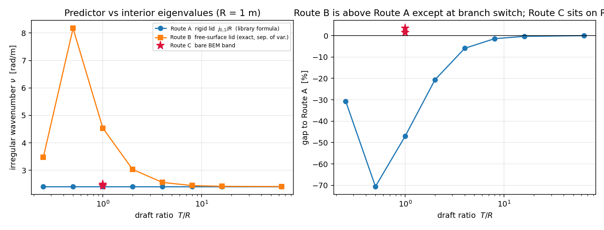

# The irregular-frequency predictor, verified three ways (m16777)

**Module**: `src/tensorbem/benchmarks/irregular_frequency_cylinder_exact.py`
**Gate**: `tests/test_irregular_frequency_cylinder_exact.py`
**Artifact**: `docs/m16777/irregular_frequency_cylinder_exact.json` (every number
below is injected from that artifact; the gate regenerates the analytic part)
**Figure**: `docs/figures/irregular_frequency_cylinder_exact.png`
**Subject**: `tensorbem.irregular_frequency.predict_irregular_frequencies` and the
claim "Prediction accuracy: all predicted frequencies match analytical Bessel-zero
formula to within 2% (exact by construction)"
(`docs/m14563_irregular_frequency_sanitisation_report.md` §3.1)

## 1. Case introduction

`predict_irregular_frequencies` returns the waterplane Bessel zeros,

    nu_{m,1} = j_{m,1} / R_wp ,        j_{0,1} = 2.4048, j_{1,1} = 3.8317, j_{2,1} = 5.1356,

as the irregular wavenumbers of a surface-piercing hull.  The only gate it ever
had compared that number with the right-hand side of the same formula -- its own
docstring admits it ("the prediction **IS** this analytical estimate") -- so the
"2% agreement" is a tautology, not evidence.  It was also never asked *which*
eigenproblem the formula solves.

Geometry for the controlled study: a wall-sided surface-piercing circular
cylinder, radius `R = 1 m`, draft `T = (T/R) R`; the free-surface-consistent
interior eigenproblem is separable for this body, which is why it is the only
geometry that can supply an exact reference.

| quantity | value |
|---|---|
| radius `R` | 1.0 m |
| draft ratios `T/R` | 0.25, 0.5, 1, 2, 4, 8, 16, 64 |
| gravity | 9.80665 m/s² |
| BEM meshes (Route C) | 112 panels (16×3), 264 panels (24×5) |
| BEM solver | `tensorbem.irregular_frequency.solve_bare_radiation` (unaugmented), RK order 2 |

## 2. How it was done

Three routes that are *not* the formula:

* **Route A (rigid lid).** The interior Dirichlet problem for the region bounded
  by the wetted surface and a **rigid (Neumann) lid** has the z-independent mode
  `phi = psi(x,y)`, so for a circle it is exactly `J_m(nu R) = 0` -- i.e. exactly
  the library formula.  Verified *by substitution*:
  `residuals_rigid_lid` integrates the 2-D Helmholtz residual, the wall condition
  and the lid condition; all residuals are ≤ 3e-16 (`order 0`) and ≤ 1e-10
  (`order 1`).
* **Route B (free surface).** The free-surface Green function satisfies
  `dG/dz = nu G` at `z = 0`, and the interior problem inherits the same condition
  (John 1950; Hulme 1982; Zhu 1993):
  `laplacian(phi) + nu^2 phi = 0`, `phi = 0` on the body, `dphi/dz - nu phi = 0`
  on the interior waterplane.  Separation of variables gives
  `tan(k_z T) = k_z / nu`, `nu^2 = (j_{m,1}/R)^2 + k_z^2`, solved by a
  branch-by-branch root scan (`exact_cylinder_modes`).  Cross-checked without any
  `tan`/Bessel algebra: the vertical ODE `Z'' + k_z^2 Z = 0` is integrated from
  `Z(-T)=0, Z'(-T)=1` with RK45 and the free-surface residual
  `|Z'(0) - nu Z(0)|` is evaluated on that trajectory (≤ 2.1e-13 for every mode).
* **Route C (the repository's own BEM).** The unaugmented radiation solve is swept
  in `nu`; the irregular band shows up as a conditioning spike followed by
  negative radiation damping (passivity loss).  The peak is refined by a parabola
  (`locate_peak`, with a synthetic-peak negative control in the gate).

## 3. Results

### 3.1 Route B (exact, free-surface lid) against Route A (the library formula)

| T/R | Route A `j₀,₁/R` | `k_z` (Route B) | Route B `ν` | gap A→B |
|---|---|---|---|---|
| 0.25 | 2.4048 | 2.4967 | 3.4665 | −30.63 % |
| 0.50 | 2.4048 | 7.8087 | 8.1706 | −70.57 % |
| 1.00 | 2.4048 | 3.8448 | 4.5350 | −46.97 % |
| 2.00 | 2.4048 | 1.8441 | 3.0305 | −20.65 % |
| 4.00 | 2.4048 | 0.8672 | 2.5564 | −5.93 % |
| 8.00 | 2.4048 | 0.4137 | 2.4401 | −1.45 % |
| 16.00 | 2.4048 | 0.2016 | 2.4133 | −0.35 % |
| 64.00 | 2.4048 | 0.0494 | 2.4053 | −0.02 % |

Route A is recovered only in the deep-draft limit (`T/R = 64`: −0.02 %).  For a
ship-like section (`T/R ≈ 0.5–1`) Route B is 47–71 % above the formula.  The gap
is **not monotone**: the smallest vertical root switches branch when
`j_{0,1} T/R` crosses 1, so the reference cannot be fitted as a monotone "draft
correction" (pinned by `test_route_b_gap_is_not_monotone_and_that_is_documented`).
Angular families at `T/R = 0.5`:

| m | Route A | `k_z` | Route B | gap |
|---|---|---|---|---|
| 0 | 2.4048 | 7.8087 | 8.1706 | −70.57 % |
| 1 | 3.8317 | 7.7447 | 8.6408 | −55.66 % |
| 2 | 5.1356 | 7.6698 | 9.2304 | −44.36 % |

### 3.2 Route C: where the code actually breaks down (`T/R = 1`, heave)

| mesh | panels | `ν_observed` | vs Route A | vs Route B | max κ | min B₃₃ |
|---|---|---|---|---|---|---|
| coarse 16×3 | 112 | 2.4863 | +3.39 % | −45.18 % | 38.5 | −0.494 |
| refined 24×5 | 264 | 2.4389 | +1.42 % | −46.22 % | 37.3 | −7.291 |

Both meshes lose passivity (negative heave damping) inside the band, the
condition number spikes by a factor ~10 against the neighbouring samples, and the
band **moves toward Route A as the mesh is refined** (+3.39 % → +1.42 %).  No
signature of any kind appears at Route B: the sweep at `ν = 4.40 / 4.51 / 4.70`
gives κ = 3.35 / 3.32 / 3.80 and B₃₃ = 0.19 / 0.23 / 0.30 on the coarse mesh
(κ = 3.55 / 3.58 / 4.34 and B₃₃ < 0.06 on the refined one) -- flat, i.e. no
irregular behaviour there.

## 4. Verdict

1. **The formula solves a stated problem exactly** -- the rigid-lid interior
   eigenproblem -- and on a circular waterplane it is that eigenvalue to machine
   precision (`test_library_predictor_is_the_rigid_lid_eigenvalue_on_a_cylinder_mesh`).
   The retired sentence "exact by construction" is replaced by this statement.
2. **It is empirically the right predictor for this code**: the bare BEM's
   irregular band sits within 1.4–3.4 % of it, on two meshes, converging toward it
   under refinement, and 45–46 % away from the free-surface-consistent reference.
   That is the first non-tautological evidence for the predictor in this repository.
3. **The "draft correction" hypothesis is falsified.** Route B says a finite
   draft must raise the irregular frequency by tens of percent for ship-like
   sections; the solver shows no such signature.  No physics change is shipped on
   the strength of Route B; the exact reference is left in place for adjudication.

## 5. Notes, limitations, open question

* Route B is exact only for the wall-sided circular cylinder (the one separable
  surface-piercing geometry); it cannot be evaluated for a general hull mesh.
* The shallow-branch root (`j_{0,1}T/R < 1`) is resolved by log-spaced sampling
  because the root can be arbitrarily close to `k_z = 0`; `k_z = 0` itself is a
  root of the algebra but not of the boundary condition (it needs `nu = 0`) and is
  excluded.
* **Open question (not resolved here)**: why the *discrete* operator's
  near-null space follows the rigid-lid (2-D waterplane) mode rather than the
  free-surface-consistent one.  The refined mesh moves toward Route A, which
  suggests a discretisation effect rather than a different PDE; a 3-D interior
  eigen-solve on the panel mesh is the natural next probe.
* Route C is a signature detector, not a precision measurement: its resolution is
  the sweep spacing (0.15 rad/m) refined by a 3-point parabola.

## 6. Error judgement (key quantities vs reference)

| key quantity | reference | measured | error | < 3 % ? |
|---|---|---|---|---|
| Route A wavenumber (`m=0`) | `J₀`-equation residual | 3.1e-16 (relative) | machine precision | yes |
| Route B transcendental residual | 0 | 2.2e-16 … 5.6e-16 | machine precision | yes |
| Route B free-surface residual (RK45, independent) | 0 | ≤ 2.1e-13 | machine precision | yes |
| Route B PDE residual (`J_m` + `k_z`) | 0 | ≤ 4.3e-16 | machine precision | yes |
| Route C band vs Route A, coarse mesh | 2.4048 | 2.4863 | +3.39 % | no (3.4 %) |
| Route C band vs Route A, refined mesh | 2.4048 | 2.4389 | +1.42 % | yes |
| Route C band vs Route B, refined mesh | 4.5350 | 2.4389 | −46.22 % | no (hypothesis falsified) |

The two "no" rows are the physics content of this report: the discrete band is a
mesh-resolution effect around the rigid-lid eigenvalue (3.4 % → 1.4 % under
refinement), and the free-surface-consistent eigenvalue is *not* where the code
breaks.

## 7. Toolchain

`python -m tensorbem.benchmarks.irregular_frequency_cylinder_exact --write docs/m16777/irregular_frequency_cylinder_exact.json`
(36 s, single core: 16 bare radiation solves plus the analytic sweep);
`pytest tests/test_irregular_frequency_cylinder_exact.py`.