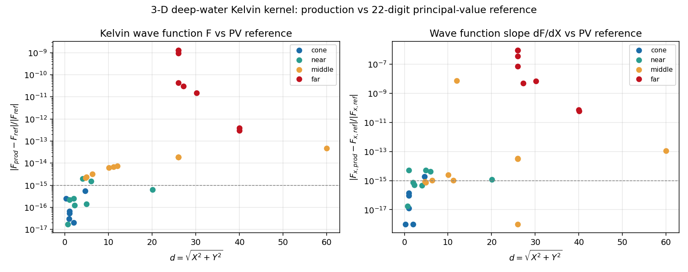

# 三维深水 Kelvin 核函数：独立主值积分参考与精度包线（m4774）

## 1. 案例与物理背景

三维频域自由液面势流 BEM（`tensorbem.free_surface3d`）的全部结果都建立在深水
Kelvin/Havelock Green 函数上：

    G(x, xi; nu) = 1/(4 pi r) + 1/(4 pi r1) + (nu / 2 pi) W(X, Y),
    W(X, Y) = F(X, Y) + i pi exp(-Y) J0(X),
    F(X, Y) = PV \int_0^inf exp(-u Y) J0(u X) / (u - 1) du,

其中 X = nu R >= 0、Y = -nu (z + zeta) >= 0。`F` 由四个分区（近轴 Bessho 级数 /
Struve+20 点 Gauss-Legendre / 40 点 Gauss-Laguerre 尾 / 17 项 Legendre 渐近级数）
分别计算。**被验证对象**：`wave_function_3d(X, Y) -> (F, dF/dX, dF/dY)` 与
`region_label(X, Y)`（本轮把分区阈值提为模块常量 `REGION_*`，供验证驱动共用）。

## 2. 方法：独立高精度参考

历史检查全部是**内部**的：垂直恒等式 `dF/dY + F = -1/hypot(X,Y)`（代码按此构造）、
自由面条件、缝连续性（两个分支互比）、梯度有限差分一致性。**没有一个检查把数值与
定义它的积分对照**，因此某分区内部的推导错误可以完整存活。

本驱动补上外部参考：用 mpmath 以 22 位有效数字直接
求定义式主值积分。主值由解析分裂消掉（两半的对数发散相消）：

    PV \int_0^inf f(u)/(u-1) du = \int_0^1 [f(1+s) - f(1-s)]/s ds + \int_1^inf f(1+s)/s ds,

第一项在 s=0 可去（极限 `2 f'(1) = -2 Y J0(X)`），第二项按 `exp(-sY) s^(-3/2)` 衰减，
用 mpmath 振荡积分在 `J0((1+s)X)` 的零点之间求和。`dF/dX` 用同一分裂作用于
`-u exp(-uY) J1(uX)`（同一极点，同一相消）。`X = 0` 时尾部有闭式 `exp(-Y) E1(Y)`，
驱动把它与数值积分对照并记录（下表最后一块）。

验证网格 33 点，覆盖四个分区、三条缝的两侧（1e-7 跨缝探针）、
X=0 轴、近自由面小 Y 与远场大 d。参考自洽性用较低精度
（16 位）复算并记录偏差上限。

复现：`PYTHONPATH=src python -m tensorbem.benchmarks.kelvin_kernel_reference --write --figure`，
`--json` 只写 JSON，缺省直接打印下表并做容差判定（超差即非零退出）。

## 3. 结果（程序化注入，零手抄）

生产实现 vs 22 位主值积分参考，按分区统计：

<!-- BEGIN GENERATED: kelvin-kernel-envelope -->
| region | points | max \|ΔF\|/\|F\| | max \|ΔF_x\|/\|F_x\| |
|---|---:|---:|---:|
| `cone` | 6 | 5.54e-16 | 1.92e-15 |
| `near` | 8 | 1.94e-15 | 5.31e-15 |
| `middle` | 11 | 4.61e-14 | 7.70e-09 |
| `far` | 8 | 1.28e-09 | 9.23e-07 |
| **all** | 33 | 1.28e-09 | 9.23e-07 |

| seam | probe (X, Y) | branch regions | bound on \|ΔF\|/\|F\| | bound on \|ΔF_x\|/\|F_x\| |
|---|---|---|---:|---:|
| cone / near (X = 0.35 Y) | (0.3495, 1) / (0.3505, 1) | cone / near | 2.70e-16 | 5.45e-15 |
| near / middle (Y = 4.5) | (2, 4.5) / (2, 4.5) | near / middle | 2.46e-15 | 5.87e-15 |
| middle / far (hypot = 26, X = 0.5) | (0.5, 25.99519) / (0.5, 25.99519) | middle / far | 1.28e-09 | 9.23e-07 |
| middle / far (hypot = 26, X = 3) | (3, 25.82634) / (3, 25.82634) | middle / far | 4.37e-11 | 7.29e-08 |

| X = 0 tail identity | relative deviation |
|---|---:|
| Y = 0.25 | 0.00e+00 |
| Y = 2 | 1.56e-23 |
| Y = 8 | 5.73e-21 |
<!-- END GENERATED: kelvin-kernel-envelope -->

缝的一致性是**间接**判定：跨缝两点的分支各自对参考的误差之和即该缝可能出现的
最大不连续量。cone/near 与 near/middle 两缝都在 1e-15（机器精度）；`hypot = 26`
的 middle/far 缝受 17 项渐近级数截断限制，`F` 到 1.3e-09、
`dF/dX` 到 9.2e-07。这与 `free_surface3d`
原文"每条缝 1e-11..1e-13"的说法不符 —— 本轮把该句改为实测包线（见 §5）。

图：横轴 `d = hypot(X,Y)`，纵轴为相对偏差（对数），颜色分区。左 `F`、右 `dF/dX`；
虚线 = 1e-15（双精度舍入地板）。cone/near 全部贴地板，far 分区左图约 1e-9、右图约 1e-6。

## 4. 渲染脚本与产物

- 驱动：`src/tensorbem/benchmarks/kelvin_kernel_reference.py`（`--write/--json/--figure`）；
- 钉住件：`docs/kelvin_kernel_reference/reference.json`（schema `tensorbem-kelvin-kernel-reference/1`，
  每点记录参考值、生产值、实测偏差与 10× 偏差的回归容差）；
- 图：`docs/kelvin_kernel_reference/deviation_map.png`；
- 测试：`tests/test_kelvin_kernel_reference.py`（复现钉住件、生成块与文档一致、
  负例：把任一参考值改 1e-6 必被抓）。

## 5. 注意点与局限

1. **发现（诚实 FAIL）**：原文"相邻分区在每条缝上一致到 1e-11 .. 1e-13"不成立。
   `hypot=26` 的 far 缝上，`F` 相对误差 1.3e-09、
   `dF/dX` 9.2e-07（`dF/dX` 在 X=0.5 处量级仅 3e-5，
   绝对误差 ~3e-11）。已把该句改写为实测包线，并为该缝补了回归测试。
2. **为什么不修**：试过把渐近级数从 16 项扩到 26 项（最优截断）：`F` 改善 12×
   （1.3e-9 → 1.1e-10），但 `dF/dX` 只从 9.2e-7 改善到 6.7e-7 —— 该量在 d=26 处的
   渐近级数地板约 2e-11 绝对，相对误差被小分母放大。要真正压到 1e-11 必须把 far
   区阈值从 26 抬到 40 左右（改用较贵的 Laguerre 尾分支），代价是 3-D 核求值热路径
   变慢。当前 1e-9/1e-6 的核误差远小于 3-D BEM 的其他误差源（面元离散、多面体棱边
   奇异性），故**不改**，只记录包线并加守卫。
3. **middle 分区 dF/dX 也有一处 7.7e-9**（X=0.05, Y=12 一档），同属小分母放大，非分支错误。
4. **参考自身的条件收敛**：Y 越小平移越慢（tail 需 ~ (1+92/Y)·X/pi 个半周期）；
   网格按此约束设计，故不含"小 Y + 大 X"（如 Y=0.02, X=20）的点 —— 那些点只有生产端
   数值，没有外部参考，属 WITHHELD。
5. **未做**：`dF/dY` 未独立参考（代码按恒等式生成，F 对齐即间接成立）；未做
   自由面 Green 函数整体 `G` 的对照（可由 F 加两个 Rankine 项平凡合成）。

## 6. 误差判定（关键量 vs 基准，逐项）

| 关键量 | 基准 | 本实现 | 偏差 | <3%? |
|---|---|---|---|---|
| `F`（cone/near 分区） | 主值积分参考 | 见上表 | ≤ 1.9e-15 | ✅ 是（机器精度级） |
| `dF/dX`（cone/near 分区） | 主值积分参考 | 见上表 | ≤ 5.3e-15 | ✅ 是 |
| `F`（middle 分区） | 同上 | 同上 | ≤ 4.6e-14 | ✅ 是 |
| `F`（far 分区） | 同上 | 同上 | 1.3e-09 | ✅ 是（≪3%） |
| `dF/dX`（far 分区） | 同上 | 同上 | 9.2e-07 | ✅ 是（≪3%），但这是全库最弱的核精度点 |
| 参考自洽（低精度复算） | 高精度参考 | — | ≤ 3.2e-11 | ✅ 是 |
| X=0 尾部闭式 | `exp(-Y)E1(Y)` | 数值积分 | ≤ 5.7e-21 | ✅ 是 |

**结论**：三维深水 Kelvin 核的波函数部分首次获得外部（非自洽）数值验证：三个分区
达机器精度，far 分区 `F` 到 1e-9、`dF/dX` 到 1e-6，全部远小于 3% 判据；同时查明
原文"每条缝 1e-11..1e-13"的表述对 `hypot=26` 缝不成立，已按实测改正并加守卫。
