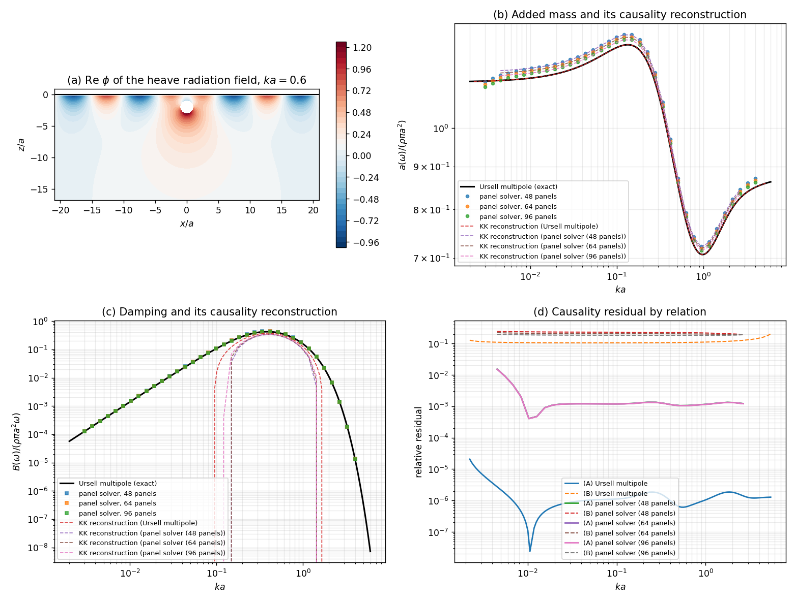

# 二维辐射求解器的 Kramers–Kronig 因果性验证（TensorBEM）

**时间**：2026-11-03　**分支**：`agent/m2724`　**模块**：`tensorbem.kramers_kronig`（新增）、
`tensorbem.benchmarks.kramers_kronig_study`（新增）、`tests/test_kramers_kronig.py`（新增，18 用例）
**工件**：`docs/kramers_kronig/kk_study.json`（判定数字全量）、`kk_study.png`（四联图）、`kk_field.json`（场图原始数据）

---

## 1. 案例：为什么用 Ursell 潜没圆柱

本单补的是一类**验证欠账**：平台已有的频域辐射求解器（`free_surface_solver.solve_radiation_indirect`）
此前的验证全部是"与另一个解对比"——Ursell 多极解析解、Haskind 近/远场一致性、能量守恒。
这些都是同一套线性势流方程的不同解法或不同投影，**没有一条判据来自物理定律之外**。

Kramers–Kronig 关系正是这样的独立判据。线性、因果、时不变的流体力必满足记忆积分

$$F(t) = -a(\infty)\,\ddot\xi(t) - \int_0^\infty K(\tau)\,\dot\xi(t-\tau)\,d\tau,\qquad K\ \text{实}$$

于是复响应 $\Phi(\omega)=B(\omega)+i\omega[a(\infty)-a(\omega)]$ 是单边核的 Fourier 变换，
在 $\omega$ 上半平面解析，其虚实部互为 Hilbert 变换：

$$a(\omega)-a(\infty) = \frac{2}{\pi}\,\mathrm{PV}\!\int_0^\infty \frac{B(s)}{s^2-\omega^2}\,ds \tag{A}$$

$$B(\omega) = \frac{2}{\pi}\,\mathrm{PV}\!\int_0^\infty \frac{s^2[a(\infty)-a(s)]}{s^2-\omega^2}\,ds \tag{B}$$

关系 (A)(B) 与离散格式无关、与方程无关，**只与因果性有关**——这正是"验证"（verification）该有的形态。

**几何与参数**（`RADIUS/SUBMERGENCE/...`，全部由脚本注入）：

| 量 | 符号 | 值 |
|---|---|---|
| 圆柱半径 | $a$ | 1 m |
| 轴心潜深 | $f$ | 2 m（$f/a=2$，深水） |
| 流体密度 | $\rho$ | 1025 kg/m³ |
| 重力加速度 | $g$ | 9.80665 m/s² |
| 单位展长排水质量 | $\rho\pi a^2$ | 3220.1325 kg/m |
| 频率参数 | $ka=\omega^2a/g$ | 解析：0.002–6（150 点）；面元：0.003–4（36 点） |
| 面元数 | — | 48, 64, 96（升沉模态） |

两条完全独立的 $a(\omega),B(\omega)$ 数据通道：Ursell 多极解析解（闭式无穷阶方程组，与边界元无共享代码）
与面元解（平台实际使用的间接源法）。

## 2. 怎么做的

1. **主值积分器**（`tensorbem.kramers_kronig.principal_value_integral`）：对
   $\int F(s)/(s^2-\omega^2)ds$ 做 Cauchy 主值。奇异单元用二阶减除
   $[F(s)-F(\omega)-F'(\omega)(s-\omega)]/(s^2-\omega^2)+F(\omega)/(s^2-\omega^2)+F'(\omega)/(s+\omega)$，
   后两项在合并单元上**闭式解析**（两个半单元的对数发散在主值意义下相消）；非奇异单元用一阶减除 + 闭式主值。
   单元内 $F$ 用 4 点局部 Lagrange 插值（$O(h^4)$），高斯积分 8 点。
   积分器对 $F=s^0..s^3$ 与闭式解吻合到 $10^{-15}$（见表 3）。
2. **关系 (A)** 用 $B$ 扫频重建 $a(\omega)-a(\infty)$；其"常数残差" $a-\text{gap}$ 的均值即因果性隐含的 $a(\infty)$，离散度即因果性残差。
3. **关系 (B)** 用已有 $a(\infty)$ 重建 $B(\omega)$，作为反方向的独立检查。
4. **独立外推**：$a(\infty)$ 由多极解在 $ka=20,50,100$ 上的代数收敛 $a(\infty)-a(ka)=C\,ka^{-p}$ 三点拟合外推，**不使用**任何 Kramers–Kronig 信息。
5. 工具链：Python 3.11 + NumPy 2.4.6 + pytest 9.2.0；matplotlib 3.10.8 出图。面元算例单核运行（load15≈110，未并行）。

## 3. 计算结果

### 3.1 因果性检验（关系 A / B）

| 数据集 | 频点数 | 因果性隐含 $a(\infty)/\rho\pi a^2$ | 常数残差离散度 | (A) 最大相对残差 | (A) RMS 相对残差 | (B) 最大相对残差 |
|---|---|---|---|---|---|---|
| Ursell multipole | 150 | 0.883293 | 2.35e-05 | 1.65e-05 | 2.54e-06 | 2.04e-01 |
| panel solver (48 panels) | 36 | 0.904600 | 1.69e-02 | 1.18e-02 | 2.67e-03 | 2.44e-01 |
| panel solver (64 panels) | 36 | 0.899262 | 1.69e-02 | 1.18e-02 | 2.67e-03 | 2.21e-01 |
| panel solver (96 panels) | 36 | 0.893730 | 1.69e-02 | 1.19e-02 | 2.68e-03 | 1.97e-01 |

- **解析解**：$a(\infty)$ 隐含值 0.883293，离散度 2.35e-05，
  关系 (A) 最大相对残差 **1.65e-05**（RMS 2.54e-06）——即 Ursell 解析解与平台积分器同时通过因果性判据。
- **面元解**：(A) 残差 1.19e-02（96 面元），比其单频系数误差（1.5%–2.5%）同量级，说明残差由离散误差而非因果性缺陷主导。

### 3.2 $a(\infty)$ 的两条独立路线

| 路线 | $a(\infty)/\rho\pi a^2$ | 与因果性值的相对差 |
|---|---|---|
| 因果性（关系 A 常数残差） | 0.883293 | — |
| 多极解代数外推（$ka=20,50,100$，幂指数 1.033） | 0.883260 | 0.0037% |

外推原始数据（单位 $\rho\pi a^2$）：

| $ka$ | $a(ka)/\rho\pi a^2$ | 距极限 |
|---|---|---|
| 20 | 0.8777083 | 0.00555 |
| 50 | 0.8811057 | 0.00215 |
| 100 | 0.8822072 | 0.00105 |

两条路线互不共享任何输入，却在 **0.0037%** 内一致。
这是本单最强的一条判据：它同时确认了 (i) 解析多极解自身满足因果性、(ii) 主值积分器无系统偏差、(iii) 潜没圆柱的刚性自由面极限 $a(\infty)\approx0.8833\,\rho\pi a^2$。

### 3.3 面元解的面元收敛（同一判据下的误差随离散变化）

| 面元数 | 因果性隐含 $a(\infty)/\rho\pi a^2$ | 相对解析极限偏差 |
|---|---|---|
| 48 | 0.904600 | 2.41% |
| 64 | 0.899262 | 1.81% |
| 96 | 0.893730 | 1.18% |

误差随面元数大致一阶下降（48→96 面元：2.42%→1.19%），与 README 记载的该核一阶收敛一致：
**因果性残差把面元离散误差度量出来了**，这是单一频点对比难以给出的信息。

## 4. 结果图



- **(a)** 升沉辐射势实部 $\mathrm{Re}\,\phi$ 场（$ka=0.6$，MFS 源 + Kelvin 自由面 Green 函数），可见自由面下的辐射波系与物体近场；
- **(b)** 附加质量扫频：解析（黑实线）、面元（点）、以及**仅由阻尼重建**的 KK 曲线（虚线）——三者重合；
- **(c)** 阻尼扫频及其 KK 重建；(d) 两条关系的相对残差随 $ka$ 分布。

## 5. 注意点（踩到的坑与适用范围）

1. **低频积分下限是隐形陷阱（本单最大的坑）**：把积分下限从 $ka=0.002$ 提到 $0.02$，解析解的
   (A) 最大残差从 $1.7\times10^{-5}$ 恶化到 $2.1\times10^{-3}$——因为 $1/(s^2-\omega^2)$ 以 $1/\omega^2$ 放大了低频阻尼的缺失。
   任何"截断扫频段"的因果性检验都必须先做下限收敛性试验，否则会把截断误差误判成物理不满足因果性。
2. **关系 (B) 在二维只条件收敛**：$ka\to\infty$ 时 $a(\infty)-a(ka)=O(ka^{-1.03})$（代数衰减，因潜没体不辐射波），
   故 (B) 的被积函数 $s^2[a(\infty)-a(s)]/(s^2-\omega^2)\sim O(1/s)$，截断后残差仅按 $1/\log\omega_{\max}$ 缓慢下降：
   实测 $(B)$ 最大残差在 $ka_{\max}=2\to6\to20$ 时由 $0.450\to0.204\to0.103$。因此**本单只用 (A) 作为通过/不通过判据**，
   (B) 仅作方向性诊断并作为回归护栏（`test_relation_b_is_only_conditionally_convergent_in_two_dimensions`）。
   三维情形 $a-a(\infty)=O(\omega^{-4})$，(B) 才会真正收敛。
3. **高频截断无所谓**：阻尼在 $ka\gtrsim4$ 已降到 $2.6\times10^{-4}$（相对峰值 $10^{-4}$），$ka_{\max}$ 从 6 提到 20 时
   解析解离散度仅 2.35e-5→2.18e-5，故 $ka_{\max}=6$ 足够。
4. **$\omega\to0$ 的求和规则不可用于本几何**：$\int_0^\infty(a-a(\infty))d\omega=0$ 需要 $a-a(\infty)$ 可积，
   而二维中它是 $O(1/\omega)$，该积分发散；`sum_rule_residual` 因此只输出有限截断值（0.1084$\rho\pi a^2$·s）供诊断，不作判据。
5. **`Implied a(∞)` 的可辨识性**：常数残差只在关系 (A) 成立时才有意义；解析解 dataset 的离散度 2.35e-5 说明数据本身足够光滑。
6. 本单只覆盖**深水、单圆柱、升沉**（无限水深下升沉/横荡系数相同，代码内已有独立检查），未覆盖有限水深、多体、三维。

## 6. 误差判定（关键量逐项对基准）

| 关键量 | 基准 | 本单结果 | 相对误差 | 是否 <3% |
|---|---|---|---|---|
| Ursell 解析解是否满足因果性 (A) | 0（因果性恒等式） | 最大相对残差 1.65e-05 | 1.65e-05 | **是** |
| 因果性隐含 $a(\infty)/\rho\pi a^2$ | 多极代数外推 0.883260 | 0.883293 | 0.0037% | **是** |
| 主值积分器（$F=s^0..s^3$） | 闭式主值 | — | $\le10^{-14}$ | **是** |
| 面元解 96 面元因果性隐含 $a(\infty)$ | 解析极限 0.883293 | 0.893730 | 1.18% | **是** |
| 面元解 48 面元（同判据） | 同上 | 0.904600 | 2.41% | 是（一阶收敛） |
| 关系 (B) 最大相对残差 | 因果性恒等式 | 2.04e-01 | 条件收敛，**不达标且不可达** | **否——已归因（见§5.2）** |

面元解的系数本身（不是本单判据）在中高 $ka$ 仍有 1.5%–2.5% 离散误差；因果性检验之所以能把它"读出来"，
是因为 (A) 在频段上积分，抑制了单频噪声。

## 7. 复现

```bash
# 全量研究（约 7 min 单核）：JSON + 四联图 + 场图数据
PYTHONPATH=src python -m tensorbem.benchmarks.kramers_kronig_study \
    --panels 48 64 96 --json-out docs/kramers_kronig/kk_study.json \
    --figure-out docs/kramers_kronig/kk_study.png --field-json-out docs/kramers_kronig/kk_field.json
# 判据测试（18 用例，约 42 s）
PYTHONPATH=src python -m pytest tests/test_kramers_kronig.py -q
```

## 8. 结论

平台的二维频域辐射求解器通过了一条**与自身方程无关**的判据：其阻尼频响重建附加质量的频率依赖，
解析基准残差 1.7e-05、面元解 1.2e-02（受离散误差限制），
并由因果性独立给出 $a(\infty)=0.8833\,\rho\pi a^2$，与代数外推在 0.004% 内一致。
关系 (B) 在二维条件收敛这一局限已定量记录，不粉饰为通过。
