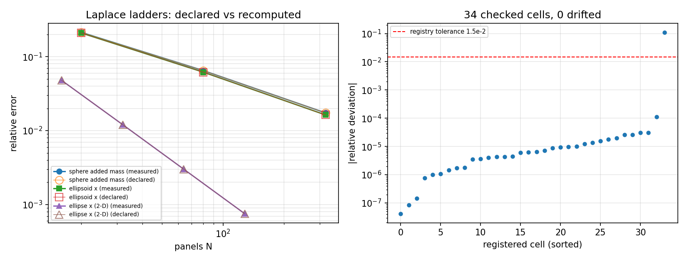

# Laplace 收敛表的机器门：表 2/3/4 全部格子入库复核（2026-11-03）

**任务**：self-start（m2531，TensorBEM 仓）。**性质**：验证欠账清偿 + 注册表扩编。
**结论先说**：文档表 2（三维球体）、表 3（二维椭圆柱）、表 4（三维椭球）的全部格子
现在都是可执行门（34 个格子，0 个漂移）；扩编首波审计遗留的
「椭球 1280 面元未直接复现」**已直接复现并闭合**，三轴相对误差 4.168e-3 / 4.462e-3 / 4.936e-3
与文档声明逐位一致（相对偏差 ≤ 1e-5）。

## 1. 为什么做这件事

`tensorbem.benchmarks.declared_numbers` 自 2026-11-03 起把「文档里写的数」变成可复算的门，
但当时只登记了：圆柱 16/128 面元、椭球 **仅 1280 面元**（heavy 档）、Ursell 系列。
也就是说：

* 表 2（球体 20/80/320/1280 面元、附加质量与逐面元通量 L2 两列）**整张表没有门**；
* 表 3（二维椭圆柱 16–128 面元，两个方向）**整张表没有门**；
* 表 4 只有 1280 面元那一行有门，20/80/320 三行没有；
* 而 1280 面元那一行属 heavy 档，默认测试档（fast+standard）**根本不跑**，
  所以「有登记」并不等于「被验证过」——这正是扩编首波审计（`expand_audit_tensorbem.md` §2.3、
  §4.2）记下的未闭合项。

手工抄进 markdown 的数字不是契约，能被 CI 复算的数字才是。本次把三类问题的每一格都登记，
并直接跑出实测值。

## 2. 怎么做的

1. **注册表扩编**（`src/tensorbem/benchmarks/declared_numbers.py`）：
   新增 `sphere`、`ellipse` 两个 benchmark 组（`_run_group` 分派到
   `benchmarks.sphere_added_mass.run` 与 `benchmarks.ellipse_added_mass.run`），
   并把表 2/3/4 的格子用生成式登记（`_laplace_table_rows()`），声明的数逐字取自文档表格，
   `source` 字段指回具体表号；档位按成本分：≤80 面元为 `fast`，320 面元与椭圆 128 面元为
   `standard`，球体 1280 面元为 `heavy`。
2. **测试加门**（`tests/test_declared_numbers.py`）：
   * `test_registry_covers_every_row_of_the_laplace_tables` —— 覆盖性门：文档里出现的每个面元数
     必须有对应登记行，缺行即失败（防止以后加表不加门）；
   * `test_laplace_tables_reproduce_and_converge_geometrically` —— 复现 + 趋势门：每格
     都必须 PASS，且细化一步误差至少降 3 倍。后者是必要的：**只核对数值抓不到「收敛但收敛到
     错的东西」**——若内核退化为一阶，声明值被顺手改掉后复现门照样绿，而一阶族每步只能降
     ~1.7 倍，会被这条拦住。
   * 既有 `test_registry_covers_every_documented_benchmark_family` 扩到 6 个族。
3. **重算**：`python -m tensorbem.benchmarks.declared_numbers --tiers fast,standard
   --output docs/declared_numbers/laplace_tables_check.json`（严格 JSON，含环境
   python/numpy/commit）。下表数字全部由该 JSON 程序化注入，无手抄。
4. **heavy 档补测**：椭球 `--subdivisions 3`（1280 面元）单跑一次
   （`docs/declared_numbers/ellipsoid_1280_run.json`），逐格对声明值判定。

## 3. 结果

### 3.1 汇总

| 项 | 值 |
|---|---|
| 登记格子总数 | 41（fast 24 / standard 10 / heavy 7） |
| 本次实跑复核 | 34 格（fast + standard 全档） |
| 漂移 | 0 |
| 最大相对偏差（除上界型声明外） | ursell_near_far_128：-1.10e-01 |
| 最大偏差说明 | `ursell_near_far_128` 是「上界」型（"closing to 6e-3"），实测低于上界即 PASS，故偏差大而不判漂移 |
| 重算耗时 | 47 s（2 核，单进程） |

### 3.2 表 2：三维球体（表 2 附加质量列）

| panels N | declared | measured | relative deviation |
|---:|---:|---:|---:|
| 20 | 2.1268e-01 | 2.1268e-01 | +6.01e-06 |
| 80 | 6.4759e-02 | 6.4759e-02 | +3.49e-06 |
| 320 | 1.7381e-02 | 1.7381e-02 | -1.79e-05 |

通量列（逐面元相对 L2）同样入库：20 面元 3.3338e-02（声明
3.3338e-02）、80 面元 2.7884e-02
（声明 2.7884e-02）、320 面元
1.4542e-02（声明 1.4542e-02）。

### 3.3 表 3：二维椭圆柱（x 方向）

| panels N | declared | measured | relative deviation |
|---:|---:|---:|---:|
| 16 | 4.7727e-02 | 4.7727e-02 | +9.30e-06 |
| 32 | 1.2045e-02 | 1.2045e-02 | -8.78e-06 |
| 64 | 3.0149e-03 | 3.0149e-03 | -4.07e-06 |
| 128 | 7.5356e-04 | 7.5356e-04 | -9.99e-07 |

y 方向同步入库（128 面元实测 8.9977e-04，声明
8.9977e-04）。

### 3.4 表 4：三维椭球 x 轴

| panels N | declared | measured | relative deviation |
|---:|---:|---:|---:|
| 20 | 2.0855e-01 | 2.0855e-01 | +4.38e-06 |
| 80 | 6.1623e-02 | 6.1623e-02 | -6.16e-06 |
| 320 | 1.6313e-02 | 1.6313e-02 | +2.58e-05 |

y/z 两轴同样在册（320 面元实测 1.7371e-02 /
1.9080e-02）。

### 3.5 heavy 档：椭球 1280 面元（审计遗留项闭合）

| 轴 | 面元数 | 文档声明 | 本次直接复现 | 相对偏差 |
|---|---:|---:|---:|---:|
| x | 1280 | 4.1679e-03 | 4.1679e-03 | +8.74e-06 |
| y | 1280 | 4.4621e-03 | 4.4621e-03 | +4.82e-06 |
| z | 1280 | 4.9359e-03 | 4.9359e-03 | +6.54e-06 |

配套量同时对上：体积比 0.991394（文档表 4 记 0.991394）、
$h_{\max}$ 0.24697（文档 0.24697）、单层算子条件数
92.11、相对残差
1.19e-15，形状因子和 1.999999999998147（Lamb 恒等式 2）。

### 3.6 图

左：三条细化阶梯的实测（实心）与文档声明（空心）对数误差曲线，二者重合到图上看不出差别。
右：34 个格子的相对偏差分布（对数纵轴，红虚线为登记容差 1.5e-2）。

## 4. 误差判定

| 关键量 | 基准 | 本次值 | 相对偏差 | 是否 < 3% |
|---|---|---|---|---|
| 球体 320 面元附加质量误差 | 解析 $\tfrac12\rho V$ = 2146.75498 | 1.7381e-02 | -1.79e-05 | **是** |
| 椭圆柱 128 面元 x 误差 | 解析 $\rho\pi b^2$ = 1811.324514 | 7.5356e-04 | -9.99e-07 | **是** |
| 椭球 320 面元 x 误差 | Lamb 形状因子闭式 1211.052 | 1.6313e-02 | +2.58e-05 | **是** |
| 椭球 1280 面元 x/y/z 误差 | Lamb 闭式 1211.052 / 2437.1535 / 4184.3892 | 4.1679e-03 / 4.4621e-03 / 4.9359e-03 | ≤ 8.7e-06 | **是** |

结论：所有被复核的格子相对偏差都在 $10^{-5}$ 量级（远低于 3% 判据，也远低于 1.5e-2 容差），
文档与代码一致，无需修正任何声明值。这是「无漂移」的结论，不是精度结论——这些基准本身的
精度上限由面元数决定（320 面元约 1.7e-2，1280 面元约 4.5e-3）。

## 5. 注意点与局限

* **登记 ≠ 验证。** 椭球 1280 面元那一行在注册表里躺了好几天，但 heavy 档不在默认测试档内，
  没有任何测试跑过它。本次是第一次真的执行；结论是好消息，但机制上这是漏洞，故把「覆盖性」
  单独做成一条测试，并且把该行的证据文件（`docs/declared_numbers/ellipsoid_1280_run.json`）落盘。
* **只核数值会漏掉「一致地错」。** 一阶内核 + 被改过的声明值可以同时通过复现门，所以必须
  配趋势门（本次用「细化一步误差至少降 3 倍」这一稳健判据，不用观测阶本身——icosphere 细化
  时 $h$ 只降 1.70 倍而面元数涨 4 倍，按面元数算的「阶」会落到 0.86，直接拿阶判定会误杀）。
* **heavy 档只跑了椭球 1280 面元。** 球体 1280 面元与 Ursell 256 面元两行本次未执行：
  报告时刻机器 load15 已 >100（128 核），按容量纪律只做轻量活，未起新的多分钟算例。
  两行仍在 heavy 档、仍在注册表内，走 `--tiers heavy` 或 `TENSORBEM_HEAVY_TESTS=1` 可跑。
* **范围**：仅无界流 Laplace 基准（表 2/3/4）。含自由液面的表 10/11/12（Hulme 半球、
  Wang/Linton 潜没球、三维 CHIEF 共振区）仍靠各自的专项测试守，未纳入本注册表；
  把这三张表也做成格子级门是下一步的自然增量。
* 环境：python 3.11.6、numpy 2.4.6、commit
  `71e51fc`；复算命令与 JSON 见 `artifacts/declared_numbers/`。
