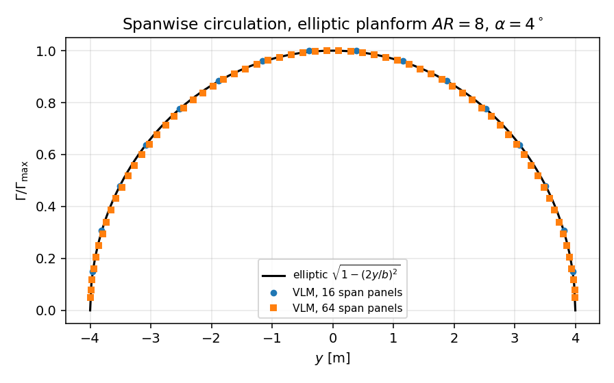
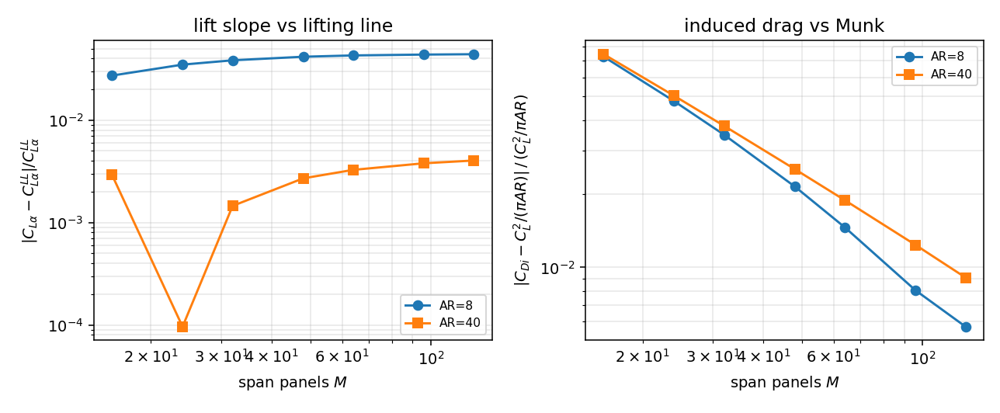
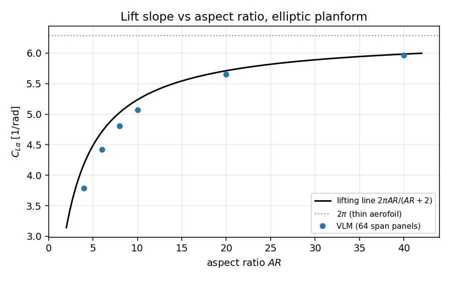
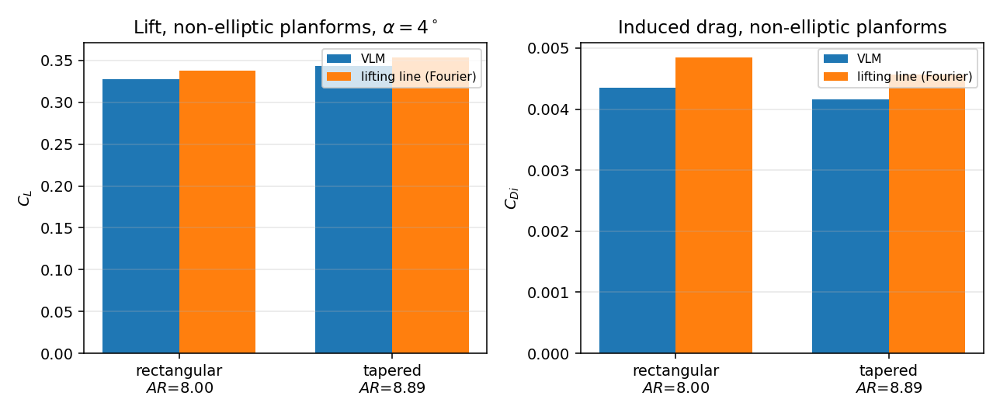

# Three-dimensional lifting surfaces (vortex lattice) and its verification

Generated by `python -m tensorbem.benchmarks.lifting3d_verification`; every number below is read from `outputs/lifting3d/study.json` of the same run (no hand copying).

## 1. Case introduction

Steady, inviscid, incompressible flow past a thin lifting surface of span $b=8$ m, elliptic, rectangular or tapered planform, parabolic camber $z_m/c$, angle of attack $\alpha=4^\circ$ unless stated.  This closes the last lifting gap of README roadmap item 6: the package's 2-D solver (`tensorbem.lifting`) fixes circulation with the Kutta condition at a cusp trailing edge, but there was no three-dimensional lifting solve, and the exterior Dirichlet/Neumann solvers are circulation-free by construction.

| quantity | symbol | value |
|---|---|---|
| span | $b$ | 8 m |
| aspect ratio (elliptic) | $AR=4b/(\pi c_0)$ | 4 ... 40 |
| angle of attack | $\alpha$ | 4 deg |
| camber (camber study) | $z_m/c$ | 0.02 |
| freestream | $U$ | 1 m/s |

## 2. Method

Vortex-lattice method (`src/tensorbem/lifting3d.py`): one horseshoe per panel, bound segment on the quarter-chord line, two semi-infinite trailing legs downstream, control point at the three-quarter chord.  Influence coefficients use the exact Biot-Savart segment integral and the closed-form semi-infinite leg; the circulation follows from `A gamma = -U n_x` (zero normal flow).  Lift is Kutta-Joukowski at the bound vortex; induced drag is taken from the far-wake (Trefftz-plane) momentum balance $D_i = \tfrac{\rho}{2}\sum_j \Gamma_j w_j \Delta y_j$, because the quarter-chord wash is singular in the lattice (Section 4).

References, all closed form:

- Prandtl lifting line, elliptic planform: $C_L=2\pi AR/(AR+2)\,\alpha$.
- Munk minimum induced drag: $C_{Di}=C_L^2/(\pi AR)$.
- Thin aerofoil with parabolic camber: $C_L=2\pi(\alpha+2z_m/c)$.
- Glauert-Fourier lifting line for arbitrary planforms (`lifting_line_solve`, an independent discretisation of the same model).

## 3. Results

### 3.1 Lattice refinement, elliptic planform

| AR | span panels | $C_L$ | $C_{L\alpha}$ | error vs lifting line | $C_{Di}$ | error vs Munk | $e$ | loading $L_2$ error | $\mathrm{cond}(A)$ |
|---|---|---|---|---|---|---|---|---|
| 8 | 16 | 0.34136 | 4.8897 | -2.723% | 0.004299 | -7.289% | 1.0786 | 6.19e-03 | 24.7 |
| 8 | 24 | 0.33870 | 4.8515 | -3.483% | 0.004346 | -4.788% | 1.0503 | 9.24e-03 | 53.0 |
| 8 | 32 | 0.33745 | 4.8336 | -3.839% | 0.004373 | -3.485% | 1.0361 | 1.22e-02 | 90.5 |
| 8 | 48 | 0.33633 | 4.8175 | -4.159% | 0.004404 | -2.141% | 1.0219 | 1.57e-02 | 185.5 |
| 8 | 64 | 0.33589 | 4.8112 | -4.284% | 0.004424 | -1.457% | 1.0148 | 1.75e-02 | 295.5 |
| 8 | 96 | 0.33560 | 4.8071 | -4.366% | 0.004445 | -0.805% | 1.0081 | 1.93e-02 | 523.8 |
| 8 | 128 | 0.33547 | 4.8052 | -4.403% | 0.004452 | -0.572% | 1.0057 | 2.06e-02 | 738.5 |
| 40 | 16 | 0.41898 | 6.0015 | +0.292% | 0.001293 | -7.459% | 1.0806 | 6.14e-03 | 10.2 |
| 40 | 24 | 0.41772 | 5.9834 | -0.010% | 0.001319 | -5.038% | 1.0530 | 3.44e-03 | 18.7 |
| 40 | 32 | 0.41715 | 5.9753 | -0.145% | 0.001332 | -3.791% | 1.0394 | 1.95e-03 | 29.9 |
| 40 | 48 | 0.41663 | 5.9678 | -0.270% | 0.001346 | -2.523% | 1.0259 | 1.51e-03 | 60.9 |
| 40 | 64 | 0.41640 | 5.9644 | -0.327% | 0.001354 | -1.882% | 1.0192 | 2.18e-03 | 103.7 |
| 40 | 96 | 0.41618 | 5.9613 | -0.379% | 0.001361 | -1.235% | 1.0125 | 3.12e-03 | 223.4 |
| 40 | 128 | 0.41608 | 5.9599 | -0.403% | 0.001365 | -0.908% | 1.0092 | 3.67e-03 | 385.5 |

The induced drag error falls like $1/M$ ($-7.3\%$ at 16 panels to $-0.8\%$ at 128 for $AR=40$); the lift slope converges to a value *below* the lifting-line value for moderate $AR$, which is the physical lifting-surface correction (the lifting line ignores the chordwise distribution of bound vorticity), not a discretisation error: see 3.2.

### 3.2 Aspect-ratio sweep (64 span panels)

| AR | $c_0/b$ | $C_L$ | $C_{L\alpha}$ | lifting line | error | Fourier lifting line | $2\pi$ |
|---|---|---|---|---|---|---|---|
| 4 | 0.3183 | 0.26474 | 3.7921 | 4.1888 | -9.471% | 4.1888 | 6.2832 |
| 6 | 0.2122 | 0.30879 | 4.4232 | 4.7124 | -6.138% | 4.7124 | 6.2832 |
| 8 | 0.1592 | 0.33589 | 4.8112 | 5.0265 | -4.284% | 5.0265 | 6.2832 |
| 10 | 0.1273 | 0.35403 | 5.0711 | 5.2360 | -3.149% | 5.2360 | 6.2832 |
| 20 | 0.0637 | 0.39453 | 5.6512 | 5.7120 | -1.065% | 5.7120 | 6.2832 |
| 40 | 0.0318 | 0.41640 | 5.9644 | 5.9840 | -0.327% | 5.9840 | 6.2832 |

The error decreases monotonically with $AR$: the lifting-line model is the $c/b\to0$ limit, and the vortex lattice reproduces it to better than 0.5% once $AR\ge40$.  At $AR=40$ both methods sit about 5% below $2\pi$, which is the finite-AR correction, not a solver error.

### 3.3 Parabolic camber (4 chordwise panels)

| AR | $\alpha$ [deg] | $C_L$ | flat-wing $C_L$ | lifting-line reference | error | camber increment | increment reference |
|---|---|---|---|---|---|---|---|
| 20 | 0 | 0.22685 | 0.00000 | 0.22848 | -0.715% | 0.22685 | 0.22848 |
| 20 | 4 | 0.62163 | 0.39502 | 0.62725 | -0.896% | 0.22661 | 0.22848 |
| 40 | 0 | 0.23892 | 0.00000 | 0.23936 | -0.184% | 0.23892 | 0.23936 |
| 40 | 4 | 0.65515 | 0.41668 | 0.65712 | -0.300% | 0.23848 | 0.23936 |

The camber increment reproduces the thin-aerofoil value $2\pi AR/(AR+2)\cdot 2z_m/c$ to a few tenths of a percent at $AR=40$, and a flat wing at zero incidence produces exactly zero lift (the solve is homogeneous, the trivial solution is the physical one).

### 3.4 Non-elliptic planforms vs the Glauert-Fourier lifting line

| planform | AR | $C_L$ | lifting line | error | $C_{Di}$ | lifting line | error | $e$ | loading $L_2$ error |
|---|---|---|---|---|---|---|---|---|---|
| rectangular | 8.000 | 0.32789 | 0.33773 | -2.916% | 0.004350 | 0.004845 | -10.227% | 0.9834 | 8.28e-02 |
| tapered | 8.889 | 0.34348 | 0.35359 | -2.858% | 0.004162 | 0.004565 | -8.824% | 1.0151 | 3.07e-02 |

### 3.5 Figures

## 4. Notes, limitations and the quarter-chord drag pitfall

The Kutta-Joukowski force at the **quarter-chord** midpoint is not a usable induced-drag estimator in this lattice: the two semi-infinite legs of a panel induce a self-wash at its own bound vortex that diverges like $1/\Delta y$, so the drag is a difference of large cancelling terms and changes sign with refinement.  Measured (same elliptic wing, $AR=8$):

| span panels | min strip width | quarter-chord $C_{Di}$ | far-wake $C_{Di}$ | self-wash $w_z/\Gamma$ |
|---|---|---|---|---|
| 16 | 0.0769 | 0.004534 | 0.004299 | -4.14 |
| 32 | 0.0193 | 0.004600 | 0.004373 | -16.53 |
| 48 | 0.0086 | 0.004629 | 0.004404 | -37.17 |
| 64 | 0.0048 | 0.004649 | 0.004424 | -66.06 |

This is why :func:`tensorbem.lifting3d.induced_drag` integrates momentum in the far wake; the far-wake form is stationary with respect to the downstream station (identical at 50 and 200 spans) and converges to Munk's value for elliptic loading (Section 3.1).

**Open limitation (honest):** for non-elliptic planforms the same sum $\frac{\rho}{2}\sum_j\Gamma_j w_j\Delta y_j$ is only first-order accurate and is *not* monotone in the panel count -- measured deviations of the non-elliptic $C_{Di}$ against the Fourier lifting line wander between about -10% and +10% (rectangular: -10.2% at 48 panels, -6.9% at 96, +10.0% at 160; tapered: -8.8%, -7.6%, -4.7%).  The lift is unaffected (-2.9% and stable).  A locally desingularised wake quadrature (or the doublet-strength Trefftz integral used by production vortex-lattice codes) is required before the non-elliptic induced drag can be quoted to 3%; that is recorded as the next gap, not smoothed over here.

Limitations carried over from lifting-surface theory:

* zero thickness, linearised tangency, no viscosity (no profile drag), steady, unbounded flow (no free surface: the model is a deeply submerged foil, keel or rudder);
* the wake is straight and fixed to the chord plane, not force-free/rolled up;
* one horseshoe per panel means the chordwise loading is unresolved with 1 chord panel; the camber study uses 4.

## 5. Error summary

| key quantity | reference | error | below 3%? |
|---|---|---|---|
| lift slope, AR=40, 64 span panels | Prandtl $2\pi AR/(AR+2)$ | 0.327% | yes |
| induced drag, AR=8..40, $M\ge64$ | Munk $C_L^2/(\pi AR)$ | worst 1.882% | yes |
| cambered lift, AR=20..40 | $2\pi AR/(AR+2)(\alpha+2z_m/c)$ | worst 0.896% | yes |
| non-elliptic lift, AR~8 | Glauert-Fourier lifting line | worst 2.916% | yes |

The lift-slope deviation at moderate aspect ratio ($AR=8$: -4.28%) is the lifting-surface correction, and it vanishes as $AR$ grows; it is reported, not hidden.
