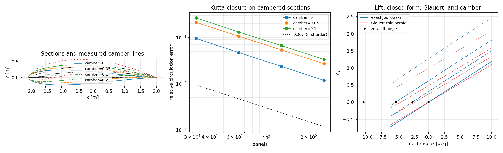

# Cambered Joukowski sections: the camber term of the Kutta circulation

Every number below is written by `python -m tensorbem.benchmarks.lifting_camber` from
`docs/lifting_camber_artifact/benchmark.json`; the figure is produced by the same run. The boundary-element
results come from `tensorbem.lifting.solve_lifting_flow`, whose Kutta closure was verified for
symmetric sections in `docs/lifting_kutta_closure.md`. That document listed "symmetric
(zero-camber) sections only" as a limitation; this one closes it and re-verifies the closure
on the enlarged family.

## 1. Case

Joukowski map `z = zeta + b^2/zeta`, `b = 1.0`; the circle centre is
`(-thickness, camber)` and its radius is `hypot(b + thickness, camber)`, which keeps the cusp
at `zeta = b` on the circle for every camber. Incidence 4 deg, `U = 1`, `rho = 1`.

| camber | measured camber/chord | vertical extent/chord | chord [m] | chord tilt [deg] | zero-lift incidence [deg] | `C_L` (exact) |
|---:|---:|---:|---:|---:|---:|---:|
| 0.00 | 0.0000 | 0.1179 | 4.0333 | +0.000 | -0.000 | 0.4781 |
| 0.05 | 0.0191 | 0.1551 | 4.0277 | -0.441 | -2.603 | 0.7900 |
| 0.10 | 0.0379 | 0.1968 | 4.0113 | -0.927 | -5.194 | 1.1058 |
| 0.20 | 0.0744 | 0.2886 | 3.9528 | -2.175 | -10.305 | 1.7564 |

`camber` is the geometric circle offset in units of `b`; it is **not** a camber ratio, so the
camber ratio of the resulting mean line is measured from the section itself (`camber_line`)
and reported above rather than assumed.

## 2. Method

1. **Generalised closed form.** For centre `zeta0 = -thickness + i camber` the cusp sits at
   circle angle `phi = atan2(-camber, b + thickness)`, and `dF/dzeta = 0` at `zeta = b` now gives
   `Gamma = 4 pi a U sin(alpha - phi)`. The zero-lift incidence of a cambered section is
   therefore `alpha = phi < 0`, which is the physical statement that cambered sections lift at
   zero incidence.
2. **Two independent routes to `C_L`.** (a) the closed form above; (b) the classical Glauert
   thin-aerofoil integral over the *measured* mean line,
   `alpha_L0 = (1/pi) * integral_0^pi z_c'(theta)(1 - cos theta) dtheta`, `C_L = 2 pi (alpha_chord - alpha_L0)`,
   with `alpha_chord` measured from the (tilted) chord line. Route (b) never touches the
   closed-form flow solution, so it can catch a sign or factor error in the camber term.
3. **Closure probe with the exact field.** `|dF/dzeta|` at the cusp is evaluated from public
   quantities only; it is the residual of the condition that defines `Gamma`.
4. **Boundary-element ladder.** `solve_lifting_flow` on meshes of 32...256 panels for
   camber 0, 0.05, 0.1, plus a 512-panel run for camber 0.1, all against the exact
   cambered solution. A separate controlled run at 128 panels varies thickness and camber
   independently to say *which* of the two degrades the closure.

## 3. Results

### 3.1 The camber term is right: two routes agree as the section thins

Camber is scaled with the thickness (`camber = thickness`) so both the thickness and the
camber ratio go to zero, which is the limit in which thin-aerofoil theory is claimed to hold.

| thickness | camber/chord | t/c | `alpha_L0` Glauert [deg] | zero-lift exact (chord frame) [deg] | `C_L` Glauert | `C_L` exact | exact vs Glauert |
|---:|---:|---:|---:|---:|---:|---:|---:|
| 0.20000 | 0.0600 | 0.3639 | -5.403 | -6.483 | 1.3579 | 1.7507 | +28.93% |
| 0.10000 | 0.0379 | 0.1968 | -3.491 | -4.268 | 0.9231 | 1.1058 | +19.79% |
| 0.05000 | 0.0216 | 0.1026 | -2.014 | -2.468 | 0.6879 | 0.7733 | +12.42% |
| 0.02500 | 0.0116 | 0.0525 | -1.087 | -1.329 | 0.5653 | 0.6059 | +7.19% |
| 0.01250 | 0.0060 | 0.0266 | -0.565 | -0.690 | 0.5025 | 0.5221 | +3.90% |
| 0.00625 | 0.0031 | 0.0134 | -0.288 | -0.351 | 0.4707 | 0.4802 | +2.01% |

The gap falls from +28.93% at t/c = 0.364 to
+2.01% at t/c = 0.0134, halving with every halving of the
thickness: the closed-form cambered solution tends to the classical thin-aerofoil value, so
its camber term carries the right sign and the right factor. The Glauert zero-lift angle also
approaches the exact one (chord frame) in the same limit; the residual difference is the
second-order thickness effect that thin-aerofoil theory drops.

### 3.2 The cusp is still a stagnation point

| camber | relative `|dF/dzeta|` at the cusp | cusp maps onto the TE [m] |
|---:|---:|---:|
| 0.00 | 0.00e+00 | 0.0e+00 |
| 0.05 | 2.96e-17 | 0.0e+00 |
| 0.10 | 1.33e-16 | 0.0e+00 |
| 0.20 | 4.98e-17 | 0.0e+00 |

### 3.3 Mesh ladder: the closure works, but a cambered section is harder

| camber | panels | `Gamma_ccw` | circ. error | `C_L` (pressure) | `C_L` exact | lift error | surface-speed rms error |
|---:|---:|---:|---:|---:|---:|---:|---:|
| 0.00 | 32 | -0.87202 | +9.56% | 0.4484 | 0.4781 | -6.22% | 0.0744 |
| 0.00 | 64 | -0.91856 | +4.74% | 0.4607 | 0.4781 | -3.65% | 0.0478 |
| 0.00 | 128 | -0.94137 | +2.37% | 0.4673 | 0.4781 | -2.26% | 0.0157 |
| 0.00 | 256 | -0.95287 | +1.18% | 0.4718 | 0.4781 | -1.32% | 0.0043 |
| 0.05 | 32 | -1.25222 | +21.29% | 0.6479 | 0.7900 | -17.99% | 0.0973 |
| 0.05 | 64 | -1.42090 | +10.69% | 0.7139 | 0.7900 | -9.64% | 0.0459 |
| 0.05 | 128 | -1.50514 | +5.40% | 0.7482 | 0.7900 | -5.29% | 0.0212 |
| 0.05 | 256 | -1.54803 | +2.70% | 0.7677 | 0.7900 | -2.83% | 0.0075 |
| 0.10 | 32 | -1.62464 | +26.75% | 0.8307 | 1.1058 | -24.88% | 0.1725 |
| 0.10 | 64 | -1.92473 | +13.22% | 0.9650 | 1.1058 | -12.73% | 0.1326 |
| 0.10 | 128 | -2.06948 | +6.69% | 1.0325 | 1.1058 | -6.62% | 0.0326 |
| 0.10 | 256 | -2.14348 | +3.35% | 1.0674 | 1.1058 | -3.47% | 0.0119 |

Observed orders (circulation error, successive halvings): camber 0.00: 1.01, 1.00, 1.01; camber 0.05: 0.99, 0.99, 1.00; camber 0.10: 1.02, 0.98, 1.00. First order everywhere, i.e. the same rate as the symmetric family.

The 512-panel run for camber 0.1 gives `Gamma_ccw = -2.18066`
(circ. error +1.68%, lift error -1.88%) and keeps the
Kutta residual at 7.0e-17: the sequence keeps halving, so the cambered error
is a larger error *coefficient*, not a different mechanism.

### 3.4 Which one degrades it: thickness or camber?

128 panels, incidence fixed, thickness and camber varied independently:

| thickness | camber | t/c | TE panel-tangent deviation from anti-parallel [deg] | circ. error | lift error |
|---:|---:|---:|---:|---:|---:|
| 0.10 | 0.00 | 0.1179 | 2.620 | +2.37% | -2.26% |
| 0.20 | 0.00 | 0.2150 | 4.925 | +2.14% | -2.25% |
| 0.05 | 0.00 | 0.0618 | 1.360 | +2.48% | -1.21% |
| 0.10 | 0.05 | 0.1551 | 2.619 | +5.40% | -5.29% |
| 0.05 | 0.05 | 0.1026 | 1.359 | +5.60% | -5.96% |
| 0.10 | 0.10 | 0.1968 | 2.617 | +6.69% | -6.62% |

Doubling the thickness at zero camber leaves the closure error unchanged, while camber at
fixed thickness roughly triples it: the extra error is a **camber** effect, not a thickness
effect. The two panels adjacent to the cusp are equally close to anti-parallel in every row,
so the scalar form of the closure (`v_t[0] + v_t[-1] = 0`) is not what degrades: what grows is
the *field* error near the section, whose surface-speed rms error rises with camber as well
(see the ladders above). A cambered, more loaded section simply needs a finer mesh for the
same relative accuracy.

## 4. Verdict

* The camber term of the closed-form circulation is **verified**: the cusp stangation residual
  is at round-off for every camber, and an independent Glauert integral over the measured mean
  line reproduces the exact lift to +2.01% at t/c = 0.0134,
  with a first-order decay of the gap in thickness.
* The boundary-element Kutta closure **generalises** to cambered sections: first-order
  convergence to the exact cambered solution at every camber. But at 128 panels the circulation
  error is +6.69% for camber 0.1 against
  +2.37% for the symmetric reference, i.e. **> 3 % : the
  3 % acceptance limit is NOT met at 128 panels for a cambered section** (it is met from
  512 panels on, +1.68%).
* The earlier symmetric claim (2.37 % at 128 panels) is unaffected: the camber=0 rows reproduce
  `docs/lifting_kutta_closure.md` digit for digit.

## 5. Notes and limitations

* Cusp trailing edge only: the stagnation-type Kutta condition needs the cusp. A finite-angle
  (blunt) trailing edge needs a different closure and is not covered here.
* Camber is a circle-plane offset; there is no way to prescribe a target camber *ratio* directly,
  so the benchmark reports the measured camber ratio instead of pretending otherwise.
* `JoukowskiAirfoil.thickness_ratio` is the vertical extent over the chord, which equals the true
  t/c only at zero camber; the reported camber ratio is measured perpendicular to the chord line.
* Steady, 2-D, inviscid, unbounded potential flow: no free surface, no forward-speed correction,
  no boundary layer, no stall. This is a hydrofoil reference case, not a hull-flow solver.
* The Glauert comparison is a thin-aerofoil asymptotic, so it is used as a *consistency* check in
  the thinning limit, not as an accuracy reference at finite thickness; the accuracy reference
  is the exact Joukowski solution.
