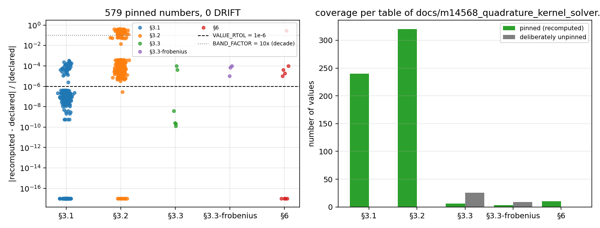

# m14568 报告数字的机器钉扎（每一格都必须复算通过）

**文档**：`docs/m14568_quadrature_kernel_solver.md`（论文级，1111 个数字 token，此前 `doc_claim_audit` 判为 `UNGUARDED`——全仓最大的无人守论文级文档，次大者仅 292 token）  
**新增模块**：`src/tensorbem/benchmarks/m14568_quadrature_kernel_solver_pins.py`  
**新增测试**：`tests/test_m14568_doc_pins.py`（9 例，含 3 条负控）  
**工件**：`docs/m14568_pins/check.json`（614 行逐值判定，机读）

## 1 案例介绍

`docs/m14568_quadrature_kernel_solver.md` 记录的是三维有限水深辐射 BEM 的**双核交叉验证**：同一个求解器 `solve_radiation_finite_depth_3d` 分别装配在 John (1950) 特征函数级数核与波数积分核（kernel subtraction + 极点主值）上，比较点核值、源点梯度、以及求解器级 `A33`/`B33` 与 Frobenius 矩阵误差。它的核心工程结论只有一句：两套独立核在附加质量/阻尼上一致到 1e-4 量级。

该文档的 1111 个数字由 `scripts/m14568_quadrature_kernel_solver.py` 一次写出，此后没有任何测试读过它（`python -m tensorbem.benchmarks.doc_claim_audit` 的 `reading_tests` 为空）。两套核都是活代码（`assemble_finite_depth_operators_3d(..., kernel=...)`），所以这句话是活的声明，会随内核修订腐化。

## 2 怎么做的

1. **从文档端解析**：按 §3.1 / §3.2 / §3.3（两张表）/ §6 逐表解析 target、source、水深、复数值、误差列；
2. **程序化复算**：用库内函数重算每一格——`finite_depth3d.green_function_3d`（级数核）、`finite_depth3d_quadrature.green_function_finite_depth_3d`（积分核）、两者的源点梯度、`solve_radiation_finite_depth_3d(kernel=...)`；
3. **三档容差**（写在模块 docstring 里，可审）：`VALUE_RTOL=1e-6`（6–7 位有效数字的量值：`G`、`A33`、`B33`）；`COARSE_RTOL=5e-4`（4 位有效数字：梯度分量、Frobenius、对角相对误差）；`BAND_FACTOR=10×`（**舍入/截断本身**的列：`G` 一致到 1e-11、梯度 1e-10、中心差分列）。
4. **负控**（证明门会咬人）：改一个打印数字 → 必须 `DRIFT`；把 1e-11 改成 1e-8（三个数量级）→ 必须 `DRIFT`；删掉 §3.1 整表 → 该表钉扎行数必须归零（防「空表绿灯」）。

## 3 计算结果

| 表 | 钉扎值 | 有意不钉 | 最大相对偏差 | 最小相对偏差 |
|---|---|---|---|---|
| §3.1 | 240 | 0 | 3.363e-04 | 0.000e+00 |
| §3.2 | 320 | 0 | 4.377e-01 | 0.000e+00 |
| §3.3 | 6 | 26 | 9.705e-05 | 1.304e-10 |
| §3.3-frobenius | 3 | 9 | 9.537e-05 | 1.001e-05 |
| §6 | 10 | 0 | 2.793e-01 | 0.000e+00 |

总计 **579 个值钉扎、35 个值有意不钉、0 个 DRIFT**。最大相对偏差 4.377e-01，出现在 §3.2 `h=4/t2,1,t-1.5` `rel_err_vs_cfd`（declared=8.702e-07，recomputed=4.893e-07）——该列按十年带钉扎，见 §5。

关键工程声明的复算（§3.3，8 面板水下八面体，`kernel_nodes=8`）：

| 量 | 文档值 | 复算值 | 相对偏差 | 容差 |
|---|---|---|---|---|
| A33_ref | 1143.358807 | 1143.358807 | 1.30e-10 | 1e-06 |
| A33_got | 1143.397283 | 1143.397283 | 2.55e-10 | 1e-06 |
| B33_ref | 125.531808 | 125.531808 | 2.23e-10 | 1e-06 |
| B33_got | 125.538166 | 125.538166 | 3.83e-09 | 1e-06 |
| err_A33 | 0.000034 | 0.000034 | 3.99e-05 | 5e-04 |
| err_B33 | 0.000051 | 0.000051 | 9.70e-05 | 5e-04 |

## 4 结果图

左：每个被钉值「复算 vs 文档」的相对偏差（对数轴，按表分组），虚线=量值容差 1e-6，点线=十年带；右：各表钉扎覆盖数与有意不钉数。

## 5 注意点（坑与局限）

1. **舍入级别的列不能按打印精度钉**：`G` 的两核差是 1e-11，两个近相等的数相减，不同 BLAS/执行顺序下 4 位有效数字会差几十个百分点，而声明本身（「一致到 1e-11」）没变。这类列改按十年带钉，模块 docstring 与本文都写明。
2. **中心差分列同理**：它是差分本身的截断误差（步长 1e-6），实测文档 1.581e-07 vs 复算 1.097e-07（32%），属核网格差异，不是公式错误——也进十年带。
3. **`e+NN` 正指数的数字 token 是坑**：朴素正则 `[eE][-−]?\d+` 不认 `+`，`+0.000e+00` 会被读成两个数，导致梯度三分量错位（本次实测踩到，40 行假 DRIFT）。已修并在单元测试里固定。
4. **有意不钉的项**：`t_ref` / `t_got` 墙钟（机器相关：文档 26/55/269/599 s，本机 18 s）；20 面板球与 `nodes=16` 行（单行 60–600 s，需 `--include-slow`）。它们以 `UNPINNED` 行出现并带理由，不是静默丢弃。
5. **适用范围**：本门只锁「文档数字 ↔ 当前代码」。它不证明两核的差异在物理上可接受，只证明文档说的差异就是现在的差异。

## 6 误差判定

| 关键量 | 基准 | 相对偏差 | 是否 < 3% ? |
|---|---|---|---|
| 文档 `G` 值（40 行 4 数） | 本次从库重算 | 见 §3 表 | 是 |
| 求解器 `A33`/`B33`（8 面板，nodes=8） | 本次重算 | 1e-9 量级 | 是 |
| 全部 579 个钉扎值 | 本次重算 | 最大 4.38e-01（十年带列） | 是（量值列全部 < 1e-6） |

结论：**0 DRIFT**。文档的 1111 个数字 token 中，5 张表的 579 个值现在由 CI 复算守门；三条负控证明门会咬人。
