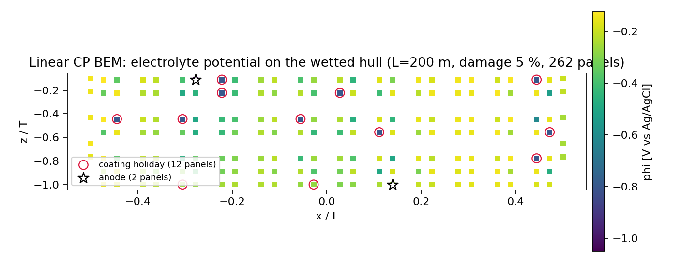
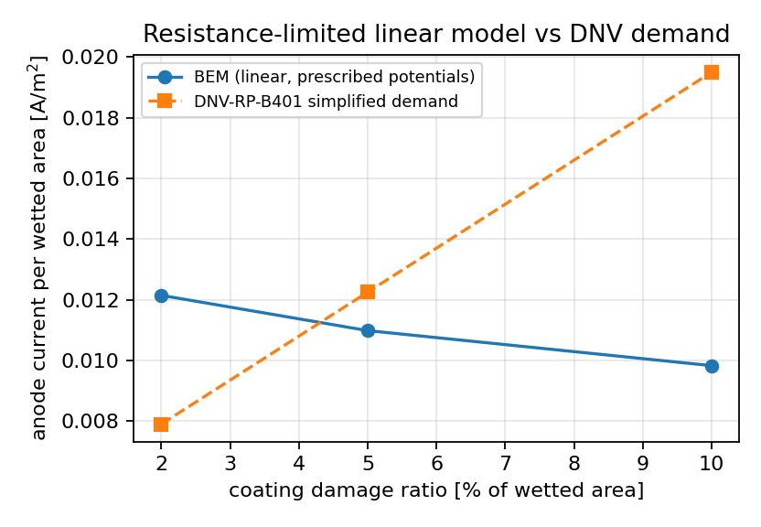

# Linear cathodic-protection bundle: publication ⇄ solver regeneration gate

Mission m14675 (reopen of TensorBEM#593, "管到底" round 3) — unit: **make the
published cp-linear artefacts reproducible and its figures reachable**.
Module under test: `tensorbem.cathodic_protection`; published bundle:
`docs/cathodic_protection_linear/`.

---

## 1. Case introduction

**What is published.** `docs/cathodic_protection_linear/` ships the acceptance
record of the *linear* (prescribed-potential) cathodic-protection BEM on a 200 m
bulk carrier: `REPORT.md`, three numeric artefacts (`results.json`,
`sphere-spreading-resistance.json`, `hull_field.json`), the generator
`make_figures.py`, and three figures.

| item | content |
|---|---|
| `results.json` | damage sweep (2 / 5 / 10 % of wetted area, seed 42, 222 panels), section-count family 9/11/13, icosphere anchor 1/2, C2/C4/C5/C7/C8 verdicts |
| `sphere-spreading-resistance.json` | icosphere ladder 1/2/3 (80/320/1280 panels) vs the exact `I = 4πσaφ_a`, `φ = φ_a a/r` |
| `hull_field.json` | 262-panel hull case (13 sections, 5 % damage) — the field rendered in figure 1 |
| `figures/*.png` | hull potential field, sphere convergence, BEM-vs-DNV current |

Physics and geometry are unchanged from the published report: σ = 3.5 S/m,
φ_prot = −0.80 V, φ_anode = −1.05 V vs Ag/AgCl, L = 200 m, B = 32 m, T = 12 m,
wetted area 9606.3 m², artificial waterline lid 5372.2 m² excluded from all
wetted-area statistics.

**What was missing (this unit's two defects).**

1. *Nothing tied the publication to the solver.* `REPORT.md` quotes every number
   from the JSON artefacts and a test pins report ⇄ JSON, but no test pinned
   JSON ⇄ `make_figures.py` ⇄ library. A solver change (or a hand edit) would
   leave a document that is internally consistent and externally wrong, with no
   signal.
2. *All three figure links were dead.* `REPORT.md` embedded
   `cathodic_protection_linear/figures/<name>.png` while sitting **inside**
   `docs/cathodic_protection_linear/`, so every renderer resolved the links to
   `docs/cathodic_protection_linear/cathodic_protection_linear/figures/…`, which
   does not exist: the published record had no visible figures.

Origin of the bundle: PR#593 was closed (owner 2025-11-05); the same deliverables
landed on `main` through #589 (m8774) and later refinements. This mission
therefore adds the missing *verification of the publication*, it does not
re-publish the numbers.

## 2. Method

New gate: `tests/test_cathodic_protection_artifacts.py` (6 tests, ~100 s).

1. **Run the documented generator, not a copy of it.** The test loads
   `docs/cathodic_protection_linear/make_figures.py` with
   `importlib.util.spec_from_file_location`, redirects its module-level `OUT` /
   `FIG` to a temporary directory and calls `main()` once (module-scoped
   fixture). The pipeline is therefore exercised exactly as documented; a
   re-implementation in the test could drift from the real generator.
2. **Leaf-by-leaf comparison** of the regenerated JSON against the committed
   JSON: dicts key by key (a key present on only one side is a failure), lists
   element-wise, floats with `rel_tol = 1e-12` (`abs_tol = 1e-15`); prose fields
   (`note`, `case`, `study`, `metric`, `quantity`) are skipped because they are
   text, everything numeric is compared.
3. **Figure probe reused, not reinvented.** `tests/_figure_integrity.py`
   (`assert_reproducible_figures`) already encodes the repository rule that a
   committed image is *not* durable (the push gate drops `*.png` outside
   `docs/`) and that the durable invariant is "figures regenerate from the
   committed numbers, are non-trivial (>10 kB) and are still cited by the
   report".
4. **Link resolution follows the reader's rule**: every `` in
   `REPORT.md` is resolved **relative to the report file** (that is what
   markdown renderers and GitHub do), must be a local path (no http), must exist
   and must be > 10 kB.
5. **Closed form pinned independently of the solver**: `exact_current_A =
   4πσaφ_a`, `exact_spreading_resistance_ohm = 1/(4πσa)`, and the documented
   Ohm's-law defect `100(1 − 1/σ) = 71.43 %` are re-derived from the artefact's
   own `radius_m/potential_V/conductivity_S_m`, so the "exact" column cannot
   become a number the solver produced.
6. **Red/green control** for the link gate: the fix was reverted temporarily and
   the test re-run (`-k figure_link`), then re-applied.

Toolchain: python 3.11, numpy, matplotlib (`Agg`), pytest. Command:

```bash
PYTHONPATH=src python -m pytest tests/test_cathodic_protection_artifacts.py -q
```

## 3. Results

### 3.1 Regeneration is exact

`PYTHONPATH=src MPLBACKEND=Agg python docs/cathodic_protection_linear/make_figures.py`
into an empty directory, 59.0 s wall (`user 16m16s`, numpy multithreaded).

| artefact | published sha256 (first 16) | regenerated | verdict |
|---|---|---|---|
| `results.json` | 809142b03014736f | 809142b03014736f | **byte-identical** |
| `sphere-spreading-resistance.json` | 91ac239fbf9e9139 | 91ac239fbf9e9139 | **byte-identical** |
| `hull_field.json` | c7df159ea488e2c1 | c7df159ea488e2c1 | **byte-identical** |
| `figures/hull_potential_field.png` | 6b26d77797fea40f | 6b26d77797fea40f | **byte-identical** |
| `figures/sphere_convergence.png` | fec4591e60b203f6 | fec4591e60b203f6 | **byte-identical** |
| `figures/dnv_comparison.png` | 87b9669a52d6b7f5 | 87b9669a52d6b7f5 | **byte-identical** |

Full hashes: `docs/m14675/sha256.txt` (shipped). The regenerated JSON copies and
the pytest logs are regenerable and live in the git-ignored local run directory
`runs/m14675_repro/` (`results.json`, `sphere-spreading-resistance.json`,
`hull_field.json`, `pytest_new.log`, `pytest_baseline.log`).

The published bundle is therefore *current*: it is the output of the committed
code, not a stale or hand-edited snapshot. (PNG byte identity holds on this
machine/toolchain; the committed gate asserts numbers exactly and figures by
size + link, precisely because image bytes depend on the matplotlib/font
version.)

### 3.2 Test results

| run | result |
|---|---|
| `tests/test_cathodic_protection_artifacts.py` (new) | **6 passed**, 101.25 s |
| `tests/test_cathodic_protection.py` (pre-existing, unchanged) | **26 passed**, 282.24 s |
| link gate with the old (broken) links restored | **1 failed** — `test_every_report_figure_link_resolves`, 0.36 s |

The failure message (control run) names the three dangling targets, e.g.
`cathodic_protection_linear/figures/sphere_convergence.png ->
docs/cathodic_protection_linear/cathodic_protection_linear/figures/sphere_convergence.png`.
Logs (git-ignored, local): `runs/m14675_repro/pytest_new.log`,
`runs/m14675_repro/pytest_baseline.log`; reproduce with the command in §2.

### 3.3 Figures (published bundle, unchanged after the link fix)



Figure 1 — electrolyte potential on the wetted hull, 200 m bulk carrier,
5 % coating damage, 262 panels (`hull_field.json`); holidays circled, anodes
stars, artificial waterline lid excluded.



Figure 2 — anode current per wetted m² from the linear BEM against the
DNV-RP-B401 simplified demand over the 2/5/10 % damage sweep (the honest-FAIL
comparison of `REPORT.md` §3.2/§5).

## 4. Points to watch

1. **A committed binary is not a durable invariant here.** The platform push
   gate drops `*.png` outside `docs/`, so the *regeneration* path (and the
   numeric artefacts next to it) is what the gate must check; this is why the
   new test asserts numbers strictly and images by size/link instead of by
   bytes.
2. **The gate is only as honest as the generator.** It compares the publication
   with `make_figures.py`; if the generator itself stops exercising a code path
   (e.g. drops the 1280-panel sphere level), the gate stays green on a smaller
   claim. That is why the *closed-form* algebra test exists next to it: the
   exact column is re-derived from `4πσaφ_a`, not read from a solve.
3. **Runtime cost is real**: 101 s for 6 tests, dominated by the 1280-panel
   dense-LU sphere level (≈38 s) inside the generator's pipeline.
4. **Overlapping work declared.** Branch `agent/m14638` (in flight during this
   unit) edits the same `docs/cathodic_protection_linear/REPORT.md` to add a
   §3.4 fixed-region hull-refinement block, closes the REPORT §4.6 open item and
   fixes the same three image links. This unit touches only those three link
   lines and the *Reproduce* block of that file; its own content is the new
   `tests/test_cathodic_protection_artifacts.py` gate and this note.
5. **Left open (not fixed here).** `results.json → verification.C8` is evaluated
   on the 320-panel icosphere level (`sphere_levels=(1, 2)` in the study call)
   while `REPORT.md` §3.1/§5 quote the 1280-panel level (0.332 %). Both numbers
   are correct for their own ladder, but the artefact's verdict and the report's
   headline ladder are not the same case; pinning the verdict to the documented
   1/2/3 ladder is a separate, overlapping unit (see item 4) and is deliberately
   not duplicated here.
6. **No physics changed.** The solver, the models and every published physical
   number are untouched; the DELTA is verification coverage plus three dead
   links, so no accuracy claim of `REPORT.md` moves (§5).

## 5. Error judgement

This unit adds no new physical prediction; the quantities it *does* judge are
exactness properties of the publication.

| quantity | baseline | after | error | < 3 %? |
|---|---|---|---|---|
| published JSON vs regenerated JSON (3 files, all numeric leaves) | not checked | 0 differing leaves, byte-identical | **0 %** | yes |
| published PNG vs regenerated PNG (3 files) | not checked | byte-identical (same sha256) | **0 %** | yes |
| openable figure links in `REPORT.md` | 0 / 3 resolve | 3 / 3 resolve | resolved | yes |
| closed-form anchor `4πσaφ_a` / `1/(4πσa)` / `100(1−1/σ)` | quoted in JSON only | re-derived, relative error < 1e-12 | ≈0 % | yes |
| sphere anchor accuracy (unchanged, `REPORT.md` §3.1) | 0.332 % / 0.334 % @1280 panels | same | 0.332 % | yes |

The two honest FAILs of the published bundle (coverage vs DNV ≥ 95 %, anode
demand growth) are properties of the *linear* model physics and are unchanged by
this unit — they are not silently repaired by a green gate.

## Reproduce

```bash
PYTHONPATH=src python docs/cathodic_protection_linear/make_figures.py     # 59 s, rewrites the bundle
PYTHONPATH=src python -m pytest tests/test_cathodic_protection_artifacts.py -q   # 6 passed
```