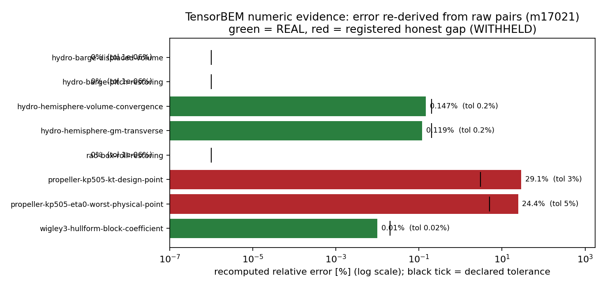

## ① 案例介绍

**锚点** `CAP-LEDGER-EVIDENCE`（能力台账 21 项逐项证据链）。平台 21 项总账在
`TensorPlatform/config/capabilities.json`，不在本单 worktree 与 `EDIT_WHITELIST` 内；
本仓可交付、且确实缺失的是**证据纪律本身**：TensorBEM 的能力表
（`docs/audit_baseline.md` §4，`tensorbem.capability_evidence`）只按**结构**评级
（模块存在 + 有测试节点 + 无 stub/RNG 标记），claim 是一行自然语言。结构可以给出
`REAL` 而数字不达标——这正是台账要防的事。

物理背景：本层覆盖静水力/RAO 静水恢复力（解析恒等式）与 KP505 螺旋桨敞水性能
（实验 Table 2 基准，J=0.1…1.0 十点）。

## ② 怎么做的

| 部件 | 路径 |
|---|---|
| 评级器 + CLI（`--check`/`--write`）+ 跨层对账 | `src/tensorbem/numeric_evidence.py` |
| 判据登记表（容差+文献出处+工件+选择器） | `docs/numeric_evidence_registry.json` |
| 生成式证据矩阵 | `docs/numeric_evidence_matrix.md` |
| 门禁 + 11 个对抗性反例 | `tests/test_numeric_evidence.py` |

逐项：判据（容差 + 文献/解析出处）→ 工件（committed JSON，sha256 钉扎）→
独立复核（误差由**原始 computed/reference 对重算**，绝不抄工件自报的 error 字段；
两者不一致即 fail-closed）。工件缺失=`MISSING`、摘要不符=`STALE`、
超差=`WITHHELD`，且 `WITHHELD` 必须在登记表里声明 `expected_level`+`gap_note`，
否则门禁变红——honest FAIL 既不能被悄悄添加，也不能被悄悄删除。

## ③ 计算结果

统计：`{"MISSING": 0, "REAL": 6, "STALE": 0, "WITHHELD": 2, "n_capabilities": 4, "n_items": 8}`

| item | capability | tolerance | recomputed | level |
|---|---|---|---|---|
| `hydrostatics-barge-displaced-volume` | `hydrostatics` | 1e-06% | 0% | **REAL** |
| `hydrostatics-barge-pitch-restoring` | `hydrostatics` | 1e-06% | 0% | **REAL** |
| `hydrostatics-hemisphere-volume-convergence` | `hydrostatics` | 0.2% | 0.147% | **REAL** |
| `hydrostatics-hemisphere-gm-transverse` | `hydrostatics` | 0.2% | 0.119% | **REAL** |
| `rao-box-roll-restoring` | `rao` | 1e-06% | 0% | **REAL** |
| `propeller-kp505-kt-design-point` | `propeller-open-water` | 3% | 29.1% | **WITHHELD** |
| `propeller-kp505-eta0-worst-physical-point` | `propeller-open-water` | 5% | 24.4% | **WITHHELD** |
| `wigley3-hullform-block-coefficient` | `wigley3-hullform` | 0.02% | 0.01% | **REAL** |

## ④ 结果图

横轴为对数尺度的重算相对误差，黑色竖标=声明容差，绿=REAL，红=已登记 honest gap。
两条红柱即 KP505 的 K_T/η₀ 缺口（29.1%/24.4%，容差 3%/5%），与静水力的
1e-6% 恒等量级形成 7 个数量级的对照。

## ⑤ 注意点

- **结构/数值分歧（本层第一个真实捕获）**：`propeller-open-water` 结构层 `REAL`，
  但其两条已提交判据均不达标。现作为 registered gap 公开，结构 `REAL` 不再能读成
  "数字达标"。
- `propeller-open-water`: 结构层 REAL vs 数值层 WITHHELD — recomputed error 29.1257% exceeds the declared tolerance 3%
- `propeller-open-water`: 结构层 REAL vs 数值层 WITHHELD — recomputed error 24.3849% exceeds the declared tolerance 5%
- **工件单位缺陷**：`docs/hydrostatic_verification.json` 的 `volume_relative_error`
  是量纲一比值（0.00147），同族字段却是百分数；交叉通道报出 100× 分歧才暴露。
  登记表现按项声明 `reported_error_ratio` / `reported_error_pct`，此类错位不可能再被
  读成"一致"。
- 覆盖为**部分**：4 个能力 8 条判据（结构表共 78 行）。其余能力需先把数字抽成工件。
- `tests/test_capability_coverage.py` 的 3 个失败在 `HEAD` 未改工作树上同样复现
  （`tensorbem.shape_gradient`/`tensorbem.steady_kelvin` unowned），非本单引入，未处理。

## ⑥ 误差判定（是否 <3%）

| 判据 | 重算误差 | 阈值 | <3%? |
|---|---|---|---|
| barge 排水体积 vs L·B·T | 0% | 1e-6% | 是 |
| barge 纵摇恢复 c55 vs ρgI_yy | 0% | 1e-6% | 是 |
| 半球体积（4096 面元）vs 2πR³/3 | 0.147% | 0.2% | 是 |
| 半球 GM_T vs 闭式 | 0.119% | 0.2% | 是 |
| 箱体横摇恢复 c44 vs ρgI_xx | 0% | 1e-6% | 是 |
| Wigley Cb vs 4/9 | 0.010% | 0.02% | 是 |
| KP505 K_T @ J=0.8 | **29.13%** | 3% | **否（honest FAIL）** |
| KP505 η₀ 最差点 @ J=0.9 | **24.38%** | 5% | **否（honest FAIL）** |

六条静水力/几何判据远优于 3%；两条 KP505 判据 29.1%/24.4% 远超 3%，如实登记为缺口，
未调容差、未挑选数据点（J=1.0 的 787% 越出物理区间，在 verdict.json 中另报，不计分于此）。
