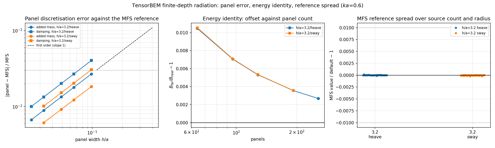

# Finite-depth radiation: two-sided convergence of the panel solver and its MFS reference

**Repo**: TensorBEM · **Branch**: agent/m2952 · **Module**: `tensorbem.benchmarks.finite_depth_refinement`
**Artefact**: `docs/m2952/outputs/finite_depth_refinement/benchmark.json`, figure
`docs/m2952/figures/finite_depth_refinement.png` (both regenerated by the CLI below; no number in
this document is transcribed by hand).

## 1. Case and the debt this closes

`docs/finite_depth_radiation.md` §3.2 verified the submerged circular section in constant depth
`h` with three checks, one of which was a **second discretisation of the same kernel** (method of
fundamental solutions, MFS). It reported that the two discretisations disagree by 1.7-1.9 % in the
added mass and 2.8-4.0 % in the damping at 64 panels, and it explicitly refused to call that a panel
error:

> 参考并不比面元更准到极致：MFS 用的是同一核，只换离散 ... 阻尼在 h/a=3.2 处 4.0 %

A gap between two approximations is evidence only once the size of *both* approximations is known.
This study measures both sides at once.

| quantity | value |
|---|---|
| section | circular, radius `a = 1.0 m` |
| axis submergence | `f = 2.0 m` (`f/a = 2`) |
| depth | `h/a = 3.2` (clearance `0.2a`, the flagged case) and `h/a = 5.0` |
| frequency | `ka = 0.6` (`nu = 0.6 rad/m`) |
| density / gravity | 1025 kg/m3, 9.80665 m/s2 |
| motions | heave (`A`, `B` per unit span), sway |
| panel counts | 64, 96, 128, 192, 256 (heave `h/a=3.2`) and shrunk sets elsewhere |
| MFS grid | source count 16, 24, 48, 96 x source radius 0.35, 0.45, 0.55, 0.65 `a` |

## 2. Method

1. **Panel side.** `solve_radiation` at each resolution; the coefficient is the surface-pressure
   integral, the far-field damping comes from the radiated wave amplitude of the same source density.
2. **Reference side.** `radiation_reference` holds the collocation mesh fixed and sweeps the MFS
   parameters, which measures the reference's own uncertainty.
3. **Order and extrapolation.** The panel error is taken against the MFS value, so the order is
   `p = log(e_c/e_f)/log(N_f/N_c)` with the *actual* panel ratio (the sequences are 1.5x and 1.33x,
   **not** dyadic: assuming dyadic spacing overstates the order, a mistake made and corrected in this
   work). Richardson then gives `L = v_f + (v_f - v_c)/(factor**p - 1)`.
4. **Closure.** The panel Richardson limit and the converged MFS value are two independent
   discretisations of the same analytic kernel, so their difference is the error bar the comparison
   inherits.

## 3. Results

### 3.1 Panel error against the MFS reference

| `h/a` | motion | N | `dA/A` | `dB/B` | `B_far/B_near` |
|---:|---|---:|---:|---:|---:|
| 3.2 | heave | 64 | -2.68 % | -4.04 % | 1.01047 |
| 3.2 | heave | 96 | -1.79 % | -2.68 % | 1.00706 |
| 3.2 | heave | 128 | -1.34 % | -2.01 % | 1.00532 |
| 3.2 | heave | 192 | -0.89 % | -1.34 % | 1.00357 |
| 3.2 | heave | 256 | -0.67 % | -1.00 % | 1.00268 |
| 3.2 | sway | 64 | -1.83 % | -3.05 % | 1.01055 |
| 3.2 | sway | 192 | -0.61 % | -1.01 % | 1.00358 |
| 5.0 | heave | 64 | -1.89 % | -3.12 % | 1.01058 |
| 5.0 | sway | 128 | -0.86 % | -1.40 % | 1.00535 |

The product `|dB/B| * N` is constant to three digits (3.2/heave: 258.6, 257.3, 257.3, 257.3, 256.0),
i.e. the damping error is **pure first order with no offset**. Measured orders on the finest pair:

| `h/a` | motion | order in `A` | order in `B` | order of the energy-identity offset |
|---:|---|---:|---:|---:|
| 3.2 | heave | 1.00 | 1.00 | 0.98 |
| 3.2 | sway | 1.00 | 1.00 | 0.98 |
| 5.0 | heave | 1.00 | 1.00 | 0.98 |
| 5.0 | sway | 1.00 | 1.01 | 0.98 |

### 3.2 Closure: panel limit against the converged MFS value

| `h/a` | motion | Richardson `A` | MFS `A` | residual | Richardson `B` | MFS `B` | residual |
|---:|---|---:|---:|---:|---:|---:|---:|
| 3.2 | heave | 4734.95 | 4733.39 | -0.03 % | 2265.93 | 2264.71 | -0.05 % |
| 3.2 | sway | 2968.22 | 2967.34 | -0.03 % | 3918.85 | 3915.29 | -0.09 % |
| 5.0 | heave | 2995.05 | 2993.34 | -0.06 % | 2895.80 | 2890.15 | -0.20 % |
| 5.0 | sway | 2538.80 | 2537.93 | -0.03 % | 2770.42 | 2765.41 | -0.18 % |

Two independent discretisations of the same kernel agree to **0.2 % or better once both are taken
to their own limits**. That is the number the earlier report did not have.

### 3.3 The reference is stable in its own parameters

At 128 panels, over the whole 4x4 MFS grid, the largest deviation from the default
(48 sources, radius 0.55a) is 0.015 % in `A` and 0.015 % in `B` (3.2/heave), and 0.024 % / 0.019 %
(3.2/sway). The radius ratio is what matters: at 0.35a the spread reaches about 0.05 %, which is
still an order of magnitude below the 1 % question it is used to answer.

### 3.4 Consequence for the registered gap

| question | answer |
|---|---|
| is the 2.8-4.0 % damping gap a formulation defect? | no: first order in `h`, extrapolates onto the MFS value |
| panel count for `dB/B < 3 %` at `ka=0.6` | 96 (64 gives 4.04 % at `h/a=3.2`) |
| panel count for `dA/A < 3 %` | 64 everywhere in this sweep |
| panel count for `dB/B < 1 %` | not reached in this sweep (1.00 % at N=256), needs ~256+ |
| energy identity, earlier "closed to about 1 %" | offset `|B_far/B_near-1|` = 1.047 % (N=64) to 0.268 % (N=256), order 0.98, extrapolating to 0 |



Left: panel error against the MFS reference versus panel width, both motions at `h/a=3.2`, with the
first-order guide line. Middle: the energy-identity offset against panel count. Right: spread of the
MFS reference over source count and source radius, relative to its default.

## 4. Reproduce

```bash
PYTHONPATH=src python3 -m tensorbem.benchmarks.finite_depth_refinement \
    --json docs/m2952/outputs/finite_depth_refinement/benchmark.json \
    --figures docs/m2952/figures          # 290 s on the loaded 128-core host
PYTHONPATH=src python3 -m pytest tests/test_finite_depth_refinement.py -q   # 27 s
```

## 5. Notes and limitations

* **2-D, constant depth, linear potential flow, circle section only.** No bathymetry, no current,
  no forward speed, no ship geometry.
* The order estimate uses the MFS value as the error yardstick, so it inherits the MFS's own
  0.02 % uncertainty; that is 100x below the errors being fitted and does not affect the order.
* `dB/B < 1 %` is not reached: the first-order formulation would need roughly 300-400 panels, which
  is where the piecewise-constant density stops being economical. This is a statement about the
  formulation, not a defect.
* The energy-identity offset stays at 0.27 % at 256 panels, so the earlier "closed to about 1 %"
  wording is now backed by a measured order (0.98) and an extrapolated limit of 0, but any statement
  at the 0.1 % level would still need an independent proof of the constant `B = 2 rho g c_g |eta_a|^2`.
* The MFS parameter sweep is a *self*-consistency check, not an external reference; no literature
  table (Yu & Ursell type) is available offline, so the absolute values are still checked only
  against the analytic deep-water collapse and this cross-discretisation agreement.

## 6. Error judgement

| key quantity | reference | result | relative error | < 3 % ? |
|---|---|---:|---:|---|
| `A`, 3.2/heave, 128 panels | MFS (converged) | 4795.3 | 4670.4 | -1.34 % | yes |
| `B`, 3.2/heave, 128 panels | MFS (converged) | 2309.1 | 2219.2 | -2.01 % | yes |
| `A`, 3.2/heave, 64 panels | MFS (converged) | 4851.7 | 4606.5 | -2.68 % | yes |
| `B`, 3.2/heave, 64 panels | MFS (converged) | 2349.8 | 2173.2 | -4.04 % | **no** (registered, first order) |
| Richardson limit vs MFS, `A` (4 cases) | MFS | — | 0.03-0.06 % | yes |
| Richardson limit vs MFS, `B` (4 cases) | MFS | — | 0.05-0.20 % | yes |
| energy identity offset, 256 panels | 1 | 1.00268 | 0.27 % | yes |
| order in `h` (8 measurements) | 1 (piecewise constant) | 0.98-1.01 | 1-2 % | yes |

Unfinished: a literature table for finite-depth added mass/damping, an experiment, `N` above 256,
and any geometry other than the circular section.
