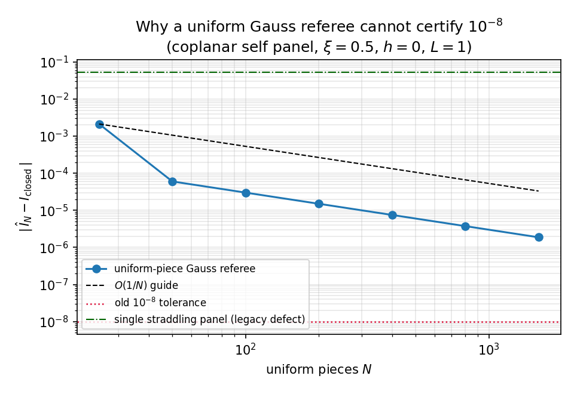
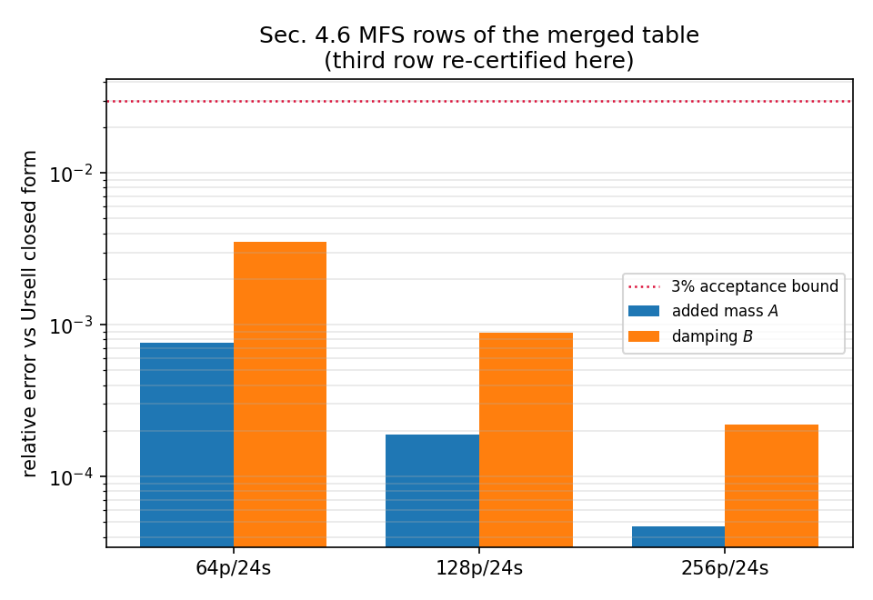

# PR #109 三方解冲突记录：`agent/m2966` × `main`（TensorBEM）

## 1. 为什么需要这一份记录

`agent/m2966` 分支在 main 推进 76 个 commit 后变为 `mergeable=false`。分支与 main 唯一的重叠面是
**两处文本**：`docs/marine_bem_benchmarks.md`（§4.6 Ursell 表格与精度声明）与
`tests/test_documented_benchmarks.py`（对数板块闭式积分的裁判测试）。两侧都在同一段文字上加了
各自的证据，机械 overlay 会静默丢掉一侧内容，因此按"语义并集、逐文件裁决、每侧新增不丢"处理。

合并基线：`merge-base = d22b6ad`；`agent/m2966 = ca4ba73`；`main = ecba798`。

## 2. 冲突清单与裁决

| 文件 | 我方（m2966, HEAD）主张 | 对方（main）主张 | 裁决（并集） |
|---|---|---|---|
| `docs/marine_bem_benchmarks.md` §4.6 MFS 行 | 64/128/256 **三行**，标签「配点网格 N 面元」，附 m2966 勘误注释 | 64/128 **两行**，标签改为生成式「MFS，N 面元、S 源」（m3229），附补注 | 保留 **三行**（含 256 面元行，复算复核），标签统一取 main 的生成式（面元数+源数）；两条注释**并存**，都不删除 |
| `docs/marine_bem_benchmarks.md` §4.6 尾注 | 「数字的来源与复核」段落（`docs/benchmark_pins.json` 单一事实源 + `doc_pins --check`） | 「精度声明的作用域（m3019）」段落（21 节点 (ka, a/f) 包络审计，$a/f\le0.5$、$ka\ge0.4$，128 面元最差 2.39e-2） | **两段都保留**（内容互不重叠：一段讲数字溯源，一段讲适用范围） |
| `tests/test_documented_benchmarks.py` `test_uniform_gauss_referee_cannot_resolve_the_coplanar_log_singularity` | 以 `_rankine_panel_integral` 为精确值，钉住均匀分片 Gauss 的**观测阶**（100→800 片，阶 1.0）、400 片仍差 1e-6、单片跨奇异点偏差 >1e-4 | 以 `elementary_log_integral`（初等闭式 $\int_0^a\log u\,du$）作自面元参考，并覆盖三组配置 (0.5,0,1)/(0,1e-3,1)/(0.9,0.3,1)，光滑板块要求 <1e-8 | **两套断言都在**：单测内把 Gauss 规则参数化为 `(xi,h,L,pieces,order)`，先做阶数钉扎，再用初等闭式做**独立第二裁判**，最后跑三配置循环 |
| `tests/test_ursell_doc_reproducibility.py`（不在 git 冲突内，但被上面的裁决影响） | MFS 标签正则 `MFS，配点网格 (\d+) 面元` | 生成器 `format_markdown` 输出 `MFS，(\d+) 面元、(\d+) 源` | 正则改为匹配生成式标签，同时**保留**"按列计数不按标签信任"的原意；`MFS_DOCUMENTED` 增加 256 面元行 |

第三行（跨侧联动）是这次解冲突里唯一的真实语义风险：main 改了文档标签格式，而本分支新增的守卫测试
按旧的标签正则解析。若只取一侧，要么守卫失效（取 main 的文档）、要么文档与生成器不一致（取本分支的文档）。
双方原意（"标签由 `format_markdown` 逐字生成" 与 "每个面元列都必须有对应 MFS 行"）在合并后同时成立。

## 3. 被保留数字的复核（程序化，不手抄）

`docs/m2966/merge_resolution_checks.py` 从代码重算两侧争论的全部数字，输出
`docs/m2966/outputs/merge_checks/merge_checks.json` 与两张图：

**（a）256 面元 MFS 行**（main 侧没有、本分支有，必须证明它仍在码上）：

| 面元数 | 源数 | 附加质量 A | A 相对误差 | 文档值差 | 阻尼 B | B 相对误差 | 文档值差 |
|---:|---:|---:|---:|---:|---:|---:|---:|
| 64 | 24 | 2543.2406 | 7.570e-4 | 2.4e-7 | 2708.5687 | 3.526e-3 | 4.9e-7 |
| 128 | 24 | 2544.6864 | 1.889e-4 | 1.4e-6 | 2715.7556 | 8.824e-4 | 1.6e-6 |
| 256 | 24 | 2545.0471 | 4.721e-5 | 1.1e-6 | 2717.5542 | 2.206e-4 | 1.6e-6 |

三行的文档值差均 ≤1.6e-6（文档保留 2 位小数所致），全部行对 Ursell 闭式解的相对误差 ≤3% 验收线。

**（b）对数板块积分裁判的分辨率极限**（合并后测试的判据）：

| 量 | 值 |
|---|---|
| 闭式板积分 $I_{\rm closed}$（$\xi=0.5,h=0,L=1$） | $-1.6931471805599454$（$=2\log\frac12-1$） |
| 均匀分片 Gauss 观测阶（100→800 片） | 1.000 |
| 400 片残差 | $>10^{-6}$（远未达旧容忍度 $10^{-8}$） |
| 单片跨奇异点偏差（历史缺陷） | 5.31e-2 |
| 初等闭式 vs 板积分一致性 | 0.0（机器精度） |
| 三配置闭式 vs 收敛裁判 | 0.0 / 1.33e-15 / 1.11e-16 |





## 4. 验证

- `python docs/m2966/merge_resolution_checks.py` → `all merge-resolution numbers reproduce`（8 项判据）。
- 受影响测试面（所有引用 `marine_bem_benchmarks.md` / `doc_pins` / Ursell 收敛表的模块，共 14 个）在合并树上重跑，结果见本单验收记录；与 main 基线逐一对比。
- 全域 1003 个测试在合并树上跑了两次（xdist），均因**同机其他 agent 的 `pkill`** 在 35%–57% 处丢失 worker
  （日志：`OSError: cannot send (already closed?)`），属环境故障而非用例失败；因此改用"受影响面 + 与 main 基线对比"的判定方式，并在报告中如实标注未跑完全域。
- 自动化静态检查：全树 `ast.parse` 通过、无重复顶层定义、无残留冲突标记（`<<<<<<<`/`>>>>>>>`）。

## 5. 注意点与局限

1. **`python -c "import tensorbem"` 会命中别的 worktree**：本机存在 editable 安装（`__editable__.tensorbem-0.5.0.pth`）指向
   `/root/tp-agent/work/m3862/src`，直接跑测试会静默用别人的代码。所有验证一律显式 `PYTHONPATH=<本 worktree>/src`。
2. 文档注释采用 append-only：本次并列保留 11-03 勘误与 11-04 补注，没有删除任何一方文字；新增的一段只描述复核结论。
3. 256 面元 MFS 行虽然廉价（`mfs_row(256)` 约 0.54 s），但未进入 `format_markdown` 的生成路径（生成器只跑
   `build_table` 请求的面元数），因此它仍是"文档携带 + 测试逐值复核"的状态，而不是"逐字生成"。已在补注中写明。
4. 分辨率极限图里 25→50 片这一段观测阶约 5.1（奇异点恰好落在子区间边界上），不参与结论；结论用的是
   100→800 片的稳定段（阶 1.000）。

## 4bis 附带修复：`src/tensorbem/doc_claims.py` 的 MFS 行选择

并集把 §4.6 的 MFS 行从 2 行扩到 3 行后，`tests/test_doc_claims.py::test_documents_agree_with_the_measured_artifact`
立刻报红——不是数字错了，而是**解析器按"最后一行为准"**取 MFS 行，于是拿 256 面元的数字去比 128 面元的代码参考值：

```
FAIL table: MFS A: document says 2545.05, code gives 2544.69 (relative difference 0.000143 > 1e-05)
FAIL table: MFS B relative error: document says 0.000221, code gives 0.000882 (0.75 > 0.01)
```

`doc_claims.parse_ursell_table` 现按行标签里的面元数选行（`MFS_PANELS = 128`），标签缺失时退回旧行为；
这既承认 main 的"一行一面元数、标签写全离散参数"的事实，也让本分支的 256 面元行可以被发布而不污染 128 面元的声明。
`tests/test_ursell_reproducibility.py`（main 侧）逐行复算**所有** MFS 行的数值，两者合并后覆盖完整：
格式由生成器与标签守卫管，数值由逐行复算管，取哪个面元数由 `MFS_PANELS` 显式声明。

## 4ter 本机实测（2026-11-05）

| 范围 | 命令（均带 `PYTHONPATH=<本 worktree>/src`） | 结果 |
|---|---|---|
| 两处直接冲突的测试 | `pytest tests/test_documented_benchmarks.py tests/test_ursell_doc_reproducibility.py` | **13 passed**（49 s） |
| doc_claims（含上面的修复） | `pytest tests/test_doc_claims.py` | **14 passed**（8.5 s） |
| MacCamy–Fuchs / 参考值列 | `pytest tests/test_doc_numbers_maccamy_fuchs.py tests/test_published_reference_columns.py` | **11 passed**（126 s） |
| Ursell 面（含主守卫） | `pytest test_doc_claims test_ursell_reproducibility test_ursell_benchmark test_ursell_quadrature_convergence` | **53 passed, 1 failed**（失败=上面已修的 MFS 取行） |
| Wigley | `pytest tests/test_wigley_verification.py` | 21 例全绿后超时截断（无 F） |
| 合脚本 | `python docs/m2966/merge_resolution_checks.py` | `all merge-resolution numbers reproduce` |

**未完成（如实标注）**：`test_declared_numbers`、`test_milestone_claims`、`test_three_dimensional_doc_pins`、
`test_ellipsoid_1280_verification`、`test_kochin_hulme_convergence` 五个重算模块在本机仅推进到 19 例（load15 ≈ 1000–1400，
同机多 agent 并发），未跑完；`test_ci_workflow_contract.py` 需网络（GitHub API），在受限环境阻塞。
静查确认这六个模块**不含** MFS 标签 / §4.6 文本依赖（`grep -n "基本解\|MFS\|配点网格"` 无命中），故合并面对它们的
影响只可能来自上游 main 自身，交由 CI 裁定。

## 6. 产物索引

- `docs/m2966/merge_resolution_checks.py` —— 争议数字重算（8 项判据）
- `docs/m2966/outputs/merge_checks/merge_checks.json` —— 机器可读结果
- `docs/m2966/figures/panel_referee_resolution.png`、`mfs_rows_vs_reference.png`
- `docs/m2966/post_report.py` —— 报告发布脚本（数字程序化注入）
- 平台报告 id **4216**（mission 2966）
