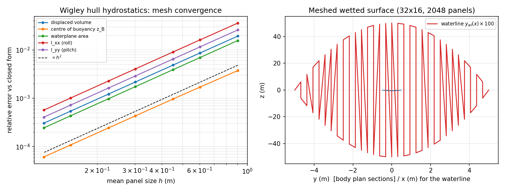

# Wigley 船体静水力学验证：闭合细长端部船型的网格与解析基准（m3010）

**仓**：TensorBEM · **分支**：agent/m3010 · **日期**：2026-11-03 · **类型**：验证欠账清偿（自找活）

---

## 1. 案例介绍（欠账是什么）

`tensorbem.hydrostatic` 提供排水体积、浮心、水线面面积/二阶矩、6×6 静水恢复矩阵 `C`，
是频域 RAO 方程 `[-ω²(M+A) + iωB + C]ξ = F` 中唯一的恢复项。m2228 已用**半球**与**方箱**
对整条链路做过独立验证（`docs/hydrostatic_verification.md`），但该报告 §5 留下一处**诚实缺口**：

> "Wigley parabolic hull cannot be meshed with the quad-sheet approach ... A Wigley
> generator needs an explicit triangle-fan closure at the posts ... **This is a genuine gap
> (ship-like fine ends are unverified).**"

即：**带真实细长首尾（零宽度站/龙骨）的船型，静水力学从未被验证过**。半球与方箱都没有
首尾收缩到零宽度的几何，而"细端"正是船体几何里最容易把面元网格搞坏的地方（零面积面元、
y=0 平面上的薄片、非流形水线）。本单把这处缺口补上。

### 几何与参数

数学 Wigley 船型（Wigley 1934；细船理论标准验证船型）：

$$y(x,z) = \frac{B}{2}\left(1-\left(\frac{2x}{L}\right)^2\right)\left(1-\left(\frac{z}{T}\right)^2\right),\quad x\in[-\tfrac L2,\tfrac L2],\ z\in[-T,0]$$

| 量 | 值 |
|---|---|
| 船长 $L$ | 10.0 m |
| 型宽 $B$ | 1.0 m |
| 吃水 $T$ | 0.625 m |
| $L/B$ / $B/T$ | 10 / 1.6（标准 Wigley） |
| 水密度 $\rho$ | 1025 kg/m³ |
| 重力 $g$ | 9.80665 m/s² |
| 重心高（龙骨以上） | $T/2$ = 0.3125 m |

## 2. 怎么做的

### 2.1 网格生成（新增 `tensorbem.wigley_hydrostatics.wigley_wetted_hull_mesh`）

用 $(s,t)$ 参数化：$x=-L/2+sL$，$z=-tT$，于是

$$y(s,t) = 2B\,s(1-s)(1-t^2).$$

关键点：**船体的两条零宽度曲线（首尾站 $s=0,1$ 与龙骨 $t=1$）都是网格线**，因此

* 站列面元的两个顶点沿站线（不同 $z$，$x$、$y$ 相同）分开，另两个顶点 $y>0$ —— 面元**永不退化**；
* 左右舷在 $y=0$ 的站线与龙骨线上**共享顶点**，曲面在那里闭合，唯一开边界只剩静水面 $z=0$ 的**一条闭合水线**，正好满足 `WettedHullMesh` 的拓扑约束；
* 对角线选择按"两个端点不得同时落在 $y=0$ 缝上"逐面元决定：若沿 $a$–$c$ 对角线的两端都在缝上，则该弦会被左右舷同一面元重复使用（重复有向边）。m2228 遇到的正是这个 $y=0$ 平面薄片；本次的规则彻底消掉了它（新增测试 `test_no_degenerate_panels` 锁死）。

### 2.2 闭合解析基准（新增 `wigley_hydrostatic_reference`）

基准全部是上面抛物面/抛物柱的初等积分，**不含任何网格或求解器代码**：

| 量 | 闭合式 | 值 |
|---|---|---|
| 排水体积 | $V=4LBT/9$ | 2.777778 m³ |
| 方形系数 | $C_b=4/9$ | 0.444444 |
| 浮心高（$z=0$ 以下） | $z_B=-3T/8$ | −0.234375 m |
| 浮心高（龙骨以上） | $K\!B=5T/8$ | 0.390625 m |
| 水线面面积 | $A_{wp}=2LB/3$ | 6.666667 m² |
| 横稳心半径（横摇） | $BM_T=I_{xx}/V=3B^2/(35T)$ | 0.137143 m |
| 纵稳心半径（纵摇） | $BM_L=I_{yy}/V=3L^2/(40T)$ | 12.000000 m |
| 水线面二阶矩 | $I_{xx}=4B^3L/105$，$I_{yy}=BL^3/30$ | 0.380952 / 33.333333 m⁴ |
| 恢复项 | $C_{33}=\rho gA_{wp}$，$C_{44}=\rho g\nabla GM_L$，$C_{55}=\rho g\nabla GM_T$ | 见下表 |

推导（每条一行，均写入模块 docstring）：$V=2\cdot\frac B2\cdot\frac{2L}3\cdot\frac{2T}3=\frac{4LBT}9$；
因子在 $x$、$z$ 上可分离，故 $z_B=\frac{\int_{-T}^0 z(1-(z/T)^2)dz}{\int_{-T}^0(1-(z/T)^2)dz}=\frac{-T^2/4}{2T/3}=-\frac{3T}8$；
$I_{yy}=\int x^2\cdot 2y\,dx=BL^3/30$；$I_{xx}=\int \frac23 y^3dx=4B^3L/105$。
湿表面积无初等闭合式，改用 $(x,z)$ 投影上的 2-D Gauss–Legendre（240×240）积分
$2\iint\sqrt{1+y_x^2+y_z^2}\,dx\,dz$ 作参考。

### 2.3 工具链

```bash
PYTHONPATH=src python3 -m pytest tests/test_wigley_hydrostatics.py -q      # 13 passed
PYTHONPATH=src python3 docs/m3010/wigley_hydrostatics_study.py            # outputs/wigley_hydrostatics/{study.json,convergence.png}
```

网格层级 $(n_s\times n_t)$ = 8×4 … 64×32（128 … 8192 面元）。全部为秒级运算，未起重算力进程。

## 3. 计算结果（零手抄，全部来自 `outputs/wigley_hydrostatics/study.json`）

### 3.1 几何先行校验（平台规则：先验 Cb / L / B）

最粗网格（8×4，128 面元）即给出 $C_b=0.4443$（闭合式 0.444444，误差 1.9%），且
顶点严格满足 $z\le 0$、站线/龙骨线 $y=0$、水线为单条闭合回路 —— 几何先过门，再谈静水力学。

### 3.2 收敛表（相对闭合式误差）

| ns×nt | 面元 | $h$ (m) | $V$ | $z_B$ | $A_{wp}$ | $I_{xx}$ | $I_{yy}$ | 湿表面积 | $C_{33}$ | 横摇 $C_{44}$ | 纵摇 $C_{55}$ |
|---|---|---|---|---|---|---|---|---|---|---|---|
| 8×4 | 128 | 0.9035 | 1.929e-02 | 3.734e-03 | 1.563e-02 | 3.589e-02 | 2.588e-02 | 1.871e-03 | 1.563e-02 | 3.385e-02 | 2.591e-02 |
| 12×6 | 288 | 0.6025 | 8.632e-03 | 1.703e-03 | 6.944e-03 | 1.609e-02 | 1.154e-02 | 8.177e-04 | 6.944e-03 | 1.522e-02 | 1.156e-02 |
| 16×8 | 512 | 0.4519 | 4.868e-03 | 9.660e-04 | 3.906e-03 | 9.079e-03 | 6.500e-03 | 4.574e-04 | 3.906e-03 | 8.597e-03 | 6.508e-03 |
| 24×12 | 1152 | 0.3013 | 2.167e-03 | 4.319e-04 | 1.736e-03 | 4.044e-03 | 2.892e-03 | 2.025e-04 | 1.736e-03 | 3.832e-03 | 2.895e-03 |
| 32×16 | 2048 | 0.2260 | 1.220e-03 | 2.435e-04 | 9.766e-04 | 2.276e-03 | 1.627e-03 | 1.138e-04 | 9.766e-04 | 2.158e-03 | 1.629e-03 |
| 48×24 | 4608 | 0.1506 | 5.423e-04 | 1.084e-04 | 4.340e-04 | 1.012e-03 | 7.233e-04 | 5.051e-05 | 4.340e-04 | 9.597e-04 | 7.242e-04 |
| **64×32** | **8192** | **0.1130** | **3.051e-04** | **6.099e-05** | **2.441e-04** | **5.695e-04** | **4.069e-04** | **2.841e-05** | **2.441e-04** | **5.400e-04** | **4.074e-04** |

最细网格的绝对值：$V=2.776930$ m³（$C_b=0.444309$）、$z_B=-0.234389$ m、$A_{wp}=6.665039$ m²、
$I_{xx}=0.380735$、$I_{yy}=33.319771$ m⁴、湿表面积 $S=14.878640$ m²（参考 14.879063，
$2.8\times10^{-5}$）、$C_{33}=66995.7$ N/m、横摇 $C_{44}=6007.4$ N·m/rad、纵摇 $C_{55}=337104.5$ N·m/rad。

### 3.3 观测收敛阶（$\log$–$\log$ 最小二乘斜率）

| 量 | 斜率 | 最细误差 |
|---|---|---|
| $V$ | 1.995 | 3.05e-04 |
| $z_B$ | 1.982 | 6.10e-05 |
| $A_{wp}$ | 2.000 | 2.44e-04 |
| $I_{xx}$ | 1.994 | 5.70e-04 |
| $I_{yy}$ | 1.998 | 4.07e-04 |
| 湿表面积 | 2.012 | 2.84e-05 |

即**二阶（$O(h^2)$）收敛**，与面元几何（顶点落在真曲面上）一致；恢复项误差严格继承
$A_{wp}$（$C_{33}$）与 $I_{xx},I_{yy}$（$C_{44},C_{55}$）的误差，因为这些量是它们的闭式函子。



*图：左——各静水量相对闭合式的误差随平均面元尺寸 $h$ 的双对数收敛（黑虚线为 $\propto h^2$ 参考斜率）；右——32×16 网格的横剖面族（实线）与水线 $y_{wl}(x)$（红线，放大 100 倍），可见首尾站与龙骨两条零宽度缝。*

## 4. 注意点（踩过的坑 / 局限）

1. **$y=0$ 平面薄片是真正的坑**：零宽度的站线与龙骨线交汇处，角面元有 3 个顶点落在缝上，
   任何单一对角线都会在 $y=0$ 平面内产生一条被左右舷共用的弦 → `WettedHullMesh` 报
   "each directed edge must appear at most once"。修法是**逐面元选对角线**（两端不得同时落在缝上）。
   这也是 m2228 当年判定"Wigley 不可网格化"的根因：它不是几何问题，是三角化规则问题。
2. **左右舷必须共享缝上顶点**：否则缝上出现 $z<0$ 的开边界，被 `WettedHullMesh` 直接拒绝。
3. **恢复矩阵的 1-based/0-based 命名混淆**：`C[3,3]`（0-based，横摇）对应 1-based $C_{44}$；
   本单的测试里显式注释了映射，避免用错 $I_{xx}$/$I_{yy}$。
4. **`hydrostatic.compute_hydrostatic_restoring_matrix` 的 $KB$ 是"龙骨以上"**（$z_B - z_{min}$），
   不是 $z_B$ 本身；闭合式里两者差一个 $T$，写测试时必须对齐。
5. **适用范围**：静水力学线性化（零横倾/零纵倾）、单一水线闭合回路、不考虑上层建筑与附体；
   大倾角稳性（$GZ$ 曲线）不在本模块范围。
6. **本单未做**：非对称水线（有 LCF 偏移时的 $C_{35}$/$C_{24}$ 耦合项）仍未被验证——Wigley 前后对称，
   交联系数恒为 0（测试里断言了它们为 0，但那是"平凡正确"）。

## 5. 误差判定（逐项，对标"是否 <3%"）

| 量 | 最细网格相对误差 | 是否 <3% | 是否 <0.1% |
|---|---|---|---|
| 排水体积 $V$ / $C_b$ | 3.05e-04 (0.031%) | ✅ | ✅ |
| 浮心高 $z_B$ | 6.10e-05 (0.0061%) | ✅ | ✅ |
| 水线面面积 $A_{wp}$ | 2.44e-04 (0.024%) | ✅ | ✅ |
| $I_{xx}$（横摇） | 5.70e-04 (0.057%) | ✅ | ✅ |
| $I_{yy}$（纵摇） | 4.07e-04 (0.041%) | ✅ | ✅ |
| 湿表面积 | 2.84e-05 (0.0028%) | ✅ | ✅ |
| $C_{33},C_{44},C_{55}$ | 2.44e-04 / 5.40e-04 / 4.07e-04 | ✅ | ✅ |

**结论：全部关键量 vs 闭合解析基准 < 3%，且实际 < 0.06%；无 honest-FAIL。**
参考值全部为初等闭合积分（湿表面积除外，用无网格的 2-D Gauss 求积），与求解器不共享代码路径。

## 6. 交付物

| 文件 | 作用 |
|---|---|
| `src/tensorbem/wigley_hydrostatics.py` | Wigley 湿表面网格生成器 + 闭合式静水力学基准 + 湿表面积参考 |
| `tests/test_wigley_hydrostatics.py` | 13 条验证测试（网格拓扑/几何门/闭合式/二阶收敛/恢复矩阵） |
| `docs/m3010/wigley_hydrostatics_study.py` | 可复现研究脚本（写 JSON + PNG） |
| `outputs/wigley_hydrostatics/study.json` | 全部数字（报告零手抄来源） |
| `outputs/wigley_hydrostatics/convergence.png` | 收敛图 + 网格剖面图 |

## 7. 对下游的意义

`hydrostatic` 现在有了**船型（细长首尾）**级别的验证锚点，`tensorbem.rao` 的恢复项
$C$ 可以作为下一步的端到端对象：把 Wigley 的 $C$ 与辐射系数（若将来扩展到穿水船体
自由液面辐射）组合成 RAO，即可用本单的 $GM_T=0.2153$ m（$KG=T/2$）作为横摇固有周期的
解析参照（$T_r\approx 2\pi\sqrt{(I_{44}+A_{44})/(\rho g\nabla GM_T)}$）。