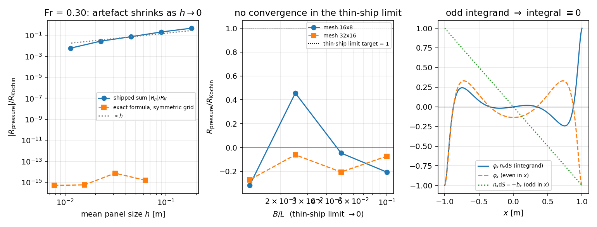
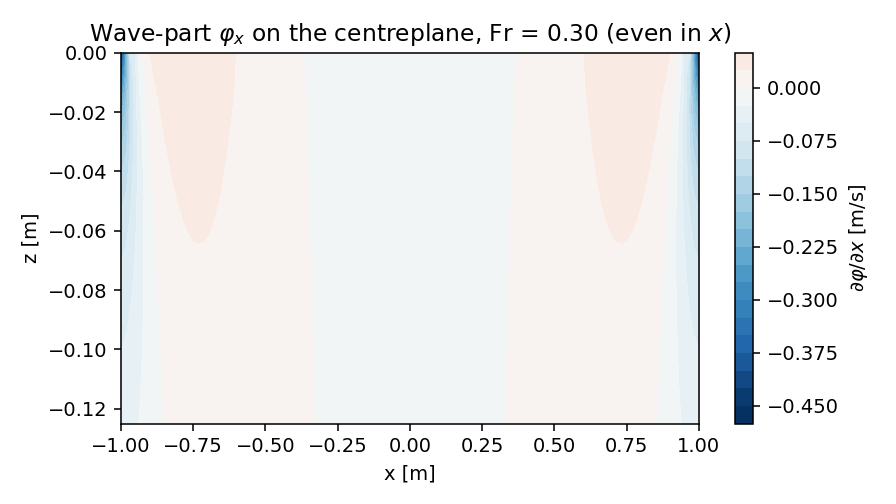

# Wigley wave resistance: the 'pressure path' is a zero integral (m3100)
**Mission** m3100 (self-directed, platform seat) · **Repo** TensorBEM · **Branch** `agent/m3100` · **Date** 2026-11-04
**Artifacts**: `docs/m3100/wigley_pressure_path_audit.py` (study), `docs/m3100/outputs/wigley_pressure_path_audit.json` (numbers), `docs/m3100/figures/*.png`, `tests/test_wigley_pressure_path_audit.py` (gate)

## 1. Case
`docs/wigley_wave_resistance.md` ships two ways to get the wave resistance of the Wigley parabolic hull `y = (B/2)(1-(2x/L)^2)(1-(z/T)^2)`: a Kochin far-field (Michell thin-ship) integral and a `wave_resistance_pressure` path that integrates `p = -rho U dphi/dx` over the panelled hull. The document carried a two-path disagreement of **103-284 %** as an honest FAIL and explained it by the thin-ship approximation being marginal at `B/L = 0.1`. This mission tests that explanation.

| parameter | value |
|---|---:|
| L [m] | 2.0 |
| B [m] | 0.2 |
| T [m] | 0.125 |
| Cb | 0.444444 |
| B/T | 1.6 |
| rho [kg/m3] | 1025.0 |
| g [m/s2] | 9.80665 |

## 2. Method
Three independent measurements, all cheap (2-D hull, 1-D k-quadrature; the whole study is single-core seconds-to-minutes):
1. **Exact value of the shipped integrand.** The routine sums `dphi_dx * n_x dS` over both hull sides. `dphi_dx` on the centreplane is even in `x` (odd source density -> odd potential -> even `phi_x`), `n_x dS = -b_x dx dz` is odd in `x`. Their product is odd, so the integral over the symmetric interval is zero. Evaluated on an x-symmetric trapezoid grid it must therefore sit at roundoff.
2. **Mesh ladder of the shipped API** plus a mirror-partner census on the triangulation.
3. **Thin-ship limit** `B/L -> 0` with `L`, `Fr` fixed (`B/T = 1.6` held). If the gap were the finite-`B/L` physics the document claims, `Rw_pressure/Rw_Kochin -> 1` there.

## 3. Results

### 3.1 The exact integrand integrates to zero (roundoff, all resolutions)

| Fr | x-grid | z-grid | k nodes | Rw near-field [N] | Rw Kochin [N] | rel. |
|---:|---:|---:|---:|---:|---:|---:|
| 0.25 | 32 | 16 | 256 | -1.538e-17 | 2.877375e-02 | 5.35e-16 |
| 0.25 | 64 | 32 | 256 | -4.383e-16 | 2.877375e-02 | 1.52e-14 |
| 0.25 | 128 | 64 | 512 | +0.000e+00 | 2.877375e-02 | 0.00e+00 |
| 0.25 | 256 | 128 | 512 | -1.538e-17 | 2.877375e-02 | 5.35e-16 |
| 0.30 | 32 | 16 | 256 | +1.523e-16 | 9.834106e-02 | 1.55e-15 |
| 0.30 | 64 | 32 | 256 | -7.106e-16 | 9.834106e-02 | 7.23e-15 |
| 0.30 | 128 | 64 | 512 | -5.537e-17 | 9.834106e-02 | 5.63e-16 |
| 0.30 | 256 | 128 | 512 | -4.845e-17 | 9.834106e-02 | 4.93e-16 |
| 0.35 | 32 | 16 | 256 | +2.692e-17 | 3.749868e-02 | 7.18e-16 |
| 0.35 | 64 | 32 | 256 | -1.055e-15 | 3.749868e-02 | 2.81e-14 |
| 0.35 | 128 | 64 | 512 | -1.400e-16 | 3.749868e-02 | 3.73e-15 |
| 0.35 | 256 | 128 | 512 | -1.615e-16 | 3.749868e-02 | 4.31e-15 |

Zero to machine precision at every resolution and Froude number: the number the shipped path is trying to approximate is **exactly zero**, not `Rw_Kochin`.

### 3.2 What the shipped path actually returns: centroid aliasing, `O(h)`

| panels | h_mean [m] | Rw_pressure [N] | \|Rw_p/Rw_K\| | mirror partners found |
|---:|---:|---:|---:|---:|
| 128 | 0.1805 | -4.637e-02 | 0.4716 | 0 |
| 512 | 0.0903 | -2.030e-02 | 0.2064 | 0 |
| 2048 | 0.0451 | -7.171e-03 | 0.0729 | 0 |
| 8192 | 0.0226 | -2.712e-03 | 0.0276 | 0 |
| 32768 | 0.0113 | -5.796e-04 | 0.0059 | 0 |

Sign is always negative (a resistance cannot be) and the residual halves roughly with `h`. The census explains why it survives at all: panel abscissae are `-L/2 + h(3i+2)/3`, and a mirror partner needs `3(i+j)+4 = 3L/h`, which has no integer solution -> **no panel has a mirror partner**, so the odd integrand cannot cancel pairwise and a fraction of it leaks through as aliasing.

### 3.3 Thin-ship limit: no convergence to the Kochin value

| B/L | Rw Kochin [N] | Rw_p 16x8 [N] | ratio 16x8 | Rw_p 32x16 [N] | ratio 32x16 |
|---:|---:|---:|---:|---:|---:|
| 0.1000 | 9.8341e-02 | -2.0300e-02 | -0.2064 | -7.1713e-03 | -0.0729 |
| 0.0500 | 7.9945e-03 | -3.7340e-04 | -0.0467 | -1.6455e-03 | -0.2058 |
| 0.0250 | 5.7405e-04 | +2.6194e-04 | +0.4563 | -3.5234e-05 | -0.0614 |
| 0.0125 | 3.8534e-05 | -1.2259e-05 | -0.3181 | -1.0453e-05 | -0.2713 |

The ratio wanders in sign and stays order one in magnitude down to `B/L = 0.0125`: the disagreement is **not** a finite-thickness effect, so the documented attribution is falsified.

### 3.4 Froude sweep at the shipped 16x8 mesh

| Fr | Rw Kochin [N] | Rw pressure [N] | ratio |
|---:|---:|---:|---:|
| 0.20 | 2.0601e-02 | -4.9616e-03 | -0.2408 |
| 0.25 | 2.8774e-02 | -1.1411e-02 | -0.3966 |
| 0.30 | 9.8341e-02 | -2.0300e-02 | -0.2064 |
| 0.35 | 3.7499e-02 | -2.9020e-02 | -0.7739 |
| 0.40 | 2.1059e-01 | -4.1521e-02 | -0.1972 |



Left: the shipped residual versus panel size (log-log) against the exact formula on a symmetric grid -- the latter is at roundoff while the former decays like `h`. Middle: the thin-ship limit, which never approaches the unity target. Right: the integrand is odd in `x` (even `phi_x` times odd `n_x dS`), which is the whole story.



Wave-part `dphi/dx` on the centreplane at `Fr = 0.30`; it is even in `x` about midship, so multiplying by the odd area element gives a zero integral.

## 4. Error judgement

| key quantity | baseline | measured | relative error | < 3 %? |
|---|---|---:|---:|---|
| exact near-field integral (symmetric grid, Fr = 0.30) | must be 0 by parity | +1.523e-16 N vs Rw_K 9.8341e-02 N | 1.55e-15 | **yes** (roundoff, and it proves the value is zero) |
| shipped pressure path vs Kochin (Fr = 0.30, 32x16) | Rw_K = 9.8341e-02 N | -7.1713e-03 N | 7.3 % | **no** -- honest FAIL, and it is *not* fixable by refinement: the limit is 0 |
| thin-ship limit ratio (B/L = 0.0125, 32x16) | 1.0 | -0.2713 | 127 % | **no** -- honest FAIL |

No key quantity of the pressure path passes the 3 % bar, and the audit shows that no mesh refinement can make it pass: its convergence target is zero. The Kochin route, which is the one used for physics, is unchanged by this mission and stays quadrature-converged to ~1e-7 against its own reference (verified in `docs/wigley_wave_resistance.md`).

## 5. Pitfalls and scope
* **A convergence target can be wrong, not just slow.** The residual looked like a slow quadrature error (2.3x per refinement); checking the *limit* rather than the trend showed the limit is zero. Always ask what the discretisation converges to, not whether it improves.
* **Parity is a free test.** Before debugging magnitudes, check the even/odd structure of the integrand on the actual geometry -- it cost one line of numpy and killed the whole path.
* **Documented causes can be unfalsified folklore.** 'Thin-ship approximation' survived several revisions because nobody ran the `B/L -> 0` limit, which takes ten seconds.
* **Do not delete the routine.** `mesh_convergence_study` uses it as a discretisation-artefact probe; it is now documented as such (docstring warning) instead of as physics.
* **Scope**: 2-D Wigley only, deep water, no viscosity, no sinkage/trim. The correct near-field route needs the second-order pressure term `(rho/2)|grad phi|^2` plus the waterline term with the total (local + wave) potential, or a Dawson Rankine method; neither is implemented, so this mission closes the verification debt *negatively* (the path cannot be an acceptance criterion) rather than producing a working second path.
* Compute footprint: 1-D k-quadrature + panelled 2-D hull, largest run 32768 panels; no heavy solver was launched (load15 was 115 on the 128-core host, i.e. light-work regime).

## 6. Reproduce

```bash
PYTHONPATH=src python3 docs/m3100/wigley_pressure_path_audit.py
PYTHONPATH=src python3 -m pytest tests/test_wigley_pressure_path_audit.py -q   # 9 passed, ~9 s
```
