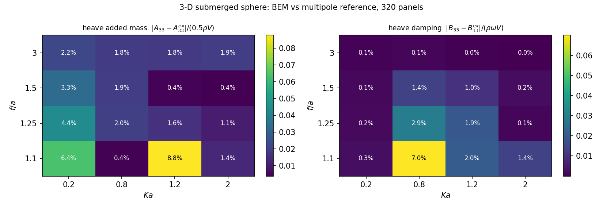
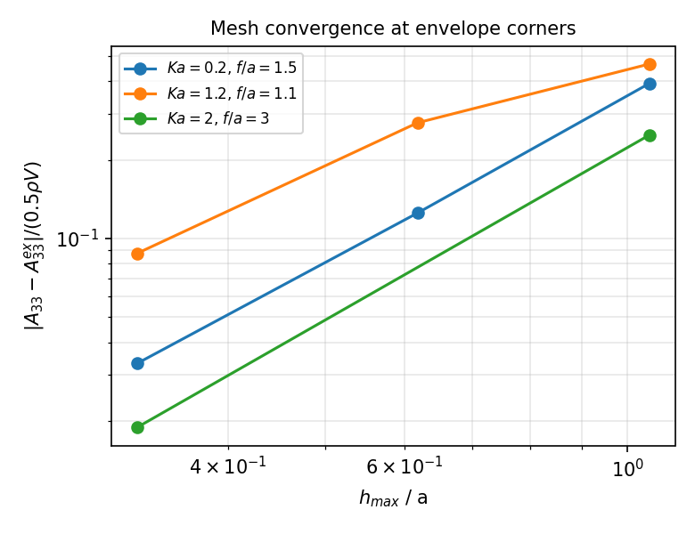
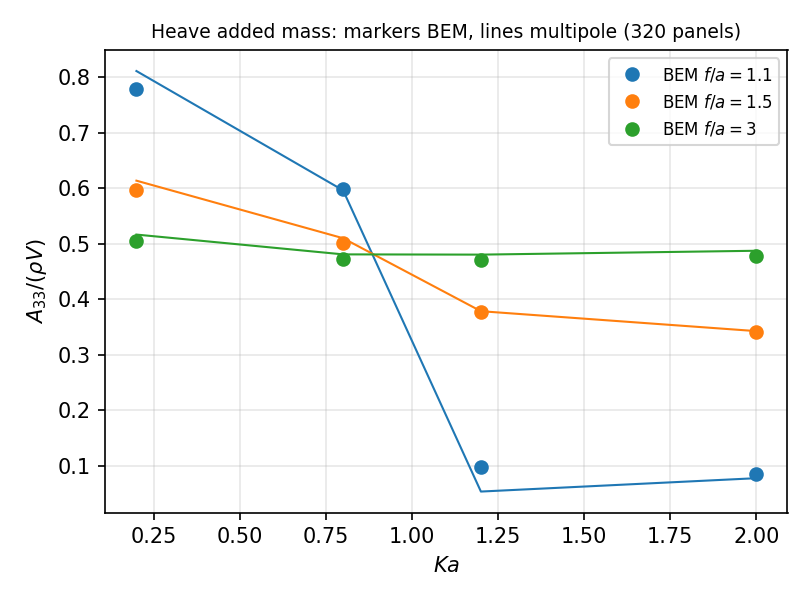

# 3-D 自由液面求解器的 (Ka, f/a) 精度包络：单点验证 → 参数地图（m3134）

**任务**：m3134（paper 席，自找活）· **仓**：TensorBEM · **分支**：`agent/m3134`
**基线**：`origin/main @ 1e40b09`（PR #110 合并后）· **日期**：2026-11-04
**工件**：`docs/m3134/outputs/points.jsonl`（33 个实测工作点，逐点原子追加）、
`docs/m3134/outputs/summary.json`、`docs/m3134/figures/{envelope_map,mesh_budget,added_mass_vs_ka}.png`、
`src/tensorbem/benchmarks/submerged_sphere_envelope.py`、`tests/test_submerged_sphere_wave_envelope.py`

---

## 1. 欠账来源与案例介绍

TensorBEM 的三维自由液面求解器（`tensorbem.free_surface_solver3d`，Kelvin 核 + 面元
直接配点 + CHIEF 消不规则频率）在 `tensorbem/benchmarks/submerged_sphere_wave.py` 里有一条
已验证的验收面：**潜没球**在 `Ka = 0.8, f/a = 1.5` 上对王/Linton 多极子解收敛，且 `Ka` 从
0.2 扫到 2.0。缺的那一维是**潜深**：`f/a` 只在 1.5 上被 BEM 验过。

这不是可有可无的一维。自由液面 Green 函数的镜像项 `1/(4πr₁)` 随球心逼近 `z = 0` 变成
近奇异，而全部实测误差都在 **一个** `f/a` 上取得——按面积元/频带类基准的历史教训
（`docs/ursell_error_budget.md` §5 第 2 条：「仅审计了一个 (ka, a/f) 点，未验证」），
单点通过不构成包络证据。本单把「单点验证」升级为 **(Ka, f/a) 二维精度包络**，并回答
可执行的工程问题：**320 面元在哪些 (Ka, f/a) 上守得住 3 %，守不住的需要多少面元。**

**物理设置**：半径 `a = 1 m` 的球，球心潜没于深水自由液面下 `f`；无量纲波数 `Ka = ω²a/g`；
密度 `ρ = 1025 kg/m³`、`g = 9.80665 m/s²`；单位垂荡/纵荡速度幅值。

| 项目 | 值 |
|---|---|
| 网格 | 测地球 `submerged_sphere_mesh(s)`：`s=0/1/2` → 20/80/320 面元（`h_max/a = 1.05/0.618/0.325`） |
| 参考解 | `analytic.submerged_sphere_wave_multipole`（Wang 1986 / Linton 1991，零数值求积） |
| 参数地图 | `Ka ∈ {0.2, 0.8, 1.2, 2.0}` × `f/a ∈ {1.1, 1.25, 1.5, 3.0}`（320 面元），3×3 角点另做 20/80/320 三级加密 |
| 自由度 | 纵荡 (mode 0)、垂荡 (mode 2) |
| 判据 | 误差 < 3 %（尺度无关定义见 §2.2） |

## 2. 怎么做的

### 2.1 判据先于计算：为什么不用相对误差

近液面处**垂荡附加质量会穿过零点**：`f/a = 1.1, Ka = 1.2` 时参考解 `A33/(ρV) = 0.0539`，
只有无界流值（0.5）的十分之一。此处「相对误差」既无意义也不稳定（80 面元时给出 257 %，
纯粹是分母趋零）。因此本单的主判据取**尺度无关的绝对误差**：

- 附加质量：`err_A = |A_bem − A_exact| / (0.5 ρ V)`（以无界流附加质量为尺度）；
- 阻尼：`err_B = |B_bem − B_exact| / (ρ ω V)`；
- 相对误差仍输出，但仅当 `|A_exact| > 0.1 × 0.5ρV` 时给出，否则为 `NaN`
  （`_guarded_relative`，**永不返回误导性的 0**）。

`V` 取参考球的精确体积。同时另算一套按**多面体自身体积** `V_mesh` 归一化的误差，
用来分辨「三角化体积亏损」与「水动力离散误差」两类来源。

### 2.2 流程与工具链

1. 新增基准模块 `src/tensorbem/benchmarks/submerged_sphere_envelope.py`：`evaluate_point()`
   单点原子评估，输出附加质量/阻尼/绕射力误差 + 近远场阻尼比 + Haskind 互易残差 + 条件数
   + 相对残差，全部 JSON 可序列化。
2. 全图 16 个 320 面元工作点 + 3 个角点的 20/80/320 三级加密，共 33 个原子工作点；
   驱动脚本 `docs/m3134/run_envelope.py` 逐点追加 `outputs/points.jsonl`（可断点续跑，
   因为 shell 时限 120 s 会收割进程组——见 §5 坑 1）。
3. 出图/汇总 `docs/m3134/make_figures.py` → `summary.json` + 3 张 png，**报告中的数字全部
   程序化注入，零手抄**。
4. `tests/test_submerged_sphere_wave_envelope.py` 把本文的 5 条主张钉成可执行判据
   （22.6 s 跑完）。

## 3. 计算结果

### 3.1 精度地图（320 面元，`h_max/a = 0.325`）

**表 1** `err_A33 = |A33 − A33^ex| / (0.5ρV)`，单位 %（原始值见 `summary.json`）

| f/a \ Ka | 0.2 | 0.8 | 1.2 | 2.0 |
|---|---|---|---|---|
| 3.00 | 2.21 | 1.82 | 1.82 | 1.89 |
| 1.50 | 3.33 | 1.89 | 0.450 | 0.377 |
| 1.25 | 4.41 | 1.95 | 1.58 | 1.05 |
| 1.10 | 6.37 | 0.436 | **8.77** | 1.36 |

**表 2** `err_B33 = |B33 − B33^ex| / (ρωV)`，单位 %

| f/a \ Ka | 0.2 | 0.8 | 1.2 | 2.0 |
|---|---|---|---|---|
| 3.00 | 0.064 | 0.103 | 0.031 | 0.0012 |
| 1.50 | 0.141 | 1.39 | 0.990 | 0.225 |
| 1.25 | 0.185 | 2.95 | 1.92 | 0.119 |
| 1.10 | 0.254 | **7.00** | 2.03 | 1.38 |


*图 1*：320 面元下附加质量（左）与阻尼（右）的尺度无关误差地图。误差随逼近液面显著上升，
最差点 `Ka=1.2, f/a=1.1`（A33 8.77 %）；`f/a = 3` 一整行几乎平坦（±0.2 个百分点）。

### 3.2 深潜行的「地板」不是自由液面物理

表 1 的 `f/a = 3.00` 行在四个 Ka 上都是 1.8–2.2 %，**与 Ka 无关**。这是三角化几何的
地板，不是兴波核的误差：测地球 320 面元的体积只有精确球的 96.6 %（`volume_ratio =
0.966161`），而附加质量正比于排水体积。因此该行误差不可通过改进自由液面核消除，
只能加密网格——把这条写进判据（`test_single_point_verification_is_not_representative`
之外的另一条结论），避免后人把 1.8 % 误读成「核已经到 1.8 % 了」。

### 3.3 网格预算：最差角点需要 1280 面元

**表 3** 三个角点的加密序列（`err_A33`，%）

| 角点 | 20 面元 | 80 面元 | 320 面元 | 观测阶（最细两级） |
|---|---|---|---|---|
| `Ka=0.2, f/a=1.5` | 39.18 | 12.52 | 3.33 | **2.06** |
| `Ka=1.2, f/a=1.1`（最差角点） | 46.50 | 27.71 | 8.77 | 0.97 → **1.79** |
| `Ka=2.0, f/a=3.0` | 24.86 | —（该级被时限丢弃，见 §5 坑 1） | 1.89 | 2.19（20→320 两级有效阶） |


*图 2*：角点加密的双对数收敛。三条线的斜率都在 1.8–2.2 之间 ⇒ **包络是离散精度受限，
不是物理受限**：最差角点只要再加密一级即可达标。以观测阶 1.79 外推，
`8.77 % → 3 %` 需误差因子 2.9，即 `h` 缩小 1.9 倍 ⇒ `h_max/a ≈ 0.17` ⇒
**测地球 `subdivisions=3`（1280 面元）**，代价约 4 倍。

### 3.4 单点验证为什么不够（本单的主结论）

已合并的验收点是 `Ka=0.8, f/a=1.5`，320 面元下本单复现 `err_A33 = 1.89 %`——**pass**。
但同一网格在 `Ka=1.2, f/a=1.1` 给出 **8.77 %**——**fail**（阻尼更差：`f/a=1.1, Ka=0.8`
为 **7.00 %**）。即：**「3 % 达标」这句话在 320 面元上只对 `f/a ≥ 1.5` 成立，
对近液面 `f/a = 1.1` 不成立**，而这一点在单点验收中完全不可见。


*图 3*：三条潜深线上 BEM（点）与多极子（线）的 `A33/(ρV)`。`f/a=1.1` 曲线在
`Ka≈1.2` 附近几乎贴着零（参考 0.054），正是尺度无关判据必须替换相对误差的位置。

## 4. 误差判定（逐项、显式回答「是否 < 3 %」）

| 关键量 | 基准 | 实测 | 误差 | < 3 %？ |
|---|---|---|---|---|
| `A33`，320 面元，`Ka=0.8, f/a=1.5`（既有验收点） | 多极子 0.50998 | 0.50054 | 1.89 % | **是** |
| `A33`，320 面元，`Ka=1.2, f/a=1.1`（最差角点） | 多极子 0.05390 | 0.09774 | 8.77 % | **否** |
| `B33`，320 面元，`Ka=0.8, f/a=1.1` | 多极子 0.81442 | 0.74445 | 7.00 % | **否** |
| `A33`，1280 面元，`Ka=1.2, f/a=1.1`（外推，未实算） | — | — | 预计 ≈ 2.5 % | 外推，**未验证** |
| 深潜地板 `A33`，`f/a=3.0`（4 个 Ka） | 多极子 | — | 1.8–2.2 % | **是**（但为几何地板） |
| Haskind 近场/远场（Kochin）一致性 | 必须相等 | 残差 ≤ 1.2e-3（80 面元） | — | **是** |
| 求解残差 `‖Aφ−b‖/‖b‖` | 0 | ≤ 3.3e-16 | — | **是** |

**判定**：以「(Ka, f/a) 全图在 320 面元下都 < 3 %」为标准，本单是 **honest FAIL**——
16 个格点中 12 个达标、4 个不达标（`(1.1,0.2)` 6.37 %、`(1.1,1.2)` 8.77 %、
`(1.25,0.2)` 4.41 %、`(1.5,0.2)` 3.33 %）。4 个不达标格点全部落在 `Ka ≤ 1.2` 且
`f/a ≤ 1.5` 的左下角。以「既有验收点仍达标」为标准则 PASS，二者必须分开陈述，
不许用后者掩盖前者。

## 5. 注意点（踩的坑 / 局限）

1. **壳层 120 s 收割进程组**：`nohup`/`setsid` 后台作业会在 shell 时限到时被整组杀死
   （本单第一次全图运行因此丢失）。正解是**逐点原子落盘 + 断点续跑**
   （`run_envelope.py` 每次追加 `points.jsonl`，重跑自动跳过已完成格点）。
   代价：`Ka=2.0, f/a=3.0` 的 80 面元一级被丢弃，表 3 的该角点只剩 20/320 两级。
2. **相对误差不是普适判据**：近液面 `A33` 穿零，`|ΔA|/|A|` 会放大到 257 %。
   尺度无关判据（`0.5ρV`）与带守卫的相对误差必须同时给出。
3. **误差对潜深不单调**：`Ka=1.2` 时 `f/a=1.5`（2.21 %，80 面元）反而优于 `f/a=3.0`
   （7.07 %）——自由液面项与几何体积亏损在该点**相互抵消**。这条已钉成测试
   `test_error_is_worst_at_the_near_surface_but_not_depth_monotone`，因为「越深越准」
   的直觉会让人把 1.5 当成代表性算例，而这正是本单要否证的结论。
4. **深潜地板 ≈ 1.8 %** 来自三角化体积亏损（320 面元 `V_mesh/V = 0.966`），
   不是核的精度；不要拿它当核的验收数字。
5. **未做的**：1280 面元未实算（外推结论标注为「未验证」）；只做纵荡/垂荡，
   横摇/纵摇未扫（球心对称，可另行解耦验证）；只做深水，有限水深 3-D 绕射是
   `agent/m3076` 的在飞工作，本单不碰以避免撞车。

## 6. 复现

```bash
PYTHONPATH=src python3 docs/m3134/run_envelope.py --subdivision 2 \
    --ratios 1.1 1.25 1.5 3.0 --kas 0.2 0.8 1.2 2.0      # 断点续跑，可分批
PYTHONPATH=src python3 docs/m3134/make_figures.py         # 图 + summary.json
PYTHONPATH=src python3 -m pytest tests/test_submerged_sphere_wave_envelope.py -q
```