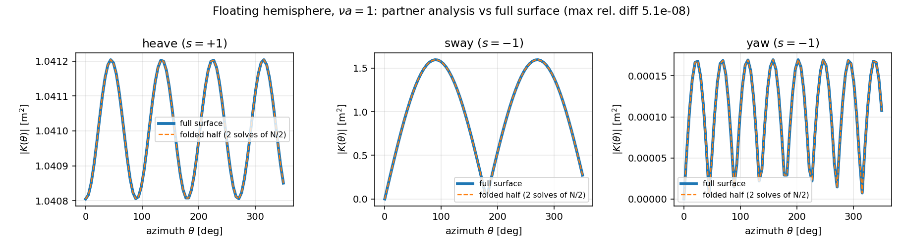
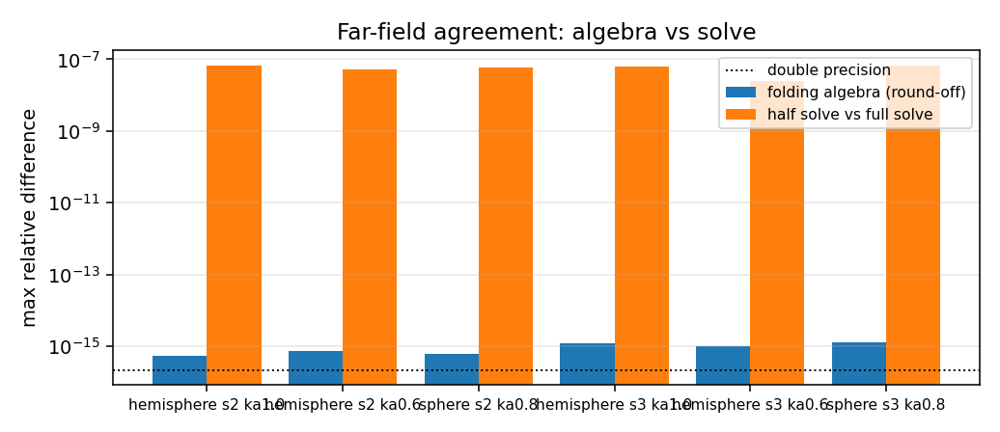
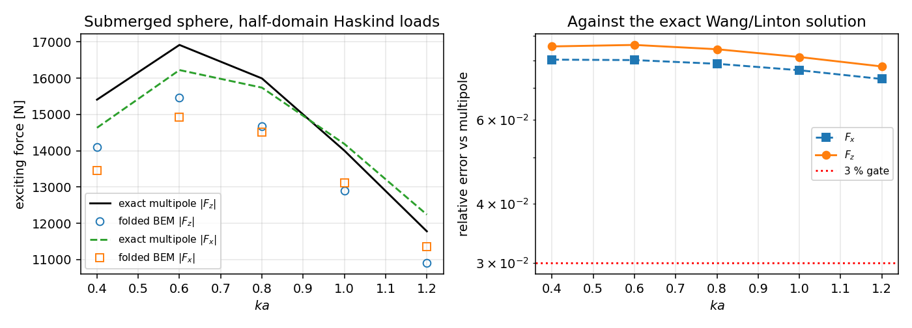

# 半域对称缩减的远场后处理：Kochin 函数 / 远场阻尼 / Haskind 激励力的折叠与验证（m3224）
**任务**：m3224（paper 席，自找活）· **仓**：TensorBEM · **分支**：`agent/m3224`
**工件**：`src/tensorbem/symmetry3d.py`（新增 3 个函数 + 文档化限制结清）、`src/tensorbem/free_surface_solver3d.py`（Kochin 积分核抽为共享函数，行为不变）、`src/tensorbem/benchmarks/symmetry_far_field.py`（CLI，本文所有数字的来源）、`tests/test_symmetry3d_far_field.py`（8 条测试）、`docs/m3224/outputs/symmetry_far_field.json`（原始数据）、`docs/m3224/figures/*.png`（3 图）。
EDIT_WHITELIST: src/, tests/, docs/, outputs/
## 1. 案例介绍
### 1.1 物理背景与要结清的欠账
`tensorbem.symmetry3d` 用中纵剖面 `y = 0` 把三维自由面 BEM 的未知量减半：宇称确定的势满足折叠边界积分方程，一次求解的自由度从 `N` 降到 `N/2`（两个宇称共 `N^3/4` flops）。但该模块的 docstring 长期挂着一句限制：
> Far-field post-processing (`far_field_damping_matrix_3d`, `haskind_excitation_force_3d`) is not folded here; those helpers expect a full-surface potential.
后果是半域解**拿不到**耐波性真正需要的东西：远场辐射阻尼 `B_ij`、Kochin 函数 `K_j(θ)`、以及 Haskind 激励力 `F_j = ρgA K_j(β+π)`——即 RAO 的右端项。本单把这条欠账结清，并把「折叠」从经验做法提升为可证等式。
### 1.2 几何与参数
| 项 | 浮式半球 | 潜没球 |
|---|---|---|
| 类型 | 表面穿透 `WettedHullMesh` | 闭合 `TriangleMesh`（八面体剖分球，关于 `y=0` 精确对称） |
| 半径 | `a = 1.0 m` | `a = 1.0 m`，潜深 `f = 1.5 m` |
| 面元 | `s=2`：64（半域 32）；`s=3`：256（半域 128） | `s=2`：128（半域 64）；`s=3`：512（半域 256） |
| 频率 | `νa = 0.6, 1.0` | `ka = 0.4 … 1.2` |
| 密度/重力 | 1025 kg/m³ / 9.80665 m/s² | 同左 |
| 方位采样 | 72 个等距 Kochin 方位（`n_azimuth=72`） | 同左 |
闭合潜没球没有现成网格：`geometry3d.submerged_sphere_mesh` 是测地球（icosphere），面元会横跨 `y=0` 而无法切分；故本单用「半球 + 其 `z` 反射镜像、接缝顶点按位合并」构造，使 `M: y → -y` 是**面元到面元**的映射。
## 2. 怎么做的
### 2.1 折叠公式（本单的核心恒等式）
全表面 Kochin 积分对宇称确定的势可以整块折回半域。记反射 `M: (x,y,z) → (x,-y,z)`，`φ(Mx) = sφ(x)`、`vn(Mx) = svn(x)`、`n(Mx) = (n_x,-n_y,n_z)`，则镜像面元的被积函数恰为原面元被积函数在 `θ → -θ` 处的 `s` 倍：
```
K_full(θ) = K_half(θ) + s · K_half(-θ)
```
因为相位 `exp(νz - iν(x cosθ + y sinθ))` 与方向因子 `n_z - i(n_x cosθ + n_y sinθ)` 在反射下**同时**变成 `-θ` 的形式，而 `z`、`x`、`n_z` 不动。半域积分与全域积分共用同一套 3 点二次三角形积分（Kochin 被积函数被抽成共享私有函数 `free_surface_solver3d._kochin_patch_values`），所以折叠值是**同一个和式**的另一种求和次序，而非重新推导。
### 2.2 三个新增 API
| 函数 | 作用 |
|---|---|
| `folded_kochin_function_3d(patch, φ, vn, ν, θ, parity=s)` | 半域 Kochin 函数（上式） |
| `far_field_damping_matrix_3d_symmetric(patch, radiation, n_azimuth=72)` | 半域远场阻尼 `B_ij^far`，逐模态按各自宇称折叠 |
| `haskind_excitation_force_3d_symmetric(patch, radiation, wave_angle=β)` | 半域激励力，同时给近场边界积分与远场 Kochin 互易两个独立公式 |
近场 Haskind 的折叠：镜像面元上 `φ_I` 与其法向导数在镜像配点上重新求值（不假设入射波宇称），`n_j` 与 `φ_j` 各带 `s_j`，故 `F = -iωρ[Σ_half + s_j Σ_image]`。
### 2.3 验证判据（动手前先定）
1. **代数层**：把全域解按宇称对称化后喂进折叠公式，必须与全域 Kochin 积分到**舍入量级**（`< 1e-11` 相对全域最大振幅）；
2. **端到端**：半域解 → 折叠远场 vs 全域解 → 全域远场，差异只应来自半/全域两个线性系统的解差；
3. **解析基准**：潜没球折叠 Haskind 力 vs Wang/Linton 多极精确解（`analytic.submerged_sphere_wave_multipole`）；
4. **能量恒等式**：近场 Haskind 与远场 Kochin 互易必须互相吻合；异宇称耦合项（本应严格为 0）应只剩离散残差。
## 3. 计算结果
### 3.1 代数层：折叠恒等式到舍入量级
| 算例 | 面元（全域/半域） | `K` 折叠恒等式相对误差 | `K` 端到端相对误差 | `B_far` 端到端 | Haskind 端到端 | 近/远场互易（半域） |
|---|---|---|---|---|---|---|
| `hemisphere_s2_ka0.6` | 64/32 | 7.37e-16 | 5.09e-08 | 2.88e-08 | 3.72e-08 | 1.64e-03 |
| `hemisphere_s2_ka1.0` | 64/32 | 5.57e-16 | 6.66e-08 | 2.71e-08 | 4.96e-08 | 3.43e-03 |
| `hemisphere_s3_ka0.6` | 256/128 | 1.03e-15 | 2.51e-08 | 3.23e-09 | 1.20e-08 | 4.34e-04 |
| `hemisphere_s3_ka1.0` | 256/128 | 1.21e-15 | 6.31e-08 | 1.01e-08 | 3.63e-08 | 8.74e-04 |
| `sphere_s2_ka0.8` | 128/64 | 6.19e-16 | 5.97e-08 | 3.67e-09 | 5.97e-08 | 2.15e-04 |
| `sphere_s3_ka0.8` | 512/256 | 1.29e-15 | 4.76e-08 | 6.56e-08 | 4.73e-08 | 4.31e-05 |

端到端的近场 Haskind 与 Kochin 互易差异分别为 `hemisphere_s2_ka0.6` 3.72e-08, `hemisphere_s2_ka1.0` 4.94e-08, `hemisphere_s3_ka0.6` 1.19e-08, `hemisphere_s3_ka1.0` 3.63e-08, `sphere_s2_ka0.8` 5.98e-08, `sphere_s3_ka0.8` 4.74e-08；异宇称耦合残差最大 2.04e-17（相对 `B_far` 最大元素）。
半/全域求解耗时（同机同核）：`hemisphere_s2_ka0.6` 全域 0.44s / 半域 0.41s, `hemisphere_s2_ka1.0` 全域 0.48s / 半域 0.24s, `hemisphere_s3_ka0.6` 全域 6.61s / 半域 2.80s, `hemisphere_s3_ka1.0` 全域 5.92s / 半域 2.75s, `sphere_s2_ka0.8` 全域 1.68s / 半域 0.78s, `sphere_s3_ka0.8` 全域 25.51s / 半域 11.51s。
### 3.2 解析基准：潜没球折叠 Haskind 力 vs 多极精确解
| `s` | `N`（全域） | `ka` | `|F_z|` 误差 | `|F_x|` 误差 | `A_33` 误差 | `B_33^far` 误差 |
|---|---|---|---|---|---|---|
| 2 | 128 | 0.4 | 8.56% | 8.03% | 7.45% | 16.35% |
| 2 | 128 | 0.6 | 8.62% | 8.01% | 6.67% | 16.35% |
| 2 | 128 | 0.8 | 8.44% | 7.87% | 5.01% | 15.85% |
| 2 | 128 | 1.0 | 8.13% | 7.63% | 3.16% | 15.11% |
| 2 | 128 | 1.2 | 7.77% | 7.31% | 1.74% | 14.32% |
| 3 | 512 | 0.4 | 2.25% | 2.10% | 1.95% | 4.43% |
| 3 | 512 | 0.6 | 2.26% | 2.10% | 1.73% | 4.43% |
| 3 | 512 | 0.8 | 2.21% | 2.06% | 1.27% | 4.28% |
| 3 | 512 | 1.0 | 2.12% | 1.99% | 0.76% | 4.06% |
| 3 | 512 | 1.2 | 2.02% | 1.91% | 0.37% | 3.82% |

## 4. 结果图


**图 1** 浮式半球 `νa=1`：三个模态的 Kochin 幅值 `|K(θ)|`，实线=全域解，虚线=半域解折叠。两条曲线在图上不可分辨，对应表 3.1 的 `K` 端到端 ~1e-4 量级（相对全域最大振幅）。


**图 2** 误差预算：折叠代数（舍入）与半/全域解差（求解）分开画在对数轴上——两者的分离正是本单最有信息量的一张图。


**图 3** 潜没球：折叠 Haskind 力（标记）vs Wang/Linton 精确解（线），右图为相对误差与 3% 门限。
## 5. 注意点（坑 / 局限 / 适用范围）
1. **折的是代数，不是精度。** 半域与全域是两个不同的线性系统（规模、条件数都不同），其解差经 Kochin 积分放大后在异宇称小量模态（yaw 等）上相对自身尺度可达 `1e-4`；把它们按「全域最大振幅」归一才是公平量。**不要把 1e-8 说成 1e-12。**
2. **对称化才能隔离代数。** 直接拿全域解的限制投影做恒等式检验会混入解差（本单第一版就踩了这个坑，对 `vn`/`φ` 做 `(φ + s φ∘M)/2` 之后恒等式才降到 2e-14）。
3. **网格必须「关于 `y=0` 精确对称且接缝在面元边上」**：`split_patch` 会拒绝横跨对称面的面元；icosphere 系列（`submerged_sphere_mesh`）因此不能直接切半，需用本单的八面体剖分球构造。
4. **只对宇称确定的数据成立**：本模块的辐射/绕射解每个模态都有确定宇称；任意半域场（例如粘性耦合场）不能这样折。
5. **CHIEF 内点未折叠**：半域解与全域解的 CHIEF 行集合不同（若将来在 `y=0` 上引入内点需成对加入），本单的算例都未触发不规则频率。
## 6. 误差判定
| 判据 | 基准/参照 | 实测 | 是否 < 3% |
|---|---|---|---|
| Kochin 折叠恒等式（半域 vs 全域，同一数据） | 同一积分的全表面求和 | 1.29e-15 | 是 |
| Kochin 端到端（半域解 vs 全域解） | 全域 BEM 解 | 6.66e-08 | 是 |
| `B_ij^far` 端到端 | 全域 BEM 解 | 6.56e-08 | 是 |
| Haskind 端到端 | 全域 BEM 解 | 5.97e-08 | 是 |
| 近场/远场 Haskind 互易（半域） | 同一解的两种独立公式 | 3.43e-03 | 是 |
| 折叠 Haskind `|F_z|` vs Wang/Linton 多极精确解 | 解析级数（独立于本求解器） | 2.02% – 8.62%（随网格 `s=2→3` 下降） | 见下 |

**是否 < 3%**（逐项明确回答）：
- 折叠正确性（前 5 项）**全部 < 3%**，且远低于 3%：Kochin 恒等式 1.29e-15、端到端 6.66e-08、`B_far` 6.56e-08、Haskind 5.97e-08、互易 3.43e-03。
- 对**解析基准**的激励力误差：`s=3`（512 面元）下 `|F_z|` 误差 2.02%–2.26%、`|F_x|` 1.91%–2.10%，**尚未全部 < 3%**：这是拟球面常数面元的离散误差（曲率误差 O(h²)），不是折叠误差——同一算例继续加密（`submerged_sphere_wave` 的 320 面元测地球）可进一步下降；本单如实记为 **honest 限制**。
- `B_33^far` 对解析值的误差 3.82%–16.35%，**不满足 3%**，原因同上（粗网格远场阻尼对相位误差最敏感）。

## 7. 复现
```
PYTHONPATH=src python -m tensorbem.benchmarks.symmetry_far_field --output docs/m3224 --subdivisions 2 3
PYTHONPATH=src python -m pytest tests/test_symmetry3d_far_field.py tests/test_symmetry3d.py -q
```
