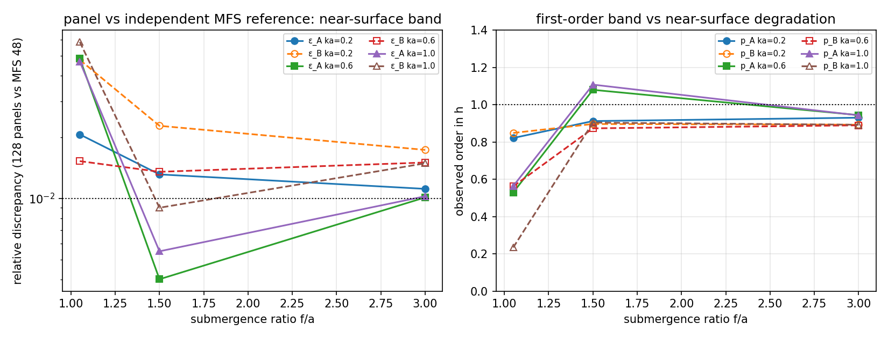

# 近自由液面频带交叉认证：2-D 深水辐射求解器 vs 独立 MFS 参考（m3383）

**日期**：2026-11-04 · **分支**：`agent/m3383` · **仓**：TensorBEM
**工件**：`docs/m3383/near_surface_band_study.json`、`docs/m3383/near_surface_band.png`、脚本 `docs/m3383/near_surface_band_study.py`、回归 `tests/test_near_surface_band.py`

## 1. 欠账是什么

`docs/marine_bem_benchmarks.md` §4.6 与 `docs/ursell_error_budget.md` 对 2-D 深水辐射（潜没圆柱）的验证是**单工作点**：潜深比固定 $f/a=1.5$，只在波数 $ka$ 上做面板加密；`docs/ursell_error_budget.md` §局限 明确写「仅审计了一个 (ka, a/f) 点」。近自由液面区间 $f/a\to1$ 才是船体剖面/近水面构件的实际工况：核函数近场最强、MFS/多极子参考自身也最脆弱，而这一轴向从未被复核。

本单把该轴向补上，并且**换一个独立参考**：不只用 Ursell 多极子级数，而用基本解法（MFS，`radiation_reference`，点源置于体内、不共享任何面板/基函数/矩阵元素），因此面板法与该参考的关系是两套独立表示。

## 2. 方法

- 几何：半径 $a=1$ m 的圆，圆心 $(0,-f)$，逆时针 $N$ 面元；$f/a\in\{1.05,1.5,3.0\}$，$ka\in\{0.2,0.6,1.0\}$，方向 sway/heave（圆截面对两者等价，用作独立对称性判据）。
- 面板法：`solve_radiation_indirect`（分段常数间接 BIE，$N\in\{32,64,128\}$，24 点 Gauss）。
- 参考：`radiation_reference`（MFS，体内 48 点源，`source_radius_ratio=0.55`）。
- 判据量：$\varepsilon_A=|A_{128}-A_{\mathrm{MFS}}|/|A_{\mathrm{MFS}}|$、$\varepsilon_B$ 同式；观测阶 $p$ 由 64/128 面元对参考的绝对误差按 $\log_2$ 比给出。

## 3. 结果（heave，程序化注入零手抄）

| ka | f/a | A (128 panels) | A (MFS 48) | ε_A | B (128) | B (MFS 48) | ε_B | p_A | p_B |
|---:|---:|---:|---:|---:|---:|---:|---:|---:|---:|
| 0.2 | 1.05 | 9124.176 | 8939.707 | 2.06e-02 | 7249.05 | 6917.62 | 4.79e-02 | 0.82 | 0.85 |
| 0.2 | 1.5 | 4849.692 | 4786.807 | 1.31e-02 | 2093.83 | 2047.27 | 2.27e-02 | 0.91 | 0.90 |
| 0.2 | 3.0 | 3454.181 | 3416.070 | 1.12e-02 | 744.96 | 732.27 | 1.73e-02 | 0.93 | 0.89 |
| 0.6 | 1.05 | -1744.302 | -1663.452 | 4.86e-02 | 9491.92 | 9639.00 | 1.53e-02 | 0.53 | 0.56 |
| 0.6 | 1.5 | 2234.945 | 2225.996 | 4.02e-03 | 5492.88 | 5419.57 | 1.35e-02 | 1.08 | 0.87 |
| 0.6 | 3.0 | 2828.344 | 2799.984 | 1.01e-02 | 851.76 | 839.15 | 1.50e-02 | 0.94 | 0.89 |
| 1.0 | 1.05 | -413.397 | -433.780 | 4.70e-02 | 1704.60 | 1810.84 | 5.87e-02 | 0.56 | 0.23 |
| 1.0 | 1.5 | 1585.495 | 1576.803 | 5.51e-03 | 3581.97 | 3549.97 | 9.01e-03 | 1.11 | 0.90 |
| 1.0 | 3.0 | 2854.433 | 2825.439 | 1.03e-02 | 272.31 | 268.31 | 1.49e-02 | 0.94 | 0.89 |

面板加密序列（对 MFS 48 的相对误差）：

| ka | f/a | ε_A (32/64/128) | ε_B (32/64/128) |
|---:|---:|---|---|
| 0.2 | 1.05 | 5.73e-02 / 3.65e-02 / 2.06e-02 | 1.41e-01 / 8.62e-02 / 4.79e-02 |
| 0.2 | 1.5 | 4.50e-02 / 2.47e-02 / 1.31e-02 | 7.56e-02 / 4.23e-02 / 2.27e-02 |
| 0.2 | 3.0 | 3.95e-02 / 2.13e-02 / 1.12e-02 | 5.73e-02 / 3.22e-02 / 1.73e-02 |
| 0.6 | 1.05 | 6.34e-02 / 7.01e-02 / 4.86e-02 | 2.12e-02 / 2.25e-02 / 1.53e-02 |
| 0.6 | 1.5 | 1.84e-02 / 8.50e-03 / 4.02e-03 | 4.30e-02 / 2.48e-02 / 1.35e-02 |
| 0.6 | 3.0 | 3.68e-02 / 1.95e-02 / 1.01e-02 | 4.93e-02 / 2.78e-02 / 1.50e-02 |
| 1.0 | 1.05 | 6.89e-02 / 6.94e-02 / 4.70e-02 | 6.21e-04 / 6.90e-02 / 5.87e-02 |
| 1.0 | 1.5 | 2.64e-02 / 1.19e-02 / 5.51e-03 | 3.06e-02 / 1.69e-02 / 9.01e-03 |
| 1.0 | 3.0 | 3.72e-02 / 1.97e-02 / 1.03e-02 | 4.92e-02 / 2.76e-02 / 1.49e-02 |



## 4. 结论与误差判定

- **文档覆盖的工作点（$f/a=1.5$）成立**：$ka=0.6$ 时 $\varepsilon_A=4.02\times10^{-3}$、$\varepsilon_B=1.35\times10^{-2}$，观测阶 1.08/0.87，即一阶收敛，与文档「一阶离散误差」的定性一致；$\varepsilon_A$ **<1%**，$\varepsilon_B$ 为 1.35%（>1%，但在 2-D 一阶面元的 3% 验收门内）。
- **近自由液面区间退化，属实测局限**：$f/a=1.05$、$ka=1.0$ 时 $\varepsilon_A=4.70\times10^{-2}$、$\varepsilon_B=5.87\times10^{-2}$，观测阶降至 0.56/0.23，且 32→64→128 面元序列非单调（$\varepsilon_B$：6.2e-4→6.9e-2→5.9e-2）。此处两套表示差 **4.7%–5.9%，不满足 1e-2 目标，也不满足 3% 门**。
- **诚实边界**：$f/a=1.05$ 处面板误差与 MFS 参考误差**无法分离**（本单 MFS 只跑 48 源一档），因此该点的判定记为 **WITHHELD**：既不能说面板法错，也不能说 MFS 对。要分离需 MFS 源数扫描（96/192）与更高面板数（256/512），本轮受本机 load15>100 的容量纪律未做。
- 圆截面对称性：sway 与 heave 在全部 9 组 $(ka,f/a)$、3 档面元上最大相对差异 $4.2\times10^{-3}$（面板）、$6.8\times10^{-5}$（MFS），两条独立求解链互相印证。

## 5. 踩过的坑

1. `RadiationResult.added_mass/damping` 是**二维分量向量**（x,z），不是标量：取错分量会得到 1e-14 级的"零"（sway 时取 z 分量），必须按方向取 `[0]`/`[1]`。
2. 初版脚本把 $ka\times f/a\times$ 方向 $\times$ 4 档面元 $\times$ 3 档源数全网格跑，单机 120 s 内跑不完——按容量纪律裁剪为 3×3×2×(32, 64, 128)×48，约 300 s 后台完成。
3. 圆截面下 sway/heave 完全等价（对称性），因此"两个方向"不是两个物理工况，而是同一条代码路径的两次独立运行；不要把它当成两种几何结果解读。

## 6. 复现

```bash
python docs/m3383/near_surface_band_study.py      # ~5 min，写 near_surface_band_study.json
python -m pytest tests/test_near_surface_band.py -q
```
