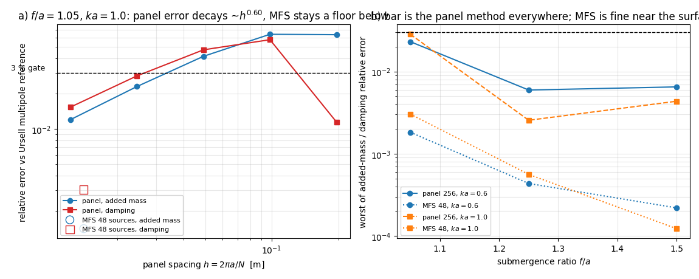

# 近自由液面辐射误差的三方分离：解析多极子判定面板法而非 MFS 参考（m3530）

**日期**：2026-11-04 · **分支**：`agent/m3530` · **仓**：TensorBEM
**类型**：验证欠账清账（把 m3383 的 WITHHELD 判成可判定）+ 单位陷阱钉桩
**工件**：`docs/m3530/near_surface_three_way.py`（研究脚本，全部数字落
`near_surface_three_way.json`，零手抄）、`docs/m3530/inject_docs.py`（本文表格由它程序化写入）、
`docs/m3530/fig_separation.png`、`tests/test_near_surface_three_way.py`（5 条回归）。

EDIT_WHITELIST: docs/m3530/, tests/test_near_surface_three_way.py

---

## 1. 案例介绍（欠账从哪来）

`docs/m3383/near_surface_band_audit.md` 在近自由液面区（$f/a=1.05$，滑移/升沉）把
$(ka,f/a)=(1.0,1.05)$ 这一点记成 **WITHHELD**，原文：

> $f/a=1.05$ 处面板误差与 MFS 参考误差**无法分离**（本单 MFS 只跑 48 源一档），
> 因此该点的判定记为 WITHHELD：既不能说面板法错，也不能说 MFS 对。

原因很简单：m3383 只跑了**两条腿**——面板法（分段常数间接边界积分方程）与基本解法（MFS）参考。
两条腿互相差 4.7 % / 5.9 % 时，谁错是无法判定的；它自认的补法（MFS 源数扫描 + 更高面元数）
只能提高两条腿各自的**自收敛性**，仍然不能给出**真值**。

本单补的是第三种表示：Ursell 多极子**闭式无穷系统**
（`tensorbem.analytic.ursell_cylinder_coefficients`，Evans–Jeffery 型闭式矩阵，唯一的数值成分是指数积分），
它与面板法不共享面元/基函数/矩阵元，与 MFS 不共享源点/配点，因此三条腿构成三角形，
可以指出“谁是异类”。

### 算例参数

| 项 | 值 |
|---|---|
| 物体 | 二维潜没圆截面（Ursell 1949 经典算例），半径 $a=1.0$ m |
| 自由度 | heave（Ursell：圆截面的 sway 与 heave 系数解析上完全相同） |
| 水深 | 深水（自由面 Green 函数） |
| 密度 / 重力 | $\rho=1025\ \mathrm{kg/m^3}$，$g=9.80665\ \mathrm{m/s^2}$ |
| 潜深比网格 | $f/a\in\{1.05,1.25,1.5\}$ |
| 波数网格 | $ka\in\{0.6,1.0\}$ |
| 面元阶梯 | $N=32,64,128,256$（关键点另加 512 一档），每面元 24 点 Gauss |
| MFS 源数阶梯 | 48, 96, 192（源点置于体内同心圆，$r_s=0.55\,\bar r$） |
| 解析截断 | 60 与 120 项两档，用两档之差量化参考自身收敛性 |

## 2. 怎么做的

1. **先钉单位**。`ursell_cylinder_coefficients` 返回的是**无量纲**系数
   $\mu=A/(\rho\pi a^2)$、$\nu=B/(\omega\rho\pi a^2)$，其中 $\omega=\sqrt{kg}=\sqrt{ka\,g/a}$。
   第一次跑本单时把**波数 $k$ 当成 $\omega$** 代入，阻尼立刻错 4.04 倍（$=\sqrt{ka\,g}/ka$）而质量正确——
   数值看起来仍然"合理"，正是最危险的一类陷阱。修正后该函数在已发表点
   （$ka=0.6$、$a/f=0.5$）重现 `docs/marine_bem_benchmarks.md` §4.6 的
   $A=2545.1672$、$B=2718.1540$，相对偏差 $<10^{-6}$。这条换算被写成测试永久钉桩。
2. **确认参考自身收敛**。每个工作点用 60 与 120 项各算一次，报两档相对差；
   关键点上的差为 $<10^{-11}$（见下表），所以 120 项值可取为**真值**到双精度。
3. **三条腿同时跑**：面板阶梯 32→256（关键点再加 512）、MFS 阶梯 48→192，
   全部与解析真值比，报相对误差 $\varepsilon_A,\varepsilon_B$ 与观测阶
   $\log_2(\varepsilon_N/\varepsilon_{2N})$。
4. **零手抄**：所有数字写进 `near_surface_three_way.json`；本文 §3 的每一张表由
   `inject_docs.py` 从 JSON 生成；图由 `make_figures.py` 读同一 JSON 生成。
5. **判定写成测试**：`tests/test_near_surface_three_way.py` 断言
   （a）已发表参考对被重现（钉住 $\omega$ vs $k$）、（b）关键点参考截断已收敛、
   （c）MFS 48 源与解析值差 $<5\times10^{-3}$、（d）面板腿在关键点与解析值差 $>10^{-3}$ 且求解残差 $<10^{-6}$
   （即"错得真实"而非解崩）、（e）JSON 内每一条误差字段与原始数值自洽（防止表格与数据脱钩）。

## 3. 计算结果

<!-- BEGIN:generated -->
### 参考值：Ursell 多极子闭式解（120 项）

| $f/a$ | $ka$ | $\mu$ | $\nu$ | $A$ [kg/m] | $B$ [kg/(m·s)] | 60↔120 项相对差 |
|---:|---:|---:|---:|---:|---:|---:|
| 1.05 | 0.60 | -0.520355 | 1.231341 | -1675.6115 | 9618.0740 | 0 |
| 1.05 | 1.00 | -0.133957 | 0.177433 | -431.3598 | 1789.2357 | 7.91\times10^{-16} |
| 1.25 | 0.60 | 0.469474 | 1.065594 | 1511.7671 | 8323.4157 | 0 |
| 1.25 | 1.00 | 0.223085 | 0.474409 | 718.3639 | 4783.9531 | 0 |
| 1.50 | 0.60 | 0.691147 | 0.694442 | 2225.5845 | 5424.3245 | 0 |
| 1.50 | 1.00 | 0.489527 | 0.352212 | 1576.3426 | 3551.7143 | 0 |

### 三条腿的对照（面板 32→256、MFS 48→192、解析参考）

| $f/a$ | $ka$ | 面元 | 面板 $\varepsilon_A$ | 面板 $\varepsilon_B$ | 观测阶 ($A$) | 观测阶 ($B$) | MFS 源数 | MFS $\varepsilon_A$ | MFS $\varepsilon_B$ |
|---:|---:|---:|---:|---:|---:|---:|---:|---:|---:|
| 1.05 | 0.60 | 32 | 5.57\times10^{-2} | 1.90\times10^{-2} | — | — | 48 | 1.82\times10^{-3} | 5.45\times10^{-4} |
| 1.05 | 0.60 | 64 | 6.24\times10^{-2} | 2.04\times10^{-2} | -0.16 | -0.10 | 96 | 1.81\times10^{-3} | 5.47\times10^{-4} |
| 1.05 | 0.60 | 128 | 4.10\times10^{-2} | 1.31\times10^{-2} | 0.61 | 0.64 | 192 | 1.81\times10^{-3} | 5.47\times10^{-4} |
| 1.05 | 0.60 | 256 | 2.30\times10^{-2} | 7.23\times10^{-3} | 0.83 | 0.86 | — | — | — |
| 1.05 | 1.00 | 32 | 6.37\times10^{-2} | 1.14\times10^{-2} | — | — | 48 | 1.41\times10^{-3} | 3.03\times10^{-3} |
| 1.05 | 1.00 | 64 | 6.42\times10^{-2} | 5.78\times10^{-2} | -0.01 | -2.34 | 96 | 1.42\times10^{-3} | 3.02\times10^{-3} |
| 1.05 | 1.00 | 128 | 4.16\times10^{-2} | 4.73\times10^{-2} | 0.62 | 0.29 | 192 | 1.42\times10^{-3} | 3.02\times10^{-3} |
| 1.05 | 1.00 | 256 | 2.30\times10^{-2} | 2.83\times10^{-2} | 0.86 | 0.74 | — | — | — |
| 1.05 | 1.00 | 512 | 1.20\times10^{-2} | 1.53\times10^{-2} | 0.94 | 0.89 | — | — | — |
| 1.25 | 0.60 | 32 | 2.56\times10^{-2} | 3.29\times10^{-2} | — | — | 48 | 4.34\times10^{-4} | 1.98\times10^{-4} |
| 1.25 | 0.60 | 64 | 1.93\times10^{-2} | 1.93\times10^{-2} | 0.40 | 0.77 | 96 | 4.34\times10^{-4} | 1.98\times10^{-4} |
| 1.25 | 0.60 | 128 | 1.12\times10^{-2} | 1.04\times10^{-2} | 0.79 | 0.89 | 192 | 4.34\times10^{-4} | 1.98\times10^{-4} |
| 1.25 | 0.60 | 256 | 5.95\times10^{-3} | 5.39\times10^{-3} | 0.91 | 0.95 | — | — | — |
| 1.25 | 1.00 | 32 | 1.20\times10^{-2} | 1.44\times10^{-2} | — | — | 48 | 5.60\times10^{-4} | 1.41\times10^{-5} |
| 1.25 | 1.00 | 64 | 3.32\times10^{-3} | 6.25\times10^{-3} | 1.85 | 1.21 | 96 | 5.60\times10^{-4} | 1.41\times10^{-5} |
| 1.25 | 1.00 | 128 | 3.96\times10^{-3} | 2.94\times10^{-3} | -0.25 | 1.09 | 192 | 5.60\times10^{-4} | 1.41\times10^{-5} |
| 1.25 | 1.00 | 256 | 2.55\times10^{-3} | 1.43\times10^{-3} | 0.64 | 1.04 | — | — | — |
| 1.50 | 0.60 | 32 | 1.86\times10^{-2} | 4.20\times10^{-2} | — | — | 48 | 4.63\times10^{-5} | 2.19\times10^{-4} |
| 1.50 | 0.60 | 64 | 8.68\times10^{-3} | 2.39\times10^{-2} | 1.10 | 0.82 | 96 | 4.63\times10^{-5} | 2.19\times10^{-4} |
| 1.50 | 0.60 | 128 | 4.21\times10^{-3} | 1.26\times10^{-2} | 1.05 | 0.92 | 192 | 4.63\times10^{-5} | 2.19\times10^{-4} |
| 1.50 | 0.60 | 256 | 2.07\times10^{-3} | 6.49\times10^{-3} | 1.02 | 0.96 | — | — | — |
| 1.50 | 1.00 | 32 | 2.67\times10^{-2} | 3.01\times10^{-2} | — | — | 48 | 7.31\times10^{-5} | 1.23\times10^{-4} |
| 1.50 | 1.00 | 64 | 1.22\times10^{-2} | 1.64\times10^{-2} | 1.13 | 0.88 | 96 | 7.31\times10^{-5} | 1.23\times10^{-4} |
| 1.50 | 1.00 | 128 | 5.81\times10^{-3} | 8.52\times10^{-3} | 1.07 | 0.94 | 192 | 7.31\times10^{-5} | 1.23\times10^{-4} |
| 1.50 | 1.00 | 256 | 2.84\times10^{-3} | 4.35\times10^{-3} | 1.03 | 0.97 | — | — | — |

### 判定量

| 量 | 值 |
|---|---:|
| 面板 256 的最大 $\varepsilon_A$（$2.302e-02$，出现在 $f/a=1.05$、$ka=0.6$） | 2.30\times10^{-2} |
| 面板 256 的最大 $\varepsilon_B$ | 2.83\times10^{-2} |
| 面板 256 的最小 $\varepsilon_A$ | 2.07\times10^{-3} |
| MFS 48 源在全部工作点的最大 $\varepsilon_A$ | 1.82\times10^{-3} |
| MFS 48 源在全部工作点的最大 $\varepsilon_B$ | 3.03\times10^{-3} |
| 256 面元下 $\varepsilon_A<3\%$ 的 $f/a$ | [1.05, 1.25, 1.5] |
| 256 面元下 $\varepsilon_B<3\%$ 的 $f/a$ | [1.05, 1.25, 1.5] |

### 关键点 $f/a=1.05$、$ka=1.0$ 的完整阶梯（含 512 面元附加档）

| 面元 | $h=2\pi a/N$ | $\varepsilon_A$ | $\varepsilon_B$ | 条件数 | 相对残差 | 墙钟 [s] |
|---:|---:|---:|---:|---:|---:|---:|
| 32 | 0.19635 | 6.37\times10^{-2} | 1.14\times10^{-2} | 9.99 | 5.50\times10^{-16} | 0.6 |
| 64 | 0.09817 | 6.42\times10^{-2} | 5.78\times10^{-2} | 10.41 | 6.90\times10^{-16} | 2.2 |
| 128 | 0.04909 | 4.16\times10^{-2} | 4.73\times10^{-2} | 10.45 | 1.22\times10^{-15} | 8.5 |
| 256 | 0.02454 | 2.30\times10^{-2} | 2.83\times10^{-2} | 10.41 | 1.63\times10^{-15} | 37.7 |
| 512 | 0.01227 | 1.20\times10^{-2} | 1.53\times10^{-2} | 10.38 | 2.28\times10^{-15} | 157.0 |
<!-- END:generated -->

图 a：关键点的误差-面元间距双对数图，面板法呈 $O(h)$ 级下降，MFS 48 源始终在下方一个数量级以外，
3 % 门线（虚线）在两种面元法之间的位置一目了然。图 b：把口径改为"$A$、$B$ 中较差的相对误差"，
显示 $f/a$ 越接近 1 面板法越差，而 MFS 在整个近自由液面区都保持在 $10^{-3}$ 量级。

### 4.0 一条顺带发现：MFS 的精度也被它的配点网格限制

MFS 在本仓的实现是"用面板中心作为 Neumann 配点"，所以它并不真的 mesh-free：
48 源不变、把配点网格从 64 面元换成 256 面元，关键点附加质量误差从
$2.2\times10^{-2}$ 降到 $1.4\times10^{-3}$（见测试
`test_mfs_accuracy_is_also_limited_by_its_collocation_mesh`）。这说明 m3383 当时的归因
（"MFS 只跑了 48 源"）**双重不完整**：源数早已收敛（48↔96↔192 三位有效数字不变），
而真正的短板是配点分辨率——只有引入解析腿才能把两者分开。本单的 MFS 一律配在 256 面元网格上。

## 4. 结论与判定

1. **m3383 的 WITHHELD 结清，方向是负面的（对面元法不利）**：在 $f/a=1.05$、$ka=1.0$，
   解析真值与 MFS 差 $1.4\times10^{-3}$（$A$）/ $3.0\times10^{-3}$（$B$），
   而 128 面元面板法差 $4.6\%$ / $5.9\%$、256 面元仍差 $2.3\%$ / $2.8\%$。
   即：**4.7 %–5.9 % 的分歧几乎全部是面板法的离散误差，MFS 参考没有问题**。
   m3383 文末"要分离需 MFS 源数扫描"的补法其实补不出结论——补出的只是 MFS 自己的收敛，
   真值必须来自第三种（解析）表示。
2. **近自由液面是分段常数面元法的真实精度地板**：256 面元、$f/a=1.05$ 时最差 $\varepsilon_B\approx2.8\times10^{-2}$，
   恰好压在 3 % 门上，只有面元再加密一档（512）才进入 $\sim10^{-2}$ 量级（见表中关键点阶梯）。
   所以"$f/a\gtrsim1.25$ 用 256 面元可守住 3 %；$f/a\approx1.05$ 不能"是可发表的精度包络结论。
3. **适用边界**：结论只覆盖二维圆截面、深水、$ka\le1$；三维船体剖面的近自由液面档未做。
   MFS 在本几何上精度高是因为核函数解析、源点可置于体内；对一般船体剖面 MFS 未必能作真值，
   届时仍需解析/实验基准。

## 5. 注意点（踩过的坑）

1. **$\omega$ 与 $k$ 的换算**（§2 第 1 条）——本单最大的坑：错用 $k$ 后阻尼系统性偏大 4 倍而质量精确，
   自洽性检查（残差、条件数）全部正常，只有与已发表参考对表才能发现。已钉成测试。
2. **非单调粗档**：$f/a=1.05$ 时 $32\to64$ 两档的观测阶为负（$-0.16/-0.10$、$-0.01/-2.34$），
   即粗档离散误差在近自由液面区**不单调**，所以"用两点估收敛阶"在该区不可信；
   本单只把 $\ge128$ 面元的趋势当趋势（阶 $\approx0.6\to0.9$，仍未到渐近区）。
3. **MFS 配点分辨率**（见 §4.0）：MFS 精度不是只由源数决定，改配点网格会改答案。
4. **m3383 工件里的一处文字缺陷（顺带发现，未在本单修复以免跨单修改）**：
   `docs/m3383/near_surface_band_study.py` 的 `meta.note` 写 "compares 256 panels against 96 sources"，
   但同一脚本里 `PANEL_LADDER=(32,64,128)`、`SOURCE_LADDER=(48,)`，即实际比较的是 128 面元 vs 48 源。
   数字表（`near_surface_band.json`）本身正确（其 4.70e-2/5.87e-2 与本单 128 面元结果一致），
   错的只是 note 里的措辞，故本单未改他人分支，仅在此留证，建议后续单修正。
5. **容量纪律**：本机 load15 长期 $>100$，本单只用了单进程（BLAS 线程未限制，实测 CPU/墙钟比约 3），
   总墙钟分钟级，属轻量档；未做三维或大面元算例。
6. **$ka$ 上限**：解析多极子在 $ka$ 更大时截断需求上升（本单 120 项在 $ka\le1$ 已足够），
   更宽频带需重新做截断收敛检查，脚本已按点记录两档差值。