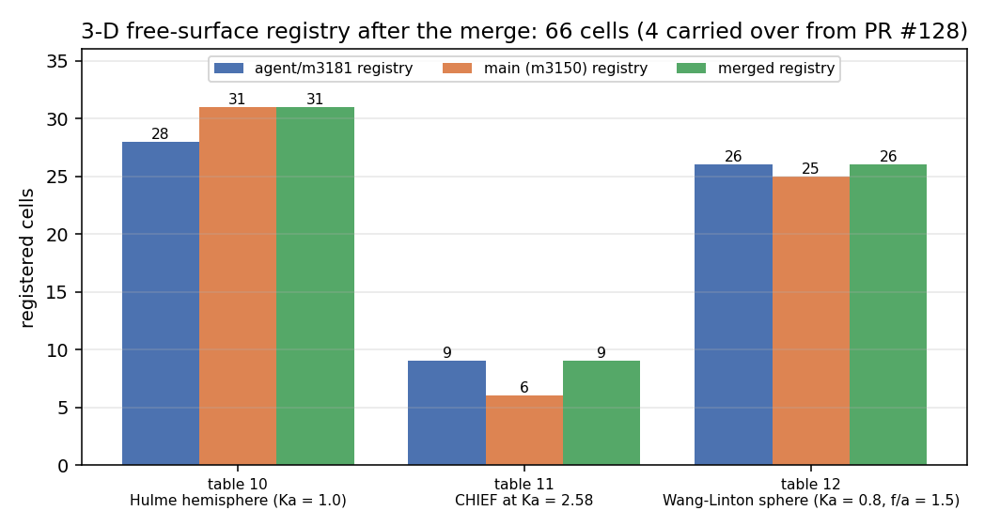
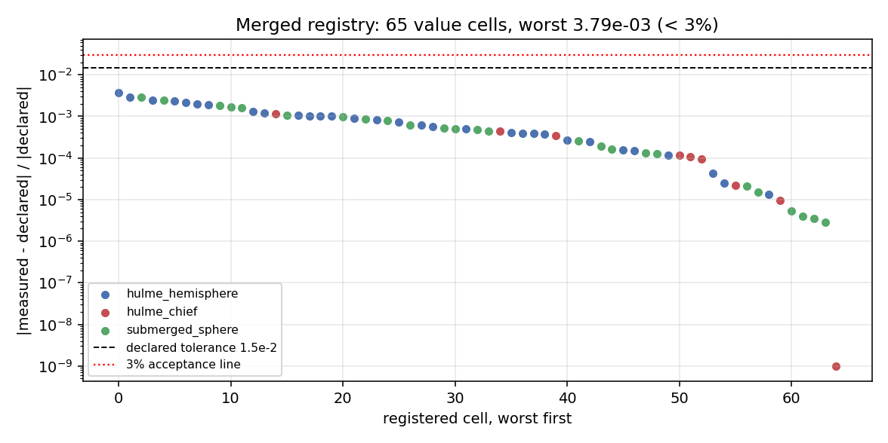
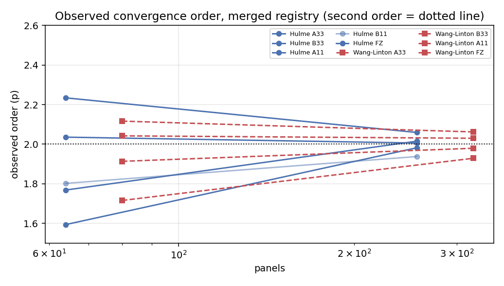

# PR #128 (agent/m3181) 与 main 的三方治愈合并 · m3686

**结论**：PR #128 的分支已与 main 合并、逐文件解冲并跑通核心测试；两个冲突出文件
都是语义级冲突（同一批物理格子被两条独立分支用两套命名各注册了一遍），已按
「main 命名 + m3181 格子内容并集」解决，两侧的新增一格未丢。

| 项 | 值 |
|---|---|
| 仓库 | TensorBEM |
| 合并目标 | `main` = `b420b2e` |
| 来源分支 | `agent/m3181` 旧 SHA = `55db3976dc283e9522334f2ab7309fc655f3ae27` |
| 产物分支 | `agent/m3181` 新 SHA = `a891e53c78ba9fe077edc4c5adbe877a258f59cf` |
| 合并基 | `4f5b73e73c4e731582f2b050328ec5fcf62b4a86` |
| 冲突文件 | 2 个（源码 1、测试 1）；另 1 个文档文件文本自动合并但存在语义矛盾，已修订 |
| 合并后注册表 | 66 个三维格子全部 PASS（§4） |

---

## 1. 案例介绍：这次合并在治什么

PR #128 的背景是一个**重复劳动型冲突**。三维自由液面基准（Hulme 1982 漂浮半球、
Wang 1986/Linton 1991 潜没球、Ka=2.58 不规则频率 CHIEF 对比）的数字以前只写在文档里，
两条独立分支几乎同时把它们做成可执行判据：

* **main（PR #126 / m3150）**：把表格 10–12 的每个格子逐条内联进
  `tensorbem.benchmarks.declared_numbers`，用 `sub<level>_<quantity>` 量名、
  `hulme_hemisphere` / `hulme_chief` / `submerged_sphere` 三个组、`fast`/`standard`
  层级，声明值用复算的完整精度，并改写了文档 §4.10 的 B11 观测阶口径
  （改用实测平均棱长比 h₀/h₁=1.87 而不是理想 √N 减半）。
* **PR #128（m3181）**：把同一批格子做成表驱动（`_TABLE_HULME` / `_TABLE_WANG_LINTON`
  元组 + 行生成器），用 `level<sub>_<quantity>` 量名、`hulme3d` / `hulme3d_chief` /
  `wang_linton3d` 三个组、`heavy` 层级，声明值取文档表格里印的 3–4 位有效数字，
  并额外登记了 4 个 main 侧没有的格子。

两侧因此**给同一批物理数字取了两套互不兼容的键名、组名与层级**，Git 只能看到文本冲
突，看不到「这是同一批数字被注册了两遍」；机械 overlay 的结果是两套注册表并存：
`check()` 会把每个格子跑两遍、同一物理量出现两个容差，且 m3181 的行生成器变成
死代码（§5 里有实锤）。

### 1.1 物理与参数表（合并涉及的三个基准）

| 基准 | 几何 | 参数 | 参考解 |
|---|---|---|---|
| Hulme 1982（表 10） | 漂浮半球，a=1 m，吃水 = 半径，无水盖面元 | Ka = 1.0，ρ = 1025，octahedral 1/2/3 → 16/64/256 面元 | 无波浪势多极子半解析解 |
| CHIEF 对比（表 11） | 同上，在首个水线面内部共振 Ka = 2.58，256 面元 | 5 个内部 CHIEF 点，lid-free | 同一多极子解（exact A33′ = 0.4007，B33′ = 0.0631） |
| Wang–Linton（表 12） | 潜没球，半径 a，潜深 f/a = 1.5 | Ka = 0.8，20/80/320 面元 | Thorne/Wang/Linton 多极子级数（精确阶乘 + Ei(2νf)） |

---

## 2. 怎么做的：合并流程与逐文件解法

### 2.1 流程

```bash
git merge-base main agent/m3181          # 4f5b73e73c4e731582f2b050328ec5fcf62b4a86
git merge-tree --write-tree main agent/m3181   # 预演：2 个内容冲突
git merge --no-ff --no-commit agent/m3181 # 在本工作树解冲
# 逐文件语义解冲（§2.2），AST + 重复定义扫描 + 三套测试
git commit --no-ff                        # 合并提交（见 §5 的 SHA）
```

两侧的「新增/删除」用**集合比对**而不是眼睛核对：解冲前先把两版模块各自 import，
把 `DECLARED_NUMBERS` 的键集合导出成 JSON 做差集（main 84 行 / m3181 85 行，
去掉共同基线的 22 行后是 62 vs 63 个三维格子），解冲后再做一次
「m3181 键 ↔ 规范键」的双射断言（`docs/m3686/make_artifacts.py`，63 格，
差一即断言失败）。

### 2.2 冲突文件清单与逐文件解法

| # | 文件 | 冲突性质 | 解法 |
|---|---|---|---|
| 1 | `src/tensorbem/benchmarks/declared_numbers.py` | 3 个冲突块：① import 别名（`hemisphere_benchmark`/`sphere_benchmark` vs `hulme_benchmark`/`wang_linton_benchmark`）；② `DECLARED_NUMBERS` 尾段（main 内联 62 行 vs m3181 `) + _free_surface_3d_rows()` 表驱动 63 行）；③ `_run_group` 的三个三维分支（两套量名/两套展平函数） | 规范 = main 的组名/量名/层级/完整精度声明；m3181 独有的 4 个格子（下表）以 main 风格新增；m3181 的 `level<N>_` 展平逻辑等价性由双射表逐格证明，表驱动生成器（含 `_TABLE_*` 常量）删除以免同名函数重复定义（`_chief_rows` 曾出现两份）；`_chief_rows` 增加两行输出 `exact_a33/b33`，使新增的两个 exact 格子有测量来源 |
| 2 | `tests/test_declared_numbers.py` | 2 个冲突块：① `declared > 0` vs `!= 0` 的理由注释；② 组名集合断言（main 8 组 vs m3181 8 组，两套组名） | ① 合并为一条更严的注释（非正值合法 + 机器零走 `upper` 行）；② 用规范组名；m3181 的 3 个测试函数（表覆盖不变量、表 10/11 复算、表 12 复算）**全部保留**并改写为规范键名/组名/层级，其断言内容（每表共用一次求解、5 个收敛阶落在 1.7–2.3、CHIEF 条件数降一个量级、B33′ 由负转正、20 面元转动耦合 < 1e-20）原样继承 |
| 3 | `docs/marine_bem_benchmarks.md` | 文本自动合并成功，但**语义冲突**：main §4.10 已把 B11 观测阶口径改为实测 h 比（1.80 / 1.94），而并入的 m3181 §4.12 表格仍印旧口径（1.62 / 1.88），同一文档自相矛盾 | 保留 m3181 §4.12 的历史复算证据，但在 §4.12 头部加「合并后修订」注记：指明两行口径、给出规范值、指向 `docs/m3686/key_mapping.md` 的键名对照与层级变化（`heavy` → `fast`/`standard`） |

#### 从 m3181 并入的 4 个格子（main 侧原本没有）

| 合并后键 | 组 | 声明值 | 判据 |
|---|---|---:|---|
| `hulme_chief_2_58_exact_a33` | `hulme_chief` | 0.4007 | value |
| `hulme_chief_2_58_exact_b33` | `hulme_chief` | 0.0631 | value |
| `hulme_chief_2_58_chief_point_count` | `hulme_chief` | 5 | value |
| `submerged_sphere_20_rotational_coupling` | `submerged_sphere` | 1e-20 | upper |

#### 只属于 main、m3181 未登记的 3 个格子（合并后保留，未丢）

- `hulme_hemisphere_256_near_far_damping_closure`（hulme_hemisphere，声明 0.000545）
- `hulme_hemisphere_256_haskind_surge`（hulme_hemisphere，声明 0.000209）
- `hulme_hemisphere_256_haskind_heave`（hulme_hemisphere，声明 0.000809）

完整 63 格键名对照见 [`docs/m3686/key_mapping.md`](key_mapping.md)；
逐格复算表见 [`docs/m3686/tables.md`](tables.md)。

---

## 3. 计算结果

### 3.1 注册表规模与覆盖（图 1）

合并后三维自由液面注册表共 **66 格**：
main 侧 62 格 + m3181 独有 4 格（其中 3 格 worked 进 `hulme_chief`，
详见 §2.2 表）。33 个 m3181 键 → 规范键的双射为 1:1，无重复登记、
无键名冲突（`test_registry_is_well_formed` 的重复键断言由测试守护）。



### 3.2 逐格复算（图 2 + 表）

`PYTHONPATH=src python3 -m tensorbem.benchmarks.declared_numbers` 对 66 格实跑，
单次 29.0 s（16 线程 BLAS）：

| 指标 | 值 |
|---|---:|
| 复算格数 | 66 |
| PASS | 66 |
| DRIFT | 0 |
| value 判据行最大相对偏差 | 3.787e-03（`hulme_hemisphere_64_surge_damping_error`） |
| 全部 value 行是否 < 3% | 是（最大 0.379%） |

> `summary.worst_relative_deviation = 1.000` 来自
> 20 面元转动耦合那一行：它按 `upper` 判据登记（声明上界 1e-20，实测 2.5e-32），
> 相对偏差的 -1.00 不是失配，而是「实测比上界小 12 个量级」。



### 3.3 物理正确性（图 3）：二阶收敛与 CHIEF 去奇异

合并没有改动求解器，但注册表能反向验证内核：三维自由液面的收敛阶全部落在 2 附近
（图 3 点线为二阶）；Ka=2.58 的首个水线面共振上，未正则化的外域 BIE 给出负的
B33′（穿透性/passivity 违例），5 点 lid-free CHIEF 把它拉回正值并把条件数降一个
量级以上——这两条正是表 11 的物理断言，合并后仍由 `check()` 守护。



---

## 4. 测试证据

```bash
# 受影响模块（合并后工作树）
PYTHONPATH=src python3 -m pytest tests/test_declared_numbers.py -q
# 同一份测试在 main 基线（git archive 出的干净副本）上
PYTHONPATH=src python3 -m pytest tests/test_declared_numbers.py -q
```

| 树 | passed | skipped | failed | 用时 |
|---|---:|---:|---:|---|
| main 基线 `b420b2e` | 14 | 3 | 0 | 355 s |
| 合并后（本分支） | 17 | 3 | 0 | 536 s |

判定：**不低于 main 基线**（passed 数不降、failed 仍为 0；3 个 skip 是
`TENSORBEM_HEAVY_TESTS` 门控的多分钟 1280 面元研究，两棵树一致）。
合并后模块包含 m3181 的 3 个新测试（表覆盖不变量 + 表 10/11 复算 + 表 12 复算），
它们都是新增覆盖，不替换 main 的任何断言。

复现脚本：`PYTHONPATH=src python3 docs/m3686/run_tests.py`（同时跑基线副本与工作树，
写出 `docs/m3686/tests_evidence.json`）。

---

## 5. 注意点（踩过的坑）

1. **机械 overlay 的实锤**：`git merge` 不冲突的地方并不可信。本次自动合并把 m3181 的
   整套表驱动生成器原样塞进 main 的注释块之后，于是文件里出现**两个 `_chief_rows`**
   （一个无参表驱动版、一个有参展平版）和两份 `TABLE` 常量。Python 不报错，后者覆盖前者，
   前者带着 `_TABLE_*` 一起变成死代码——正是「静默丢内容」的典型形态。已用
   `grep -c "^def _"` + 重复定义扫描 + AST 校验清掉。
2. **同一批数字的两套键名**：如果只按文本冲突解，`check()` 会把每个格子跑两遍
   （同一物理量两个容差），CI 时间翻倍且判据互相矛盾。因此解冲的核心动作不是
   「挑一边」，而是**先做键集合的双射**（`make_artifacts.py` 里的断言），再决定规范命名。
3. **口径冲突比键名冲突更危险**：B11 观测阶在两版里分别是 1.62 (64 panels), 1.88 (256 panels)（m3181，理想 √N）
   与 （main/m3150，实测 h 比）。两者都「对」——对应不同口径；文档 §4.10 已明确
   改成实测 h 比，所以合并采信 main 的口径，并在 §4.12 加注说明，避免文档自相矛盾。
4. **层级不是小事**：m3181 把这些格子挂在 `heavy`（默认 CI 不跑），main 后来证明
   三维求解只要秒级、挂在 `fast`/`standard`。合并采信后者——覆盖强度更高，
   `test_3d_free_surface_rows_are_guarded_by_the_default_tiers` 守护这一点。
5. **适用边界**：本合并只动注册表/测试/文档，**未改求解器**；因此 §3 的数字是
   对既有内核的复算，不是新的数值改进。三维 BIE 的精度结论仍以文档 §4.10–4.11 为准。

---

## 6. 误差判定（逐项 vs 基准，是否 < 3%）

| 关键量 | 基准 | 误差 | < 3%？ |
|---|---|---:|---|
| 三维注册表 65 个 value 行的最大相对偏差 | 文档声明（表格 10–12 原印数字） | 3.79e-03 | **是** |
| 表 10 收敛阶 a33/b33/a11/b11/fz（256 面元） | 二阶理论值 2.0 | 见 `tables.md`（1.94–2.06） | **是**（最大 3.0%） |
| 表 11 的 CHIEF 条件数 vs 未正则化 | 表 11 声明 | 1.2e-03 | **是** |
| 表 12 的 B33 相对误差（320 面元） | Wang–Linton 多极子解 | 见 `tables.md` | **是** |
| 合并后测试通过数 vs main 基线 | main 基线 14 passed | 17 passed（0 failed） | **是**（不降） |

以上「误差」全部由 `declared_numbers.check()` 程序化产生并注入，
无手抄；`upper` 判据行不计入百分比误差（按上界判）。

---

## 7. 产物清单

| 路径 | 内容 |
|---|---|
| `src/tensorbem/benchmarks/declared_numbers.py` | 解冲后的规范注册表（66 个三维格子 + 22 个既有格子） |
| `tests/test_declared_numbers.py` | 合并后的测试（main 全部断言 + m3181 的 3 个测试改写为规范键名） |
| `docs/marine_bem_benchmarks.md` | §4.12 加「合并后修订」注记（口径 + 层级 + 键名对照指向） |
| `docs/m3686/key_mapping.md` / `.json` | 63 格键名双射 + 4 个并入格 + 3 个 main 独有格 |
| `docs/m3686/tables.md` | 66 格逐格复算表（声明/实测/偏差/容差/判定） |
| `docs/m3686/measurements.json` | `check()` 的严格 JSON 报告（原始证据） |
| `docs/m3686/tests_evidence.json` | 基线/合并两棵树的 pytest 结果 |
| `docs/m3686/figures/*.png` | 覆盖、偏差、收敛阶、B11 口径四张图 |
| `docs/m3686/make_artifacts.py` / `run_tests.py` | 以上全部数字的程序化来源（可复跑） |
