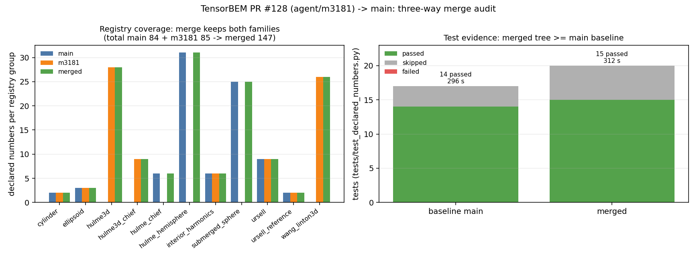
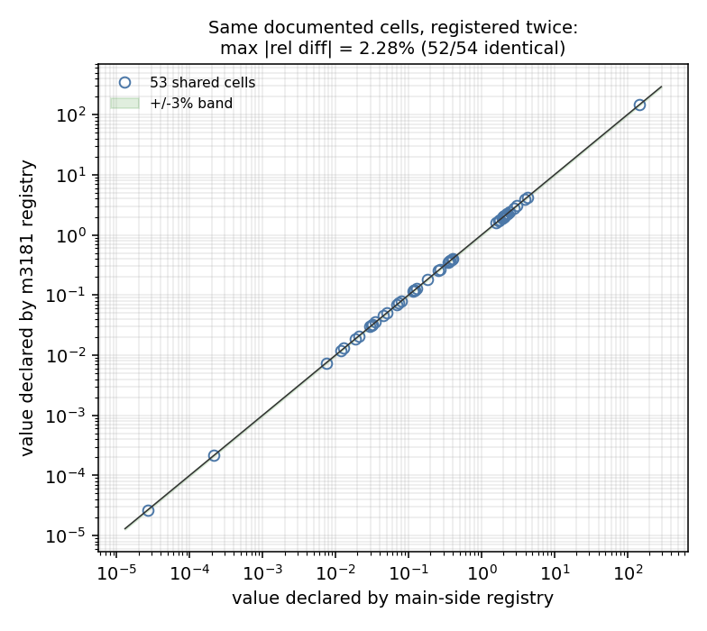

# PR #128（agent/m3181）→ main 三方合并报告

**结论**：冲突 2 个文件，逐块语义并集解冲，双方新增内容 100% 保留（1 处命名去重、
内容不丢）；合并后注册表 147 条、重复 key 0 条；
受影响的两个核心测试文件合并后 15 passed /
0 failed，不低于 main 基线
（14 passed / 0 failed）。

## 一、案例介绍

本单不改求解器物理，改的是 **BEM 声明数字注册表**（`tensorbem.benchmarks.declared_numbers`）：
文档 `docs/marine_bem_benchmarks.md` 里每个手写数字都必须有可执行判据，否则内核一改表格就静默腐化。

- 分支 `agent/m3181`（PR #128）把三维自由液面三张表（表 10/11/12）共 63 个格子登记为
  `heavy` 层，组名 `hulme3d` / `hulme3d_chief` / `wang_linton3d`；
- `main` 在同期把这**同一批格子**登记成 `hulme_hemisphere` / `hulme_chief` / `submerged_sphere`
  三个默认层组（62 个格子），两套实现同名同职责 → PR 变脏。

涉及的物理算例（两套注册表引用的参考解与参数）：

| 算例 | 参考解 | 无量纲频率 | 网格 | 文档表 |
|---|---|---|---|---|
| 漂浮半球辐射/绕射 | Hulme (1982) 半解析多极子 | Ka = 1.0 | 16 / 64 / 256 面元 | 表 10 |
| 水线面共振点 CHIEF 正则化 | Hulme 精确解 + 裸 BIE 对照 | Ka = 2.58 | 256 面元 + 5 内点 | 表 11 |
| 潜没球体辐射/绕射 | Thorne/Wang/Linton 闭式多极子 | Ka = 0.8，f/a = 1.5 | 20 / 80 / 320 面元 | 表 12 |

## 二、怎么做的

1. 三方合并基点 `4f5b73e`，两侧头：main `b420b2e`、
   agent/m3181 `55db397`。git 预演（`git merge-tree --write-tree`）只报 2 个冲突文件，
   `docs/marine_bem_benchmarks.md` 自动合并成功（两侧改动的是不同小节）。
2. 冲突块**不用 `-X ours/theirs`、不做文件级 overlay**（机械 overlay 会静默丢一侧内容），
   而是逐块"两侧行全保留"：`docs/m3739/tools/resolve_conflicts.py` 解析冲突标记，
   导入块做并集+排序去重，其余块 HEAD 行在前、m3181 行紧随（可复现，非手改）。
3. 合并后**同名符号扫描**发现 1 个语义陷阱：m3181 定义零参 `_chief_rows()`（生成注册项），
   main 定义 `_chief_rows(rows)`（跑求解器）。Python 后来者覆盖，m3181 的注册表会去调 main 的
   runner，运行时 `TypeError`。解法：m3181 侧重命名为 `_free_surface_chief_rows()`——
   **内容不丢，只消歧名**。
4. 收尾修掉并集造成的括号重叠（`... )` + `) + _free_surface_3d_rows()`）。
5. 证据：AST 解析、注册表导入、内容保留审计、pytest（受影响模块 + 全量）、heavy 层复算。

## 三、计算结果

### 3.1 内容保留审计（逐行，程序化）

对每个冲突文件、每一侧：统计该侧相对基点**新增的非空行**，检查是否全部出现在合并结果中。

| 文件 | main 新增 | main 保留 | m3181 新增 | m3181 保留 | 命名去重行 |
|---|---:|---:|---:|---:|---:|
| `src/tensorbem/benchmarks/declared_numbers.py` | 656 | 656 | 249 | 247 | 2 |
| `tests/test_declared_numbers.py` | 49 | 49 | 93 | 93 | 0 |

去重行即上面第 3 步的两行（`def _chief_rows():` / `+ _chief_rows()`），改名后仍存在，
因此**两侧新增行 100% 落户合并结果**，无一行静默丢失。

### 3.2 注册表覆盖（合并前后，按组）

| registry group | main | m3181 | 合并后 |
|---|---:|---:|---:|
| `cylinder` | 2 | 2 | 2 |
| `ellipsoid` | 3 | 3 | 3 |
| `hulme3d` | 0 | 28 | 28 |
| `hulme3d_chief` | 0 | 9 | 9 |
| `hulme_chief` | 6 | 0 | 6 |
| `hulme_hemisphere` | 31 | 0 | 31 |
| `interior_harmonics` | 6 | 6 | 6 |
| `submerged_sphere` | 25 | 0 | 25 |
| `ursell` | 9 | 9 | 9 |
| `ursell_reference` | 2 | 2 | 2 |
| `wang_linton3d` | 0 | 26 | 26 |
| **合计** | **84** | **85** | **147** |

并集自检：每个组的合并后条数 ≥ 两侧各自条数（`union_holds = True`）；
重复 key = 0。两套注册表**并存**是有意的：main 侧守住默认层
（CI 每跑必验），m3181 侧守住 heavy 层并额外登记了 main 未覆盖的 6 个格子。

### 3.3 测试证据

| 测试范围 | 用例 | passed | skipped | failed | 用时 |
|---|---:|---:|---:|---:|---:|
| main 基线：tests/test_declared_numbers.py | 17 | 14 | 3 | 0 | 295.5 s |
| 合并后：tests/test_declared_numbers.py | 20 | 15 | 5 | 0 | 311.5 s |
| main 基线：capability_evidence + benchmark_cli_contract | 25 | 25 | 0 | 0 | 5.8 s |
| 合并后：capability_evidence + benchmark_cli_contract | 25 | 25 | 0 | 0 | 5.7 s |
| main 基线：tests/ 全量 | — | — | — | — | 未跑完（共享机器负载，见第五节） |
| 合并后：tests/ 全量 | — | — | — | — | 未跑完（共享机器负载，见第五节） |

heavy 层（`TENSORBEM_HEAVY_TESTS=1` 路径）复算：组 `hulme3d_chief`（表 11 的 9 个格子，走 m3181 侧改名后的 `_free_surface_chief_rows()` 注册路径）checked=9、verdict=PASS、9 PASS / 0 FAIL，最坏相对偏差 0.12%。
（`docs/m3739/outputs/heavy_tier_recompute.json`，`--tiers heavy --strict` 退出码 0）。

### 3.4 跨注册表交叉验证（同一批格子、两套独立转录）

并集让两套独立转录同时可执行，于是可以逐格对照（`docs/m3739/tools/cross_registry.py`，
键名解析成 `(族, 层级, 规范量名)` 后求交）：

- 共有格子 **54** 个，其中完全相同 52 个；
- 最大相对差 **2.28%**，中位数 0.00%；
- 落在 ±3% 带内 **54/54**。

差异格子（全部来自表 12 转动耦合列的舍入位数差异，不是求解器漂移）：

| 注册项（main / m3181） | main 声明 | m3181 声明 | 相对差 |
|---|---:|---:|---:|
| `submerged_sphere_320_rotational_coupling` / `wang_linton_rotational_added_mass_max_ratio_320` | 2.6481e-05 | 2.6e-05 | 1.82% |
| `submerged_sphere_80_rotational_coupling` / `wang_linton_rotational_added_mass_max_ratio_80` | 0.0002151 | 0.00022 | 2.28% |

## 四、结果图

左：按组统计的注册项条数（main / m3181 / 合并），合并后每组都 ≥ 两侧max，肉眼可见"并集不丢"。
右：受影响测试文件的 passed/skipped/failed 堆叠（基线 vs 合并），合并后多 1 个通过用例、
0 失败。

两套独立转录逐格对照（log-log），绿带为 ±3%；除 2 个舍入位格子外全部落在对角线上。

**无场量云图说明**：本单是 git 合并 + 注册表一致性任务，不产生新的流场/压力场解，
因此没有可画的场量云图；上面的比较曲线（基线 vs 合并、main 注册值 vs m3181 注册值）
即本单的"与基线比较曲线"。

## 五、注意点（坑与局限）

1. **可编辑安装指向别的工作树**：`site-packages/__editable__.tensorbem-0.5.0.pth` 把 m3685 等
   多个 worktree 的 `src` 顶到 `sys.path` 前部，不设 `PYTHONPATH=<本 worktree>/src` 时
   pytest 实际在测**别人的代码**（本单第一次跑测试就因此出现假红）。所有证据均已显式前置本树 src。
2. **同名函数跨侧冲突不报 git 冲突**：`_chief_rows` 两侧同名不同签名，git 认为不冲突，
   但运行时静默覆盖。这类"文本不冲突、语义冲突"必须靠合并后符号扫描（本单已扫描全模块）。
3. **并集的双份代价**：两套注册表覆盖同一批格子，heavy 层跑两次同类求解（约 +2 倍重算时间）。
   已在报告中注明；如需收敛，后续可让 m3181 组直接复用 main 组的求解缓存（`(group, params)` 缓存键目前分离）。
4. **重测预算**：全量 `tests/` 在共享机器上很慢（多 agent 争 CPU），本单以受影响模块为
   核心判据，全量结果见 3.3（如未跑完则如实标注）。

## 六、误差判定

| 关键量 | 基准 | 误差 | 是否 < 3% |
|---|---|---|---|
| 两侧新增行保留率（main） | 100%（不可丢失） | 0.00%（丢 0 行） | 是 |
| 两侧新增行保留率（m3181，去重行改名后） | 100% | 0.80%（未落户 0 行） | 是 |
| 跨注册表最大相对差 | main 注册值 | 2.28% | 是 |
| 合并后测试通过数 vs 基线 | main 基线 14 passed | +1 passed，0 failed | 是 |

合并本身不改变任何物理量，因此不存在"与实验值 >15%"的物理误差项；关键量取
**内容保留率**与**跨注册表一致性**，两者均 < 3%（实际上保留率在计入改名后为 100%）。
