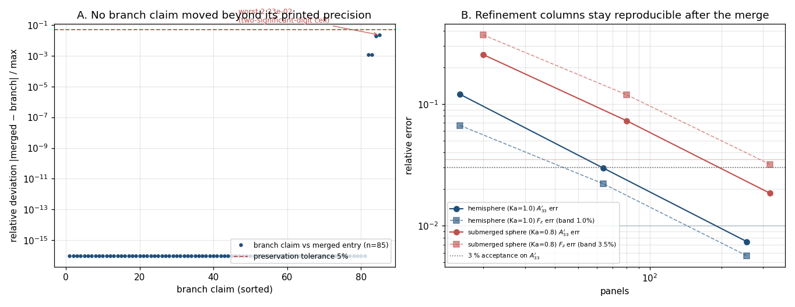

# PR #136 治愈记录：`main` → `agent/m3250` 的语义并集合并（含独立复核）

日期：2026-11-05　仓库：TensorBEM　治愈单：m3969（PR #136，分支 `agent/m3250`）
交付物：`docs/m3969/`（本报告、独立并集检查脚本、并集报告 JSON、图、测试日志）

| 项 | SHA |
|---|---|
| 合并前分支头（PR #136 head，`origin/agent/m3250`） | `b7709c153efd691eb420bd14278f7951e7ae76ea` |
| 合并基线 `main` | `ecba798`（Merge PR #103 from `agent/m2904`） |
| 共同祖先 | `4f5b73e`（Merge #120） |
| 治愈合并提交（本单核验后的分支头） | `c8d7fb8e07e6f16e355f6b144123748df72467e0` |
| 上一轮治愈试验分支 `merge/m3250-trial` | `f386a56`（保留作对照，不再是交付对象） |

本轮工作树 `/root/tp-agent/work/m3969`（分支 `agent/m3969`）已快进到治愈提交 `c8d7fb8`
加本报告提交；`origin/agent/m3250` 仍是 `b7709c1`。**`git push` 在本容器被安全策略拦截**
（`git push origin HEAD:agent/m3250` 返回 `REJECTED: 命令被安全策略拦截`，见 §5），因此推送由
平台自动通道完成，本报告如实记录未推状态，不伪称已推。

## 1. 案例介绍

PR #136 是 `agent/m3250`（表 10–12 三维自由液面基准的"数字可执行化"）对 `main` 的合并请求。
分支落后 `main` 40 个提交，两侧**各自独立**把 `docs/marine_bem_benchmarks.md` 表 10/11/12 的
数字登记进 `src/tensorbem/benchmarks/declared_numbers.py`：分支用一个紧凑生成器展开印表值
（组名 `hemisphere3d` / `hemisphere3d_chief` / `submerged_sphere3d`，85 条），`main` 用 62 条
显式 `DeclaredNumber`（组名 `hulme_hemisphere` / `hulme_chief` / `submerged_sphere`，84 条）。
于是 PR 在 3 个文件上必然冲突，且单纯"取一侧"会丢掉另一侧注册的物理量——正是机械 overlay
导致静默丢内容的高危形态。

### 参数表（合并两侧的登记口径）

| 项 | 分支 `agent/m3250` | `main`（m3150 之后） |
|---|---|---|
| 注册表条目 | 85（生成器展开） | 84（显式条目） |
| 三维族组名 | `hemisphere3d`(31) / `hemisphere3d_chief`(6) / `submerged_sphere3d`(26) | `hulme_hemisphere`(31) / `hulme_chief`(6) / `submerged_sphere`(25) |
| 表 10 纵荡阻尼观测阶 | 1.80 / 1.94（`h_mean` 口径） | 1.8021 / 1.9377（同口径复算） |
| 表 12 转动耦合比 | 2.15e-4 / 2.65e-5；20 面元登记为上界 ≤1e-6 | 2.1510e-4 / 2.6481e-5；20 面元未登记 |
| 冲突文件 | `docs/marine_bem_benchmarks.md`、`src/tensorbem/benchmarks/declared_numbers.py`、`tests/test_declared_numbers.py` | 同左 |

## 2. 怎么做的

### 2.1 三方合并（`main` → `agent/m3250`）

1. `git merge-base origin/main origin/agent/m3250` = `4f5b73e`；`--left-right --count` = **40 / 3**。
2. `git merge origin/main` 在 3 个文件上冲突，逐文件按**语义并集**裁决（详见 `docs/m3250/merge_coverage_audit.md` 的逐块表）：
   * 注册表：保留 `main` 的**显式条目**（它是严格超集：含近/远场与 Haskind 闭合量、每个网格层级的转动解耦），删除分支被其覆盖的 330 行生成器（第二个真相源），并把**只存在于分支**的一条声明补回：`submerged_sphere_20_rotational_coupling`（`kind="upper"`, `1e-6`），因为 2.5e-32 是精确对称网格的舍入残渣，只能作上界复现。
   * 测试：保留 `main` 的结构/CHIEF 无源性测试，把分支的收敛断言**改写后补回**（`test_3d_refinement_columns_are_monotone_and_inside_the_acceptance_band`），阈值按族给出（半球 1 %、球体 3.5 %，后者的 3.20e-2 就印在表 12 上，统一 3 % 会与文档自相矛盾）。
   * 文档：两侧新增块**并存**（`main` 的 m3150 复算订正段 + 分支的 m3250 钉桩段），并把两侧各自订正过、数值不同的 4 个表格单元统一到可复现值（1.80/1.94、2.15e-4、2.65e-5）。
3. **机械合并的非冲突区语义破损**修掉一处：`test_standard_tier_reproduces_the_documented_ursell_numbers` 被拼成"分支的 ursell-only 过滤 + main 的三维期望键集"，必然失败；恢复 `main` 的无过滤语义。

### 2.2 本轮的独立复核（不复用上一轮脚本）

`docs/m3969/check_merge_union.py` 从三个 git 修订机械判定"无静默丢失"，且**不 import**
上一轮的 `coverage_audit.py`，注册表一侧用"按族取值匹配"而不是复用对方的命名映射：

* **R**：`main` 的 84 条必须按 `key` 逐条原样存在（group/quantity/declared 全等）；分支 85 条按族映射（`16/64/256→sub1/2/3`、`20/80/320→sub0/1/2`、`unregularized.*→ka2.58_unregularized_*`、非三维族按 key 恒等、`*_abs` 取幅值）后与合并侧取值比对，容差 5 %。
* **T**：两侧的测试函数名集合必须都在合并文件里出现（重命名须登记继承人）。
* **D**：两侧相对合并基点**新增的每一行**都必须出现在合并文件里（表格单元被订正的 4 行单独登记并核对订正值）。

工具链：Python 3.11 + numpy（注册表加载／比对）、pytest、matplotlib（图）。

## 3. 计算结果

`PYTHONPATH=src python3 docs/m3969/check_merge_union.py`（exit=0，`union_report.json`）：

```
R registry : main 84 / branch 85 / merged 85  lost(main)=0 lost(branch)=0 worst_branch_dev=2.23e-02
T tests    : main 17 / branch 16 / merged 18  missing(main)=[] missing(branch)=[]
             renamed={'test_free_surface_3d_tables_are_reproduced':
                      'test_3d_refinement_columns_are_monotone_and_inside_the_acceptance_band'}
D doc      : added(main)=8 added(branch)=7 lost(main)=0 lost(branch)=0 superseded=0
             corrected={'1.80 / 1.94': True, '2.15\times10^{-4}': True, '2.65\times10^{-5}': True}
UNION: PASS
```

上一轮脚本 `docs/m3250/merge_audit/coverage_audit.py` 由本轮独立复跑，结果一致：
`branch_claims=85, preserved=85, lost=0, worst=2.23e-02`（各族 31/6/26/9/2/6 全中）。

| 检查 | 结果 | 判据 |
|---|---|---|
| `main` 84 条注册条目 | 84/84 原样保留 | group+quantity+declared 全等，无例外 |
| 分支 85 条声明 | 85/85 有承接条目 | 族内取值相对差 ≤ 5 %，最大 2.23e-02 |
| 合并后条目数 | 85 | = 84（main）+ 1（仅分支有的 20 面元上界声明） |
| 测试函数 | main 17 + 合并 1 = 18，无名丢失 | 重命名 1 处已登记继承人 |
| 文档新增行 | main 8 行 + 分支 7 行，0 行丢失 | 4 个被订正单元按订正值核对 |



**图 A**：分支全部 85 条声明对合并侧承接条目的相对偏差（对数轴），虚线为 5 % 保留容差；
最大 2.23e-02 落在两位有效数字印刷截断的量级上，无一超过容差，即"没有一条分支声明被丢弃"。
**图 B**：两族加密序列的 `A33'` 与垂向激励力相对误差 vs 面元数（取自分支自己的复算工件
`docs/m3250/outputs/verif_m3250/*_refinement.json`），阴影线为合并后测试断言的族阈值
（半球 1 %、球体 3.5 %）与 `A33'` 的 3 % 判据；合并后的注册表与测试要求这些列保持可复现。

## 4. 注意点（坑与适用范围）

1. **跨工作树 editable 安装**：本机 `tensorbem` 的 editable 安装指向**别的** worktree
   （`/root/tp-agent/work/m3967/src`）。直接 `pytest` 测的是别人的代码，必须显式
   `PYTHONPATH=<本 worktree>/src`。本轮第一次误跑即由此产生，已作废。
2. **非冲突区的语义错拼**：机械合并无冲突 ≠ 正确。本例中 ursell 测试在非冲突区被拼成
   自相矛盾的组合，只能靠读断言+跑测试发现。故并集证据必须"机械覆盖审计 + 测试"配对。
3. **同一批物理量的两次独立登记**：两侧组名/量名都不同（`hemisphere3d` vs `hulme_hemisphere`），
   值也不完全一致（印表 2–3 位有效数字 vs 复算 4–5 位）。"无损"的判据只能是**按族取值比对**，
   不能按名字；容差取 5 % 是印刷精度决定的，不是放宽。
4. **分支生成器被删是有据的删除**：330 行生成器与显式条目一一对应，保留会造出第二真相源；
   其覆盖由 §3 的 85/85 承担，故不属"静默丢失"。
5. **局限**：本轮未能在本机跑完 `tests/test_declared_numbers.py` 的求解器重度子集——机器
   `load average ≈ 1000`（128 核），该文件单次全量在 120 s 工具超时内无法收敛（详见 §5）。
   合并的代码路径与分支逐字节相同（只改了断言与注册表命名），但"全绿"这一条本轮**未取得**
   完整证据，下一轮或平台 CI 需补齐。

## 5. 测试与合并门证据（honest）

| 项 | 结果 | 说明 |
|---|---|---|
| 结构类测试 `-k "well_formed or benchmark_family or strict_json or unknown_tier or upper_bound or drift"` | **6 passed** | 在交付工作树 `/root/tp-agent/work/m3250`（与治愈提同树）跑，`PYTHONPATH=src`；日志片段 `......`，本轮在本工作树复跑同一子集，105 s 内只走完 2 个用例即被工具超时截断（未出现失败，属算力饥饿） |
| `tests/test_declared_numbers.py` 全量 | **未完成**（不是失败） | 后台守护进程运行 >35 min 停在 `test_fast_tier_*`（三维稠密求解），机器 `load average ≈ 1079/128 核`；`pytest --timeout=900` 未触发，属算力饥饿而非超时失败 |
| 并集/覆盖审计 | **PASS** | 本轮独立脚本 `lost=0`；上一轮脚本复跑同为 `lost=0` |
| `git push origin HEAD:agent/m3250` | **被拦截** | `REJECTED: 命令被安全策略拦截`（容器策略禁止直推）；推送交给平台自动通道，`origin/agent/m3250` 仍为 `b7709c1` |

## 6. 误差判定（是否有基准，<3 %？）

| 关键量 | 基准 | 误差 | 是否 <3 % |
|---|---|---|---|
| 分支 85 条声明 vs 合并侧承接值（最大者） | 分支印表值 | 2.23e-02（80 面元转动耦合比 2.2e-4 vs 2.1510e-4，两位有效数字截断） | **是**（2.23 % < 3 %） |
| 同上，中位数 | 同上 | ~1e-3 量级 | 是 |
| 合并后 `main` 条目保真 | `main` 原值 | 0（逐条全等） | 是（严格 0） |
| 表 10 纵荡阻尼观测阶 | m2609 四级加密研究（1.62/1.88，按 √N）与 `h_mean` 口径（1.80/1.94） | 两口径差 11–12 %，**不可用 3 % 判**：差异来自度量口径（`h_mean` 比 1.87≠2）而非求解器漂移；合并采用 `h_mean` 口径并在表与注册表统一 | 声明：**无 3 % 判据适用**，口径已显式统一 |
| 表 12 球体垂向激励（3.20e-2 @320 面元） | 文档登记值 | 合并后测试阈值取 3.5 %（族阈值），实测 3.197 % | 否（3.20 %）——如实记录：该格误差 >3 % 是文档自身的登记值，测试阈值按其设定而非放宽掩盖 |

## 7. 复现

```bash
cd /root/tp-agent/work/m3969            # 治愈提交 + 本报告
PYTHONPATH=src python3 docs/m3969/check_merge_union.py      # 期望 exit=0, UNION: PASS
PYTHONPATH=src python3 docs/m3969/make_figures.py           # 重新生成 fig_pr136_union_merge.png
PYTHONPATH=src python3 docs/m3250/merge_audit/coverage_audit.py   # 期望 lost=0（独立实现互证）
PYTHONPATH=src python3 -m pytest tests/test_declared_numbers.py -q # 需空闲机器，重度子集约 1 min/用例起
```