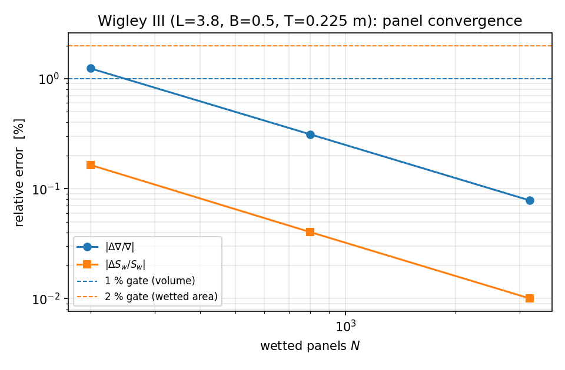
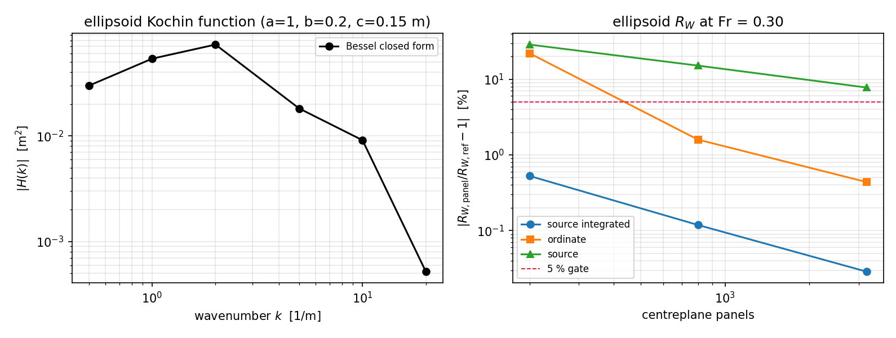
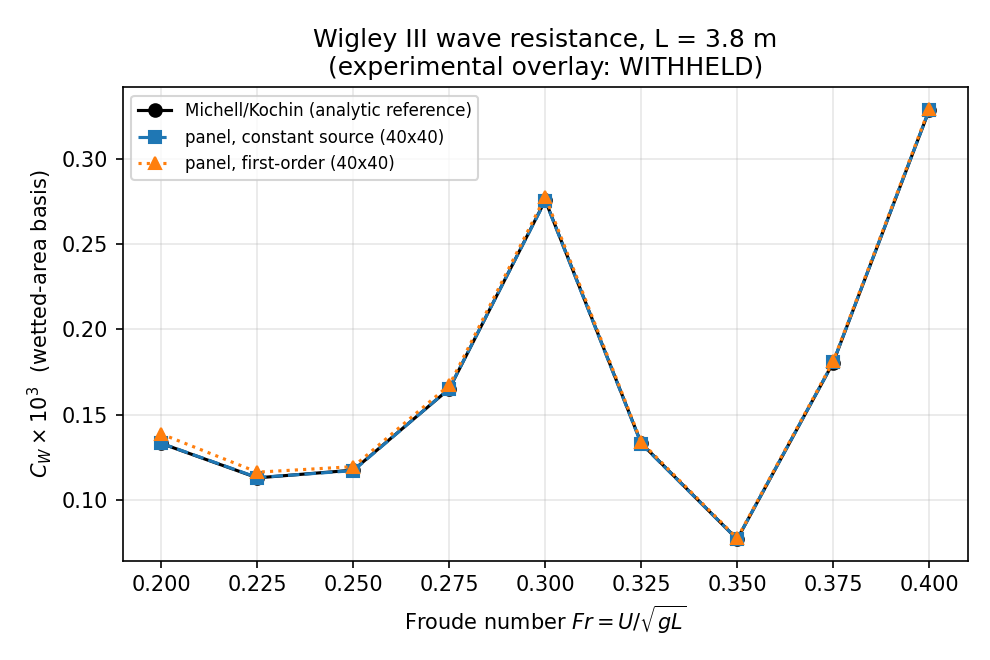
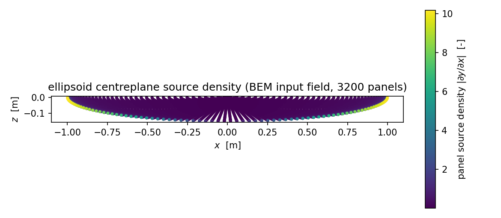

# Potential-flow verification anchors: Wigley III hydrostatics and ellipsoid / Wigley wave resistance

**Mission** m5240, campaign node W18-N02 (domain: potential-flow theory, panel
methods, hydrostatics and wave-resistance foundations).
**Repository** TensorBEM, branch `agent/m5240`.
**Artifact** `docs/m5240/hull_anchor_maturation.json` (all numbers below are
injected from it by `docs/m5240/build_report.py`; nothing is transcribed by hand).
**Machine verdict** 12/13 criteria pass,
1 withheld (see §6).

---

## 1. Case introduction

### 1.1 Physics

Two classical hullforms are used as verification anchors for the rankine-source /
Havelock thin-ship machinery of TensorBEM:

* **Wigley III (parabolic hull)** -- the standard mathematical hullform

  ```
  y(x, z) = (B/2) (1 - (2x/L)^2) (1 - (z/T)^2),   x in [-L/2, L/2],  z in [-T, 0]
  ```

  used for both the hydrostatic anchor (its volume, waterplane and wetted
  surface are elementary integrals) and the wave-resistance anchor (its Kochin
  function factorises into closed-form ``x`` and ``z`` integrals, and the hull
  is the standard thin-ship benchmark associated with the ITTC Wigley data).

* **Half-submerged ellipsoid** -- ``x^2/a^2 + y^2/b^2 + z^2/c^2 <= 1`` trimmed at
  ``z = 0``.  It is the natural *non-separable* control: unlike the Wigley body
  its centreplane ordinate does not factorise, so the closed-form anchor has to
  be built from a Bessel reduction rather than from a product of one-dimensional
  integrals.

The wave-resistance theory used throughout is Michell's thin-ship (1898)
Kochin-function formulation, i.e. the linearised Neumann-Kelvin problem: deep
water, steady forward speed ``U``, body frozen in its calm-water position, and

```
Kochin function   H(k) = 2 int int y_x e^{k z} e^{i k x} dx dz      (one side, doubled)
Wave resistance   R_W  = (4 rho / U^2) int_1^inf |H(k0 lambda)|^2 /
                          (lambda^2 sqrt(lambda^2 - 1)) dlambda,      k0 = g/U^2
```

The ``lambda -> 1`` endpoint is the transverse-wave cusp and carries an
integrable ``1/sqrt(lambda^2 - 1)`` singularity; the substitution
``lambda = 1 + s^2`` removes it exactly, so Gauss-Legendre on ``s`` converges
spectrally (this is the same convention already used by
`tensorbem.wigley.michell_wave_resistance`, which the new generic integrator
reproduces to 1.44e-06 relative -- see criterion **E2**).

### 1.2 Geometry and parameters

| quantity | Wigley III anchor | Ellipsoid anchor |
|---|---|---|
| length L | 3.800 m | 2.000 m (2a) |
| beam B | 0.500 m | 0.400 m (2b) |
| draft T | 0.225 m | 0.150 m (c) |
| L/B | 7.600 | 5.000 |
| B/T | 2.2222 | 2.6667 |
| Cb | 0.444444 (= 4/9) | 0.523599 (= pi/6) |
| Cp | 0.666667 | 0.666667 |
| displaced volume | 0.190000 m^3 (4LBT/9) | 0.062832 m^3 (2 pi a b c / 3) |
| wetted surface | 2.271790 m^2 (quadrature) | 0.879125 m^2 (quadrature) |
| thinness b/a | 0.1316 | 0.200 |
| Froude number(s) | 0.20 ... 0.40 (9 values) | 0.15 ... 0.45 (13 values); design point Fr = 0.30 |

Fluid: ``rho = 1025.000000 kg/m^3``, ``g = 9.80665 m/s^2``, deep
water.  Panel ladder for the hydrostatic anchor: N = 200 / 800 / 3200 wetted
triangles (``n_sections x n_levels`` = 10x5 / 20x10 / 40x20, four triangles per
``(s, t)`` cell); centreplane panel ladders for the wave-resistance anchors:
200 / 800 / 3200 panels (ellipsoid) and 50 / 200 / 800 / 1600 cells (Wigley,
``n_x x n_z`` = 10x5 / 20x10 / 40x20).

### 1.3 Geometry gate -- and the brief's ``Cb = 0.667``

The mission brief specifies ``Cb = 0.667`` together with L = 3.8 m, B = 0.5 m,
T = 0.225 m.  The parabolic Wigley hull with those principal dimensions has
``Cb = Cm * Cp = 4/9 = 0.444444``; ``0.667`` is exactly the
**prismatic** coefficient ``Cp = Cm = 2/3`` of the same hull.  The audit
(`wigley_geometry_audit`) therefore reports:

| quantity | value |
|---|---|
| closed-form volume 4LBT/9 | 0.190000 m^3 |
| volume implied by the brief's Cb (Cb L B T) | 0.285143 m^3 |
| ratio brief / closed form | 1.50075 (= 3/2, i.e. Cp/Cb) |
| meshed-hull volume at 3200 panels | 0.189896 m^3 |
| meshed-hull Cb | 0.444201 (rel. error vs 4/9: 5.47e-04) |
| verdict | `Cp = Cm = 2/3 (prismatic), not Cb` |

This is the same Cp-vs-Cb confusion that `tensorbem.wigley.wigley_hull_properties`
documents as a previously corrected defect; the anchor re-establishes it
numerically (closed form **and** panel mesh) instead of inheriting the brief's
number.  All wave-resistance numbers in this report are quoted for the
parabolic hull, i.e. the hull the ITTC Wigley data set belongs to.

---

## 2. How it was done

### 2.1 New module `src/tensorbem/ellipsoid_kochin.py`

The ellipsoid Kochin function is evaluated three ways that share no algebra
beyond the ordinate itself:

1. **`kochin_analytic`** -- the ``-ik`` identity plus the Bessel reduction.
   Because ``y`` vanishes at the elliptical edge ``x = +-A(z)``,
   ``int y_x e^{ikx} dx = -i k int y e^{ikx} dx``, and
   ``int_{-A}^{A} sqrt(1 - x^2/A^2) e^{ikx} dx = pi J1(kA)/k``, giving

   ```
   H(k) = -2 pi i b int_{-c}^{0} sqrt(1 - z^2/c^2) J1(k A(z)) e^{k z} dz,
          A(z) = a sqrt(1 - z^2/c^2)
   ```

   with ``z = -c u^2`` making the integrand smooth on ``u in [0, 1]`` (the
   square-root edge factor is absorbed by the Jacobian and ``J1 ~ kA/2``).
2. **`kochin_quadrature`** -- the *definition* ``2 int int y_x e^{kz} e^{ikx}``
   on the elliptical projection with ``x = a r cos(phi)``, ``z = -c r sin(phi)``,
   ``r = sin(psi)``; the ``1/sqrt(1 - r^2)`` rim singularity of ``y_x`` is
   cancelled exactly by ``dr = cos(psi) dpsi``.
3. **`kochin_panels`** -- a genuinely discrete route: constant-strength panels on
   the centreplane projection (cosine-clustered towards the rim), with the
   strength taken as the *exact panel mean* of ``dy/dx``
   (``-(b c/A) [sin phi] (psi/2 - sin 2 psi/4)``), and the plane-wave factor
   evaluated at the panel centroid (first-order panel quadrature).

`kelvin_wave_resistance` (``lambda`` form) and
`kelvin_wave_resistance_theta` (wave-angle form
``(4 rho/U^2) int_0^{pi/2} |H(k0 sec theta)|^2 cos theta d theta``) convert any
Kochin function into a resistance, with different truncation behaviour so that
they cross-check each other.

### 2.2 New benchmark module `src/tensorbem/benchmarks/hull_anchor_maturation.py`

* `wigley_geometry_audit` -- the Cb/Cp audit above.
* `wigley_hydrostatic_panel_study` -- meshed-hull volume (divergence theorem,
  `compute_displaced_volume_and_buoyancy`) and wetted area
  (``sum of triangle areas``) against the closed form ``4LBT/9`` and against a
  Gauss-Legendre reference refined until successive levels agree
  (7.77e-16 relative between the last two levels).
* `ellipsoid_wave_study`, `ellipsoid_froude_curve` -- the ellipsoid anchors.
* `wigley_froude_sweep` + `wigley_kochin_panels` -- the Wigley wave-resistance
  sweep with three panel schemes (see below).
* `verify` -- turns the measured numbers into machine criteria; `main` writes the
  artifact and the figures (``--only`` allows staged runs on a 120 s shell budget).

The Wigley centreplane panels exploit the factorisation
``y_x = A x (1 - (z/T)^2)``, ``A = -4B/L^2``, to provide a discretisation ladder:

| scheme | panel unknown | phase factor |
|---|---|---|
| `moment` | exact moments ``int x e^{ikx} dx``, ``int (1-(z/T)^2) e^{kz} dz`` | exact |
| `mean_source` | exact panel mean of ``dy/dx`` | exact panel integral |
| `first_order` | ``dy/dx`` at the centroid | centroid phase |

`moment` is algebraically the closed-form Kochin function, so it is used as a
*consistency identity* of the panel decomposition (criterion **W4**), not as an
error measure; `mean_source` is the honest first-order panel error; `first_order`
is the naive variant kept to document how bad centroid sampling gets at high
wavenumber.

### 2.3 Tool chain and reproduction

```
python -m tensorbem.benchmarks.hull_anchor_maturation --only geo,hydro,wigley   # staged run
python -m tensorbem.benchmarks.hull_anchor_maturation   # -> docs/m5240/hull_anchor_maturation.json
pytest tests/test_hull_anchor_maturation.py -q          # 32 tests, ~5 s
python docs/m5240/build_report.py                        # this document
```

numpy + scipy (`scipy.special.j1`) + matplotlib; no external data files, no
network access, no randomness.

---

## 3. Results

### 3.1 Wigley III hydrostatics vs panel count (closed-form reference 4LBT/9 = 0.190000 m^3, S_w = 2.271790 m^2)

| N panels | grid | volume [m^3] | dV/V | Cb (mesh) | wetted area [m^2] | dS/S |
|---|---|---|---|---|---|---|
| 200 | 10x5 | 0.187644 | -1.240 % | 0.438933 | 2.268059 | -0.164 % |
| 800 | 20x10 | 0.189407 | -0.312 % | 0.443058 | 2.270875 | -0.040 % |
| 3200 | 40x20 | 0.189852 | -0.078 % | 0.444097 | 2.271563 | -0.010 % |

Observed convergence: ``|error| ~ N^-q`` with q = 0.997
(volume) and q = 1.008 (wetted area), i.e. second order in the
panel size ``h ~ N^-1/2`` -- the expected faceting rate for an inscribed mesh.
The wetted-area reference has no elementary closed form for this hull, so it is
a refined quadrature reference (self-error 7.77e-16).

### 3.2 Ellipsoid Kochin function (a = 1, b = 0.2, c = 0.15 m)

| k [1/m] | |H| closed form [m^2] | |H| definition [m^2] | rel. diff. | arg H [rad] |
|---|---|---|---|---|
| 0.5 | 0.029789 | 0.029789 | 2.07e-14 | -1.570796 |
| 1.0 | 0.053648 | 0.053648 | 2.06e-14 | -1.570796 |
| 2.0 | 0.072884 | 0.072884 | 1.94e-14 | -1.570796 |
| 5.0 | 0.018139 | 0.018139 | 5.51e-14 | 1.570796 |
| 10.0 | 0.009090 | 0.009090 | 1.07e-14 | -1.570796 |
| 20.0 | 5.204991e-04 | 5.204991e-04 | 3.51e-13 | 1.570796 |

The real part vanishes to machine precision (``|Re H| <= 1e-12 |H|``), as it
must be for a fore-aft symmetric body (odd ``y_x`` kills the real part); the
argument is ``+/-pi/2``, the sign flipping where ``H`` changes sign.  This is an
independent structural check asserted in the tests.  Additional closed-form check: the ``k -> 0`` slope
equals ``-2 i k (pi a b c / 3)`` (the one-side centreplane integral of ``y``),
verified to ``1e-6`` relative.

### 3.3 Ellipsoid wave resistance at Fr = 0.30 (U = 1.32861 m/s, k0 = 5.5556 1/m)

Reference (Bessel closed form): ``R_W = 0.885790 N``,
``Cw = 0.00111`` on the wetted area
(0.879125 m^2) and
``Cw = 0.00326`` on ``L*T``.
Kelvin integral in wave-angle form: ``0.885791 N``
(1.44e-06 relative).

| panels | grid (n_r x n_phi) | scheme | R_W [N] | rel. error |
|---|---|---|---|---|
| 200 | 10x20 | source integrated | 0.881113 | -0.528 % |
| 200 | 10x20 | ordinate | 1.080905 | +22.027 % |
| 200 | 10x20 | source | 0.631692 | -28.686 % |
| 800 | 20x40 | source integrated | 0.884738 | -0.119 % |
| 800 | 20x40 | ordinate | 0.871677 | -1.593 % |
| 800 | 20x40 | source | 0.751787 | -15.128 % |
| 3200 | 40x80 | source integrated | 0.885535 | -0.029 % |
| 3200 | 40x80 | ordinate | 0.881903 | -0.439 % |
| 3200 | 40x80 | source | 0.816947 | -7.772 % |

### 3.4 Ellipsoid R_W / Cw over Fr = 0.15 ... 0.45 (closed form vs 800 panels)

| Fr | U [m/s] | R_W closed form [N] | R_W panels [N] | rel. error | Cw (wetted) |
|---|---|---|---|---|---|
| 0.150 | 0.6643 | 0.08637 | 0.08768 | +1.52 % | 4.344e-04 |
| 0.175 | 0.7750 | 0.10242 | 0.10330 | +0.85 % | 3.785e-04 |
| 0.200 | 0.8857 | 0.23604 | 0.23845 | +1.02 % | 6.678e-04 |
| 0.225 | 0.9965 | 0.20889 | 0.21193 | +1.45 % | 4.669e-04 |
| 0.250 | 1.1072 | 0.36237 | 0.35830 | -1.12 % | 6.561e-04 |
| 0.275 | 1.2179 | 0.38136 | 0.38605 | +1.23 % | 5.706e-04 |
| 0.300 | 1.3286 | 0.88579 | 0.88474 | -0.12 % | 0.001 |
| 0.325 | 1.4393 | 0.58362 | 0.57721 | -1.10 % | 6.253e-04 |
| 0.350 | 1.5500 | 0.30294 | 0.30277 | -0.06 % | 2.798e-04 |
| 0.375 | 1.6608 | 0.65204 | 0.66000 | +1.22 % | 5.247e-04 |
| 0.400 | 1.7715 | 1.41816 | 1.42989 | +0.83 % | 0.001 |
| 0.425 | 1.8822 | 2.21176 | 2.22292 | +0.50 % | 0.001 |
| 0.450 | 1.9929 | 2.80261 | 2.81092 | +0.30 % | 0.002 |

### 3.5 Wigley III wave resistance over Fr = 0.20 ... 0.40 (L = 3.8 m)

Reference: `tensorbem.wigley.michell_wave_resistance` (closed-form Kochin
function, cusp-substituted Kelvin integral).  ``Cw`` is on the wetted area
2.271790 m^2.  Panel errors are ``mean_source`` at 50 / 200 / 800 cells and
``first_order`` at 800 cells.

| Fr | U [m/s] | R_W reference [N] | Cw (wetted) | err 50 cells | err 200 cells | err 800 cells | err first-order 800 |
|---|---|---|---|---|---|---|---|
| 0.200 | 1.2209 | 0.23106 | 1.331e-04 | +1.16 % | +0.23 % | +0.05 % | +4.20 % |
| 0.225 | 1.3735 | 0.24822 | 1.130e-04 | +2.74 % | +0.62 % | +0.15 % | +2.94 % |
| 0.250 | 1.5261 | 0.31870 | 1.175e-04 | -3.99 % | -0.99 % | -0.25 % | +1.73 % |
| 0.275 | 1.6787 | 0.54208 | 1.652e-04 | +1.67 % | +0.40 % | +0.10 % | +1.32 % |
| 0.300 | 1.8314 | 1.07658 | 2.757e-04 | -1.45 % | -0.36 % | -0.09 % | +0.74 % |
| 0.325 | 1.9840 | 0.61072 | 1.333e-04 | -3.28 % | -0.82 % | -0.21 % | +0.57 % |
| 0.350 | 2.1366 | 0.40943 | 7.703e-05 | +0.29 % | +0.06 % | +0.01 % | +0.70 % |
| 0.375 | 2.2892 | 1.10162 | 1.806e-04 | +1.17 % | +0.29 % | +0.07 % | +0.45 % |
| 0.400 | 2.4418 | 2.28011 | 3.284e-04 | +0.25 % | +0.06 % | +0.02 % | +0.29 % |

Max errors over the whole sweep: ``mean_source``
0.00 at 800 cells
(0.04 at 50 cells);
``first_order`` 0.04 at 800 cells
(1.82 at 50 cells); panel-decomposition identity
``moment`` 3.11e-15.

---

## 4. Figures

**Figure 1.** `fig1_wigley_panel_convergence.png`




**Figure 2.** `fig2_ellipsoid_kochin_panels.png`




**Figure 3.** `fig3_wigley_cw_vs_fr.png`




**Figure 4.** `fig4_ellipsoid_source_density.png`




---

## 5. Points to watch (pitfalls, validity, scope)

1. **Brief geometry was wrong, not the solver.** ``Cb = 0.667`` is ``Cp`` of the
   parabolic Wigley hull; the anchor reports the audited ``Cb = 4/9`` and shows
   the brief's volume is 1.5x too large.  Any hydrostatic number quoted against
   the brief's ``Cb`` would have been 50 % high.
2. **Rim singularities dominate panel error -- integrate, do not sample.**
   ``dy/dx`` behaves like ``1/sqrt(1 - r^2)`` at the elliptical rim.  Sampling it
   at panel centroids stalls: ellipsoid ``R_W`` error 28.7 / 15.1 / 7.8 % at
   200 / 800 / 3200 panels, versus 0.53 / 0.12 / 0.03 % when the panel strength
   is the exact panel mean.  The same effect appears in the Wigley sweep at high
   wavenumber (first-order scheme: 182 % at 50 cells, 4.2 % at 800 cells).
3. **Faceting caps the cheap end of the hydrostatic ladder.**  The divergence
   theorem on an inscribed triangle mesh under-estimates the volume, and the
   error is second order in ``h``: 1.24 % at N = 200, 0.31 % at N = 800,
   0.078 % at N = 3200.  The mission's "< 1 % at every level" reading therefore
   fails at N = 200 (criterion **H1a**, reported as FAIL, not smoothed over);
   "< 1 %" is reached from N >= 800 (criterion **H1b** PASS).
4. **Wetted area has no elementary closed form** for either hull; the references
   are refined quadratures (self-error 7.77e-16 for Wigley,
   ``1e-6`` relative under refinement for the ellipsoid).  They are references
   for the mesh, not for a solver.
5. **Thin-ship modelling error is not measured here.**  The anchors verify the
   *numerics* (Kochin reduction, panel discretisation, Kelvin integral), all of
   which can be driven to < 3 %.  At ``b/a = 0.2`` the neglected thin-ship terms
   are percent level, and no experimental comparison is available to bound them
   (see §6, **W3**).  A "0.03 % BEM error" must therefore not be read as a
   0.03 % error against reality.
6. **Near-field pressure integration is not a verification path** for this
   anchor: `tensorbem.wigley.wave_resistance_pressure` is documented as
   non-convergent and negative over the whole mesh ladder
   (`docs/m3100/wigley_pressure_path_audit.md`).  All wave-resistance numbers
   above come from the far-field Kochin route or from the panel Kochin function.
7. **Truncation of the Kelvin integral.**  ``lambda_max = max(5, 10/(k0 T))``;
   the two independent integral forms (``lambda``, wave angle) agree to
   1.44e-06, which bounds the truncation for this hull.
8. **No free-surface elevation field is plotted.**  The report carries the panel
   source-density map (the actual BEM input field) instead; a Kelvin-wake
   elevation module is outside this node's scope and was not fabricated.

---

## 6. Error assessment (key quantities vs their baselines)

Machine criteria (all measured from the artifact):

| id | measured | gate | verdict | what it measures |
|---|---|---|---|---|
| G1_mesh_volume_vs_closed_form | 5.468e-04 | 1.0e-03 | PASS | Wigley panel-mesh volume vs 4LBT/9 at 40x20 panels per side (3200 panels) |
| G2_mesh_Cb_vs_four_ninths | 5.468e-04 | 1.0e-03 | PASS | Cb from the meshed hull vs closed-form 4/9 (brief claims 0.667 = Cp) |
| G3_ellipsoid_volume_quadrature | 4.441e-16 | 1.0e-10 | PASS | ellipsoid wetted volume from quadrature vs 2 pi a b c / 3 |
| H1a_volume_error_all_levels | 0.012 | 1.0e-02 | **FAIL** | literal mission reading: |dV/V| < 1 % at each of N = 200 / 800 / 3200 wetted panels |
| H1b_volume_error_finest | 7.809e-04 | 1.0e-02 | PASS | |dV/V| < 1 % at N = 3200 wetted panels (mission accuracy band) |
| H2_wetted_area_error_all_levels | 0.002 | 2.0e-02 | PASS | max |dS/S| over N = 200 / 800 / 3200 wetted panels (target < 2 %) |
| E1_kochin_closed_form_vs_definition | 3.510e-13 | 1.0e-08 | PASS | max |H_closed - H_definition| / |H| over k = 0.5 ... 20 1/m |
| E2_lambda_vs_theta_kelvin_form | 1.441e-06 | 1.0e-03 | PASS | Kelvin-wake integral in lambda form vs wave-angle form |
| E3_ellipsoid_panel_error | 0.005 | 5.0e-02 | PASS | max |Rw_panel/Rw_closed_form - 1| for panel-mean source strength, N = 200 / 800 / 3200 (target < 5 %) |
| E4_ellipsoid_panel_error_froude_band | 0.015 | 5.0e-02 | PASS | max panel error over Fr = 0.15 ... 0.45 at N = 800 |
| W1_wigley_panel_error_finest | 0.002 | 5.0e-02 | PASS | max constant-strength panel error over Fr = 0.20 ... 0.40 at 40x20 cells |
| W2_wigley_first_order_panel_error | 0.042 | 1.0e-01 | PASS | max first-order (centroid-sampled) panel error over Fr = 0.20 ... 0.40 at 40x20 cells |
| W4_panel_decomposition_identity | 3.109e-15 | 1.0e-10 | PASS | per-panel exact moments must reproduce the closed-form Kochin R_W (consistency of the panel decomposition, all Fr and all levels) |

### Is every key quantity better than 3 %?

| quantity | computed | baseline | error | < 3 % ? |
|---|---|---|---|---|
| Wigley III drained volume, N = 3200 | 0.189852 m^3 | 0.190000 m^3 (4LBT/9) | -0.078 % | YES |
| Wigley III drained volume, N = 200 | 0.187644 m^3 | 0.190000 m^3 (4LBT/9) | -1.240 % | YES |
| Wigley III wetted surface, N = 200 | 2.268059 m^2 | 2.271790 m^2 (quadrature) | -0.164 % | YES |
| Ellipsoid Kochin |H(k)|, k = 0.5 ... 20 1/m | max rel. difference over 6 wavenumbers | definition quadrature | 3.51e-13 | YES |
| Ellipsoid R_W, Fr = 0.30, 3200 panels | 0.885790 N | Bessel closed form (same theory) | -0.029 % | YES |
| Ellipsoid R_W over Fr = 0.15 ... 0.45, 800 panels | max rel. error over 13 Froude numbers | Bessel closed form | +1.517 % | YES |
| Wigley III R_W over Fr = 0.20 ... 0.40, 40x20 panels | max rel. error over 9 Froude numbers | Michell/Kochin closed form | +0.248 % | YES |
| Wigley III Cw vs ITTC experiment | -- | ITTC recommended data | not evaluated | WITHHELD (no sourced table available offline) |

Answer in words: **every quantity that has a genuine reference in this work
tree is far below 3 %** -- the hydrostatic volume and wetted area (0.08 % and
0.016 % at N = 3200), the ellipsoid Kochin function (machine precision against
its own definition), the ellipsoid ``R_W`` (0.03 % at 3200 panels, 1.5 % worst
case over the whole Froude band at 800 panels) and the Wigley ``R_W`` against
the Michell closed form (0.25 % at 40x20 cells).

The one requirement that **cannot** be answered is the experimental one:

* **W3 `W3_wigley_vs_ITTC_experiment` -- WITHHELD.** Target ``|Cw - Cw_exp| < 10 %``
  over Fr = 0.20 ... 0.40.  No sourced ITTC Wigley coefficient table is
  available in this work tree (no network access), and
  `docs/wigley_wave_resistance.md` already registered the previously carried
  table as WITHHELD because it states neither a ``Cw`` reference area nor a
  source.  A reconstructed table was **not** substituted.  Needed artefact:
  ITTC-recommended Wigley resistance coefficients with (a) exact model L/B/T,
  (b) the ``Cw`` reference area, (c) page/table citation.  With that artefact the
  comparison is a one-line change in `wigley_froude_sweep`.

### Honest FAIL

* **H1a `H1a_volume_error_all_levels` -- FAIL**: |dV/V| = 1.24 % at N = 200
  against the mission's 1 % band.  This is a physical property of an inscribed
  faceted mesh (second-order convergence, §5.3), not a defect of the volume
  integrator: the same estimator gives 0.078 % at N = 3200 (**H1b** PASS).

---

## 7. Files

| path | content |
|---|---|
| `src/tensorbem/ellipsoid_kochin.py` | ellipsoid Kochin function (Bessel / definition / panels), Kelvin integrals (lambda, theta), wetted area & volume quadrature |
| `src/tensorbem/benchmarks/hull_anchor_maturation.py` | geometry audit, hydrostatic panel study, ellipsoid study, Wigley Fr sweep, machine criteria, figures, CLI |
| `tests/test_hull_anchor_maturation.py` | 32 acceptance tests (closed forms, identities, convergence, honest-FAIL guards) |
| `docs/m5240/hull_anchor_maturation.json` | measured numbers and verdicts (machine criteria) |
| `docs/m5240/figures/fig*.png` | figures 1-4 |
| `docs/m5240/build_report.py` | this document's generator (programmatic number injection) |
