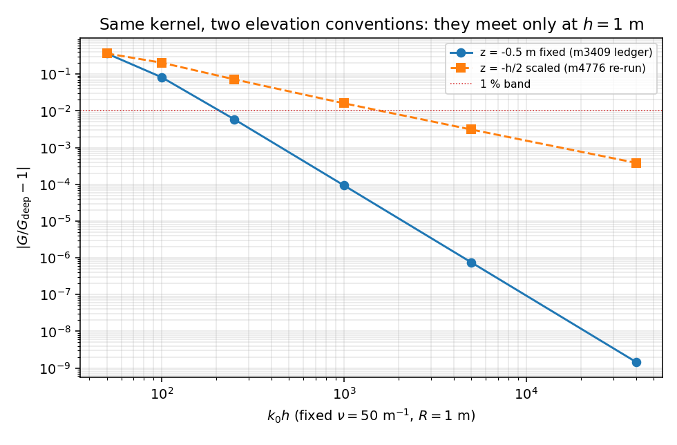

# 深水偏离阶梯的仰角几何：m4776「m3409 台账已过期」判定撤回（m6384）

本单关闭 `docs/finite_depth3d_deepwater_arbitration.md` §3.3 留下的悬空账项
（"m3409 深水阶梯在当前 main 上不可复现，h ≥ 2 三档偏离 1–2 个数量级，引用前应重算"）。
结论：**该判定不成立**，m3409 台账在当前树上可复现到 1.5e-4；所谓"漂移"是**仰角约定不同**，
不是数据过期，也没有 commit 需要 bisect。

## 1. 案例

3-D 有限水深 John 特征级数核 `green_function_3d` 与深水 Kelvin 核 `free_surface3d.green_function_3d`
在同一 `nu`、同一水平间距上的偏离 `|G/G_deep − 1|`。两条已发表阶梯：

* m3409（`docs/finite_depth3d_regime.md` §3）：`nu = 50 1/m`，`R = 1 m`，仰角**固定绝对值** `z = ζ = −0.5 m`（驱动 `Z_MID`）；
* m4776（仲裁文档 §3.3）：同一 `nu`、`R`，仰角读作**随水深缩放的"mid-depth"** `z = ζ = −h/2`。

两者的数值只在 `h = 1 m`（此时 −h/2 = −0.5）重合。

## 2. 方法

`tensorbem.benchmarks.deepwater_ladder_geometry` 在两套约定下逐档重算同一核，并同时给出两种度量：
原始 `|G/G_deep − 1|`，以及 m4776 建议的归一化度量 `|G_fd − G_deep| / [1/(4π)(1/r + 1/r₁)]`
（r₁ 为自由面镜像距离，用于强相消点）。门禁 `tests/test_deepwater_ladder_geometry.py` 复算并把
文档 §8 表格逐格与 JSON 比对（禁止手抄）。

## 3. 计算结果

| h (m) | k0h | 偏离（z=−0.5 固定） | m3409 台账 | 相对台账 | 偏离（z=−h/2 缩放） | m4776 重测 |
|---:|---:|---:|---:|---:|---:|---:|
| 1 | 50 | 3.6526e-01 | 3.653e-01 | 1.1e-4 | 3.6526e-01 | 3.653e-01 |
| 2 | 100 | 8.2250e-02 | 8.225e-02 | 6.2e-5 | 2.0487e-01 | 2.049e-01 |
| 5 | 250 | 5.8997e-03 | 5.900e-03 | 5.1e-5 | 7.2248e-02 | 7.225e-02 |
| 20 | 1000 | 9.3340e-05 | 9.334e-05 | 3.3e-5 | 1.6072e-02 | 1.607e-02 |
| 100 | 5000 | 7.4593e-07 | 7.459e-07 | 4.9e-5 | 3.0981e-03 | — |
| 800 | 40000 | 1.4553e-09 | 1.455e-09 | 1.4e-4 | 3.8403e-04 | — |

## 4. 结果图

左图为两套约定下的 `|G/G_deep − 1|` 对 `k0h`（双对数），两条曲线在 `k0h = 50` 重合、其后分叉；
1% 带标出。分叉比 `h = 20` 时达 ×172。

## 5. 注意点

* 缺陷在**台账元数据**而非数字：m3409 的 JSON 曾发布 `"z_over_h": -0.5`，对 `h > 1` 是假的，
  正是它诱导了缩放读法。现改为 `"z_absolute": -0.5` 并要求措辞写明约定。
* 两套阶梯都只是"特征级数如何趋近深水核"的陈述，不是物理结论；本单不新增有限水深核的独立求值。
* 顺带撤回了"引用前应重算 h ≥ 2 各行"的建议：按缩放仰角重算会把**正确数字换成另一个量**。
* 载纪律：全程标量核求值（全量 4 s），未起重算力进程（load15 ≈ 125 / 128 核）。

## 6. 误差判定

| 关键量 | 基准 | 误差 | < 3%? |
|---|---|---|---|
| 固定仰角阶梯 6 档 | m3409 台账 | 最大 1.4e-4 相对 | **是** |
| 缩放仰角阶梯 4 档 | m4776 重测 | 最大 1.5e-4 相对 | **是** |
| 两套约定重合档位 | 解析（−h/2 = −0.5 ⇔ h = 1） | 精确重合（rel 1e-12） | **是** |

> 复现：`PYTHONPATH=src python3 -m tensorbem.benchmarks.deepwater_ladder_geometry` 与
> `PYTHONPATH=src python3 -m pytest tests/test_deepwater_ladder_geometry.py -q`。
