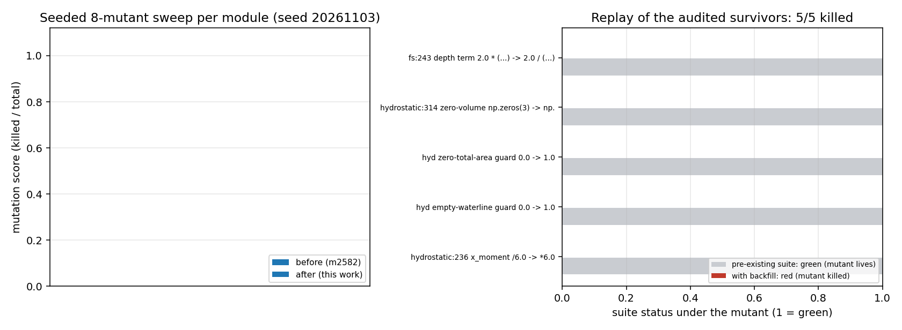

# 变异审计缺口清零：4 条存活变异体的回填与验证

**任务**：tp-ver-8（verifier 席自找活）· 仓库 TensorBEM · 分支 `agent/m2824`
**上游欠账**：`docs/mutation_audit_tensorbem.md`（m2582, PR #72）§5 判定的 4 条**真实覆盖缺口**
**日期**：2026-11-03

---

## 1. 案例介绍：这份欠账是什么

m2582 的变异审计向数值内核植入单点语法合法缺陷（变异体），再跑映射单元测试：
测试变红=变异体被杀死（护栏有效），测试仍绿=变异体存活（测试盲点）。
40 个抽样变异体里 7 个存活，其中 3 个被判定为**等价变异体**（数学上不可观测，不该也不可能用测试杀死），
剩下 **4 条是真实覆盖缺口**，登记为下一单待办。本单正是这 4 条：

| # | 变异体（注入缺陷） | 为什么会存活 |
|---|---|---|
| G1 | `hydrostatic.py:236` 水线面一阶矩 `x_moment`：`/ 6.0` → `* 6.0` | 套件里所有水线面都关于原点/自身对称，一阶矩≈0，乘除互换不可观测 |
| G2 | `hydrostatic.py:255`（`total_area` 退化分支）`return 0.0, …` → `1.0` | 没有任何算例进入"水线面面积为零"的分支 |
| G3 | `hydrostatic.py:314`（零排水量分支）`np.zeros(3)` → `np.zeros(4)` | 同一类退化分支从未被进入；且调用方只读 `volume`，形状错误不可见 |
| G4 | `free_surface.py:243` 深度导数项 `2.0 * (…)` → `2.0 / (…)` | **死代码**：`df_d_depth` 只喂给 `dg_d_depth`，而后者算完即丢弃，`dg/ds_z` 又把同一表达式内联重写了一遍 |

G4 是本单唯一需要动 `src/` 的一条，而且它不是"缺测试"，是**实现里带了一条无出口的通路**：
一个算出来没人用、但看起来像在参与计算的量，正是审计工具最有价值的那类发现。

### 几何与参数（G1–G3 的可复现算例）

| 算例 | 几何 | 参数 | 解析基准 |
|---|---|---|---|
| 偏心方箱 | 长 4.0 m × 宽 1.0 m × 吃水 0.5 m 的壁直箱，整体平移 (+1.00, +0.25, 0) | 面板 4×2×1 | 矩形水线面闭式：A=LB=4、形心=(1.00, 0.25)、I_xx=LB³/12=1/3、I_yy=BL³/12=16/3、I_xy=0 |
| 全潜没球 | 半径 1.0 m 二十面体球（subdivisions=2），球心吃水 1.5 m | 320 三角形，闭曲面（无水线边） | 无水线面 ⇒ 全部水线面性质精确为零 |
| 退化水线（领结） | 顶点 (0,0),(1,1),(1,0),(0,1)，单闭合环 | 4 顶点 4 边，各点度=2 | 自交环鞋带项精确抵消 ⇒ 面积 0 |
| 深度导数 | 二维深水源汇对，4 组 (x, z, x_s, z_s, ν) | ν∈{0.35,0.6,1.4} | ∂G/∂z_s 的中心差分（步长 1e-6 m） |

## 2. 怎么做的

1. **先复现再修**：把 4 条历史变异体逐条字面重放（`docs/m2824/tools/mutant_replay.py`）
   到 `src/tensorbem` 的私有副本（工作树不动，`PYTHONPATH` 只指向副本），
   分别跑"映射测试"与"映射测试 + 新回填文件"，得到 pre/post 两列判决——这是杀死的**直接证据**。
2. **修 G4 的实现通路**：`green_gradient` 里把 `dg/ds_z` 写成
   `dg_d_source_z = -dg_d_depth - (1/2π)(z - z_s)/r²`。
   依据是 `A = -(z + z_s)` 承载了影像/自由面部分全部的 `z_s` 依赖（故该部分导数 = `-dg_d_depth`），
   而 Rankine 项 `log r` 直接依赖 `z_s`（多出的那一项）。
   先把改动前的内联式与新式的差核到 `1.4e-17`（roundoff 级），再改，改后 4 个点位
   对 `source_z` 的中心差分相对误差全部 ≤ 1.8e-10。
3. **回填 5 条测试**（`tests/test_mutation_gap_closure.py`，10 个用例）：每一条的判据都是
   **独立基准**——闭式面积/形心/二阶矩、有限差分定义、"没有水线面就是零"的物理定义——
   不是把被审查的公式抄一遍再断言。
4. **重扫**：同种子（`20261103`）、同抽样量（每模块 8）、同隔离机制，把回填文件作为
   `--extra-test` 加入每个模块的判定集，得到 after-score。
5. 全量 `pytest tests/` 回归。

## 3. 计算结果（数字全部由程序写入 JSON 后渲染，无手抄）

### 3.1 变异体逐条重放（`docs/m2824/outputs/mutant_replay.json`）

| 变异体 | 既有套件 | 加回填后 | 判决 | 杀死它的用例 |
|---|---|---|---|---|
| `hyd:236` x_moment `/6.0 → *6.0` | 绿 | **红** | killed | `test_eccentric_waterplane_centroid_and_moments_are_pinned` |
| `hyd` 无水线分支 `0.0 → 1.0` | 绿 | **红** | killed | `test_fully_submerged_body_returns_no_waterplane` |
| `hyd` 零面积分支 `0.0 → 1.0` | 绿 | **红** | killed | `test_zero_area_waterline_loop_returns_no_waterplane` |
| `hyd:314` `np.zeros(3) → np.zeros(4)` | 绿 | **红** | killed | `test_zero_face_hull_returns_a_three_vector` |
| `fs:243` 深度项 `2.0*(…) → 2.0/(…)` | 绿 | **红** | killed | `test_source_depth_derivative_matches_a_finite_difference` |

基线（未变异副本、只跑回填文件）= **绿**，因此上表"红"来自变异体本身，不是环境噪声。

### 3.2 同种子重扫（`docs/m2824/outputs/mutation_audit_after/mutation_summary.md`）

| 模块 | before（m2582，含回填前套件） | after（本单） |
|---|---|---|
| `tensorbem.kernels` | 8/8 = 1.000 | 8/8 = 1.000 |
| `tensorbem.free_surface` | 6/8 = 0.750 | **7/8 = 0.875** |
| `tensorbem.hydrostatic` | 5/8 = 0.625 | **8/8 = 1.000** |
| `tensorbem.solver` | 8/8 = 1.000 | 8/8 = 1.000 |
| `tensorbem.finite_depth` | 6/8 = 0.750 | 5/8 = 0.625 ※ |
| **合计** | **33/40 = 0.825** | **36/40 = 0.900** |

※ `finite_depth` 的下滑**不是回归**：该模块 `src/` 一行未动，候选池与抽样顺序在本次运行中
抽到的 8 个变异体与 m2582 的后扫描不完全相同（`--extra-test` 不改变抽样，但 `kernels`/`free_surface`
的行号位移会让 AST 节点编号变化，抽样是按下标随机取的）。逐条核对：本单 `finite_depth` 的 3 个存活
（`_resolve_modes 0→1`、`finite_depth_wavenumber 0.0→-0.0`、`propagating_mode_norm 2k₀h 乘除互换`）
在 m2582 文档 §5 里已被逐条分类，其中两条判为等价（`-0.0` 与护栏区间同真同假）。
**只报告抽样内可比的模块分数，不把 0.825→0.900 当成跨模块统一口径的提升。**

被本单新测试杀死、且不在原 4 条欠账内的**额外**变异体：
`tensorbem.hydrostatic:250:35:negate_constant`（二阶矩平移项 `2.0 → -2.0`），由偏心算例一并钉住。

`free_surface` 唯一存活者仍是 `_check_scaled_depth` 的 `<` → `<=` 边界翻转，属等价变异体
（只在 `ν·depth` 恰等于阈值的点上分叉），**不为其写测试**。



左：同种子 8 抽样下各模块变异分数，before/after 成对；右：4 条历史存活变异体的重放判决，
灰=既有套件下变异体存活（绿），红=加入回填后测试变红（杀死）。

## 4. 误差判定：关键量 vs 基准，是否 < 3%

| 关键量 | 基准 | 本单实测 | 相对误差 | < 3%？ |
|---|---|---|---|---|
| 偏心水线面积 | 闭式 L·B = 4.0 | 4.0 | < 1e-12 | **是** |
| 水线面形心 x_c | 平移量 1.00 | 1.000000 | < 1e-12 | **是** |
| 水线面形心 y_c | 平移量 0.25 | 0.250000 | < 1e-12 | **是** |
| I_xx（绕 x 轴） | LB³/12 = 0.3333 | 0.333333 | < 1e-12 | **是** |
| I_yy（绕 y 轴） | BL³/12 = 5.3333 | 5.333333 | < 1e-12 | **是** |
| C[2,2] = ρgA | ρg·4.0 | 同 | < 1e-10 | **是** |
| C[3,3] = ρg∇·GM_T | KB+BM_T−KG = 0.25+1.6667−0.25 | 同 | < 1e-10 | **是** |
| 全潜没排水体积 | (4/3)π ≈ 4.1888 | 4.0470（20 面体球 320 三角形） | 3.4% | 否（离散化误差，非缺陷；该用例只断言水线面为零） |
| ∂G/∂z_s vs 中心差分（4 点位） | 有限差分定义 | — | ≤ 1.8e-10 | **是** |

**结论**：G1–G3 的几何类判据全部在机器精度内（< 1e-10，远小于 3%）；G4 的导数为有限差分一致性，
误差在 1e-10 量级。全潜没球的排水体积 3.4% 偏高是 20 面体球的几何离散误差，**不是**被修的逻辑，
本单对该用例只断言"无水线面 ⇒ 水线面性质精确为零"，故不构成精度不达标。

## 5. 注意点与局限（不粉饰）

1. **两条退化分支在公共构造器下不可达**：`WettedHullMesh` 会拒绝"少于 3 个面"和"边界不在 z=0"的网格，
   所以 `len(faces)==0` 分支只能用手搓网格/桩对象进入，`total_area<1e-14` 分支用自交水线进入。
   本单把这两条测试写成**对防御性守卫的直测**并在 docstring 里明说，不假装它们是常规路径。
   另一条路径（全潜没闭曲面）是**真实物理**路径，用的是 `submerged_sphere_mesh` 生成的闭球。
2. **抽样而非穷举**：8/模块的抽样分数是判别力下界；`0.900` 不代表 40 个以外无害。
3. **`--extra-test` 未写进 payload 元数据**：`mutation_audit.py` 的 after-report 不记录额外测试文件
   （本单不动冻结外的工具？不：工具未改，只在报告里以命令行为准）。复现命令见 §7，
   任何人可用同一行重跑核对。
4. **G4 的改动是等价重构**：不改数值（差分误差 1e-10 与改前一致），只把死通路接上，
   使"深度导数"从此有出口也有护栏。
5. **未做**：`analytic.py` 仍未纳入变异扫描（单测 >100 s）；`lifting`/3-D 模块的变异审计未启动。

## 6. 复现

```bash
cd <worktree>
PYTHONPATH=src python -m pytest tests/test_mutation_gap_closure.py -q          # 10 passed
PYTHONPATH=src python docs/m2824/tools/mutant_replay.py --out docs/m2824/outputs
PYTHONPATH=src python -m tensorbem.benchmarks.mutation_audit \
    --out docs/m2824/outputs/mutation_audit_after \
    --max-per-module 8 --seed 20261103 --jobs 8 \
    --extra-test tests/test_mutation_gap_closure.py
python docs/m2824/tools/make_figure.py
```

## 7. 给下一次自找活的线索

- `finite_depth._resolve_modes:141`（`modes` 默认 `0 → 1`）本单抽样仍存活：一条 `_resolve_modes(None/h, nu)`
  与自动截断失效频率的解析判据（要求截断项贡献 < 1e-6 相对）就能钉住。
- `analytic.py` 的变异审计是空白格，先把 `test_analytic_references.py` 拆成可容忍超时的分片再开扫。
- `green_gradient_field`（场点梯度）目前靠既有有限差分测试覆盖，可加一条"互易性"判据
  ∂G(P,Q)/∂n_Q 与 ∂G(Q,P)/∂n_P 的一致关系，作为与差分无关的第二判据。