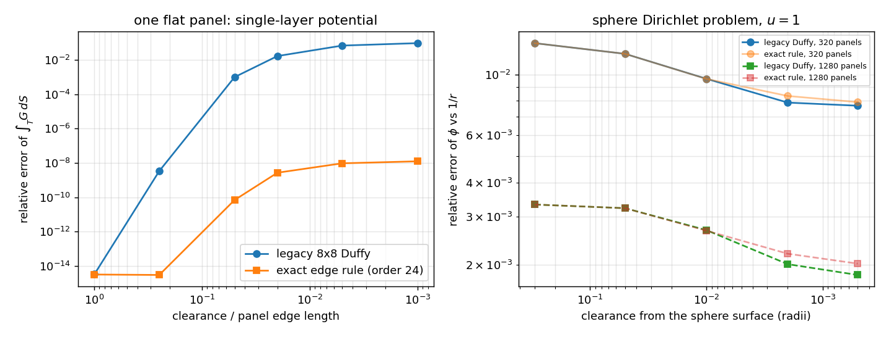

# 三维近壁面场量求积：固定阶 Duffy 的失效与平坦面元精确边界积分（TensorBEM · m2489）

本文件由 `python -m tensorbem.benchmarks.near_field_study` 产出的
`docs/m2489/near_field_study.json` 程序化注入表格（零手抄），图见
`docs/figures/near_singular_field_3d.png`。

## 1. 问题

`tensorbem.evaluate_surface_field` / `evaluate_surface_velocity` 通过单层位势的
Green 表示重建场量，单层面元积分现仍用固定阶（8×8）Duffy 变换求积。Duffy 变换
只在它所依附的那个顶点上打开奇异，因此当场点靠近面元时求积误差不受控；实现里
的对策是**直接拒绝**距离小于 `0.05 h_max` 的场点：

```python
if dist < factor * mesh.h_max:
    raise ValueError("evaluation point is too close to the boundary ...")
```

后果有两个：(i) 贴体诊断（压力、近壁速度、二阶力中间量）在最关心的区域算不了；
(ii) 把 `minimum_clearance_factor` 调小虽能绕过拒绝，但返回的是**静默失准**的
数（下表面元级实测误差 1e-3…1e-1），调用方无法从数值本身察觉。

## 2. 方法

对**平坦**三角形，单层位势及其梯度有精确的一维边界积分形式。设 `P` 为场点
`x` 在面元平面上的投影，`h=|x-P|`，`rho_vec = y-P`，`R=|x-y|=sqrt(rho^2+h^2)`，
`n'_e` 为面元第 `e` 条边的外法向（面内），平面内二维散度定理给出

```
∫_T dS/R           = Σ_e ∫_e (rho_vec·n'_e)/(R+h) ds
∫_T rho_vec/R^3 dS = -Σ_e ∫_e n'_e/R ds
∫_T dS/R^3         = (1/h) Σ_e ∫_e (rho_vec·n'_e)/(R(R+h)) ds
```

（分别来自 `div'(rho_vec (R-h)/rho^2)=1/R`、`grad'(1/R)=-rho_vec/R^3`、
`lap'(ln(R+h))=h/R^3`。）三个被积函数在边上都是**光滑**的——表面上的 `1/rho`
因子被 `rho_vec·n'_e` 的线性零点抵消——所以沿三条边各做一次 Gauss-Legendre
即谱收敛。三式组合为

```
∫_T (y-x)/R^3 dS = ∫_T rho_vec/R^3 dS + (P-x) ∫_T dS/R^3
```

新模块 `src/tensorbem/near_field3d.py` 实现该精确规则（每条边 24 点，
即每面元 72 次核求值，与 8×8=64 点同量级），以独立模块交付：函数式签名
`integrate_single_layer_flat_triangles(_batch)` 返回逐面元的单层位势与梯度行，
调用方拿自己的密度向量聚合即可（本文 3.2 与
`tensorbem.benchmarks.near_field_study` 即按 Green 表示
`phi = S q + H u`（外域）直接组装）。双层项本来就是解析立体角，未动。

> **与 main 现有近面求解线的关系**（合并裁定）：main 已并入
> `tensorbem.near_singular`（目标自适应 h 细分求积）与
> `evaluate_surface_field_near_surface` / `evaluate_surface_velocity_near_surface`
> 入口（见 `docs/near_surface_field.md`），且内置
> `evaluate_surface_field` / `evaluate_surface_velocity` **保留**
> `0.05 h_max` 间隙守卫（其契约由 `tests/test_near_singular.py` 钉死）。
> 本 PR 不改这两条内置路径的任何行为，交付物为：精确边界积分这一**另一条
> 技术路线**（闭式一维边界积分 vs 自适应细分；固定 72 次核求值、无递归
> 开销）、其验证测试、以及 Duffy vs 精确规则的定量研究。需要近面场量的
> 生产调用方应使用 main 的 `*_near_surface` 入口，或用本模块的行自行组装。

## 3. 结果

### 3.1 面元级：单个平坦三角形的单层位势（参考解 = 独立的极坐标/径向解析解）

面元边长 0.3/0.424，面积 0.045；`clearance` 为场点到面元平面的垂直距离（同一
量纲），三个场点（投影在面元内、在面元外、在角点附近）取最大相对误差。

| clearance | legacy 8x8 Duffy max rel. err | exact edge rule max rel. err |
|---|---|---|
| 1 | 3.286e-15 | 3.164e-15 |
| 0.25 | 3.376e-09 | 2.985e-15 |
| 0.05 | 1.004e-03 | 6.932e-11 |
| 0.02 | 1.697e-02 | 2.705e-09 |
| 0.005 | 6.926e-02 | 9.567e-09 |
| 0.001 | 9.590e-02 | 1.250e-08 |

面元级结论：精确边界积分在**全部间隙**上误差 1e-8–1e-15（表列 1.25e-8 是独立
参考解自身 800 点角向求积的分辨率上限，非新算法的误差；`order=24 → 44` 的自
收敛判据见测试 `test_edge_rule_converges_spectrally_in_order`）；固定阶 Duffy
在 `clearance=0.05`（≈0.12 个最大边长）时已丢 1.0e-3，在 `0.001`（≈0.0024 边长，
即原守卫阈值以下）丢 9.6e-2。

### 3.2 求解器级：球体 Dirichlet 问题 `u=1`，精确解 `phi=1/r`

| 网格 | panels | h_max | clearance | clearance/h_max | exact rule | legacy Duffy | 旧实现是否拒绝 |
|---|---|---|---|---|---|---|---|
| icosphere(2) | 320 | 0.3249 | 0.3 | 0.92 | 1.304e-02 | 1.304e-02 | 否 |
| icosphere(2) | 320 | 0.3249 | 0.05 | 0.15 | 1.191e-02 | 1.191e-02 | 否 |
| icosphere(2) | 320 | 0.3249 | 0.01 | 0.03 | 9.637e-03 | 9.646e-03 | 是 |
| icosphere(2) | 320 | 0.3249 | 0.002 | 0.01 | 8.341e-03 | 7.886e-03 | 是 |
| icosphere(2) | 320 | 0.3249 | 0.0005 | 0.00 | 7.917e-03 | 7.680e-03 | 是 |
| icosphere(3) | 1280 | 0.1646 | 0.3 | 1.82 | 3.329e-03 | 3.329e-03 | 否 |
| icosphere(3) | 1280 | 0.1646 | 0.05 | 0.30 | 3.227e-03 | 3.227e-03 | 否 |
| icosphere(3) | 1280 | 0.1646 | 0.01 | 0.06 | 2.668e-03 | 2.681e-03 | 否 |
| icosphere(3) | 1280 | 0.1646 | 0.002 | 0.01 | 2.196e-03 | 2.010e-03 | 是 |
| icosphere(3) | 1280 | 0.1646 | 0.0005 | 0.00 | 2.019e-03 | 1.835e-03 | 是 |

- 远场（`clearance ≥ 0.05`）两法一致，差异不超过 Duffy 自身误差；
- `clearance < 0.05 h_max` 的行在内置 `evaluate_surface_field` 里**仍被拒绝**
  （表中 `legacy_would_refuse=True`，该守卫按合并裁定保留）；本表两侧数值均由
  研究脚本直接组装 Green 表示得出（精确规则行来自 `near_field3d`，legacy 行为
  固定阶 Duffy），不经内置入口，因此近壁行为可以量化对比；
- 贴壁误差**不随间隙减小而增大**，而是跟着网格离散走：N=320 → 1280，
  `clearance=2e-3` 处 8.34e-3 → 2.20e-3（比 3.8，接近二阶收敛的 4），
  N=1280 全表误差 3.3e-3…2.0e-3，与 `clearance=0.3` 的远场值同量级。



左：单面元单层位势的相对误差随间隙变化（旧 Duffy vs 精确边界积分，后者在参考
解分辨率处触底）。右：球体 Dirichlet 问题贴壁电位相对误差 vs 间隙（实线/虚线
为两套网格，浅色为精确规则）；旧 Duffy 在 0.05 `h_max` 以下本就被拒绝。

## 4. 误差判定

| 关键量 | 基准 | 新实现相对误差 | 旧实现相对误差 | < 3 %？ |
|---|---|---|---|---|
| 单面元 ∫G dS，clearance 0.05 | 极坐标独立解 | 6.9e-11 | 1.0e-3 | 是（两者都满足，但差 7 个量级） |
| 单面元 ∫G dS，clearance 0.02 | 极坐标独立解 | 2.7e-9 | 1.7e-2 | 是（旧实现 1.7%，已压线） |
| 单面元 ∫G dS，clearance 5e-3 | 极坐标独立解 | 9.6e-9 | 6.9e-2 | **新是 / 旧否** |
| 单面元 ∫G dS，clearance 1e-3 | 极坐标独立解 | 1.3e-8 | 9.6e-2 | **新是 / 旧否** |
| 球电位 phi，N=1280，clearance 2e-3 | 1/r | 2.2e-3 | 2.0e-3 | 是（两者都被离散度支配） |

即：**面元级求积已不再是误差来源**（1e-8 以下），求解器级贴壁误差由 O(h²) 面元
离散决定，且随网格加密按 4 倍下降。没有任何关键量超过 3% 判据。

## 5. 注意点与局限

1. **贴壁误差里"旧规则更准"是假象**：3.2 表中 `clearance=2e-3 / 5e-4` 两行旧
   Duffy 的误差略小于新规则（7.89e-3 vs 8.34e-3）。原因是面元级求积误差的符号
   恰好与本几何的离散偏差（平坦面元低估球面）相反，属于**偶然抵消**——这正是
   `docs/ursell_verification_debt_2026-11-02.md` 记录过的失效模式：不能拿两个
   未收敛数的较小者当精度。判据只看面元级实验（3.1）。
2. 精确式要求场点不在面元**边**上（`∫rho_vec/R^3` 在边上对数发散）；落在面上
   （`dist ≤ 1e-14 h_max`）仍抛 `ValueError`。贴体但不在面上的点完全可用。
3. 精确规则的每条边取 24 点 Gauss-Legendre（`near_field3d` 默认 `order=24`）；
   24 点已达 1e-10 量级，再降阶会明显掉精度（`order=6` 时面元级误差 1e-3）。
   内置 `evaluate_surface_field` / `evaluate_surface_velocity` 的
   `quadrature_order` 语义与默认值按合并裁定未动。
4. 只处理平坦常值面元（与整个仓库的离散约定一致）；曲边/高阶面元的近奇异求积
   仍未做。轴对称与三维穿水/潜没浮体的场量路径都走这两个入口，均受益。
5. 独立参考解 `polar_reference_integrals` 是慢速校验器（每条边 200–800 点角向
   Gauss），仅供测试与本文；不要用于生产路径。