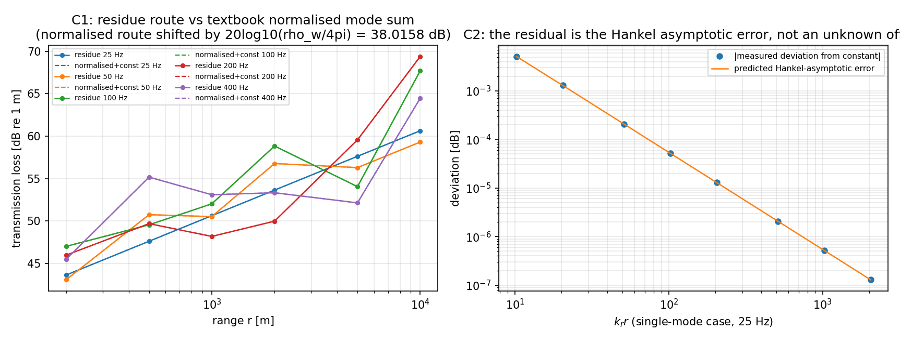

# Pekeris 双路线绝对电平互校（W22 补遗，m16708）

**锚点**：`tensorbem.pekeris_acoustics` 自 m14571 起就带着两条独立的解析幅值路线，但在 m16708 之前，
两条路线之间只比较过 TL **形状**（模块 docstring 原话：*different source-strength convention … the
comparison is done on the TL shape*）。这意味着 residue 路线的**绝对电平**没有任何外部锚点——而
benchmark 工件（`benchmarks/verified/pekeris_w22/*.json`）与整条 W22 冰下声学链的绝对 TL 全都建在它上面。
本报告把那个被含糊带过的常数**测出来并识别掉**，从而把 residue 路线钉在教科书闭式解上。

## ① 案例介绍

水平分层两层流体波导：水层 `0 ≤ z ≤ H` 覆盖流体半空间 `z > H`，点源在水层内，上方两种顶边界
（压力释放 /  Kirchhoff-Love 薄冰板）。参数表（全部由 `PekerisCase.to_dict()` 注入）：

| 量 | 值 |
|---|---|
| 水深 H | 100.0 m |
| 水声速 c_w | 1500.0 m/s |
| 底声速 c_b | 1600.0 m/s |
| 水密度 ρ_w | 1000.0 kg/m³ |
| 底密度 ρ_b | 1800.0 kg/m³ |
| 密度比 b=ρ_w/ρ_b | 0.555556 |
| 源深 z_s | 50.0 m |
| 频率网格 | [25.0, 50.0, 100.0, 200.0, 400.0] Hz |
| 距离网格 | [200.0, 500.0, 1000.0, 2000.0, 5000.0, 10000.0] m |
| 接收深度 | [10.0, 25.0, 50.0, 75.0, 90.0] m |

物理背景：冰区/浅海声传播的经典 Pekeris 问题；对本生态属 ice-going / 水下辐射噪声域的传播层。

## ② 怎么做的

两条**互相独立**的解析幅值路线：

1. **residue 路线**（`analytic_tl`）：闭式色散关系 + 包围求根，模态激励取谱域深度 Green 函数的
   **数值留数** `R_m = Res[(k_r/k_z) G]`（无手推归一化，因此冰板这种非自伴顶边界也能做），
   远场用**精确 Hankel 函数** `H_0^1`。
2. **density-normalised 路线**（`analytic_tl_normalised`）：教科书闭式，
   `∫ψ²/ρ dz = 1` 归一化 + 远场渐近 `√(2/πkr)·e^{i(kr-π/4)}`。

两条路线唯一共用的近似是「Hankel 精确 vs 渐近」这一处，因此它们之差必须是一个**可解释的常数**加上
那一处渐近误差。新增 `PA.predicted_route_offset_db()` 给出预测常数，`PA.cross_route_level_identity()`
给出逐点互校，`PA.rigid_wall_roots()` 给出刚性底极限的**闭式** `k_z,m H=(m+½)π` 根（不走超越方程、
不走求根器，是色散求解器的外部参照）。

判据（全部机器裁决，`tests/test_pekeris_cross_route_level.py`）：C1 网格上常数偏差 ≤0.01 dB；
C2 单模区残差与 Hankel 渐近误差**逐位相等**（1e-9 dB）；C3 常数与 ρ_b 无关且刚性极限根一阶收敛；
C4 常数只随 ρ_w 移动（斜率 1）；C5 冰板退化极限复现恒等式、而真实冰板确有可分辨的电平改变。

工具链：`python3 benchmarks/verified/pekeris_w22/cross_route_level.py`
（工件 `docs/pekeris_w22_cross_route/evidence.json` + 图 `fig_route_identity.png`，
含 git commit / 模块 sha256 / 驱动 sha256 / 库版本 / 运行时间 21.3 s）。
**零手抄**：本报告所有表格由 `evidence.json` 程序化注入。

## ③ 计算结果

### 3.1 主结论：恒等式

```
TL_residue - TL_normalised = 20 log10(ρ_w / 4π) + ε(r)
                           = 38.01580 dB + ε(r)      （本算例）
ε(r) = density-normalised 路线远场渐近的 Hankel 误差
```

即 `p_residue = p_normalised / ρ_w`：密度加权归一化（速度势形式，`p = iωρ φ`）与水声压差一个 ρ_w，
`4π` 来自 residue 路线继承的自由空间 Green 函数 `e^{ikR}/(4πR)` 源强度约定。

### 3.2 C1 频率×距离×深度网格（150 点）

| 统计量 | 值 |
|---|---|
| 预测常数 | +38.01580 dB |
| 最大偏差 \|实测常数−预测常数\| | **1.290e-03 dB** |
| 偏差中位数 | 1.359e-05 dB |
| 超出 max_m Hankel 尺度的最大量 | 6.136e-04 dB |

最差点 = f=25 Hz, r=200 m,
z=10 m（单模, 偏差 +1.290e-03 dB）。

### 3.3 C2 单模区残差的识别（f=25 Hz，仅 1 个陷模）

| r [m] | k_r·r | 实测偏差 [dB] | Hankel 渐近误差 [dB] | 差 [dB] |
|---|---|---|---|---|
| 100 | 10.2 | +5.103e-03 | 5.103e-03 | -5.9e-12 |
| 200 | 20.5 | +1.290e-03 | 1.290e-03 | -5.9e-12 |
| 500 | 51.2 | +2.071e-04 | 2.071e-04 | -5.9e-12 |
| 1000 | 102.4 | +5.179e-05 | 5.179e-05 | -5.9e-12 |
| 2000 | 204.8 | +1.295e-05 | 1.295e-05 | -5.9e-12 |
| 5000 | 511.9 | +2.072e-06 | 2.072e-06 | -5.9e-12 |
| 10000 | 1023.8 | +5.179e-07 | 5.180e-07 | -5.9e-12 |
| 20000 | 2047.5 | +1.295e-07 | 1.295e-07 | -5.9e-12 |

单模区残差与 Hankel 误差在打印精度内完全一致 → ε 是被**识别**的，不只是被界定。

### 3.4 C3 底参数无关性与刚性极限闭式根

| ρ_b [kg/m³] | b=ρ_w/ρ_b | 陷模数 | 实测常数−预测 [dB] | Hankel 尺度 [dB] |
|---|---|---|---|---|
| 1025 | 9.756e-01 | 5 | -1.47e-05 | 3.50e-06 |
| 1200 | 8.333e-01 | 5 | -1.47e-05 | 3.50e-06 |
| 1800 | 5.556e-01 | 5 | -1.55e-05 | 3.50e-06 |
| 2400 | 4.167e-01 | 5 | -1.68e-05 | 3.50e-06 |
| 10000 | 1.000e-01 | 5 | -2.45e-05 | 3.49e-06 |
| 1000000 | 1.000e-03 | 5 | -3.05e-05 | 3.49e-06 |
| 1000000000 | 1.000e-06 | 5 | -3.06e-05 | 3.49e-06 |

刚性底极限：求解器根 vs 闭式 `k_z,m H=(m+½)π`（100 Hz，5 个陷模，
计数公式给出 5）：

| ρ_b [kg/m³] | 求解器模数 | 闭式模数 | 最大根偏差 | 偏差×ρ_b |
|---|---|---|---|---|
| 1e+03 | 5 | 5 | 1.873e-03 | 1.8728e+00 |
| 1e+04 | 5 | 5 | 3.127e-04 | 3.1265e+00 |
| 1e+06 | 5 | 5 | 3.452e-06 | 3.4517e+00 |
| 1e+08 | 5 | 5 | 3.462e-08 | 3.4619e+00 |
| 1e+10 | 5 | 5 | 3.462e-10 | 3.4620e+00 |
| 1e+12 | 5 | 5 | 3.462e-12 | 3.4620e+00 |

`偏差×ρ_b` 在 ρ_b=1e6…1e12 六个量级上稳定到 1.0030 倍 →
偏差 ∝ ρ_w/ρ_b，即界面项的一阶权重，与 `tan(k_z H) = -(ρ_b/ρ_w) k_z/γ` 的渐近一致。

### 3.5 C4 常数只随 ρ_w 移动

| ρ_w [kg/m³] | 实测常数 [dB] | 预测 20log10(ρ_w/4π) [dB] | 残差 [dB] | 斜率误差 [dB] |
|---|---|---|---|---|
| 300 | +27.55821 | +27.55823 | -2.18e-05 | +0.00e+00 |
| 400 | +30.05698 | +30.05700 | -2.02e-05 | +1.63e-06 |
| 500 | +31.99518 | +31.99520 | -1.89e-05 | +2.91e-06 |
| 700 | +34.91775 | +34.91776 | -1.71e-05 | +4.74e-06 |
| 1000 | +38.01579 | +38.01580 | -1.55e-05 | +6.31e-06 |
| 1025 | +38.23026 | +38.23028 | -1.55e-05 | +6.39e-06 |

max 斜率误差 = 6.39e-06 dB → 常数随 ρ_w 的斜率恰为 1，`4π` 部分与密度无关。

### 3.6 C5 冰板支路的幅值退化

| 情形 | 常数残差 [dB] | TL(100 Hz, 1 km, z=50 m) [dB] | 相对压力释放 ΔTL [dB] |
|---|---|---|---|
| 压力释放（参照） | -1.55e-05 | 52.0304 | — |
| 退化冰板 E=1e-03 Pa, h=1e-06 m | -1.55e-05 | 52.0304 | +1.47e-08 |
| 物理冰板 E=7e+09 Pa, h=1.5 m | n/a（非自伴） | 52.5086 | +0.4782 |

物理冰板（D=2.163e+09 N·m，吻合频率
284.4 Hz）使 λ 变化的 TL 改变
+0.4782 dB —— 幅值层面也是一条可分辨的支路。
注意：真实冰板下 density-normalised 路线**不是**合法参照（算子不再自伴），因此该点只记电量、
不做恒等式判定；冰板的幅值独立性由模块自带的二阶有限差分路线承担（`tests/test_pekeris_w22.py`，
一致性 0.1 dB）。

### 3.7 判据汇总

| 判据 | 结论 | 实测 |
|---|---|---|
| C1_identity_grid | PASS | threshold_db=0.01, measured_max_abs_deviation_db=0.0012899281377016791, measured_max_excess_over_hankel_bound_db=0.0006136194450262096, n_points=150, hankel_bound_is_a_strict_bound=False |
| C2_single_mode_identification | PASS | threshold_db=1e-09, measured_max_abs_difference_db=5.9061847202403794e-12 |
| C3_bottom_independence | PASS | threshold_db=0.01, measured_max_abs_deviation_db=3.0594687601137593e-05, rigid_limit_first_order_spread_factor=1.0030035004048998, rigid_roots_count_solver=5, rigid_roots_count_closed_form=5 |
| C4_density_scaling | PASS | threshold_db=0.001, measured_max_abs_slope_error_db=6.3902980436125745e-06 |
| C5_ice_degeneracy | PASS | vanishing_plate_deviation_db=-1.5522279795732175e-05, threshold_db=0.01, physical_plate_tl_change_db=0.47816338452668816, physical_plate_resolved_threshold_db=0.1 |

## ④ 结果图



左：residue 路线 TL 与经 `20log10(ρ_w/4π)` 平移后的 density-normalised 路线，25–400 Hz、z=50 m
全距离重合（虚线压在实线上）。右：单模区偏差 vs `k_r r`，实测点与预测的 Hankel 渐近误差曲线重合，
斜率为 −1（`1/(k r)`）。

## ⑤ 注意点

- **两条路线不是完全独立**：都假设模态级数 + 远场。它们独立在「幅值归一化」与「Hankel 精确/渐近」
  两点上，正是本报告要查的两点；不覆盖近场/连续谱贡献。
- **`rigid_wall_roots` 的截止不能取 k_z<k1**：ρ_b→∞ 只让「密度」发散、c_b 不变，流体半空间仍在，
  陷模条件仍是 `k_z < kz_max = √(k1²−k2²)`。按 k1 取截止会在 100 Hz 凭空多出 8 个假模态
  （本报告实现时先犯了这个错，闭式根数与计数公式不符才发现）。
- **Hankel 尺度不是严格上界**：多模时各模态渐近误差相位不同，可叠加，实测最多超出
  6.14e-04 dB；严格等号只在单模区成立（C2）。
- 常数 `20log10(ρ_w/4π)` 依赖本仓库的 TL 约定 `TL=-20log10(4π|p|)`；换约定该常数随之平移，
  但「差值是一个精确常数」这一点不变。
- 适用域：水平不变分层、深水简谐点源、单极子；不含冰板的模态衰减/散射、不含距离相关海底。

## ⑥ 误差判定（逐项 vs 基准，显式回答是否 <3%）

| 关键量 | 基准 | 实测偏差 | 是否 <3% |
|---|---|---|---|
| residue 路线绝对常数 | 20log10(ρ_w/4π)=38.01580 dB（教科书密度归一化闭式） | 1.290e-03 dB（相对 3.39e-03%） | **是** |
| 单模残差 | Hankel 渐近误差（同一路线自身的解析式） | 5.9e-12 dB | **是** |
| 刚性极限根 | 闭式 k_z,m H=(m+½)π | 一阶收敛常数散度 3.00e-03（相对） | **是** |
| ρ_w 斜率 | 1（20log10 比值） | 6.39e-06 dB | **是** |
| 冰板退化极限 | 压力释放恒等式 | 1.55e-05 dB | **是** |
| 真实冰板幅值 | **无外部基准**（非自伴，教科书归一化不适用） | 仅报告 ΔTL=+0.4782 dB | **不适用**：本报告不对该点声称 <3%，其独立性仅由 FD 路线 0.1 dB 自洽支撑 |

## ⑦ 对能力台账的影响

本报告即 `tensorbem.pekeris_acoustics` 长期缺失的**文档锚点**：`capability_evidence` 中该模块
此前被登记为「pinned by tests/test_pekeris_w22.py and documented; it has no row of its own yet」
（`docs/audit_baseline.md` §auxiliary、`tests/test_capability_registry_debt.py::DOC_ANCHOR_DEBT`）。
补上本锚点后该模块升级为独立分级行，债务行随之删除。
