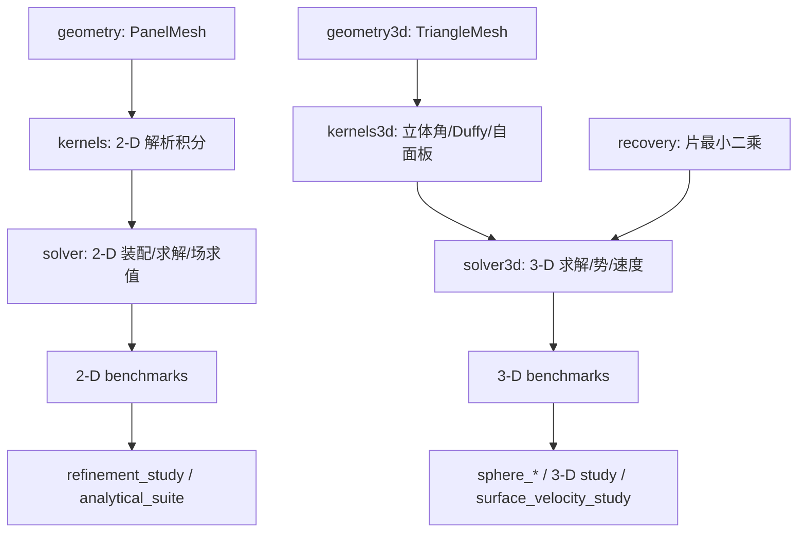

# TensorBEM 项目分析报告

**分析对象：** `cxs503/TensorBEM`，提交 `7f5d7c4`（`main`，与 `arena/31a96013-tensorbem` 同源）
**分析日期：** 2026-10-22
**环境：** Linux / Python 3.11.2 / NumPy 2.4.6 / pytest 9.1.1
**方法：** 源码走查 + 全量测试 + 覆盖率 + 全部基准复现 + 额外数值实验（未改动任何源码）

---

## 0. 结论速览

TensorBEM 是一个**“验证优先”的 Laplace 边界元研究原型**：2-D 多边形常数面元 + 3-D 三角形常数面元，只处理 Dirichlet 问题；核心数值代码约 1.7k 行，测试约 1.6k 行，文档约 0.9k 行。它最突出的优点不是功能多，而是**每个数值声明都能复现、每个局限都写进了文档**。

我复现了 README/ docs 中全部头条数字，误差与收敛阶均一致（按文档采用的 \(h_{\max}\) 定义计算观测阶）。144 个测试通过、3 个因缺少 matplotlib 跳过，总覆盖率 84%，核心数值模块 91%–99%。

| 维度 | 评价 | 主要依据 |
|---|---|---|
| 数值正确性 | **强** | 3-D 双层矩阵行和误差 ≤ \(1.6\times10^{-15}\)；相对残差 ≤ \(6.4\times10^{-16}\)；立体角梯度经有限差分/闭合曲面恒等式交叉验证 |
| 验证严谨性 | **强** | 解析解、网格收敛、固定探针、失败趋势不隐藏；主动报告“通量一阶、积分量二阶”等不利事实 |
| 文档 | **强，但有漂移** | 数字可复现；少量措辞（“二阶”）与表号问题 |
| API 一致性 | **中** | 2-D/3-D 结果对象与导出符号不对称；2-D 场求值未导出 |
| 输入健壮性 | **中偏弱** | 发现 4 处可静默产生错误结果的校验缺口（见 §6.1） |
| 性能/可扩展性 | **弱（验证原型水平）** | \(O(N^2)\) 存储、\(O(N^3)\) 求解；2-D 条件数 \(\approx 0.6N\)，3-D \(\approx 2.1\sqrt{N}\) |
| 工程化 | **中** | 测试质量高；无 lint/type/format、绘图未进 CI、无黄金回归值 |
| 物理能力 | **早期** | 仅 Laplace + Dirichlet；无自由液面、Neumann/混合、多体语义、船体几何、力积分 |

**一句话判断：** 作为一个“可验证的 BEM 内核”，它已经相当扎实；作为一个“船海水动力工具”，它还处在原型的最早期。当前最值得做的不是加物理，而是先补齐输入校验（半天）、把性能/条件数诊断工程化（1–2 周），再考虑用 \(C^0\) 线性面元根治精度上限（1–2 月）。

---

## 1. 项目定位与成熟度

### 1.1 定位

README 与路线图给出的目标很明确：

1. 2-D 多边形 Laplace BEM（常数面元、解析面元积分）——**已完成**；
2. 3-D 三角形 Laplace BEM（内域/外域 Dirichlet、立体角、Duffy 求积）——**已完成**；
3. 3-D 速度场与表面速度恢复——**已完成**；
4. 自由液面、波浪辐射/绕射、船体几何、快速求解器——**未开始**；
5. 面向 TensorPlatform 的稳定任务/结果契约——**未开始**。

GitHub 上有 9 个已合并 PR、2 个开放 issue：

- **#11**：明确记录表面速度恢复路径的适用边界（光滑迹假设、表示公式在 \(O(h)\) 边界层内不可靠）；
- **#8**：3-D 船体势流基准路线图（先椭球、再船体，明确排除自由液面）。

这说明项目对“能做什么/不能做什么”有清醒认识，这在研究型数值代码中并不常见。

### 1.2 成熟度判断

| 能力 | 状态 | 说明 |
|---|---|---|
| 2-D Laplace Dirichlet | 可用于验证 | 解析面元积分，条件数随 \(N\) 线性增长 |
| 3-D Laplace Dirichlet（内/外域） | 可用于验证 | 常数面元 + 质心配点，稠密直接解 |
| 3-D 势/速度/表面速度 | 可用于验证 | 远离表面与恢复路径可信；表示公式路径仅作诊断 |
| 自由液面 / 波浪 | 无 | 无相应 Green 函数与边界条件 |
| Neumann / 混合边界 | 无 | 只有 Dirichlet |
| 多体 / 多连通域 | 无明确语义 | 2-D 仅单闭合多边形；3-D 网格校验不区分连通分量 |
| 船体几何 / 力积分 API | 无 | 附加质量在基准脚本内临时积分 |
| 大规模计算 | 无 | 稠密 \(O(N^2)\)/\(O(N^3)\)，无 FMM/H-matrix/并行 |

---

## 2. 代码结构与数据流

### 2.1 模块职责与规模

| 模块 | 行数 | 职责 |
|---|---:|---|
| `geometry.py` | 79 | 2-D `PanelMesh` 校验、正多边形生成 |
| `kernels.py` | 106 | 2-D 基本解、双层核、直线面元解析积分 |
| `solver.py` | 132 | 2-D 装配、求解、内部场重构 |
| `geometry3d.py` | 263 | 闭合三角网格校验、icosphere、网格质量指标 |
| `kernels3d.py` | 536 | 3-D 核、立体角及其梯度、Duffy/极坐标自面板求积 |
| `solver3d.py` | 406 | 3-D 装配、内/外域求解、势/速度/表面速度 |
| `recovery.py` | 156 | 质心数据的切向梯度最小二乘恢复 |
| `benchmarks/` | 1 599 | 8 个基准/研究报告脚本 |
| `tests/` | 1 640 | 15 个测试文件，111 个测试函数 |
| `docs/` | 904 | 2-D/3-D/船海三份中文报告 |

### 2.2 依赖关系



结构清晰，没有循环依赖；基准脚本只调用公共求解器，不复制数值内核。

### 2.3 公共 API

`tensorbem/__init__.py` 导出 14 个符号，覆盖 2-D/3-D 网格、求解器、势/速度求值与恢复。两个不一致：

- `solver.evaluate_interior_field`（2-D 场求值）**没有导出**，而对应的 3-D `evaluate_surface_field` 导出了；
- `solver.assemble_matrices` 未导出，而 3-D 的 `assemble_surface_matrices` 导出了；
- `recovery.tangent_basis` 没有导出，但测试直接 import，属于“事实公共 API”。

这不是 bug，但会让使用者形成两套心智模型。建议统一：要么都导出，要么在 `__init__` 中明确“高级/内部”分组。

---

## 3. 数值方法核对

### 3.1 2-D 公式

\[
G(x,y)=-\frac{1}{2\pi}\log\frac{|x-y|}{2},\qquad -\nabla^2G=\delta,
\]
\[
c\,u=\int_\Gamma G q\,ds-\int_\Gamma\frac{\partial G}{\partial n_y}u\,ds,\qquad c=\tfrac12,
\]

离散为 \(\mathbf S\mathbf q=(\tfrac12\mathbf I+\mathbf H)\mathbf u\)。实现上：

- 单层、双层面元积分都是**解析直线公式**（`kernels.py`），包括自面板对数奇异；
- 双层自面板主值为 0（目标在中点、\(h=0\) 分支）；
- 参考长度 2 避免单位圆单层算子的容量退化。

我核对了 `_log_distance_primitive` 与 `integrate_double_layer_panel` 的符号与分支：\(h\to0\) 的极限、面板外共线目标为 0、投影落在面板内时 \(\arctan\) 差落在 \((0,\pi)\)，均正确。

### 3.2 3-D 公式

\[
G=\frac{1}{4\pi r},\qquad
\frac{\partial G}{\partial n_y}=\frac{(x-y)\cdot n_y}{4\pi r^3}.
\]

- 双层积分用**有符号立体角**闭式：\(H_{ij}=-\Omega_{ij}/(4\pi)\)，对平面常数面元精确；
- 自面板单层积分用**绕质心的极坐标分片**，把 \(1/r\) 的径向积分化为解析的径向长度；
- 非自面板单层用 **Duffy 变换 + \(8\times8\) Gauss**；
- 内域：\(\mathbf S\mathbf q=(\tfrac12\mathbf I+\mathbf H)\mathbf u\)；外域：\(\mathbf S\mathbf q_e=(\tfrac12\mathbf I-\mathbf H)\mathbf u\)，\(q_e\) 沿流体域法向。

速度通过 Green 表示式求导：

- 单层梯度核可积，沿用 Duffy；
- 双层梯度超奇异，但常数密度下等于面元立体角闭式的梯度，用 `gradient_solid_angle_triangles_batch` 精确计算。

表面速度用恒等式

\[
\nabla\phi|_\Gamma=\nabla_{\mathrm{tan}}u+n\,q
\]

把问题降为“边界值的切向导数 + 已解出的法向通量”，切向导数由共享顶点的面元片最小二乘恢复。

### 3.3 实现正确性的独立证据

除仓库自带测试外，我做了三项额外检查：

| 检查 | 结果 | 含义 |
|---|---|---|
| 自面板极坐标阶 16/32/64 vs 128 | 最大相对差 \(9.4\times10^{-13}\) / \(3.7\times10^{-15}\) / \(5.1\times10^{-15}\) | 默认 order=64 已收敛到机器精度 |
| 非自面板 Duffy order 8 vs 24（320 面元） | 非对角最大相对差 \(2.4\times10^{-5}\) | 求积误差远低于离散误差（\(10^{-2}\)） |
| 双层矩阵行和 \(\sum_j H_{ij}+1/2\)（20–1280 面元） | \(1.1\times10^{-16}\) – \(1.6\times10^{-15}\) | 立体角符号与闭合性正确 |

另外，我构造了一个**仓库中没有的** 3-D 二次调和场 \(u=x^2-y^2\)（在真实多面体上仍是精确解），80/320/1280 面元下通量相对误差为 \(8.93\times10^{-2}\to2.61\times10^{-2}\to7.34\times10^{-3}\)（\(h\) 观测阶约 1.92、1.86），内部场 RMSE 为 \(3.95\times10^{-3}\to9.30\times10^{-4}\to2.24\times10^{-4}\)。这说明求解器并非只对线性场“碰巧正确”，建议把它正式纳入测试/基准。

---

## 4. 复现结果

以下全部由当前提交直接运行得到。观测阶按文档约定使用实际的 \(h_{\max}\) 比值，而不是简单的 \(N\) 比值——这也是文档中 2.03/2.01 等数字能对上的原因。

### 4.1 2-D 制造解与圆柱附加质量

| \(N\) | 圆盘通量 RMSE | 观测阶 | 圆柱附加质量相对误差 | 条件数 | 运行时间 |
|---:|---:|---:|---:|---:|---:|
| 16 | \(9.20\times10^{-3}\) | — | \(2.62\times10^{-2}\) | 9.81 | 0.011 s |
| 32 | \(2.29\times10^{-3}\) | 2.02 | \(6.48\times10^{-3}\) | 19.17 | 0.029 s |
| 64 | \(5.71\times10^{-4}\) | 2.01 | \(1.61\times10^{-3}\) | 38.11 | 0.118 s |
| 128 | \(1.42\times10^{-4}\) | 2.00 | \(4.02\times10^{-4}\) | 76.11 | 0.359 s |

与 README 的 \(2.62\times10^{-2}\to4.02\times10^{-4}\) 完全一致。

### 4.2 2-D 四类解析算例（128 面元）

| 算例 | 通量相对 L2 | 通量阶 | 内部场 RMSE | 场阶 |
|---|---:|---:|---:|---:|
| 圆盘三阶调和 | \(1.57\times10^{-3}\) | 1.96 | \(4.65\times10^{-5}\) | 2.04 |
| 椭圆二次调和 | \(1.10\times10^{-3}\) | 2.00 | \(1.18\times10^{-4}\) | 2.02 |
| 方形分离变量 | \(2.90\times10^{-2}\) | 0.55 | \(5.25\times10^{-5}\) | 2.07 |
| L 形凹角奇异 | \(8.48\times10^{-2}\) | 0.21 | \(6.41\times10^{-4}\) | 1.35 |

与 `docs/verification.md` 的摘要数字逐位一致。方形/L 形的低阶是**凸角法向跳变与凹角奇异**的真实表现，不是实现错误；文档也已明确说明。

### 4.3 3-D 三类验证

| \(N\) | 内域通量相对 L2 | 内域场 RMSE | 球体附加质量相对误差 | 常值 Dirichlet 总通量误差 | 条件数 |
|---:|---:|---:|---:|---:|---:|
| 20 | \(1.46\times10^{-1}\) | \(1.43\times10^{-2}\) | \(2.13\times10^{-1}\) | \(1.65\times10^{-1}\) | 9.13 |
| 80 | \(4.38\times10^{-2}\) | \(3.70\times10^{-3}\) | \(6.48\times10^{-2}\) | \(4.92\times10^{-2}\) | 18.62 |
| 320 | \(1.23\times10^{-2}\) | \(9.21\times10^{-4}\) | \(1.74\times10^{-2}\) | \(1.30\times10^{-2}\) | 37.57 |
| 1280 | \(3.76\times10^{-3}\) | \(2.29\times10^{-4}\) | \(4.47\times10^{-3}\) | \(3.32\times10^{-3}\) | 76.13 |

附加质量观测阶（\(h\) 定义）：1.72、1.90、1.96；常值 Dirichlet：1.75、1.92、1.97。与文档一致。

### 4.4 3-D 速度与表面速度

| \(N\) | 外域速度相对 L2 | 阶 | 表面速度（恢复） | 阶 | 表面速度（表示公式） |
|---:|---:|---:|---:|---:|---:|
| 80 | \(1.02\times10^{-1}\) | — | \(1.50\times10^{-1}\) | — | \(6.53\times10^{-1}\) |
| 320 | \(2.76\times10^{-2}\) | 2.03 | \(4.37\times10^{-2}\) | 1.78 | \(5.69\times10^{-1}\) |
| 1280 | \(7.07\times10^{-3}\) | 2.01 | \(1.38\times10^{-2}\) | 1.67 | \(5.32\times10^{-1}\) |

三个探针半径（1.5a/2.5a/4a）在 1280 面元下分别为 \(7.07/7.11/7.12\times10^{-3}\)，说明误差来自离散而非探针位置。

“表示公式”路径停在 53%–65%，不随加密下降；这是常数面元迹的 \(O(h)\) 误差被梯度放大成 \(O(1)\) 的真实效应，仓库用四组对照实验（常值迹、幅值缩放、求积阶、加密）做了排除法。这一诊断的质量很高。

### 4.5 性能、内存与条件数

| \(N\) | 3-D 装配 | 3-D 完整基准 | 双矩阵内存 | 3-D 条件数 | 2-D 条件数 |
|---:|---:|---:|---:|---:|---:|
| 20 | 0.03 s | 0.03 s | 0.006 MB | 9.13 | — |
| 80 | 0.14 s | 0.15 s | 0.10 MB | 18.62 | — |
| 320 | 0.79 s | 0.81 s | 1.6 MB | 37.57 | — |
| 1280 | 6.23 s | 6.90 s | 26.2 MB | 76.13 | — |
| 128（2-D） | — | 0.36 s | 0.26 MB | — | 76.11 |

经验拟合：

- 2-D 单层矩阵 \(\kappa_2\approx 0.6N\)（16→128 时 9.8→76.1）；
- 3-D \(\kappa_2\approx 2.1\sqrt{N}\)（20→1280 时 9.1→76.1）；
- 1280 面元时 `np.linalg.cond` 耗时 0.454 s，`solve` 仅 0.055 s，**SVD 条件数是求解的 8.2 倍**。

内存外推（两个 \(N\times N\) float64 矩阵）：5120 面元约 419 MB，10240 面元约 1.68 GB，20480 面元约 6.7 GB。这与 README 的“稠密直接法仅用于验证网格”一致，但没有在 API 层做任何内存保护或提示。

---

## 5. 测试与 CI 评估

### 5.1 测试执行

```
144 passed, 3 skipped in 86.94 s
```

跳过的 3 个测试都是因为未安装 matplotlib。覆盖率（`coverage run --source=tensorbem`）：

| 模块 | 覆盖率 |
|---|---:|
| `geometry3d.py` | 99% |
| `solver.py` | 97% |
| `recovery.py` | 97% |
| `solver3d.py` | 95% |
| `kernels3d.py` | 92% |
| `geometry.py` | 91% |
| `kernels.py` | 86% |
| `benchmarks/*` | 32%–83% |
| **合计** | **84%** |

核心数值模块覆盖充分；缺口集中在 `main()`、`--output`、绘图函数。

### 5.2 测试设计的优点

- 不只测“能跑”，还测**符号/量纲/极限**：常值边界势近零通量、双层行和、闭合曲面立体角梯度和为零；
- 用**有限差分**交叉验证势与速度、立体角与闭式梯度；
- 收敛测试带**具体阈值**（如附加质量 `<2e-2`、速度阶 `1.6–2.4`、恢复/表示误差比 `>2.5`）；
- 对失败趋势不掩盖：方形的低阶、凹角的 0.21 阶、表示公式的 53%–65% 都作为“通过的事实”保留在 JSON 中。

### 5.3 测试与 CI 的缺口

- **绘图代码未在 CI 中运行**：CI 只安装 `.[dev]`，matplotlib 缺失导致 3 个测试跳过，`plot_*` 函数覆盖率接近 0；
- 只有 Python 3.11 单版本，`requires-python >=3.10` 未做 3.10/3.12 矩阵；
- 无 lint / format / type check，尽管代码大量使用 `numpy.typing` 注解；
- 无 `python -m build` / sdist 安装检查；
- 无覆盖率门槛（84% 只是本次测量，CI 不强制）；
- 每次 push 都跑 1280 面元的 `surface_velocity_study`（约 68 s）和 3-D 研究（约 21 s），全流程约 3.5 分钟；可以拆成“PR 快速门禁 + main/夜间全量”。

---

## 6. 发现的问题

### 6.1 P0：可静默产生错误结果（建议优先修）

#### P0-1 近边界守卫可被非正因子绕过

`evaluate_surface_field` / `evaluate_surface_velocity` 用
`minimum_clearance_factor * h_max` 作为拒绝阈值，但没有校验参数为正
（`solver3d.py:192, 254`，阈值在 `:226`、`:296`）。

实测在 80 面元球体、内部线性场 \(u=x\) 下，取第 57 号面元质心
\((0.886556,-0.166667,-0.278249)\)（精确值 \(u=x=0.886556\)）：

| 因子 | 结果 | 绝对误差 |
|---|---|---|
| `-0.1` | 返回 `-0.009535`（未报错） | \(8.96\times10^{-1}\) |
| `0.0` | 返回 `-0.009535`（未报错） | \(8.96\times10^{-1}\) |
| `1e-9` | 正确抛出 “too close” | — |
| `0.05`（默认） | 正确抛出 “too close” | — |

也就是说：默认值会拦住，但**传入 0 或负数就等于关掉了守卫**，而返回值仍是一个有限数，调用方无法从数值本身察觉它已经失效。仓库自己的测试也用到了 `minimum_clearance_factor=0.0`（`tests/test_sphere_velocity.py:137`），说明这个入口会被真实调用。

**建议：** 要求 `minimum_clearance_factor > 0` 且有限；若确实需要“贴近表面”诊断，增加显式的 `allow_unsafe=False` 参数，并在返回值或警告中报告实际间隙比。

#### P0-2 2-D 场求值不检查点是否在域内

`evaluate_interior_field` 的 docstring 说“点必须严格在域内”（`solver.py:97`），但代码只校验形状与有限性（`:101-110`），不检查域归属或离边界距离。

实测 `u=x`、32 面板单位圆：

| 点 | 返回 | 正确性 |
|---|---|---|
| `(0.5, 0)` | 0.4992 | 正确 |
| `(2.0, 0)` | 0.000806 | **错误，应为 2.0，且不报错** |
| `(1.0, 0)`（边界上） | 0.4690 | **错误，且不报错** |

3-D 的 `evaluate_surface_field` 至少有 clearance 守卫，2-D 完全没有；这是 2-D/3-D 行为不一致的实质性问题。

**建议：** 用射线法做点在多边形内判断，并用点到边的最小距离做 clearance 守卫（2-D 解析积分在边界附近本身是稳定的，主要问题是域外点）；或者把函数改名为 `evaluate_field_unchecked` 并在文档中明确。

#### P0-3 `regular_polygon` 接受非整数面元数

`regular_polygon` 只检查 `panel_count < 3`（`geometry.py:71-78`），没有整数/布尔校验。实测：

```
regular_polygon(3.5) -> 4 个面元
regular_polygon(16.0) -> 16 个面元
```

而 `icosphere` 对 `subdivisions` 有严格的整数校验（`geometry3d.py`），两者不一致。更糟的是，这个值会流入 `refinement_study.run_study`（`benchmarks/refinement_study.py` 只检查 `n >= 3`），导致 JSON 报 `"panels": 3.5` 而实际网格有 4 个面元。

**建议：** 复用 `icosphere` 的校验模式：拒绝 `bool`、`float` 与非整数 `int` 子类。

#### P0-4 几何校验不保证“简单多边形/单一连通体”

- `PanelMesh` 只检查零长度边、有限性和有符号面积（`geometry.py:23-39`）。我构造的五角星顺序自相交多边形被接受（5 个面元、周长 9.51）；重复非相邻顶点也被接受。
- `TriangleMesh` 只检查有向边配对与有符号体积（`geometry3d.py:64-88`），不检查自相交、不区分连通分量。我拼接两个相距 3 个单位的 icosphere，被当作一个合法网格接受（160 面元），`domain="interior"` 仍能求解；对非常值场，"内域"的语义未定义：表示公式会把另一个分量的贡献也叠加进来，而实现既不检查也不说明。

**建议：**

- 2-D：加入简单多边形检查（边-边相交 + 重复顶点），或提供 `validate=False` 的快速路径；
- 3-D：统计连通分量；对 `domain="interior"` 要求单分量，对多体提供显式的 `components`/`exterior_multi_body` 语义；把“多体”作为正式功能而不是未定义行为。

### 6.2 P1：精度、性能与可扩展性

#### P1-1 条件数随规模增长

- 2-D：\(\kappa_2\approx0.6N\)，128 面元时 76，1024 面元预计约 600；
- 3-D：\(\kappa_2\approx2.1\sqrt{N}\)，1280 面元时 76。

单层算子是第一类积分方程，条件数增长是方法本身的性质，不是实现 bug。但当前所有基准都在 \(\kappa<100\) 的舒适区，文档没有给出“多大 \(N\) 会开始丢精度”的量化边界。建议在报告中加入 \(\kappa(N)\) 和“双精度可接受上限”的说明，并考虑预条件 / deflation，或改用第二类（双层）形式处理适合的问题。

#### P1-2 稠密存储与求解

`assemble_surface_matrices` 一次分配两个 \(N\times N\) 矩阵并在 Python 中逐行循环（`solver3d.py:74-106`）；2-D 更是双重 Python 循环（`solver.py:51-59`）。实测 1280 面元装配 6.2 s，4096 面元预计约 1 分钟、内存约 268 MB（双矩阵），20480 面元约 6.7 GB。

**建议（按性价比排序）：**

1. 用**解析单层三角形积分**替代 Duffy（可同时改善近奇异精度），把每行代价从 \(q^2\) 次距离计算降到 \(O(1)\) 个闭式项；
2. 分块向量化装配（例如每次 64 行，控制峰值内存），或利用 BLAS 的批量外积；
3. 把 \(N\) 的上限、内存估算和“验证用途”写进 API 文档与错误信息。

#### P1-3 `np.linalg.cond` 的 SVD 成本

在 1280 面元时 `cond` 0.454 s，`solve` 0.055 s，前者是后者的 8.2 倍（`solver3d.py:136`、`solver.py:79`）。条件数是诊断量，不应该在每次求解中无条件做 SVD。

**建议：** 增加 `compute_condition_number: bool = True`（基准/验证开，生产关），或改用 1-范数条件数估计（仍需 LU，但常数更小），并把残差作为默认的廉价诊断。

#### P1-4 近边界求值只有一个全局 `h_max` 守卫

固定 \(8\times8\) Duffy 对“面元-面元”相互作用足够（2.4e-5），但对贴近表面的点并非近奇异格式。实测 1280 面元球体、沿面元法向外移：

| 距离 | 外域速度相对误差 |
|---|---|
| \(0.25h\) | \(5.2\%\) |
| \(0.5h\) | \(1.5\%\) |
| \(1.0h\) | \(1.1\%\) |

这与 issue #11 记录的“紧贴表面 48%、体心 1.6%”是同一条曲线。当前守卫用全局 \(h_{\max}\)，对非均匀网格会既可能过严（细面元区）也可能过松（粗面元区）。

**建议：** 用最近面元的局部尺度定义 clearance；把实际间隙比返回/记录；对力积分场景提供“必须离开 \(O(h)\) 层”的显式检查；长期实现近奇异求积。

#### P1-5 常数面元是精度上限的根源

常数面元 + 质心配点给出：

- 内域通量观测阶约 1.75–2.27（约 \(O(h^{1.7-2.3})\)）；
- 外域逐面元通量 \(O(h^{0.3-1.1})\)（棱边奇异主导）；
- 表面表示公式 \(O(1)\) 误差（迹误差被梯度放大）。

恢复路径绕开了表面表示公式的问题，但没有改变“常数迹只有 \(O(h)\)”这一事实。issue #11 已把 \(C^0\) 线性/高阶面元列为根治方案。

**建议：** 把“\(C^0\) 线性三角形”作为下一个数值里程碑；同步修改影响矩阵、自面板项、配点方案与收敛测试。短期可先做边界数据光滑化（issue #11 的第一个选项）。

#### P1-6 2-D 制造解基准的参考量可以更干净

`unit_disk.run` 用圆周法向 \(\cos\theta\) 作为参考（`benchmarks/unit_disk.py:27-30`）。对正多边形上的线性场，弦中点法向恰好就是径向，所以这实际上是精确的；但对一般多边形/非正多边形，这会混入几何误差。建议直接用 `mesh.normals[:, 0]`，并单独报告几何逼近误差（面积/周长比）。

### 6.3 P2：工程、文档与 API

| 编号 | 问题 | 位置/证据 | 建议 |
|---|---|---|---|
| P2-1 | `tangent_basis` 已是死代码（只有测试 import） | `recovery.py:54-71`；commit #12 明确“保留为公共且受测” | 若保留，加入 `__all__` 并说明用途；否则删除并同步删测试 |
| P2-2 | `recovery.py` 模块 docstring 说“在切平面内拟合”，实现实际在 3-D 中拟合再投影 | `recovery.py:8-15` vs `:124-131` | 把 docstring 改成与实现一致，并解释为何不能先投影 |
| P2-3 | “二阶收敛”措辞过强 | `recovery.py:15`、`solver3d.py:344-345`、`surface_velocity_study.py:18,41`；实测 1.67–1.78，README 与报告更谨慎 | 统一为“渐近二阶；在刻面球上观测 1.67–1.78” |
| P2-4 | 表号重复：6.3 与 6.4 都叫“表 4” | `docs/three_dimensional_bem.md:347, 360` | 后者改为表 5 |
| P2-5 | 2-D/3-D 结果对象不对称 | `LaplaceDirichletResult` 缺 `relative_residual_l2`/`domain`/`quadrature_order`；`LaplaceSurfaceResult` 有 | 对齐字段，或定义共享协议 |
| P2-6 | 版本号两处维护 | `pyproject.toml:7`、`__init__.py:33` | 用 `dynamic = ["version"]` 或 `importlib.metadata` |
| P2-7 | 包元数据偏少 | `pyproject.toml` 无 authors/urls/classifiers/keywords，`license = {text=...}` 是旧式写法 | 补 PEP 621 元数据；考虑 PEP 639 的 `license = "Apache-2.0"`；加 `py.typed` |
| P2-8 | CLI 行为不一致 | `unit_disk.py:96`、`cylinder_added_mass.py:76` 无 `--output`/`parser.error`；`refinement_study.py:59` 无异常处理；`sphere_*`/3-D 有 | 抽一个公共 `run_cli()`；为所有基准统一 `--output` |
| P2-9 | JSON 环境信息不一致 | `sphere_velocity.py`/`sphere_added_mass.py`/`refinement_study.py` 无 `environment`；`analytical_suite.py`/`three_dimensional_study.py` 有 | 统一写入 Python/NumPy/平台/Git SHA |
| P2-10 | 测试只设宽松上界，无黄金值 | 例如附加质量 `<2e-2`、速度阶 `1.6–2.4` | 提交 `tests/reference/*.json`，按相对容差比较；可捕获“静默退化 30% 仍通过” |
| P2-11 | 3-D 无非线性调和场测试 | 本次 ad hoc 的 \(u=x^2-y^2\) 未入库 | 增加一个二次/球谐算例，防止“只对线性场正确” |
| P2-12 | 缺少 invalid-geometry 测试 | 自相交多边形、多连通体均未被测试 | 加 P0-4 的回归测试 |
| P2-13 | CI 不测绘图/无 lint/type/多版本/构建 | `.github/workflows/tests.yml:20` 只装 `.[dev]` | 加 `.[dev,visualization]`、`ruff`、`mypy`、3.10/3.12 矩阵、`python -m build` |

---

## 7. 风险与建议路线

### 7.1 风险排序

| 风险 | 概率 | 影响 | 说明 |
|---|---|---|---|
| 调用方传入 `clearance=0` 得到静默错误速度 | 中 | 高 | 力积分/压力场会直接错 |
| 2-D 域外点被当作域内求值 | 中 | 高 | 后处理云图/探针可能悄悄错 |
| 非整数面元数进入报告 | 低 | 中 | 报告不可复现 |
| 自相交/多体网格被接受 | 低 | 高 | 结果无物理意义 |
| 大规模算例内存/条件数失控 | 高（若扩容） | 中 | 目前仅用于验证，风险可控 |
| 常数面元精度上限 | 确定 | 中 | 限制工程可用性 |
| 文档“二阶”措辞误导 | 中 | 低 | 已有 README 纠正，但模块 docstring 仍强 |

### 7.2 建议时间表

**0–2 天（低风险、高收益）**

1. 修 P0-1 至 P0-4 的输入校验，补对应回归测试；
2. 统一 2-D/3-D 导出与结果字段；
3. 修表号、`recovery.py` docstring、“二阶”措辞；
4. CI 加 `.[dev,visualization]`、`ruff`、3.10/3.12 矩阵、构建检查。

**1–2 周**

5. `cond` 改为可选，默认只算残差；
6. 解析单层三角形积分 + 分块装配（性能与近奇异精度同时受益）；
7. 用最近面元局部尺度替换全局 `h_max` clearance，并在错误信息中报告间隙比；
8. 黄金 JSON 回归 + 3-D 二次调和场测试 + invalid-geometry 测试；
9. 给所有基准统一 `--output` 与环境元数据。

**1–3 月**

10. \(C^0\) 线性三角形面元（影响矩阵、自面板项、配点、收敛测试）；
11. 非球形闭合体基准（椭球平移附加质量，解析参考已知），对应 issue #8 Phase B；
12. 力/压力积分 API（把 `sphere_added_mass` 里的临时积分提升为公共函数）；
13. 多体语义与连通分量校验。

**3–12 月（战略）**

14. 自由液面 Green 函数 / Rankine 面板法、Neumann/混合边界、波浪辐射/绕射；
15. H-matrix/FMM 或迭代求解器 + 预条件；
16. 船体几何导入（STL/IGES）与水线处理；
17. 面向 TensorPlatform 的稳定任务/结果契约（JSON schema + 版本化）。

### 7.3 如果只做三件事

1. **修 4 个 P0 校验**（约半天）——消除“静默错误”这一类最危险的问题；
2. **把 `cond` 设为按需 + 单层解析积分/分块装配**（1–2 周）——同时改善性能、内存与近奇异精度；
3. **用 \(C^0\) 线性面元替换常数面元**（1–2 月）——根治表面速度表示路径与精度上限，是从“验证原型”走向“可用的势流内核”的关键一步。

---

## 8. 复现方式

```bash
cd TensorBEM
python -m venv .venv
.venv/bin/python -m pip install -e ".[dev]"
.venv/bin/python -m pytest -q

# 2-D
.venv/bin/python -m tensorbem.benchmarks.unit_disk --panels 64
.venv/bin/python -m tensorbem.benchmarks.cylinder_added_mass --panels 128
.venv/bin/python -m tensorbem.benchmarks.refinement_study \
    --panels 16 32 64 128 --output artifacts/refinement-study.json
.venv/bin/python -m tensorbem.benchmarks.analytical_suite \
    --panels 16 32 64 128 --output artifacts/analytical-study.json

# 3-D
.venv/bin/python -m tensorbem.benchmarks.sphere_added_mass --subdivisions 3
.venv/bin/python -m tensorbem.benchmarks.sphere_velocity --subdivisions 3
.venv/bin/python -m tensorbem.benchmarks.surface_velocity_study \
    --levels 1 2 3 --output artifacts/surface-velocity-study.json
.venv/bin/python -m tensorbem.benchmarks.three_dimensional_study \
    --levels 0 1 2 3 --output artifacts/three-dimensional-study.json
```

覆盖率：

```bash
.venv/bin/python -m pip install coverage
.venv/bin/python -m coverage run --source=tensorbem -m pytest -q
.venv/bin/python -m coverage report -m
```

**额外数值实验（本报告 §3.3、§4.5）** 用的是临时 Python 片段，未写入仓库；核心结论可由上表与仓库测试复现。所有生成的 `artifacts/*.json` 均被 `.gitignore` 排除，不会污染仓库。

### 8.1 本次分析的边界

- 只在 Python 3.11 / NumPy 2.4.6 上运行，未覆盖 3.10/3.12 与不同 BLAS；
- 最大规模到 1280 面元，4096/20480 面元的内存与时间是根据 \(O(N^2)\) 外推；
- 额外检查（极坐标阶、Duffy 阶、二次调和场、非法几何）是临时脚本，不是仓库测试；
- 本地 git 历史是单提交快照，无法逐 PR 二分；PR/issue 信息来自 GitHub 元数据；
- 未独立重新推导全部核函数公式，正确性判断以仓库测试、有限差分交叉验证和本报告的复现结果为准。

---

## 9. 总结

TensorBEM 的强项是**方法透明、验证可复现、局限写得比结论还清楚**：双层行和到 \(10^{-15}\)、残差到 \(10^{-16}\)、四组对照实验定位表面速度问题，这些都不是“跑通 benchmark”级别的工程，而是可复核的数值分析。2-D/3-D 的头条数字在我这里全部复现。

它的弱项同样明确：**输入校验存在可静默出错的缺口、2-D/3-D API 不对称、稠密求解与条件数限制了规模、常数面元锁死了精度上限、工程化门禁（lint/type/plot/多版本/黄金值）不完整**。

因此，下一步的优先级应该是“先修正确性入口，再做性能与诊断，最后换单元阶次”，而不是立刻堆自由液面或船体几何。当前代码已经足够作为后续开发的**可信基线**；把上述 P0/P1 处理掉之后，它会成为一个更可靠的“数值实验平台”。
