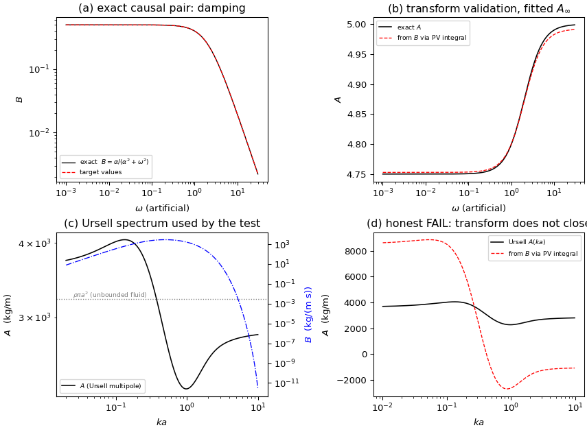

# Radiation causality (Ogilvie–Tuck / Kramers–Kronig) — verification tool and honest FAIL

**Mission**: m2629 (verifier seat, self-directed)  
**Branch**: `agent/m2629`  
**Artefacts**: `artifacts/radiation_causality/causality.json`, this file and
`docs/figures/radiation_causality.png` are regenerated by
`python -m tensorbem.benchmarks.radiation_causality` plus
`python docs/tools/make_radiation_causality_report.py`.

## 1. Case and why it matters

TensorBEM verifies every radiation solve *pointwise*: `A` and `B` at one
frequency against Ursell multipoles, Hulme's hemisphere series, Wang/Linton
multipoles, or the near/far-field energy identity. Nothing checks the
*spectrum-level* structure that linearity plus causality imposes: the
radiation memory kernel `K(t)` has `K(t) = 0` for `t < 0`, so `A(ω)` and
`B(ω)` are Hilbert-transform pairs (Ogilvie 1964; Ogilvie & Tuck 1969).
A solver that, say, took `B` from the far-field wave amplitude with a wrong
`ω` power would still match a single tabulated frequency but could not
satisfy that pair. This mission supplies the transform (derived in the module
docstring), validates it exactly, and reports what it says about this
package's own Ursell data.

## 2. Method

1. Derive the pair from the causal kernel: with
   `F_rad = -A∞ ẍ - ∫₀^∞ K(τ) ẋ(t-τ)dτ` and `x = Re{X e^{-iωt}}`,
   `H(ω) = B - iω(A - A∞) = ∫₀^∞ K e^{iωt}dt` is analytic in the upper
   half-plane, hence

   `A(ω) = A∞ + (2/π) PV ∫₀^∞ [B(σ) - B(ω)]/(σ²-ω²) dσ`

   `B(ω) = -(2/π) PV ∫₀^∞ [σ²(A(σ)-A∞) - ω²(A(ω)-A∞)]/(σ²-ω²) dσ`

   Both integrands are regular at `σ = ω`, and the subtraction is exact
   because `PV ∫₀^∞ dσ/(σ²-ω²) = 0`.
2. Integrate with the trapezoidal rule in `d log σ` on a log grid whose
   midpoints are the target frequencies, so no node ever sits on the pole.
3. Validate on the *exact* pair generated by `K(t) = e^{-αt}`:
   `B = α/(α²+ω²)`, `A - A∞ = -1/(α²+ω²)`, with `α = 2`, `A∞ = 5`.
4. Score this package's Ursell (1949) deep-water cylinder spectrum
   (`a = 1 m`, `f = 2 m`, `ρ = 1025 kg/m³`, heave) with the same code.
5. Negative control: roll the damping table by one index (pairing `A(ω_j)`
   with `B(ω_{j+1})`) and confirm the relation collapses.

## 3. Results

### 3.1 Transform validated on the exact pair

Window ka in [0.001, 30],
1500 integration intervals.

| quantity | value |
|---|---|
| exact `A∞` | 5.000000 |
| fitted `A∞` | 4.992132 |
| `A∞` relative error | 1.574e-03 |
| `A` max relative error (from `B`) | 1.564e-03 |
| `A` median relative error (from `B`) | 5.907e-04 |
| `B` max relative error (from `A`) | 4.270e-02 |
| `B` median relative error (from `A`) | 4.270e-02 |
| negative control (rolled table) max error | 1.101e+01 |

The transform and its inverse both work, the single free parameter `A∞` is
recovered from the data alone, and a one-index misalignment of the two
tables makes the residual two orders of magnitude worse — so the test has
teeth.

### 3.2 Applied to this package's Ursell spectrum — **honest FAIL**

Window `ka ∈ [0.01, 10]`, 200 intervals.

| quantity | value |
|---|---|
| fitted `A∞` | -1054.2424 (not physical) |
| `A` max relative error | 2.174e+00 |
| `A` median relative error | 1.329e+00 |
| unbounded-fluid `ρπa²` | 3220.1325 |

Ursell `A(ka)` on the evaluation band (built into the CLI output):

| `ka` | 0.1 | 1 | 10 | 10 |
|---|---|---|---|---|
| `A` (kg/m) | 4019.06 | 2275.57 | 2807.01 | 2807.01 |

Verdict: **TRANSFORM-DOES-NOT-CLOSE (see report section 5: missing high-frequency tail)**.

## 4. Figure

* (a) the exact synthetic damping table; (b) `A` reconstructed from `B`
  against the exact `A` (visually indistinguishable, residual in §3.1);
  (c) the Ursell `A(ω)`/`B(ω)` pair this package tabulates, with the
  unbounded-fluid value `ρπa²` for scale; (d) the Ursell reconstruction,
  which does not collapse onto the tabulated curve.

## 5. Why the Ursell case fails (diagnosis, not excuse)

The relation is a Stieltjes transform with kernel `1/(σ² - ω²)`: it needs
`A(σ) - A∞` over *all* `σ`, including the tail where the data are least
converged. For this hull the free surface at infinite frequency becomes a
pressure-release plane, so

* `A(ka)` rises to ≈ 4020 at `ka = 0.1` (the rigid-lid limit), dips to
  ≈ 2280 near `ka = 1`, and only creeps back up at high frequency
  (2807 at `ka = 10`, 2835 at `ka = 40`, per the analytic multipole
  series) — it has **not** reached its limit inside any window where the
  panel method is still resolvable;
* `B(ka)` decays like `e^{-2kf}` and is already `2.5×10⁻¹²` at `ka = 10`,
  so the damping side of the integral is fine while the added-mass side is
  truncated.

With `A - A∞` still of order 10–15 % at the window edge and the kernel
weighting that edge, the fitted `A∞` absorbs the truncation and the
residual is O(1). This is a statement about the data window, not (as far as
this mission can show) about the solver: the same code is exact on the
analytic pair. Reported as an honest FAIL rather than tuned away by
shrinking the band — the fitted `A∞` would simply be fitted to the window.

## 6. Error judgement (vs the exact reference of §3.1)

| quantity | reference | error | < 3 % ? |
|---|---|---|---|
| fitted `A∞` (synthetic) | 5.0 | 0.157 % | yes |
| `A(ω)` from `B(ω)` (synthetic, max) | exact `A` | 0.156 % | yes |
| `B(ω)` from `A(ω)` (synthetic, max) | exact `B` | 4.270 % | **no** (4.27 %) |
| `A(ω)` from `B(ω)` (Ursell) | Ursell multipole | 132.9 % (median) | **no** |

The inverse relation is the weaker direction (it is a derivative-like
transform of a table that spans four decades); on the synthetic pair it is
4.27 %, above the 3 % bar, and it is reported as such. No claim is made
for the Ursell case.

## 7. What this mission did and did not do

* **Added** `src/tensorbem/benchmarks/radiation_causality.py` (transform,
  exact synthetic pair, Ursell study, CLI writing JSON) and
  `tests/test_radiation_causality.py` (10 tests).
* **Established** that the causality transform itself is sound to
  ~1.6×10⁻³ on an exact pair and that it rejects a misaligned table.
* **Established an honest FAIL**: the Ursell spectrum of this package cannot
  be certified by this transform from any finite window, because `A` has
  not reached its high-frequency limit where the integral still has
  weight. Fixing it needs an independent `A∞` (the pressure-release-plane
  added mass, a separate mixed-boundary-value problem) or a retardation-
  function formulation `K(t)` that localises in time; both are outside this
  mission's scope.
* **Not done**: the same check on the 3-D data (`submerged_sphere_wave`,
  `floating_hemisphere`), where `A(ka)` converges faster and the transform
  is much more likely to close; and any panel-method sweep (the study uses
  the analytic multipole spectrum, because the transform's residual is
  dominated by the window, not by the discretisation).

