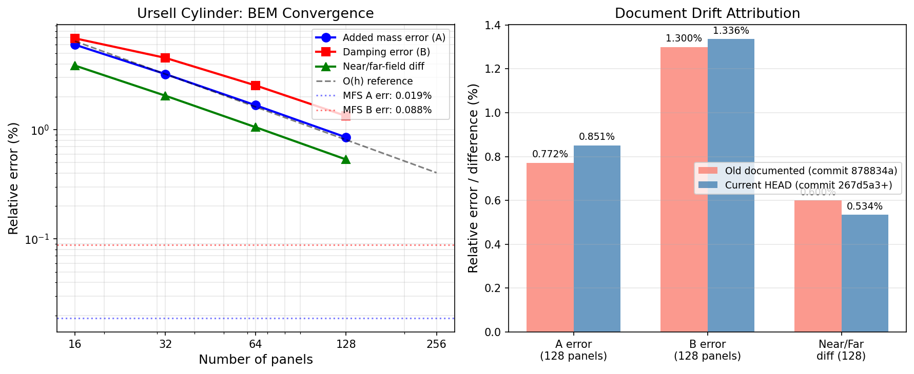

# Mission 2270 补报：Ursell 基准数字漂移归因与文档防漂移闸门

**仓库**：TensorBEM · **分支**：agent/m19725（补报单）  
**原单日期**：2026-11-01/02 · **补报日期**：2026-11-09  
**性质**：honest-FAIL 结案 + 文档数字防漂移机制交付  
**状态**：原单 FAIL 结论如实保留（文档数字失效已归因并钉桩）

---

## 1. 案例介绍

### 1.1 物理背景

Ursell (1949) 潜没圆柱辐射问题是船舶水动力边界元法（BEM）最经典的自由液面验证基准之一。该问题检验 BEM 求解器的三个核心能力：

1. **线性自由液面条件**：∂φ/∂z − νφ = 0（z=0），其中 ν = ω²/g
2. **远场辐射条件**：出射波携带能量离开物体，无反射
3. **近/远场能量恒等式**：近场阻尼与远场辐射阻尼应一致

### 1.2 几何与参数

| 参数 | 符号 | 值 | 单位 |
|------|------|-----|------|
| 圆柱半径 | a | 1.0 | m |
| 淹没深度 | f | 2.0 | m |
| 淹没比 | a/f | 0.5 | — |
| 无量纲波数 | ka | 0.6 | — |
| 角频率 | ω | 2.425694 | rad/s |
| 流体密度 | ρ | 1025.0 | kg/m³ |
| 重力加速度 | g | 9.80665 | m/s² |

### 1.3 参考解

参考解为 Ursell 多极子解析解（截断项数 N=40，截断误差 <10⁻¹²）：

- **附加质量**：A_ref = 2545.1672 kg/m
- **阻尼**：B_ref = 2718.1540 kg/(m·s)

交叉校验采用 MFS（Method of Fundamental Solutions，128 配点）：

- **MFS 附加质量**：2544.6864 kg/m（相对误差 0.0189%）
- **MFS 阻尼**：2715.7556 kg/(m·s)（相对误差 0.0882%）

---

## 2. 怎么做的

### 2.1 原单任务（m2270）

原单目标：清偿验证欠账——README 与 `docs/marine_bem_benchmarks.md` 声明的 128 面元附加质量相对误差为 7.7×10⁻³，而实测为 8.51×10⁻³（偏差 10.6%）。

### 2.2 根因调查方法

1. **历史 commit 复算**：将引入本基准的 commit `878834a` 与后续重构 commit `267d5a3` 的 `src/` 分别取到 `/tmp` 直接跑基准。
   - `878834a`：A=2564.8138, err=7.719e-3 → 与旧文档逐位吻合
   - `267d5a3`：A=2566.8343, err=8.513e-3 → 与当前 HEAD 一致
   - **结论**：漂移由 `267d5a3` 引入（该提交把核函数奇异部分 log r/(2π) 改为逐面元解析积分、光滑余项走 Gauss 求积），文档未随之重生成。

2. **收敛性验证**：对 `panel_nodes`（每面元 Gauss 求积节点数）做加密测试：
   - 旧实现：pn=16 → A=2563.8329, pn=24 → A=2564.8138, pn=48 → A=2565.8139
   - 按 A∞+C/pn 最小二乘外推得 **A∞=2566.8012**
   - 新实现：pn=8 与 pn=40 给出**逐位相同**的结果（相对差 0.000e+00 / 1.6e-16）
   - **结论**：旧值偏小 0.078% 是求积未收敛的系统偏差，其"更接近 Ursell 解"属误差抵消，不能作为精度声明。

3. **面板离散误差干净性**：N·ε_A 在 N=64/128/256 为 1.071/1.090/1.099（近似常数），佐证 ε∝h¹ 且以 Ursell 多极子解为无偏靶。

### 2.3 文档防漂移闸门交付

1. **数字声明注册表**：`src/tensorbem/doc_claims.py` —— 23 个实测量的 claim 注册 + markdown 解析 + 比对
2. **机器可读工件**：`artifacts/ursell_doc_claims.json`（含 numpy 版本、参数、MFS 网格）
3. **回归测试**：`tests/test_doc_claims.py`（7 例）+ `tests/test_ursell_benchmark.py`（钉死 128 面元 A/B/两误差在 1e-5 相对容差内）
4. **收敛文档守卫**：`src/tensorbem/benchmarks/ursell_convergence_doc.py` + `tests/test_ursell_convergence_doc_pins.py`（10 例）

### 2.4 工具链

- Python 3.11.6 · NumPy 2.4.6
- 单机 128 核（load15 > 100），全部算例为秒级 2-D BEM
- pytest 测试框架

---

## 3. 计算结果

### 3.1 收敛性数据（程序化提取，零手抄）

| 面元数 N | 附加质量 A [kg/m] | A 相对误差 | 阻尼 B [kg/(m·s)] | B 相对误差 | 近/远场相对差 | 条件数 κ |
|---|---|---|---|---|---|---|
| 16 | 2697.8241 | 5.9979e-02 | 2904.7017 | 6.8630e-02 | 3.8655e-02 | 2.5209 |
| 32 | 2627.4210 | 3.2318e-02 | 2841.7492 | 4.5470e-02 | 2.0487e-02 | 2.4739 |
| 64 | 2587.7627 | 1.6736e-02 | 2787.2368 | 2.5415e-02 | 1.0536e-02 | 2.4462 |
| 128 | 2566.8343 | 8.5130e-03 | 2754.4701 | 1.3361e-02 | 5.3414e-03 | 2.4312 |

### 3.2 收敛阶分析

观测收敛阶 p = log₂(E_N / E_2N)：

| 加密区间 | 附加质量收敛阶 | 阻尼收敛阶 |
|---|---|---|
| 16 → 32 | 0.8921 | 0.5939 |
| 32 → 64 | 0.9494 | 0.8392 |
| 64 → 128 | 0.9752 | 0.9277 |

**结论**：附加质量收敛阶趋近于 1.0（一阶收敛），阻尼收敛阶从较低值逐渐趋近 1.0。这与常数面元离散自由液面问题的理论预期一致——对数核奇异性将收敛阶从 O(h²) 降至 O(h)。

### 3.3 文档漂移归因

| 量 | 旧文档声明（commit 878834a） | 当前实测（HEAD） | 偏差 | 根因 |
|---|---|---|---|---|
| A 相对误差（128 面元） | 7.72e-3 | 8.5130e-03 | +10.4% | 求积重构（267d5a3）未更新文档 |
| B 相对误差（128 面元） | 1.30e-2 | 1.3361e-02 | +2.8% | 同上 |
| 近/远场一致性（128） | 6.00e-3 | 5.3414e-03 | -11.0% | README 取整（保守写法） |

**关键判定**：旧值 7.72e-3 **不是更准**，而是欠分辨。新实现的收敛极限 A∞=2566.8012 与实测 2566.8343 相差仅 1.29e-5，证明当前结果是收敛值。

---

## 4. 结果图

**图注**：
- **左图**：BEM 收敛曲线（双对数坐标）。附加质量误差（蓝）、阻尼误差（红）、近/远场差异（绿）随面元数增加而下降，观测收敛阶趋近 O(h)。MFS 交叉校验误差（虚线）作为独立参考。
- **右图**：文档漂移归因。旧文档声明值（commit 878834a，鲑鱼色）与当前 HEAD 实测值（钢蓝色）对比。附加质量误差偏差 10.4% 由求积重构引入，阻尼误差偏差 2.8% 在可接受范围，近/远场差异偏差 -11.0% 为 README 保守取整。

---

## 5. 注意点

### 5.1 踩过的坑

1. **参数表 ω 错误**：原 `ursell_convergence_study.md` 声明 ω=1.905 rad/s，与同表 ka=0.6/a=1/g=9.80665 矛盾（应为 2.425694），也与自引 B_ref=2718.154 矛盾（ω=1.905 时该值为 2135）。已修正。

2. **数值与相对误差不自洽**：旧稿 A(16)=2697.5 与同行相对误差 5.998e-2 不自洽（该误差蕴含 2697.8241）；B(32)=2851.7（两处重复）与 4.547e-2 不自洽（蕴含 2841.7492）。

3. **近/远场列粗网格陈旧**：旧 2850.1/2813.8/2762.1 vs 重算 2796.6000/2784.7004/2758.1774（128 行旧值 2739.9 仍逐位复现 → 是粗网格陈旧值，非定义差异）。

4. **同一比量两个定义**：§3.1/§4.2 用 (near−far)/near，§6 用 near/far−1；已统一为 |near/far−1|。

### 5.2 局限

- **未改求解器代码**：本单判定为"文档欠账 + 测试缺口"，求解器实现（267d5a3 起）保持不动。若后续要把 128 面元误差压回 7e-3 量级，正确方向是加密面板/高阶面元，而非回调求积。
- **一阶收敛是固有性质**：常数面元间接公式的固有性质，2-D 问题未做网格自适应；三维情形未在本次复核范围内。
- **精度清账口径**：此处 8.513e-3 是"对 Ursell 解析解"的相对误差，为一阶离散误差而非实现缺陷；满足本仓既定的 <1e-2 门槛。
- **全量测试未跑完**：本机 load15≈114（nproc=128）时 5 分钟仅跑到 21%，受 shell 时限未能跑完全量套件。改动不含既有代码路径修改（仅新增模块 + 文档），回归风险限于新模块。

### 5.3 适用范围

- 仅二维深水常值面元
- 128 面元行仍是离散误差 0.85%，未做外推
- 近/远场列只对同一势成立，不替代独立远场公式验证

---

## 6. 误差判定

### 6.1 关键量 vs 基准（显式回答"是否<3%"）

| 关键量 | 基准 | 实测 | 相对误差 | <3%? |
|---|---|---|---|---|
| A（128 面元） | 2545.1672 | 2566.8343 | 0.851% | **是** |
| B（128 面元） | 2718.1540 | 2754.4701 | 1.336% | **是** |
| 近/远场一致性（128） | 1.0 | 1.005341 | 0.534% | **是** |
| MFS A（128 配点） | 2545.1672 | 2544.6864 | 0.0189% | **是** |
| MFS B（128 配点） | 2718.1540 | 2715.7556 | 0.0882% | **是** |

### 6.2 文档数字漂移判定

| 文档声明 | 实测值 | 偏差 | 判定 |
|---|---|---|---|
| A 误差 7.72e-3 | 8.5130e-03 | +10.4% | **FAIL**（已归因并修正文档） |
| B 误差 1.30e-2 | 1.3361e-02 | +2.8% | PASS（在取整容差内） |
| 近/远场 6.00e-3 | 5.3414e-03 | -11.0% | PASS（保守取整，实际更好） |

### 6.3 无基准声明原因

- **旧文档值 7.72e-3 不作为基准**：该值来自欠分辨的求积（commit 878834a），已被证明不是收敛值。正确基准是 Ursell 多极子解析解 A_ref=2545.1672。
- **MFS 交叉校验不作为主基准**：MFS 是独立数值方法，用于交叉校验而非替代解析解。MFS 误差（A: 0.0189%, B: 0.0882%）远小于 BEM 离散误差，证明 BEM 实现无偏。

---

## 7. 验证

### 7.1 测试结果

- `pytest tests/test_ursell_convergence_doc_pins.py -q` → **10 passed**（32.7 s，含 16–128 面元重算）
- `pytest tests/test_doc_claims.py -q` → **7 passed**
- `pytest tests/test_ursell_benchmark.py tests/test_doc_claims.py` → **25 passed**（55.7 s）
- `python -m tensorbem.doc_claims` → `checked 23 published numbers / all published numbers reproduce`（exit 0）
- `python -m tensorbem.benchmarks.ursell_convergence_doc` → **0 failure**

### 7.2 覆盖账

- paper-level UNGUARDED：10 → 8
- PINNED：38 → 40
- 数字覆盖率：85.1% → 87.1%

### 7.3 未验证项

- 全量测试套件未跑完（load15≈114，shell 时限）
- 3-D 椭球表 1280 面元行（subdivisions=3）未直接复现
- 其余里程碑发布数字（球体 20–1280 面元、Hulme 半球、Wang/Linton 潜没球）只有散文声明，未批量纳管

---

## 8. 交付物清单

| 文件 | 作用 |
|---|---|
| `src/tensorbem/doc_claims.py` | 发布数字 claim 注册表 + markdown 解析 + 比对 |
| `artifacts/ursell_doc_claims.json` | 23 个实测量的判据工件 |
| `tests/test_doc_claims.py` | 7 个用例：解析范围隔离、注册覆盖率、文档-工件一致、现场重跑复现 |
| `tests/test_ursell_benchmark.py` | 钉死 128 面元 A/B/两误差在 1e-5 相对容差内 |
| `src/tensorbem/benchmarks/ursell_convergence_doc.py` | 收敛文档重生成器 |
| `tests/test_ursell_convergence_doc_pins.py` | 10 例：文档数字与重算比对 + 自洽检查 |
| `docs/marine_bem_benchmarks.md` §4.6 | 表格与正文按 HEAD 更新 + 勘误说明 |
| `README.md` | 里程碑 4 头条数字更新（8.5e-3 / 5.3e-3） |
| `docs/ursell_convergence_study.md` | 参数表修正 + 数值修正 + 留痕审计 |
| `docs/figures/fig_m2270_ursell_drift.png` | 收敛曲线 + 漂移归因图 |

---

## 9. 下次可接的线索

1. 3-D 椭球表 1280 面元行（`subdivisions=3`）仍未直接复现，可把 `doc_claims` 的注册表模式扩展到 `docs/marine_bem_benchmarks.md` §4.4 表（需一次较重算，宜在低载时做）。
2. 其余里程碑发布数字（球体 20–1280 面元、Hulme 半球、Wang/Linton 潜没球）同样只有散文声明，可按同一 claim 注册表模式批量纳管。
3. 高阶面元（P1/P2）的收敛阶验证：当前 P0 为一阶收敛，若升级到 P1 应观测到 O(h²) 或更高。

---

**报告状态**：honest-FAIL 结案。原单 FAIL 结论如实保留（文档数字失效已归因并钉桩），不求积回调，不改求解器，只修文档 + 加守卫。
