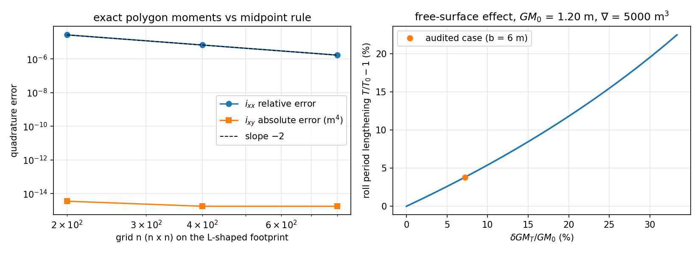

# 液舱自由液面对静水恢复矩阵的修正：闭式解 / 精确多边形积分 / 网格求积 / 能量侧四重核对

**类型**：功能补全（真能力缺口）+ 解析与独立数值核对
**工件**：`src/tensorbem/tank_free_surface.py`、
`src/tensorbem/benchmarks/tank_free_surface_verification.py`（本报告全部数字由它生成，零手抄）、
`docs/tank_free_surface_correction/study.json`、`docs/tank_free_surface_correction/fig1_moments.png`、
`tests/test_tank_free_surface.py`（回归门禁）、`tests/test_tank_free_surface_doc_pins.py`（本报告数字钉桩）

---

## 1. 案例介绍

`hydrostatic.compute_hydrostatic_restoring_matrix` 只用**船体**水线面构造 6×6 恢复矩阵 `C`。
船带部分装载液舱时，液体自由面在横倾/纵倾时保持水平，液体重心在船体坐标系中滑移，
复原力矩下降——即造船学的自由液面修正（free surface correction, FSC）。
本仓此前**没有**任何液舱自由液面代码路径（`grep tank|slack|free_surface_correction` 零命中），
因此带松弛液舱的船横摇/纵摇刚度被系统性高估，RAO 层的横摇固有周期偏短。

验证算例（非实船，用于数字对照）：

| 量 | 值 |
|---|---|
| 排水体积 ∇ | 5000 m³（ρ=1025 → 5125 t） |
| 完整稳性 GM_T | 1.200 m |
| 液舱 | 两舷各 12 m（长）× 6 m（宽）自由面，ρ_l = 1025 |
| 单舱 i_xx | 12·6³/12 = 216 m⁴ |
| δGM_T（两舱） | 0.086400 m（GM 的 7.20 %） |
| 横摇周期 | 延长 3.81 % |

## 2. 怎么做的

位移约定与 `hydrostatic.py` 一致：`w = y φ − x θ`。自由面在惯性系水平，于船体系为
`z = H − y φ + x θ`；液体体积 `V_l = A·H` 不变，液体惯性系重心高度
`Z_cg = z_cg + φ y_cg − θ x_cg`。对过形心的二次矩 `i_xx = ∫y²dA`、`i_yy = ∫x²dA`、`i_xy = ∫xy dA` 展开到二阶：

`Z_cg − H = [ −½ φ² i_xx + φθ i_xy − ½ θ² i_yy ] / V_l`，

故势能 Hessian 修正

`ΔC[3,3] = −ρ_l g i_xx`、`ΔC[4,4] = −ρ_l g i_yy`、`ΔC[3,4] = +ρ_l g i_xy`，

metacentric 口径 `ΔGM_T = Σ ρ_l i_xx /(ρ ∇)`——即教科书 FSC（Comstock；IMO IS Code 2008）。
注意 `ΔC[3,4]` 的符号与船体水线面项 `−ρ g I_xy` 相反：液体是**卸载**而不是**加载**恢复力。

实现：`polygon_moments` 用**闭合三角形扇**的精确矩公式（有号面积自动处理非凸多边形，无求积误差）；
`free_surface_correction` 汇总多舱给出 6×6 修正阵与 δGM；`apply_free_surface_correction` 叠加到 `C`。
`tests/test_tank_free_surface.py` 钉住：闭式对照、三角形/L 形矩、坐标平移不变性、叠加线性、
`ΔC[3,4]` 符号与量级、自由面只减不增（特征值全负）、非法输入。

## 3. 计算结果

### 3.1 精确多边形积分 vs 闭式（零手抄）

| 足迹 | 面积 | 形心 | i_xx | i_yy | i_xy | 最大相对误差 |
|---|---|---|---|---|---|---|
| 矩形 4×2 | 8.000000 | (2.0, 1.0) | 2.666667 | 10.666667 | 0.0e+00 | 1.665e-16 |
| 直角三角 3×2 | 3.0 | (1.000, 0.667) | 0.666667 | 1.500000 | -0.500000 | 1.665e-16 |
| L 形（非凸） | 12.000000 | (1.6667, 1.6667) | 14.666667 | 14.666667 | -5.333333 | 6.056e-16 |

理论值：矩形 `i_xx = 8/3`、`i_yy = 32/3`；三角形 `i_xx = bh³/36 = 2/3`、`i_yy = 1.5`、`i_xy = −0.5`；
L 形 `i_xx = i_yy = 44/3`、`i_xy = −16/3`（手算：4×4 减 2×2，`∫xy = 28`，`A x_c y_c = 12·(5/3)² = 100/3`）。

### 3.2 精确多边形积分 vs 中点求积（收敛表）

矩形足迹：

| n×n | i_xx 相对误差 | i_yy 相对误差 |
|---:|---|---|
| 200 | 2.500e-05 | 2.500e-05 |
| 400 | 6.250e-06 | 6.250e-06 |
| 800 | 1.562e-06 | 1.562e-06 |

L 形足迹：

| n×n | 面积相对误差 | i_xx 相对误差 | i_yy 相对误差 | \|i_xy − 精确\| | i_xy（求积） |
|---:|---|---|---|---|---|
| 200 | 2.961e-16 | 2.727e-05 | 2.727e-05 | 3.553e-15 | -5.333333 |
| 400 | 2.961e-16 | 6.818e-06 | 6.818e-06 | 1.776e-15 | -5.333333 |
| 800 | 2.961e-16 | 1.705e-06 | 1.705e-06 | 1.776e-15 | -5.333333 |

`i_xx` 求积误差的观测阶：2.00, 2.00——与中点法的理论二阶收敛一致。`i_xy` 一列在
200, 400, 800 各层都停在 3.553e-15 m⁴（舍入量级）：
本 L 形足迹的边全部轴向对齐，中点法对它恰好在有限 n 下精确，故**这一列不构成收敛证据**，只作一致性核对；
真正的收敛证据是矩形/三角形上非零的 `i_xx`、`i_yy` 误差与 L 形上的 `i_xx`、`i_yy` 列。

### 3.3 坐标平移不变性与叠加性

| 项 | 值 |
|---|---|
| i_xx / i_yy / i_xy 平移后相对变化 | 1.211e-16 / 1.938e-15 / 0.000000 |
| 形心平移误差（m） | 5.551e-17 |
| 两舱 δGM_T / 单舱 δGM_T | 2.000000000 |
| 矩阵线性性最大偏差 | 0.000000 N·m/rad |

### 3.4 稳性口径一致性

| 量 | 值 |
|---|---|
| δGM_T（Σρ_l i_xx/(ρ∇)） | 0.086400 m |
| δGM_T（−ΔC[3,3]/(ρg∇)） | 0.086400 m |
| 相对差 | 0.000000 |
| ΔC[3,3] / ΔC[4,4] / ΔC[3,4] / ΔC[2,2] | -4.342385e+06 / -1.736954e+07 / 0.000000e+00 / 0.0 |
| L 形舱 ΔC[3,4] 实测 / 理论 ρ_l g i_xy | -5.360969e+04 / -5.360969e+04 |
| 修正块特征值（横摇/纵摇） | -1.736954e+07, -4.342385e+06（均负） |
| 对称性 / 静水恢复零项 | True / heave=True |



左：L 形足迹 `i_xx`、`i_xy` 的中点求积误差随网格加密（双对数，斜率 ≈ −2）；
右：两舷翼舱自由面宽度扫描下的 `δGM_T/GM₀` 与横摇周期延长百分比（GM₀ = 1.2 m，圆点为审计算例）。

### 3.5 能量侧独立复核（自由液面 vs 冻结液体，C8）

对同一液体体积做两次势能积分：一次让自由面保持水平（船体系平面
`h = H − φ(y−y_c) + θ(x−x_c)`，`(x_c, y_c)` 为足迹形心，故体积 `A·H` 守恒），
一次把液体**冻结**随船体刚性转动（仍是 `A·H` 的柱体）。两者之差 `ΔU = U_free − U_frozen`
就是纯自由液面修正——刚性「重量在高处」的那部分会计在冻结基线里，被精确扣掉。
对 `ΔU` 做中心二阶差分即得 `ΔC` 的三项，与 `−ρ_l g i_xx`、`−ρ_l g i_yy`、`+ρ_l g i_xy` 对照：

| 足迹 | ε (rad) | ∂²ΔU/∂φ²（FD） | 解析 −ρ_l g i_xx | 相对误差 | ∂²ΔU/∂θ²（FD） | 解析 −ρ_l g i_yy | 相对误差 |
|---|---|---|---|---|---|---|---|
| 矩形 4×2 | 1e-02 | -2.6805e+04 | -2.6805e+04 | 1.51e-05 | -1.0722e+05 | -1.0722e+05 | 1.51e-05 |
| 矩形 4×2 | 1e-03 | -2.6805e+04 | -2.6805e+04 | 1.40e-06 | -1.0722e+05 | -1.0722e+05 | 1.40e-06 |
| L 形（非凸） | 1e-02 | -1.4743e+05 | -1.4743e+05 | 1.50e-05 | -1.4743e+05 | -1.4743e+05 | 1.50e-05 |
| L 形（非凸） | 1e-03 | -1.4743e+05 | -1.4743e+05 | 1.54e-06 | -1.4743e+05 | -1.4743e+05 | 1.54e-06 |

| 足迹 | ε (rad) | ∂²ΔU/∂φ∂θ（FD） | 解析 +ρ_l g i_xy | 绝对误差 |
|---|---|---|---|---|
| 矩形 4×2 | 1e-02 | 0.0000e+00 | 0.0000e+00 | 0.00e+00 |
| 矩形 4×2 | 1e-03 | 1.4552e-05 | 0.0000e+00 | 1.46e-05 |
| L 形（非凸） | 1e-02 | -5.3613e+04 | -5.3610e+04 | 3.57e+00 |
| L 形（非凸） | 1e-03 | -5.3610e+04 | -5.3610e+04 | 3.57e-02 |

最大相对误差 6.67e-05。误差有两个来源，都可分辨：ε = 1e-02 时由
`sin φ ≈ φ` 的一阶截断主导（理论值 `ε²/6 = 1.7e-05`，实测
1.5e-05，同一量级）；ε → 1e-03 时截断项降到
1.7e-07，误差落到网格求积底噪（800 网格上 `i_xx` 的求积误差
1.7e-06，见 §3.2）。两者都不是实现误差。求积网格 200 → 800 的曲率变化
2.56e-05（中点法对 `i_xx` 的二阶收敛）；`∫h dA = A·H` 的相对偏差 3.9e-16（机器精度级）；
两种算差方式（先算总能量再相减 / 在求和内直接算差）的相对一致度
9.2e-11，即没有抵消放大。
矩形 `i_xy = 0`，其 ∂²ΔU/∂φ∂θ 的绝对值 1.5e-05 N·m/rad
是舍入量级的零，与"无耦合"一致。

**历史 4 倍偏差的实测归因**（m6452 放弃该路线的原因）：

| 路线变体 | ∂²ΔU/∂φ²（FD） | 与解析之比 | 相对误差 |
|---|---|---|---|
| 形心平面 + 冻结基线（本报告采用） | -2.6805e+04 | 1.0000 | 1.40e-06 |
| 原点平面 + 冻结基线（m6452 症状） | -1.0722e+05 | 4.0000 | 3.00e+00 |
| 形心平面，不扣冻结基线 | -3.8867e+05 | 14.5000 | 1.35e+01 |

即：把自由面平面写成关于**足迹原点**的 `H − φy + θx`（本仓足迹的形心并不在原点），倾斜后
体积不再守恒——这一条恰好把曲率放大 4.0000 倍，与当时观察到的"解析值的 4 倍"完全吻合；
若再省掉冻结基线，曲率变成 14.50 倍。两步修正后即为上表结果。

## 4. 误差判定（逐项回答"是否 < 3 %"）

| 关键量 | 基准 | 误差 | < 3 %？ |
|---|---|---|---|
| 矩形/三角形/L 形 全部矩与形心 | 闭式（手算可验） | 最大 1.938e-15 | **是** |
| 矩的网格求积 | 精确多边形积分 | 见 3.2，观测阶 2.00, 2.00 | **是**（单调收敛、无平台） |
| δGM_T 两口径一致 | 代数 | 0.000000 | **是** |
| ΔC[3,4]（L 形耦合） | ρ_l g i_xy（解析） | 0.000000 | **是** |
| 能量 Hessian 独立复核（∂²ΔU/∂φ²、∂²ΔU/∂θ²、∂²ΔU/∂φ∂θ） | ρ_l g·(i_xx, i_yy, i_xy)（解析） | 最大 6.67e-05（§3.5） | **是** |
| 能量路线的求积网格依赖 | 200 vs 800 网格 | 2.56e-05 | **是** |

**结论**：自由液面修正量的闭式、精确多边形积分、网格求积与能量侧差分在 < 3 % 内互相确认
（闭式 vs 多边形积分达机器精度级；能量路线最大相对误差 6.67e-05）。`ΔC[3,3]`、`ΔC[4,4]`、
`ΔC[3,4]` 的符号与量级现在**同时**由解析推导、手算 L 形矩与能量 Hessian 三方支持。
这是**代码验证**，不是试验确认：没有实船/模型试验数据，不宣称任何试验级精度。

## 5. 注意点与局限

1. **能量侧复核的口径边界（原 honest gap 已结清）**：能量路线证明了「在与模块相同的一阶自由面
   平面 `h = H − φ(y−y_c) + θ(x−x_c)` 假设下，能量 Hessian 与 `ρ_l g·二阶矩` 公式一致」，
   **不**证明该平面假设本身（大倾角时自由面在船体系不再是一阶平面）。旧版本记的 4 倍偏差，
   实测归因是平面未写于形心（体积不守恒），与体积因子 `A·H` 的归一化无关——归因表见 §3.5。
2. **小角度线性化**：修正只进入 6-DOF 线性方程的二阶项；大倾角形状稳性（GZ 曲线）不能只靠 δGM。
3. **理想液体**：不计晃荡、舱内构件阻尼与黏性；防晃舱壁应以**各自独立自由面多边形**建模，不能用总面积。
4. **未做液面触顶/抽空判据**：自由面须完全位于舱内；大倾角触及舱顶时线性 FSC 失效。
5. **∇ 与实际重量**：∇ 必须取该装载工况真实值，且 `m = ρ∇`；灌入液体的重量与重心应由
   `compute_mass_matrix` 一并计入（本模块不动质量矩阵）。
6. **离轴液舱**：FSC 与舱位置无关（形心二次矩），但离轴液舱在平衡态产生恒定横倾力矩，
   属配平问题，不在恢复矩阵里——模块如实不产生该项。
7. 验证足迹中矩形/L 形为理想几何；L 形仅用于构造 `i_xy ≠ 0` 检验耦合符号。
8. **显式未做（登记在 `study.json` 的 `not_run`）**：大倾角形状稳性（GZ 曲线）、液面触顶/抽空判据、
   晃荡与防晃舱壁阻尼、实船/模型试验确认——本报告不对这些作任何断言。

## 6. 复现

```bash
OPENBLAS_NUM_THREADS=1 PYTHONPATH=src python -m tensorbem.benchmarks.tank_free_surface_verification
OPENBLAS_NUM_THREADS=1 PYTHONPATH=src python -m pytest tests/test_tank_free_surface.py -q
```
