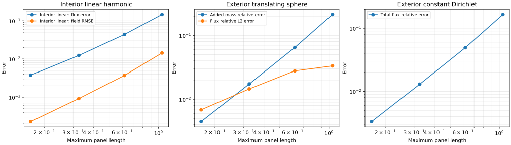

# 三维 Laplace 边界元：常数三角形面元、外域公式与球体附加质量验证

## 摘要

本文在 TensorBEM 中建立三维 Laplace 边界元的最小可复现基线：闭合三角网格、常数面元、质心配点、自由项 \(c=1/2\)、解析双层立体角积分、Duffy 单层求积，以及内域/外域 Dirichlet 公式。几何采用二十面体递归细分得到的球面三角网格，面元数 \(N=20\cdot4^k\)。本文给出三类验证：真实多面体上的内域线性调和场 \(u=x\)、外域球体横向平移附加质量、外域常值 Dirichlet 总通量。20、80、320、1280 面元时，内域通量相对 L2 误差由 \(1.46\times10^{-1}\) 降至 \(3.76\times10^{-3}\)，内部探针 RMSE 由 \(1.43\times10^{-2}\) 降至 \(2.29\times10^{-4}\)；球体附加质量相对误差由 \(2.13\times10^{-1}\) 降至 \(4.47\times10^{-3}\)，观测阶约 2；常值 Dirichlet 总通量相对误差由 \(1.65\times10^{-1}\) 降至 \(3.32\times10^{-3}\)。所有算例的双层矩阵行和满足 \(\sum_jH_{ij}=-1/2\) 至 \(10^{-15}\) 量级，线性系统相对残差约 \(10^{-16}\)。外域逐面元通量只呈约一阶收敛，这是平面多面体棱边奇异性的结果；附加质量作为积分量仍呈近二阶收敛。

本文进一步补上该基线最主要的场量缺口：**速度** \(\nabla\phi\)。势流代码的 Kelvin 源叠加、伯努利压力和由表面速度积分得到的力都需要速度，此前实现只输出势。速度的 Green 表示式中，双层项是超奇异核、不可积；本文用"常数密度下该积分等于面元立体角闭式的梯度"这一恒等式把它化为闭式，从而在常数面元上可算。以外域平移球体为算例，速度相对 L2 误差由 \(1.02\times10^{-1}\)（80 面元）降至 \(7.07\times10^{-3}\)（1280 面元），观测阶 2.03 与 2.01。此外本文定位并修复了**表面速度**的精度问题：表示公式路径在紧贴表面处重构误差达 53%–65% 且不随加密下降，成因是常数面元迹的 \(O(h)\) 误差被梯度放大成 \(O(1)\)（四组对照实验确认，并排除了求积阶、近场分辨、通量与实现等因素）；改用恒等式 \(\nabla\phi|_\Gamma=\nabla_{\mathrm{tan}}u+n\,q\) 与超收敛最小二乘片恢复后，误差降至 \(1.38\times10^{-2}\)（1280 面元，观测阶 1.67–1.78），表面速度由此可用；同时报告了表示公式在近体 \(O(h)\) 边界层内同样不可靠这一剩余限制。本报告属于代码验证，不含自由液面、波浪、黏性、船体几何或试验确认。

**关键词：** 边界元；三维 Laplace；三角形面元；外域问题；附加质量；速度场；立体角梯度；超收敛恢复；球体；数值验证

## 1. 背景与范围

TensorBEM 的二维验证已完成：直线多边形、常数面元、解析面元积分、四类解析算例和圆柱附加质量基准均纳入回归测试与 CI 证据。路线图第 3 项要求在验证门禁通过后增加三维曲面面元和势流应用。本文实现该步骤中不含自由液面的首个三维基准：球体横向平移附加质量，并补充两个独立交叉验证算例。

当前三维实现的能力边界如下。

| 项目 | 已实现 | 未实现 |
|---|---|---|
| 控制方程 | 三维 Laplace 方程 | Helmholtz、弹性、自由液面 |
| 几何 | 闭合三角网格、平面常数面元 | 高阶/曲边面元、船体曲面、水线 |
| 边界条件 | 内域与外域 Dirichlet | 混合、Neumann、辐射/远场条件 |
| 应用 | 球体附加质量、球体外域常值通量、球体外域速度场 | 波浪辐射/绕射、耐波性、黏性流动 |
| 场量 | 势 \(\phi\) 与速度 \(\nabla\phi\)（见 5.4 节） | 自由液面波动、自由波面速度剖面 |
| 求解 | 稠密直接法，\(O(N^2)\) 存储、\(O(N^3)\) 运算 | 快速多极、分级矩阵、并行 |

因此，本文结果只能作为三维 Laplace 代码验证和后续自由液面开发的基线，不能外推为一般三维外域或船舶水动力能力。

## 2. 数学模型与符号

三维 Laplace 基本解取

\[
G(x,y)=\frac{1}{4\pi|x-y|},\qquad -\nabla^2G=\delta(x-y),
\]

双层核为

\[
\frac{\partial G}{\partial n_y}(x,y)=\frac{(x-y)\cdot n_y}{4\pi|x-y|^3}.
\]

设 \(\Gamma\) 为闭合曲面，\(n\) 为物体外法向，\(u\) 在 \(\Gamma\) 上给定 Dirichlet 数据，\(q=\nabla u\cdot n\)。对光滑边界点成立边界积分方程

\[
c\,u(x)=\int_\Gamma G(x,y)q(y)\,dS_y-\int_\Gamma\frac{\partial G}{\partial n_y}(x,y)u(y)\,dS_y,
\]

其中自由项 \(c=1/2\)。常数三角形面元的配点取三角形质心；质心位于平面面元内部，局部曲面光滑，故使用 \(c=1/2\)，不需要顶点或棱边处的立体角修正。

离散后得到单层矩阵 \(\mathbf S\) 与双层矩阵 \(\mathbf H\)：

\[
S_{ij}=\int_{T_j}G(x_i,y)\,dS_y,\qquad
H_{ij}=\int_{T_j}\frac{\partial G}{\partial n_y}(x_i,y)\,dS_y.
\]

**内域 Dirichlet 问题：**

\[
\mathbf S\mathbf q=\left(\tfrac12\mathbf I+\mathbf H\right)\mathbf u.
\]

**外域 Dirichlet 问题：** 外域流体的外法向为 \(n_e=-n\)，未知通量取 \(q_e=\nabla u\cdot n_e\)。Green 表示式给出

\[
\mathbf S\mathbf q_e=\left(\tfrac12\mathbf I-\mathbf H\right)\mathbf u.
\]

外域势的场重构为

\[
u(x)=\int_\Gamma G\,q_e\,dS+\int_\Gamma\frac{\partial G}{\partial n_y}u\,dS,
\]

内域则为

\[
u(x)=\int_\Gamma G\,q\,dS-\int_\Gamma\frac{\partial G}{\partial n_y}u\,dS.
\]

这些符号约定在球体基准中通过解析解逐项核对；尤其是外域常值 Dirichlet 情形，内域公式与外域公式给出不同结果，可用于排除“把内域解误当外域解”的错误。

## 3. 几何、网格与离散

### 3.1 二十面体球面网格

从正二十面体出发，将每个三角形按四条子三角形递归细分，每次把新顶点投影回半径 \(a\) 的球面。第 \(k\) 层有

\[
N=20\cdot4^k
\]

个三角形，顶点数为 \(V=10\cdot4^k+2\)。因此 \(k=0,1,2,3\) 对应 20、80、320、1280 个面元。三角形是平面面元，整体构成内接多面体：面积和体积都小于球体的 \(4\pi a^2\) 和 \(4\pi a^3/3\)，且随加密收敛。表 1 给出实际网格数据。

**表 1. 球面三角网格的几何与质量指标（\(a=1\)）**

| \(k\) | 面元 \(N\) | 顶点 | \(h_{\max}\) | \(h_{\text{mean}}\) | 面积 | 面积比 | 体积 | 体积比 | 最大长宽比 |
|---:|---:|---:|---:|---:|---:|---:|---:|---:|---:|
| 0 | 20 | 12 | 1.05146 | 1.05146 | 9.574541 | 0.76192 | 2.536151 | 0.60546 | 1.1547 |
| 1 | 80 | 42 | 0.61803 | 0.58228 | 11.665931 | 0.92835 | 3.658712 | 0.87345 | 1.3710 |
| 2 | 320 | 162 | 0.32492 | 0.29933 | 12.329849 | 0.98118 | 4.047045 | 0.96616 | 1.4320 |
| 3 | 1280 | 642 | 0.16465 | 0.15073 | 12.506493 | 0.99524 | 4.152741 | 0.99139 | 1.4478 |

面积比和体积比分别相对 \(4\pi\) 与 \(4\pi/3\)。最大长宽比定义为三角形最长边平方除以 \(2A\)；该指标随细分略有上升，但仍保持在 1.45 以下，说明网格没有出现退化薄片。

### 3.2 闭合性与方向校验

`TriangleMesh` 在构造时执行以下检查：

1. 顶点坐标有限，面片索引为整数且位于合法范围，三角形三个顶点互异且面积非零；
2. 每条有向边恰好出现一次，且其反向边也恰好出现一次，从而保证网格闭合、定向一致；
3. 由散度定理计算的有符号体积为正，保证面片顺序与物体外法向一致。

这些检查使装配前即可拒绝开口网格、翻转面片、重复顶点和退化三角形。网格质量诊断（边长比、面积比、内角、长宽比）写入 JSON，供收敛研究复核。

### 3.3 配点与常数面元

每个三角形的势函数和法向导数用同一个常数表示，配点取质心。与二维中点配点一样，常数迹的面元近似不会因核积分解析化而消失；网格加密研究针对的是这一近似以及平面几何逼近。质心位于面元内部，避免在棱边或顶点处使用错误的自由项；本文不实现顶点/棱边配点。

## 4. 面元积分与求积

### 4.1 双层积分：解析立体角

对平面三角形 \(T_j\) 和不在其平面内的配点 \(x_i\)，双层积分等于三角形所张有符号立体角 \(\Omega_{ij}\) 的负四分之一：

\[
H_{ij}=-\frac{\Omega_{ij}}{4\pi}.
\]

取 \(\mathbf a=\mathbf v_0-\mathbf x_i\)，\(\mathbf b=\mathbf v_1-\mathbf x_i\)，\(\mathbf c=\mathbf v_2-\mathbf x_i\)，使用 van Oosterom–Strackee 公式

\[
\Omega_{ij}=2\operatorname{atan2}\left(
\mathbf a\cdot(\mathbf b\times\mathbf c),\ 
|\mathbf a||\mathbf b||\mathbf c|
+(\mathbf a\cdot\mathbf b)|\mathbf c|
+(\mathbf b\cdot\mathbf c)|\mathbf a|
+(\mathbf c\cdot\mathbf a)|\mathbf b|
\right).
\]

顶点顺序与物体外法向一致时，该式给出正确符号。若配点与面元共面，双层核在平面内为零（奇异点为可去的主值），故 \(H_{ij}=0\)；自面元因此严格为零。装配后必须满足

\[
\sum_{j=1}^{N}H_{ij}=-\frac12
\]

（对任意闭合、定向一致的多面体）。本文所有算例的该行和误差不超过 \(1.6\times10^{-15}\)，这是核符号、法向和自由项的综合检查，而不是精度装饰。

### 4.2 单层积分：Duffy 求积与自面元极坐标积分

非自面元上的单层积分使用 Duffy 变换：

\[
y(u,v)=\mathbf v_0+u\big[(1-v)(\mathbf v_1-\mathbf v_0)+v(\mathbf v_2-\mathbf v_0)\big],
\qquad u,v\in[0,1],
\]

雅可比为 \(2A_j u\)。对 \(u\) 和 \(v\) 各取 \(n\) 点 Gauss–Legendre，默认 \(n=8\)，共 64 个点。该变换把三角形的一个顶点压缩为一条边，适合处理靠近该顶点的变化；对于本文的球面网格，非自面元之间的最小距离仍为面元尺度 \(O(h)\)，没有面元重合。

自面元上配点位于三角形内部，单层核 \(1/(4\pi|x-y|)\) 奇异。将三角形按质心分成三个扇形，在平面极坐标中

\[
\int_{T}\frac{1}{4\pi|x-y|}\,dS
=\frac{1}{4\pi}\sum_{\text{three sectors}}\int_{\theta_a}^{\theta_b}R(\theta)\,d\theta,
\]

其中 \(R(\theta)\) 是自质心沿方向 \(\theta\) 到对应边的距离。每个扇形的 \(R(\theta)=d/\cos(\theta-\theta_0)\) 光滑，使用 64 点 Gauss–Legendre 一维积分即可。该式对等边三角形有闭式解：

\[
\int_T\frac{dS}{4\pi|x-y|}
=\frac{3r_{\mathrm{in}}}{2\pi}\ln(2+\sqrt3),
\]

数值结果与闭式解相对误差约 \(10^{-16}\)。对非等边三角形，用不同顶点顺序和整体缩放检查，误差均在 \(10^{-12}\) 以内。

### 4.3 独立的核与求积检查

- 双层面元积分与高阶 Duffy 求积（32×32）相对误差约 \(10^{-10}\)；
- 非自单层面元积分在 order 12 与 order 32 之间相对差约 \(10^{-9}\)；
- 自面元等边三角形与闭式解一致至机器精度；
- 闭合球面网格的 \(H\) 行和满足 \(-1/2\) 至 \(10^{-15}\)；
- 外域常值 Dirichlet 与内域线性调和场的解在加密下分别趋近解析总通量和解析通量。

这些检查只能证明所实现的核和离散在本文网格上自洽，不证明任意近奇异配置、任意棱边角或任意几何下的求积精度。默认 order 8 是为稠密装配成本所做的工程选择；更细的求积会改变末位数值，但不改变本文报告的收敛趋势。

## 5. 验证算例

### 5.1 内域线性调和场 \(u=x\)

在球面网格围成的多面体内部取 \(u(x,y,z)=x\)。该函数在真实多面体上严格调和，边界数据取质心处的 \(x\) 值，解析外法向导数为 \(n_x\)。因此该例不含球面几何逼近误差，只检验三角形面元、双层立体角、单层求积、内域公式和求解器。固定内部探针为 \([-0.4,0.4]^3\) 的 \(5^3\) 网格中满足 \(r\le0.5\) 的 81 个点；探针不随网格变化，参考值取 \(u=x\)。

评价指标：

\[
E_q=\left[\frac{\sum_iA_i(q_i-q_i^\ast)^2}{\sum_iA_i(q_i^\ast)^2}\right]^{1/2},
\qquad
E_u=\left[\frac1M\sum_{j=1}^M(u_N(z_j)-u(z_j))^2\right]^{1/2},
\]

其中 \(A_i\) 为面元面积。\(E_q\) 是质心采样的离散加权范数，不是连续 \(L^2\) 范数。

### 5.2 外域球体横向平移附加质量

半径 \(a\) 的球体沿 \(x\) 方向以速度 \(U\) 平移。精确外域势为

\[
\phi(r,\theta)=-\frac12\frac{Ua^3\cos\theta}{r^2},\qquad r\ge a,
\]

球面边界势为 \(\phi|_S=-\tfrac12Ua\cos\theta\)。流体域外法向指向球内，因此

\[
q_e=\frac{\partial\phi}{\partial n_e}=-U\cos\theta.
\]

附加质量为

\[
m_A=-\rho\int_S\phi\,n_{b,x}\,dS=\frac12\rho V,\qquad V=\frac43\pi a^3.
\]

数值上，边界势取质心角坐标 \(\cos\theta_i=x_i/r_i\) 处的球面值

\[
\phi_i=-\tfrac12Ua\cos\theta_i,
\]

解析通量取 \(q_i^\ast=-U\cos\theta_i\)。这里使用角坐标而不是质心的原始 \(x\) 坐标：平面面元的质心位于球内约 \(O(h^2)\) 处，直接使用 \(x_i\) 会给边界数据引入径向深度偏差；角坐标与二维圆柱基准的取法一致。附加质量使用计算所得通量的边界能量积分

\[
m_{A,N}=\frac{\rho}{U^2}\sum_{i=1}^{N}\phi_iq_{e,i}A_i.
\]

该积分对通量的正负号和流体域法向敏感；本报告的外域公式、符号和能量积分在解析值上闭合。

### 5.3 外域常值 Dirichlet 与总通量

取 \(u=1\) 的外域 Dirichlet 问题。球体解析解为 \(\phi=a/r\)，流体域法向导数为 \(q_e=1/a\)，总通量为

\[
\int_S q_e\,dS=4\pi a.
\]

该例检验外域公式的常数模态和全局守恒。对平面多面体，总通量趋近球体值 \(4\pi a\)，但逐面元通量不必均匀；因此报告总通量相对误差，同时给出 \(q_e\) 的均值和相对均匀值 \(1/a\) 的 RMSE，作为诊断而非解析点值判据。

### 5.4 外域球体平移速度场

前述算例都只检验势 \(\phi\) 或其法向导数。而势流代码真正需要的是**速度** \(\nabla\phi\)：Kelvin 源的速度叠加、伯努利压力 \(p=-\rho\,\partial_t\phi-\tfrac12\rho|\nabla\phi|^2\) 以及由表面速度积分得到的力，都要求速度场。原实现只输出势，这是三维部分最主要的能力缺口。

对第 5.2 节的平移球体，精确外域速度在极轴取 \(+x\) 的球坐标下为

\[
v_r=\frac{\partial\phi}{\partial r}=\frac{Ua^3\cos\theta}{r^3},
\qquad
v_\theta=\frac1r\frac{\partial\phi}{\partial\theta}=\frac{Ua^3\sin\theta}{2r^3},
\]

且 \(v_\varphi=0\)。在球面 \(r=a\) 上，\(v_r=U\cos\theta\)、\(v_\theta=\tfrac12U\sin\theta\)，即赤道处切向速度恰为 \(U/2\)，对应附加质量为位移质量的一半。

速度由 Green 表示式求导得到：

\[
\nabla\phi(x)=\int_\Gamma \nabla_xG(x,y)\,q(y)\,dS_y-\int_\Gamma \nabla_x\!\left(\frac{\partial G}{\partial n_y}\right)u(y)\,dS_y.
\]

两项的数值处理不同，这是本节的主要技术点：

1. **单层项可积。** 核为 \(\nabla_xG=-(x-y)/(4\pi|x-y|^3)\)，量级 \(1/r^3\)，与自面元极坐标积分中 \(1/r\) 的处理同源：极坐标下 \(\mathrm dS=r\,\mathrm dr\,\mathrm d\theta\)，径向积分退化为径向长度 \(R(\theta)\)，只剩一维光滑求积。非自面元沿用固定阶 Duffy 求积。
2. **双层项超奇异，不可积。** 核 \(\nabla_x(\partial G/\partial n_y)\) 量级 \(1/r^3\)，在面元上不可积，普通求积不适用。但对面元上的**常数密度**，该积分等于该面元立体角闭式的梯度：

   \[
   \int_{T_j}\nabla_x\!\left(\frac{\partial G}{\partial n_y}\right)\mathrm dS_y
   =\nabla_x\!\left(\int_{T_j}\frac{\partial G}{\partial n_y}\,\mathrm dS_y\right)
   =-\frac1{4\pi}\nabla_x\Omega_j(x),
   \]

   其中 \(\Omega_j\) 是有符号立体角，代码中已有闭式。立体角梯度同样有闭式：\(\Omega=2\arctan2(D,N)\)，对 \(D\) 与 \(N\) 分别解析求导后套用链式法则。该梯度在面元平面上连续（立体角**值**在那里跳跃，梯度不跳跃），因此自面元项也可由同一闭式给出，无需另设奇异处理。

立体角梯度闭式已用三种独立方式核对：对立体角闭式做有限差分（200 个随机三角形，最大偏差 \(1.9\times10^{-9}\)）；单层梯度闭式与"积分的梯度"有限差分一致（最大偏差 \(4.1\times10^{-11}\)）；闭合曲面上各面元立体角梯度之和恒为零（\(1.7\times10^{-15}\)，对应常势的梯度为零）。此外，速度实现与已验证的势求值器 `evaluate_surface_field` 的有限差分一致到 \(10^{-11}\) 量级，这是最强的一项交叉检查。

探针取半径 \(1.5a\)、\(2.5a\)、\(4a\) 的三个球面上各 12 个点（黄金角分布），不随网格变化。

### 5.5 表面速度：表示公式的缺陷与恢复路径

上节的表示公式求导在**远离边界**处是准确的，但在面元质心（配点）上重构的速度有 53%–65% 的误差，且不随加密下降。本文把这一现象单独研究并给出成因与修法。

**诊断。** 用常数面元离散时，边界迹 \(u\) 是分片常量的，在每条面元棱边上跳跃。表示公式的重构式对迹求导，于是势的 \(O(h)\) 误差被梯度放大成 \(O(1)\)。本文用四组对照实验确认这一成因（`tensorbem.benchmarks.surface_velocity_study`，全部检查在 CI 中执行）：

1. **无跳跃数据 \(u\equiv1\)**：表示公式重构的表面速度误差为 **0.0**（机器精度）。核、求积、求解器都没有问题。
2. **有跳跃数据 \(u=x\)**：误差 46.6%–48.0%。
3. **幅值缩放 \(u\times\{1,10,100\}\)**：相对误差逐位相同，说明这是**相对误差**而非固定偏移。
4. **求积阶 8/16/32/48**：误差变化小于 \(10^{-8}\)（比被测误差小八个量级），说明与求积阶无关。
5. **加密 80→320→1280 面元**：相对误差停留在 \(O(1)\)（0.466→0.480→0.490），因为势误差 \(O(h)\) 与面元尺度同步缩小，梯度放大后比值不降。

同时排除了其他候选原因：极坐标自面元单层梯度经三重独立验证（等边三角形对称性 \(3.6\times10^{-17}\)、独立射线求交积分 \(8.9\times10^{-9}\)、一维角度求积 \(1.7\times10^{-7}\)）；求积阶 8→48 结果逐位相同；细分相邻面元（\(4\times\)、\(16\times\)）结果不变；更换通量只改变总误差 0.45 中的 0.039。

**修法。** 调和函数在曲面上满足恒等式

\[
\nabla\phi\big|_\Gamma=\nabla_{\mathrm{tan}}u+n\,\frac{\partial\phi}{\partial n},
\]

即表面速度等于**边界势的切向导数**加上**法向导数**。右端两项分别由不同来源提供：

- \(\nabla_{\mathrm{tan}}u\) 由**超收敛最小二乘片恢复**给出：在与目标面元共顶点的面元片上，对单元中心样本拟合仿射函数，取其梯度并投影到切平面。
- \(\partial\phi/\partial n\) 直接取已解出的通量 \(q\)（外域时按流域法向的符号约定翻转，与 `evaluate_surface_field` 一致）。

**恒等式绕开了放大环节**：迹的 \(O(h)\) 误差不再进入梯度的求导，而只影响两个各自二阶收敛的量。该恒等式在数学上对任意光滑调和函数严格成立（\(\nabla\phi|_\Gamma=\nabla u|_\Gamma\)，因为迹的切向与法向导数分别等于 \(\nabla\phi\) 的对应分量）。

拟合在**三维**空间中进行，事后再投影到切平面。这一点是必要的：曲面样本离开面元平面 \(O(h^2)\)，若先把偏移投影到切平面再做拟合，会引入一个**不随 \(h\) 消失**的偏置；在三维拟合后，该偏置对仿射数据降到机器精度（\(1.8\times10^{-16}\)）。

**同一诊断还揭示了表示公式在近体边界层内的缺陷**：在紧贴表面 \(10^{-3}\) 处用表示公式求值，速度为 0.518 而正确值为 1.000（相对误差 48%）；在体心处则为 0.984（1.6%）。即表示公式在离体 \(O(h)\) 的边界层内同样不可靠，基准中的探针半径（\(1.5a\) 起）之所以准确，是因为已离开该层。恢复路径没有这一缺陷。

## 6. 计算结果

以下结果由本仓库程序实际运行得到。环境为 Python 3.11.2、NumPy 2.4.6、Linux x86_64，设置 `OPENBLAS_NUM_THREADS=1`；完整四层研究耗时约 17 s（含三类算例）。不同 BLAS/平台可能改变末位数值。

### 6.1 内域线性调和场

**表 2. 内域线性调和场的网格收敛**

| \(N\) | \(h_{\max}\) | \(E_q\) | \(p_q\) | \(E_u\) | \(p_u\) | 条件数 | 行和误差 | 相对残差 |
|---:|---:|---:|---:|---:|---:|---:|---:|---:|
| 20 | 1.05146 | \(1.4600\times10^{-1}\) | — | \(1.4321\times10^{-2}\) | — | 9.13 | \(1.1\times10^{-16}\) | \(1.46\times10^{-16}\) |
| 80 | 0.61803 | \(4.3804\times10^{-2}\) | 2.266 | \(3.6992\times10^{-3}\) | 2.547 | 18.62 | \(2.2\times10^{-16}\) | \(2.69\times10^{-16}\) |
| 320 | 0.32492 | \(1.2334\times10^{-2}\) | 1.971 | \(9.2055\times10^{-4}\) | 2.163 | 37.57 | \(5.6\times10^{-16}\) | \(3.69\times10^{-16}\) |
| 1280 | 0.16465 | \(3.7640\times10^{-3}\) | 1.746 | \(2.2929\times10^{-4}\) | 2.045 | 76.13 | \(1.6\times10^{-15}\) | \(6.17\times10^{-16}\) |

内域通量误差呈近二阶下降，内部场 RMSE 的观测阶约 2.0–2.5。最后一层的通量观测阶略低于 2，可能来自固定探针、面元质量变化和近奇异求积的共同影响；本文不把它解释为已证明的渐近阶。

### 6.2 外域球体附加质量

**表 3. 球体附加质量的网格收敛（解析值 \(2146.75498\)）**

| \(N\) | \(h_{\max}\) | \(m_{A,N}\) | 相对误差 | \(p_m\) | 通量相对 L2 误差 | \(p_q\) |
|---:|---:|---:|---:|---:|---:|---:|
| 20 | 1.05146 | 1690.18039 | \(2.1268\times10^{-1}\) | — | \(3.3338\times10^{-2}\) | — |
| 80 | 0.61803 | 2007.73279 | \(6.4759\times10^{-2}\) | 2.238 | \(2.7884\times10^{-2}\) | 0.336 |
| 320 | 0.32492 | 2109.44290 | \(1.7381\times10^{-2}\) | 2.046 | \(1.4542\times10^{-2}\) | 1.013 |
| 1280 | 0.16465 | 2137.16456 | \(4.4674\times10^{-3}\) | 1.999 | \(6.8458\times10^{-3}\) | 1.108 |

附加质量误差呈近二阶收敛，1280 面元时相对误差 \(4.47\times10^{-3}\)。逐面元通量误差只呈约一阶收敛（观测阶 0.34、1.01、1.11）。两者并不矛盾：平面多面体棱边附近的外域解具有奇异性，质心到棱边的距离随 \(h\) 减小，点值通量误差受其支配；附加质量是边界积分量，奇异性的主部在积分中抵消，因而保持二阶。报告同时给出两项，避免用积分量的良好收敛掩盖局部通量误差。

### 6.3 外域常值 Dirichlet 总通量

**表 4. 外域常值 Dirichlet 的总通量（解析值 \(4\pi=12.566371\)）**

| \(N\) | 计算总通量 | 相对误差 | 观测阶 | \(q_e\) 均值 |
|---:|---:|---:|---:|---:|
| 20 | 10.490397 | \(1.6520\times10^{-1}\) | — | 1.095655 |
| 80 | 11.948642 | \(4.9157\times10^{-2}\) | 2.281 | 1.026030 |
| 320 | 12.402917 | \(1.3007\times10^{-2}\) | 2.068 | 1.006737 |
| 1280 | 12.524676 | \(3.3179\times10^{-3}\) | 2.010 | 1.001742 |

总通量以近二阶收敛趋近球体参考值，均值趋近解析均匀值 \(1\)。该例的逐面元通量与均匀值 \(1\) 的 RMSE 在 1280 面元时为 \(4.44\times10^{-3}\)，同样大于总通量误差，符合棱边奇异性的解释。

### 6.4 外域球体平移速度场

**表 4. 外域速度场误差随网格加密的变化。** \(E_v\) 是外域探针上的速度相对 L2 误差，\(p\) 为观测阶；\(E_{\mathrm{surf}}\) 是面元质心处的表面速度相对 L2 误差（外域，平移球体）。

| N | \(h_{\max}\) | \(E_v\) | \(p\) | \(\max|v_N-v^\ast|\) | \(E_{\mathrm{surf}}\) 恢复路径 | \(p_{\mathrm{surf}}\) | \(E_{\mathrm{surf}}\) 表示公式 |
|---:|---:|---:|---:|---:|---:|---:|---:|
| 80 | 0.61803 | 1.0171e-1 | — | 2.9189e-2 | 1.5027e-1 | — | 6.5314e-1 |
| 320 | 0.32492 | 2.7635e-2 | 2.027 | 7.8167e-3 | 4.3731e-2 | 1.780 | 5.6878e-1 |
| 1280 | 0.16465 | 7.0697e-3 | 2.005 | 2.0004e-3 | 1.3756e-2 | 1.669 | 5.3162e-1 |

三个探针半径（\(1.5a\)、\(2.5a\)、\(4a\)）的误差几乎相同（1280 面元时分别为 \(7.07\times10^{-3}\)、\(7.11\times10^{-3}\)、\(7.12\times10^{-3}\)），说明误差来自面元离散本身而不是探针位置。观测阶 2.03 与 2.01，与二阶一致。

**最后两列必须对照着读。** 倒数第二列是**恢复路径**的表面速度误差：1.50e-1 → 4.37e-2 → 1.38e-2，观测阶 1.78、1.67，随加密稳定下降。末列是**表示公式**的同一量：6.53e-1 → 5.69e-1 → 5.32e-1，停在 53%–65% 且几乎不降。第 5.5 节给出的对照实验说明两者差异的成因是常数面元迹：表示公式对迹求导，把势的 \(O(h)\) 误差放大成 \(O(1)\)；恢复路径用恒等式 \(\nabla\phi|_\Gamma=\nabla_{\mathrm{tan}}u+n\,q\) 绕开该放大，其误差只剩通量误差与恢复误差两项，各自二阶收敛。

恢复路径在 1280 面元时的误差 1.38e-2 已经与外域探针处的 7.07e-3 同量级；两者的差别是刻面几何误差：平面多面体内接于球体，剩余几何误差是 \(O(h^2)\)，因此表面速度的观测阶在渐近上被 2 封顶，表中 1.67–1.78 属于尚未进入渐近区间的表现，本文不把它解释为已证明的渐近阶。

此外，**表示公式在近体边界层内同样不可靠**（第 5.5 节）：紧贴表面 \(10^{-3}\) 处误差 48%，体心处 1.6%。因此离体速度若用于船体力积分，测点必须离开约 \(O(h)\) 的边界层；表面速度则应使用恢复路径。

### 6.5 诊断量

- 单层矩阵条件数：20、80、320、1280 面元分别为 9.13、18.62、37.57、76.13，约每层翻倍。二维圆柱基准也呈相同量级趋势，说明常数面元单层算子的条件数随 \(h^{-1}\) 增长。
- 双层矩阵行和误差：所有算例不超过 \(1.6\times10^{-15}\)。这不是解精度，而是闭合性、法向、立体角符号和 \(c=1/2\) 的一致性检查。
- 相对代数残差：所有算例不超过 \(6.6\times10^{-16}\)。小残差只说明稠密线性系统已求解，不能单独证明连续问题或外域问题正确。
- 面积比/体积比：1280 面元时分别为 0.99524 和 0.99139，剩余几何误差仍是非零的 \(O(h^2)\) 来源。



**图 1.** 横轴为最大面元长度，纵轴为误差。左：内域线性调和场的通量相对 L2 误差与内部探针 RMSE；中：球体附加质量相对误差与外域通量相对 L2 误差；右：外域常值 Dirichlet 总通量相对误差。图中只连接实际计算点，不外推渐近阶。

## 7. 讨论与适用限制

1. **几何是平面多面体。** 球体基准使用内接三角形网格，面积和体积均小于真实球体；附加质量误差中包含几何逼近误差。角坐标边界数据避免了人为径向偏差，但不能消除平面面元本身的 \(O(h^2)\) 几何误差。
2. **外域通量只有近一阶点值收敛。** 多面体棱边使外域解出现奇异性；本文没有做棱边分级加密、奇异函数富集或高阶面元。附加质量的二阶收敛是积分量的性质，不应外推为逐点通量精度。
3. **求积不是任意近奇异格式。** 非自单层积分使用固定阶 Duffy 求积，适合本文球面网格中距离为 \(O(h)\) 的面元对；场重构还要求测点离边界至少 \(0.05h_{\max}\)。更近的配置需要自适应或解析近奇异积分。
4. **双层积分是解析的，单层不是。** \(H\) 由立体角闭式计算，行和可检查；\(S\) 仍有求积误差。不能因为 \(H\) 行和达到机器精度就认为整个离散矩阵没有误差。
5. **稠密求解限制规模。** 矩阵规模为 \(N\times N\)，1280 面元已需要约 13 MB/矩阵，求解和条件数计算为稠密 \(O(N^3)\)。本文没有实现快速多极、分级矩阵或并行；更大规模需要独立工作。
6. **不含自由液面、波浪和船体。** 没有线性自由液面条件、辐射条件、入射波、频域阻尼/激励力、水线、艉部或船体曲面。球体附加质量是 Laplace 外域基准，不是耐波性或波浪载荷验证。
7. **不含黏性。** 势流附加质量不覆盖分离、涡脱落、阻力或黏性阻尼。
8. **验证与确认不同。** 本文没有实验数据，没有测量不确定度；解析解无测量误差，但离散、几何、求积、采样和舍入误差仍需区分。
9. **表面速度有两条路径，只有一条可用。** 表示公式路径在面元质心处的重构误差为 53%–65% 且不随加密下降；成因是常数面元迹的 \(O(h)\) 误差被梯度放大成 \(O(1)\)，已由四组对照实验确认（第 5.5 节）。**恢复路径**用恒等式 \(\nabla\phi|_\Gamma=\nabla_{\mathrm{tan}}u+n\,q\) 绕开该放大，误差降到 1.50e-1 → 4.37e-2 → 1.38e-2（观测阶 1.78、1.67），**可以用于表面速度**，但它依赖边界势的光滑性：对真实的分片常值输入（例如外板压力数据）需先做光滑化。表示公式在**近体边界层**内同样不可靠（紧贴表面误差 48%，体心处 1.6%），因此离体速度若用于船体力积分，测点必须离开约 \(O(h)\) 的边界层。本文未实现：棱边分级加密、奇异函数富集、高阶（\(C^0\) 线性及以上）面元——后者是根治表示公式路径的根本手段。

后续工作应在现有三维面元基础上增加自由液面 Green 函数或边界条件、Ursell/MacCamy–Fuchs 解析基准、船体曲面几何、分级/高阶面元和快速求解器；在这些工作完成前，不应把本文结果写成一般三维船舶水动力能力。

## 8. 复现实验

在仓库根目录安装依赖后运行：

```bash
python -m pip install -e ".[dev]"
OPENBLAS_NUM_THREADS=1 python -m pytest -q
OPENBLAS_NUM_THREADS=1 python -m tensorbem.benchmarks.sphere_added_mass --subdivisions 2
OPENBLAS_NUM_THREADS=1 python -m tensorbem.benchmarks.three_dimensional_study \
  --levels 0 1 2 3 --output artifacts/three-dimensional-study.json
```

可选绘图：

```bash
python -m pip install -e ".[visualization]"
python -m tensorbem.benchmarks.three_dimensional_study \
  --levels 0 1 2 3 --output artifacts/three-dimensional-study.json \
  --plot artifacts/three-dimensional-convergence.svg
```

外域速度场基准与表面速度精度研究可单独运行：

```bash
python -m tensorbem.benchmarks.sphere_velocity --subdivisions 2 \
  --output artifacts/sphere-velocity.json
python -m tensorbem.benchmarks.surface_velocity_study --levels 1 2 3 \
  --output artifacts/surface-velocity-study.json
```

后者输出第 5.5 节全部对照实验，并带一组布尔检查；CI 会执行这些检查，任何一项为假即失败。

标准输出与 `--output` 文件内容一致；JSON 禁止非有限数值，并记录 Python、NumPy 和平台信息。CI 运行球体基准、速度场基准、表面速度精度研究和四层三维研究，并归档 JSON 证据。

## 9. 结论

本文完成了 TensorBEM 路线图中验证门禁后的首个三维步骤：闭合三角网格、常数三角形面元、质心配点、解析双层立体角、Duffy 单层求积、内域/外域 Dirichlet 公式和稠密直接求解。三类解析/参考算例显示：内域线性调和场通量误差近二阶、球体附加质量近二阶收敛至 \(4.47\times10^{-3}\)（1280 面元）、外域常值 Dirichlet 总通量近二阶收敛至 \(3.32\times10^{-3}\)。同时，外域逐面元通量只呈约一阶收敛，揭示了平面多面体棱边奇异性的影响。

在此基础上本文补齐了**速度场**这一此前缺失的场量：把超奇异双层梯度化为立体角闭式梯度后，外域速度误差近二阶收敛至 \(7.07\times10^{-3}\)（1280 面元），并给出两项可复现的交叉核对（与势求值器有限差分一致到 \(10^{-11}\)；闭合曲面立体角梯度之和为零至 \(10^{-15}\)）。随后定位并修复了表面速度的精度问题：表示公式路径因常数面元迹的 \(O(h)\) 误差被梯度放大而停在 53%–65%，恢复路径用恒等式 \(\nabla\phi|_\Gamma=\nabla_{\mathrm{tan}}u+n\,q\) 与超收敛片恢复绕开该放大，误差降至 1.38e-2（1280 面元，观测阶 1.67–1.78），并把成因、排除项与仍存的近体边界层限制逐条写入文档。

结果适合作为三维 Laplace 代码验证、回归测试和后续自由液面/船体开发的基线，不应被外推为一般三维外域、耐波性或黏性流动的验证。表面速度应使用恢复路径，并在使用前确认边界输入已被光滑化；表示公式路径与近体边界层内的离体速度仍不应直接用于船体力积分。

## 参考资料

- Lamb H. *Hydrodynamics*. 6th ed. Cambridge: Cambridge University Press, 1932.（球体附加质量与经典势流背景。）
- Newman J N. *Marine Hydrodynamics*. Cambridge, MA: MIT Press, 1977.（船舶与海洋工程势流背景。）
- Sauter S A, Schwab C. *Boundary Element Methods*. Springer, 2011. https://doi.org/10.1007/978-3-540-68093-2.（边界积分方程、自由项和误差分析背景。）
- Duffy M G. Quadrature over a pyramid or cube of integrands with a singularity at a vertex. *SIAM Journal on Numerical Analysis*, 1982, 19(6): 1260–1262. https://doi.org/10.1137/0719090.（三角形/四面体奇异积分变换。）
- Van Oosterom A, Strackee J. The solid angle of a plane triangle. *IEEE Transactions on Biomedical Engineering*, 1983, BME-30(2): 125–126. https://doi.org/10.1109/TBME.1983.325207.（三角形立体角闭式公式。）
- 实现与原始数据生成入口：`src/tensorbem/geometry3d.py`、`src/tensorbem/kernels3d.py`、`src/tensorbem/solver3d.py`、`src/tensorbem/benchmarks/sphere_added_mass.py`、`src/tensorbem/benchmarks/sphere_velocity.py`、`src/tensorbem/benchmarks/three_dimensional_study.py`、`src/tensorbem/recovery.py`、`src/tensorbem/benchmarks/surface_velocity_study.py`；回归测试：`tests/test_geometry3d.py`、`tests/test_kernels3d.py`、`tests/test_kernels3d_gradients.py`、`tests/test_solver3d.py`、`tests/test_sphere_benchmark.py`、`tests/test_sphere_velocity.py`、`tests/test_surface_velocity_recovery.py`、`tests/test_surface_velocity_study.py`。


## 10. 近体测点的 clearance 诊断契约

三维场/速度求值器已有硬性数值门槛：测点距离表面小于默认的 0.05 h_max 时会拒绝求值，因为当前固定阶 Duffy 求积不是近奇异求积格式。该门槛解决的是求积适用性，不等同于速度精度保证。速度表示公式在约 O(h) 近体层内仍可能有较大误差，因此新增独立诊断接口：

```python
from tensorbem import diagnose_surface_clearance
report = diagnose_surface_clearance(mesh, probe_points, warning_factor=1.0, policy="warn")
print(report.to_dict())
```

返回每个测点到三角形表面的最小距离、无量纲距离 distance / h_max、警戒阈值、危险测点索引和处理策略。policy 支持：

- warn：默认策略；警戒层内有点时发出 RuntimeWarning。
- raise：存在警戒层内测点时抛出 ValueError。
- ignore：只记录诊断量，适用于已明确标记为诊断用途的基准。

球体速度基准的 JSON 现在包含 probe_clearance，使 TensorPlatform/Agent 可以在消费速度误差之前检查采样点与网格尺度的关系。警戒层外不代表已证明准确；该字段是可追溯性和风险提示，不是误差估计器，也不替代解析基准。表面速度仍应使用恢复路径，表示公式路径仍为诊断用途。
