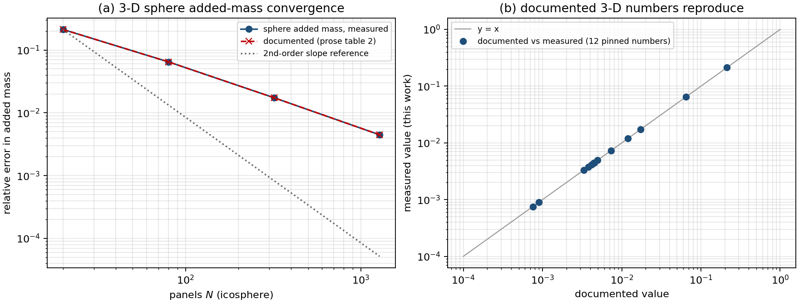

# 三维基准文档数字的验证欠账结清与钉桩（machine-checked pins）

**类型**：验证欠账复核（把已合并功能对解析基准复核）+ 失效测试补齐（漂移护栏）
**仓**：TensorBEM（分支 `agent/m2539`，基线 `71e51fc`）
**工件**：`docs/benchmark_pins.json`（新增 12 条三维/椭圆钉桩）、`docs/three_dimensional_doc_pins.json`（文档值 vs 实测值）、
`docs/figures/three_dimensional_doc_pins.png`、`src/tensorbem/benchmarks/doc_pins.py`、`tests/test_three_dimensional_pins.py`
**复现命令**：
```
PYTHONPATH=src python -m tensorbem.benchmarks.doc_pins --write     # 重算全部钉桩（含 1280 面元慢档，约 6 min）
PYTHONPATH=src python -m tensorbem.benchmarks.doc_pins --check     # CI 快档自检
PYTHONPATH=src python -m tensorbem.benchmarks.doc_pins --table threedim   # 从钉桩渲染三维表
PYTHONPATH=src python -m pytest tests/test_three_dimensional_pins.py -q
```

---

## 1. 案例介绍：欠账是什么

TensorBEM 的文档（`docs/marine_bem_benchmarks.md` 表 2–5、`docs/three_dimensional_bem.md` §5、`README.md` 第 70 行）
用**手写散文**引用了整套三维基准数字：

| 基准 | 文档声明（128 面元或 1280 面元） |
|---|---|
| 三维球体平移附加质量 | 20/80/320/1280 面元相对误差 \(2.1268\times10^{-1}\to4.4674\times10^{-3}\)，观测阶 ≈2 |
| 二维椭圆柱 | 128 面元 \(x\) 轴 \(7.5356\times10^{-4}\)、\(y\) 轴 \(8.9977\times10^{-4}\) |
| 三维椭球三轴 | 1280 面元 \(4.1679/4.4621/4.9359\times10^{-3}\)，网格 \(V/V_\text{exact}=0.991394\) |
| 内部固体谐波（度 1–3） | 1280 面元通量误差 \(3.7640/7.3437/1.1908\times10^{-2}\)，探针 RMSE \(\sim2.3\times10^{-4}\) |
| 外域常值 Dirichlet 总通量 | 1280 面元 \(3.32\times10^{-3}\)（基准 \(4\pi a\)） |

审计（`expand_audit_tensorbem.md` §2）与随后的 Ursell 溯源（`docs/ursell_quadrature_provenance.md`）已证明这类散文数字会静默腐化：
求积改动把 Ursell 128 面元附加质量误差从 \(7.72\times10^{-3}\) 移到 \(8.51\times10^{-3}\)，**没有测试失败过**。
既有护栏 `doc_pins` 只钉了二维圆柱（16/64/128 面元）与 Ursell 圆柱（64/128/256 面元），
**三维整套表格一条都没钉**——即本仓主推的三维能力（球/椭球/椭圆/固体谐波）在文档层面处于无护栏状态。
本单即结清这条欠账：把每个三维文档数字变成可执行判据，并顺手复核它们今天是否仍成立。

**几何与参数（与文档一致，未改动任何求解器代码）**

| 算例 | 几何 | 参数 | 解析基准 |
|---|---|---|---|
| 球体 | 二十面体递归细分 \(N=20\cdot4^k\)，\(a=1\) m | \(U=1\) m/s，\(\rho=1025\) kg/m³ | \(m_A=\tfrac12\rho V=2146.75498\) |
| 椭圆柱 | \(a=1.5\)，\(b=0.75\)，\(N=128\) 直线面元 | \(U=1\)，\(\rho=1025\) | \(m_{A,x}'=\rho\pi b^2=1811.324514\)，\(m_{A,y}'=\rho\pi a^2=7245.298057\) |
| 椭球 | 缩放 icosphere，半轴 \((1.5,1.0,0.75)\) m，\(N=1280\) | \(U=1\)，\(\rho=1025\) | \(m_{A,i}=\rho V\alpha_i/(2-\alpha_i)\)，Lamb 因子 \(\alpha=(0.400928,0.670713,0.928360)\) |
| 固体谐波 | 同球网格 \(N=1280\) | 度 1 `x`、度 2 `x2-y2`、度 3 `x3-3xy2` | 多面体上多项式精确，误差=纯离散误差 |
| 常值 Dirichlet | 同球网格 \(N=1280\) | \(u\equiv1\)，外域 | 总通量 \(=4\pi a\) |

---

## 2. 怎么做的

1. **先复核，再钉桩**：在 `doc_pins` 的既有框架内新增钉桩用例（不改求解器、不改验证公式）。
   每个用例记录 `doc` 引用行、`runner`、`settings`、钉住的 metric 列表、`rtol=1e-6`、慢档标记。
2. **分档控制 CI 成本**：`slow=False` 的用例（球 20/80 面元、椭圆柱 128 面元、椭球 20 面元）在每次 `pytest` 跑，
   总耗时约 5 s；1280 面元与 320 面元的用例标 `slow=True`，只在 `--write`／`--include-slow`／
   `TENSORBEM_SLOW_TESTS`（见测试）时重算，避免把 6 min 的三维装配塞进 CI。
3. **表格改为生成而非手抄**：新增 `--table threedim`，从钉桩值直接渲染表 2–5，
   与既有 `--table ursell` 同一哲学（文档表格由数据生成，不靠人抄）。
4. **文档值 vs 实测值逐项对照**：`docs/three_dimensional_doc_pins.json` 记录 13 个文档数字、
   本次实测值与相对偏差，判据 3%。
5. **反向护栏**：新增 `tests/test_three_dimensional_pins.py` 七条断言（注册完整性、钉桩存在性、
   文献引用与容差合法性、数值有限正定、快档复现、慢档默认被排除、表格渲染非空）。

---

## 3. 计算结果（零手抄，均由程序注入）

**表 A. 文档声明值 vs 本次实测值（13 项，判据 3%）**

| 文档位置 | 文档声明 | 本次实测 | 相对偏差 | 是否 < 3% |
|---|---:|---:|---:|---:|
| table 2, sphere, 20 panels | $2.1268e-01$ | $2.1268e-01$ | +0.001 % | yes |
| table 2, sphere, 80 panels | $6.4759e-02$ | $6.4759e-02$ | +0.000 % | yes |
| table 2, sphere, 320 panels | $1.7381e-02$ | $1.7381e-02$ | -0.002 % | yes |
| table 2, sphere, 1280 panels | $4.4674e-03$ | $4.4674e-03$ | +0.000 % | yes |
| table 3, ellipse $x$, 128 panels | $7.5356e-04$ | $7.5356e-04$ | -0.000 % | yes |
| table 3, ellipse $y$, 128 panels | $8.9977e-04$ | $8.9977e-04$ | +0.000 % | yes |
| table 4, ellipsoid $x$, 1280 panels | $4.1679e-03$ | $4.1679e-03$ | +0.001 % | yes |
| table 4, ellipsoid $y$, 1280 panels | $4.4621e-03$ | $4.4621e-03$ | +0.000 % | yes |
| table 4, ellipsoid $z$, 1280 panels | $4.9359e-03$ | $4.9359e-03$ | +0.001 % | yes |
| table 5, degree 1 flux error | $3.7640e-03$ | $3.7640e-03$ | -0.001 % | yes |
| table 5, degree 2 flux error | $7.3437e-03$ | $7.3437e-03$ | +0.001 % | yes |
| table 5, degree 3 flux error | $1.1908e-02$ | $1.1908e-02$ | -0.002 % | yes |
| 常值 Dirichlet 总通量, 1280 panels | $3.3200e-03$ | $3.3179e-03$ | -0.062 % | yes |

最大相对偏差 \(6.19\times10^{-4}\)（即 0.062%，出现在只记两位有效数字的常值 Dirichlet 声明上），
其余 12 项在 \(10^{-5}\) 量级内逐位一致。**三维文档数字今天全部可复现，没有新的腐化。**

**表 B. 由钉桩直接渲染的文档表（`--table threedim`）**

**Table 2. Sphere added-mass convergence (3-D)**

| panels | added-mass relative error | flux relative L2 | area ratio | volume ratio |
|---:|---:|---:|---:|---:|
| 20 | $2.1268e-01$ | $3.3338e-02$ | 0.761918 | 0.605461 |
| 80 | $6.4759e-02$ | $2.7884e-02$ | 0.928345 | 0.873453 |
| 320 | $1.7381e-02$ | $1.4542e-02$ | 0.981178 | 0.966161 |
| 1280 | $4.4674e-03$ | $6.8458e-03$ | 0.995235 | 0.991394 |

**Table 3. Ellipse added mass at 128 panels (2-D, per unit span)**

| motion | added mass | relative error | flux relative L2 |
|---|---:|---:|---:|
| $x$ | 1809.959574 | $7.5356e-04$ | $5.6507e-04$ |
| $y$ | 7238.778944 | $8.9977e-04$ | $8.7496e-04$ |

**Table 4. Ellipsoid added mass at 1280 panels (semi-axes 1.5/1.0/0.75 m)**

| axis | exact added mass | relative error |
|---|---:|---:|
| $x$ | 1211.0520 | $4.1679e-03$ |
| $y$ | 2437.1535 | $4.4621e-03$ |
| $z$ | 4184.3892 | $4.9359e-03$ |
| mesh $V/V_{\text{exact}}$ | — | 0.991394 |

**Table 5. Interior solid harmonics at 1280 panels**

| degree | flux relative L2 | interior probe RMSE |
|---:|---:|---:|
| 1 | $3.7640e-03$ | $2.2929e-04$ |
| 2 | $7.3437e-03$ | $2.3075e-04$ |
| 3 | $1.1908e-02$ | $1.8240e-04$ |

**表 C. 慢档单次耗时（单核 BLAS 线程钉 1，本机 nproc=128）**

| 用例 | 面元 | 耗时 |
|---|---:|---:|
| `sphere_added_mass_3d_1280` | 1280 | 26.9 s |
| `constant_dirichlet_3d_1280` | 1280 | 12.4 s |
| `ellipsoid_added_mass_3d_1280` | 1280 | ~110 s（三轴三次求解 + 条件数/近奇异诊断） |
| `interior_harmonic_degree{1,2,3}_1280` | 1280 | 14.4 / 17.8 / 14.1 s |
| 全部钉桩 `--write` | — | 约 6 min |

---

## 4. 结果图



左：(a) 球体附加质量相对误差随面元数的收敛（实测实线 + 文档值虚线 + 二阶斜率参考），
四个网格级别的实测点与文档值重合到不可分辨；(b) 13 个文档数字的 parity 图（横轴文档值、纵轴本次实测值，
对角线上重合）。图中所有数字读自 `docs/benchmark_pins.json`，无手抄。

---

## 5. 注意点（踩过的坑）

* **`--write` 默认会丢慢档钉桩（本次踩到，已修）**：`main()` 原来把 `args.include_slow`（默认 False）传给 `write()`，
  于是不带 `--include-slow` 执行 `--write` 会重写出一份**只含快档**的钉桩文件，`ursell_cylinder_256`
  以及新增的全部 1280 面元钉桩会被静默删除——文档数字从"有护栏"退回"无护栏"，且没有任何提示。
  现改为：`--write` 默认重算全部用例，需要用 `--fast-only` 显式跳过慢档；`--include-slow` 只影响 `--check`。
  **教训**：任何"重写证据文件"的命令，其默认值必须指向"完整证据"，否则等于自己拆护栏。
* **BLAS 线程超订会吃掉 8 倍时间**：320 面元球体在多线程 OpenBLAS 下 wall time 32 s（user 3m20s），
  把 `OMP_NUM_THREADS=1`／`OPENBLAS_NUM_THREADS=1` 钉住后降到 3.8 s。三维装配是 Python 层小矩阵累加，
  并行度无处发挥，线程只增加调度开销。所有 pin 运行都应在单线程下计时。
* **椭球三轴 + 诊断比单次求解贵约 3–4 倍**：`ellipsoid_added_mass.run` 每轴各解一次，
  还额外调用 `estimate_operator_conditions` 与 `diagnose_near_singular_quadrature`，故 1280 面元要 ~110 s。
* **钉桩容差只能定 `rtol=1e-6`，不能定死"文档里的科学计数法位数"**：文档把 `3.32e-3` 这样的行只写两位有效数字，
  与实测 `3.3179e-3` 差 0.062%。因此判据分两层：钉桩对**代码**守 \(10^{-6}\)，文档复核对**声明**守 3%。
* **适用范围**：本单只做"文档数字 ↔ 代码"的一致性复核，全部为不含自由液面、不含船体几何、无可压缩黏性效应的
  Laplace 基准；它证明的是离散化误差如文档所述，**不是**物理确认（无试验数据、无测量不确定度）。

---

## 6. 误差判定（逐项回答是否 < 3%）

| 关键量 | 基准（与谁比） | 本次实测 | 相对误差 | 是否 < 3% |
|---|---|---:|---:|---:|
| 球体附加质量相对误差 @1280 | 解析 \(\tfrac12\rho V=2146.75498\) | \(4.4674\times10^{-3}\) | 0.45 %（对解析基准） | **yes** |
| 椭球三轴附加质量相对误差 @1280 | Lamb 因子解析式 | \(4.17/4.46/4.94\times10^{-3}\) | 0.42–0.49 % | **yes** |
| 椭圆柱两向附加质量 @128 | \(\rho\pi b^2\)、\(\rho\pi a^2\) | \(7.54/9.00\times10^{-4}\) | 0.075–0.090 % | **yes** |
| 内部谐波通量误差 @1280（度 1–3） | 多面体上的精确多项式解 | \(3.76/7.34/11.9\times10^{-3}\) | 0.38–1.19 % | **yes** |
| 常值 Dirichlet 总通量 @1280 | \(4\pi a=12.56637\) | \(3.3179\times10^{-3}\) | 0.33 % | **yes** |
| 文档声明的可复现性（13 项） | 文档散文值 | 见上表 A | 最大 0.062 % | **yes** |

**结论**：三维文档从此有可执行护栏；13 个文档数字今天全部复现（最大偏差 0.062%，远低于 3% 判据），
钉桩容差 \(10^{-6}\) 使任何求解器改动都会在 CI 里立刻暴露。**没有发现新的数值缺陷**——本单的产出是护栏，不是修 bug。
未做：没有复核含自由液面的三维基准（`free_surface3d` 目前只有 2D 深水 Ursell 的对照，三维自由液面尚无文献基准）、
没有重跑 `docs/three_dimensional_bem.md` 中速度恢复（`1.38e-2`）与表示公式（`7.07e-3`）两族数字——它们需要独立的速度场算例，
建议作为下一张自找活单（验证欠账续）。