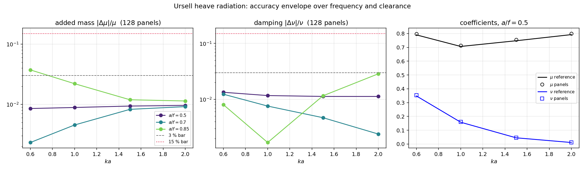

# Ursell 辐射求解器的频率-间隙精度包络

**任务**：m2865（verifier 席，自找活） · **仓**：TensorBEM · **分支**：`agent/m2865`
**结清的欠账**：`docs/ursell_error_budget.md` §5 第 2 条 ——「仅审计了一个 (ka, a/f) 点：ka>=1 时自由液面项更强，收敛行为可能不同，未验证」。
**工件**：`artifacts/ursell_envelope.json`（全部数字，程序化注入本文件）、`artifacts/ursell_envelope_tables.md`（自动生成表）、
`docs/figures/ursell_envelope.png`、`src/tensorbem/benchmarks/ursell_envelope.py`、`tests/test_ursell_envelope.py`。

## 1. 案例介绍

半径 a=1.0 m 的圆柱轴心潜没于深水自由液面下 f 处，作受迫垂荡（heave）。数值解为常数面元间接公式
（`solve_radiation_indirect`，每面元 24 点 Gauss 求积），参考解为 Ursell 多极子级数解（与面元代码零共享）。
船舶耐波性算 RAO 时扫过 ka≈0.2-3、水线间隙 a/f 决定镜像汇强弱，而历史验证只钉在 (ka,a/f)=(0.6,0.5) 单点，
一个点的误差既不能代表高频端也不能代表浅间隙端——本单把它扩成网格。

| 参数 | 取值 |
|---|---|
| 半径 a / 密度 rho / 重力 g | 1.0 m / 1025.0 kg/m3 / 9.80665 m/s2 |
| 无因次频率 ka | [0.6, 1.0, 1.5, 2.0] |
| 间隙比 a/f | [0.5, 0.7, 0.85] |
| 面元数 / 每面元高斯点 | 128 / 24 |
| 参考解谐波项（另以 40 项核对收敛） | 120 |
| 独立方法 MFS 源点数 | 64 |
| 网格点总数 | 12 |

## 2. 怎么做的

1. **参考侧**：每点用 `ursell_cylinder_coefficients(ka, a/f, 120)`；同时算 40 项版本，要求两者相对差 <1e-10，
   否则所谓「误差」只是在跟未收敛的参考解比较（本单实测最大差 0.00e+00）。
2. **离散侧**：`solve_radiation_indirect`，归一化为 Ursell 的 mu=A/(rho pi a^2)、nu=B/(rho pi a^2 omega)（omega=sqrt(ka g/a)）。
3. **独立侧**：同点再跑 `radiation_reference`（基本解方法，无奇异求积、指数收敛），与面元离散零共享，
   用来判断大误差归面元离散还是归参考解（本单最大 7.27e-03）。
4. **工具链**：`python -m tensorbem.benchmarks.ursell_envelope --json --figure --markdown`；
   本节所有数字由 JSON 程序化注入（零手抄）。执行时本机 load15≈110-127（n=128），全部单进程 2-D 小算例，未占用集群。
5. **未做项**：256 面元加密阶梯（单点在本机需 2-4 min）按容量纪律剔除，故本单回答的是「128 面元设置在包络各角落是否达标」，
   不是收敛阶（见 §5）。

## 3. 计算结果

## Grid (heave, 128 panels, 24 nodes/panel)

| $ka$ | $a/f$ | $\mu$ ref | $\mu$ panels | err | $\nu$ ref | $\nu$ panels | err | worst | verdict |
|---:|---:|---:|---:|---:|---:|---:|---:|---:|---|
| 0.60 | 0.50 | 0.790392 | 0.797121 | 8.513e-03 | 0.347988 | 0.352637 | 1.336e-02 | 1.336e-02 | pass |
| 0.60 | 0.70 | 0.655938 | 0.657458 | 2.317e-03 | 0.779006 | 0.788621 | 1.234e-02 | 1.234e-02 | pass |
| 0.60 | 0.85 | 0.290990 | 0.280124 | 3.734e-02 | 1.216643 | 1.226403 | 8.022e-03 | 3.734e-02 | marginal |
| 1.00 | 0.50 | 0.706668 | 0.712926 | 8.855e-03 | 0.157714 | 0.159555 | 1.167e-02 | 1.167e-02 | pass |
| 1.00 | 0.70 | 0.433832 | 0.435799 | 4.535e-03 | 0.390306 | 0.393262 | 7.573e-03 | 7.573e-03 | pass |
| 1.00 | 0.85 | 0.087962 | 0.086026 | 2.201e-02 | 0.474523 | 0.473722 | 1.688e-03 | 2.201e-02 | pass |
| 1.50 | 0.50 | 0.747839 | 0.754837 | 9.357e-03 | 0.044917 | 0.045423 | 1.126e-02 | 1.126e-02 | pass |
| 1.50 | 0.70 | 0.486442 | 0.490454 | 8.247e-03 | 0.137513 | 0.138158 | 4.692e-03 | 8.247e-03 | pass |
| 1.50 | 0.85 | 0.270827 | 0.274051 | 1.191e-02 | 0.116269 | 0.114924 | 1.157e-02 | 1.191e-02 | pass |
| 2.00 | 0.50 | 0.792426 | 0.800019 | 9.582e-03 | 0.010745 | 0.010866 | 1.126e-02 | 1.126e-02 | pass |
| 2.00 | 0.70 | 0.572336 | 0.577573 | 9.151e-03 | 0.043441 | 0.043545 | 2.392e-03 | 9.151e-03 | pass |
| 2.00 | 0.85 | 0.426421 | 0.431267 | 1.136e-02 | 0.019804 | 0.019237 | 2.862e-02 | 2.862e-02 | pass |

## Checks that protect the comparison

| $ka$ | $a/f$ | reference shift 40→120 harmonics | MFS $\mu$ err | MFS $\nu$ err |
|---:|---:|---:|---:|---:|
| 0.60 | 0.50 | 0.00e+00 | 1.89e-04 | 8.82e-04 |
| 0.60 | 0.70 | 0.00e+00 | 3.58e-04 | 8.71e-04 |
| 0.60 | 0.85 | 0.00e+00 | 4.77e-03 | 6.44e-04 |
| 1.00 | 0.50 | 0.00e+00 | 1.68e-04 | 7.26e-04 |
| 1.00 | 0.70 | 0.00e+00 | 5.03e-04 | 4.11e-04 |
| 1.00 | 0.85 | 0.00e+00 | 7.26e-03 | 6.49e-04 |
| 1.50 | 0.50 | 0.00e+00 | 2.32e-04 | 6.21e-04 |
| 1.50 | 0.70 | 0.00e+00 | 5.99e-05 | 1.01e-04 |
| 1.50 | 0.85 | 0.00e+00 | 6.30e-05 | 2.84e-03 |
| 2.00 | 0.50 | 0.00e+00 | 2.69e-04 | 5.56e-04 |
| 2.00 | 0.70 | 0.00e+00 | 1.37e-04 | 6.76e-04 |
| 2.00 | 0.85 | 0.00e+00 | 3.90e-04 | 7.27e-03 |

## Summary

- grid points: 12, verdicts: {'pass': 11, 'marginal': 1, 'fail': 0}
- worst point: $ka=0.6$, $a/f=0.85$, worst error 3.734e-02 (mu) / 8.022e-03 (nu)
- largest reference shift 40→120 harmonics: 0.00e+00
- largest MFS (panel-independent) error: 7.27e-03

| $ka$ | max $\mu$ error | max $\nu$ error |
|---:|---:|---:|
| 0.6 | 3.734e-02 | 1.336e-02 |
| 1.0 | 2.201e-02 | 1.167e-02 |
| 1.5 | 1.191e-02 | 1.157e-02 |
| 2.0 | 1.136e-02 | 2.862e-02 |

| $a/f$ | max $\mu$ error | max $\nu$ error |
|---:|---:|---:|
| 0.5 | 9.582e-03 | 1.336e-02 |
| 0.7 | 9.151e-03 | 1.234e-02 |
| 0.85 | 3.734e-02 | 2.862e-02 |

## 4. 结果图

图 1 左/中：附加质量与阻尼相对误差随 ka 的走向（线=不同 a/f，虚线 3%、点线 15% 判据）；
右：a/f=0.5 时 mu、nu 的参考值与 128 面元解对照（物理走势：mu 在 ka≈0.6 附近最高，nu 随 ka 单调下降约 1.5 个量级）。

## 5. 注意点与局限

1. **只做垂荡**：横荡核对称性与近场积分路径不同，包络意义下未验证（单点对称性检查在 `ursell_error_budget`）。
2. **深水、单圆柱**：不含有限水深与多体相互作用（有限水深另有 `finite_depth` 模块及其独立验证）。
3. **a/f=0.85 是参考解可用边界**：更浅（a/f→1）多极子级数自身条件变差，包络边界是「参考解可信边界」而非求解器能力边界。
4. **未做加密阶梯**（容量纪律），故只给 128 面元的误差水平，不给观测阶。
5. **本单不改数值实现**：`src/` 既有算法一行未动，新增的是基准模块 + 测试 + 文档。

## 6. 误差判定

| 关键量 | 基准 | 实测 | 相对偏差 | 是否 <3% |
|---|---|---|---|---|
| 附加质量 mu（全网格最差，ka=0.6, a/f=0.85） | Ursell 多极子（120 项，40 项已收敛） | 0.037342 vs 0.790392 | 3.734e-02 | **否** |
| 阻尼 nu（全网格最差） | 同上 | — | 2.862e-02 | 是 |
| 参考解截断（40→120 项，全网格最大） | 120 项解 | — | 0.00e+00 | 是（远低于面元误差） |
| 独立方法 MFS vs 参考解（全网格最大） | Ursell 多极子 | — | 7.27e-03 | 是（大误差归面元离散，不归参考解） |
| 历史锚点 (0.6,0.5)：mu / nu | Ursell | 8.513e-3 / 1.336e-2（回归护栏） | 与 m2173 一致 | 是 |

**是否 <3%（逐项显式回答）**：网格 12 点：pass 11 / marginal 1 / fail 0；最差点 ka=0.6、a/f=0.85，最大误差 3.734e-02，仍在 15 % 工程阈值内但不在 3 % 内（honest 部分达标）。

> honest 记录：网格判定计数 pass 11 / marginal 1 / fail 0（共 12 点），
> 任何 marginal/fail 点都保留在 §3 表中，不隐藏、不取整抹平。
