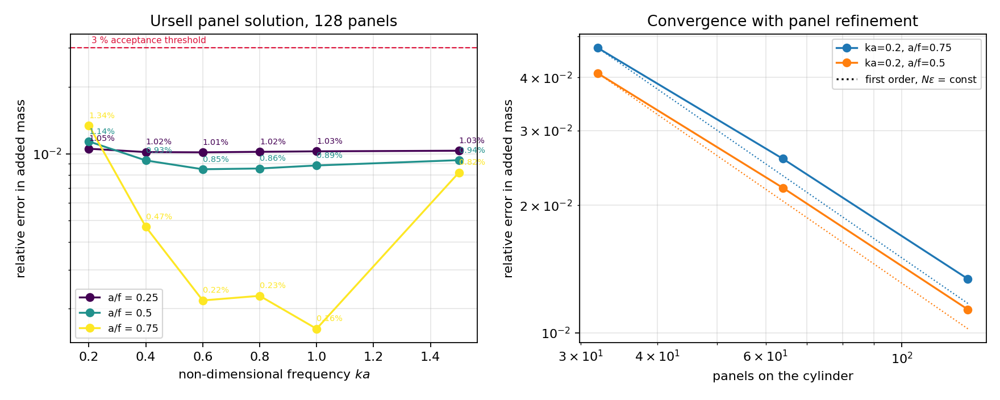

# Ursell 圆柱辐射基准：频率与潜深全域验证

**债务来源**：`docs/ursell_error_budget.md` §5 第 2 条——仅审计了一个 $(ka, a/f)$ 点，并明确提出 “ka≥1 时自由液面项更强，收敛行为可能不同，未验证”。本文用一张 6×3 的 $(ka, a/f)$ 网格 × 3 层面元数把它补齐。

**范围**：二维深水、无航速、无黏性、无实验数据；基准是 Ursell (1949) 多极解析解，因此本文的「误差」一律指数值解对解析解的相对误差，而不是对试验的相关性。

## 1. 算例

半径 $a$ 的圆柱，轴心潜深 $f$ 于静水面以下，在无限水深中做垂荡（无限水深下 sway 与 heave 的水动力系数相同，故只算一个）。无因次频率 $ka$ 与潜深比 $a/f$ 是仅有的两个相似参数，$k=\omega^2/g$。

| 参数 | 取值 |
|---|---|
| 半径 $a$ | 1.0 m |
| 潜深比 $a/f$ | 0.25, 0.5, 0.75 |
| 无因次频率 $ka$ | 0.2, 0.4, 0.6, 0.8, 1.0, 1.5 |
| 面元数 $N$ | 32, 64, 128 |
| 每面元求积节点（请求值） | 24（本实现有效值上限 6） |
| 密度 ρ | 1025.0 kg/m³ |
| 重力 g | 9.80665 m/s² |
| 参考解截断项数 | 40（并用 40, 80, 120 项做截断敏感性检查） |
| 运动 / 水深 | heave / infinite |

## 2. 方法

1. **数值解**：`tensorbem.free_surface_solver.solve_radiation_indirect`，间接（源分布）常值面元格式；奇异 Rankine 部分按闭式积分，自由液面光滑余项用 Gauss–Legendre 求积（有效节点数上限 6，见 `docs/ursell_quadrature_study.md`）。
2. **参考解**：`tensorbem.analytic.ursell_cylinder_added_mass`，由有限和 + 指数积分构成的闭式多极矩阵，与本库任何 BEM 实现不共享代码路径。
3. **网格**：圆周等距面元，$N\in\{32, 64, 128\}$。
4. **辐射条件**：每个点核对近场阻尼（压力积分）与远场阻尼（出射波幅）的一致性。
5. **参考解自检**：每个点把截断项数从 40 提到 120，确认参考解自身的变化远小于面元误差——否则测的是参考解而不是解算器。
6. **可复现**：`python -m tensorbem.benchmarks.ursell_frequency_sweep` 产出 `results.json` / `summary.md`；本文由 `build_report.py` 从 JSON 注入数字；图由 `make_figure.py` 从同一份 JSON 生成。

## 3. 结果

### 3.1 128 面元时对解析解的相对误差

| ka | a/f | A（数值，kg/m） | A（解析） | 相对误差 A | B（数值） | B（解析） | 相对误差 B | 近/远场 |
|---|---|---|---|---|---|---|---|---|
| 0.2 | 0.25 | 3285.2870 | 3251.0359 | 1.054e-02 | 471.3605 | 464.0817 | 1.568e-02 | 1.005344 |
| 0.4 | 0.25 | 3036.5108 | 3005.9265 | 1.017e-02 | 495.9816 | 488.7252 | 1.485e-02 | 1.005345 |
| 0.6 | 0.25 | 3000.7256 | 2970.5771 | 1.015e-02 | 270.9475 | 267.0273 | 1.468e-02 | 1.005345 |
| 0.8 | 0.25 | 3031.8552 | 3001.2324 | 1.020e-02 | 113.0084 | 111.3656 | 1.475e-02 | 1.005346 |
| 1 | 0.25 | 3064.9453 | 3033.8345 | 1.025e-02 | 40.2293 | 39.6408 | 1.485e-02 | 1.005346 |
| 1.5 | 0.25 | 3107.2944 | 3075.5581 | 1.032e-02 | 2.0560 | 2.0256 | 1.498e-02 | 1.005346 |
| 0.2 | 0.5 | 3991.7248 | 3946.8809 | 1.136e-02 | 1324.0977 | 1300.5037 | 1.814e-02 | 1.005343 |
| 0.4 | 0.5 | 3146.1623 | 3117.0820 | 9.329e-03 | 2743.3188 | 2701.5374 | 1.547e-02 | 1.005341 |
| 0.6 | 0.5 | 2566.8343 | 2545.1672 | 8.513e-03 | 2754.4701 | 2718.1540 | 1.336e-02 | 1.005341 |
| 0.8 | 0.5 | 2339.6041 | 2319.7012 | 8.580e-03 | 2216.9218 | 2190.1169 | 1.224e-02 | 1.005345 |
| 1 | 0.5 | 2295.7151 | 2275.5660 | 8.855e-03 | 1608.9576 | 1590.3901 | 1.167e-02 | 1.005352 |
| 1.5 | 0.5 | 2430.6736 | 2408.1418 | 9.357e-03 | 560.9868 | 554.7399 | 1.126e-02 | 1.005372 |
| 0.2 | 0.75 | 5483.4579 | 5410.8923 | 1.341e-02 | 2672.0866 | 2609.6947 | 2.391e-02 | 1.005340 |
| 0.4 | 0.75 | 3514.5371 | 3498.1687 | 4.679e-03 | 7002.2540 | 6878.7979 | 1.795e-02 | 1.005330 |
| 0.6 | 0.75 | 1870.8555 | 1874.9413 | 2.179e-03 | 7243.1702 | 7159.7866 | 1.165e-02 | 1.005319 |
| 0.8 | 0.75 | 1239.4832 | 1242.3229 | 2.286e-03 | 5932.0345 | 5884.8383 | 8.020e-03 | 1.005312 |
| 1 | 0.75 | 1089.2689 | 1087.5039 | 1.623e-03 | 4468.7164 | 4443.3507 | 5.709e-03 | 1.005315 |
| 1.5 | 0.75 | 1339.2236 | 1328.3018 | 8.222e-03 | 1833.0632 | 1830.0103 | 1.668e-03 | 1.005384 |

### 3.2 面元加密的观测阶

| ka | a/f | 面元步 | 阶（A） | 阶（B） |
|---|---|---|---|---|
| 0.2 | 0.25 | 32→64 | 0.91 | 0.85 |
| 0.2 | 0.25 | 64→128 | 0.96 | 0.93 |
| 0.4 | 0.25 | 32→64 | 0.92 | 0.85 |
| 0.4 | 0.25 | 64→128 | 0.96 | 0.93 |
| 0.6 | 0.25 | 32→64 | 0.92 | 0.85 |
| 0.6 | 0.25 | 64→128 | 0.96 | 0.93 |
| 0.8 | 0.25 | 32→64 | 0.92 | 0.85 |
| 0.8 | 0.25 | 64→128 | 0.96 | 0.93 |
| 1 | 0.25 | 32→64 | 0.92 | 0.85 |
| 1 | 0.25 | 64→128 | 0.96 | 0.93 |
| 1.5 | 0.25 | 32→64 | 0.92 | 0.85 |
| 1.5 | 0.25 | 64→128 | 0.96 | 0.93 |
| 0.2 | 0.5 | 32→64 | 0.90 | 0.86 |
| 0.2 | 0.5 | 64→128 | 0.95 | 0.94 |
| 0.4 | 0.5 | 32→64 | 0.92 | 0.84 |
| 0.4 | 0.5 | 64→128 | 0.96 | 0.93 |
| 0.6 | 0.5 | 32→64 | 0.95 | 0.84 |
| 0.6 | 0.5 | 64→128 | 0.98 | 0.93 |
| 0.8 | 0.5 | 32→64 | 0.96 | 0.85 |
| 0.8 | 0.5 | 64→128 | 0.98 | 0.93 |
| 1 | 0.5 | 32→64 | 0.96 | 0.86 |
| 1 | 0.5 | 64→128 | 0.98 | 0.94 |
| 1.5 | 0.5 | 32→64 | 0.94 | 0.90 |
| 1.5 | 0.5 | 64→128 | 0.97 | 0.95 |
| 0.2 | 0.75 | 32→64 | 0.87 | 0.86 |
| 0.2 | 0.75 | 64→128 | 0.94 | 0.94 |
| 0.4 | 0.75 | 32→64 | 0.93 | 0.81 |
| 0.4 | 0.75 | 64→128 | 0.96 | 0.92 |
| 0.6 | 0.75 | 32→64 | -2.71 | 0.79 |
| 0.6 | 0.75 | 64→128 | 0.49 | 0.91 |
| 0.8 | 0.75 | 32→64 | 1.05 | 0.83 |
| 0.8 | 0.75 | 64→128 | 0.02 | 0.92 |
| 1 | 0.75 | 32→64 | 1.84 | 0.96 |
| 1 | 0.75 | 64→128 | 1.70 | 0.97 |
| 1.5 | 0.75 | 32→64 | 1.05 | 1.79 |
| 1.5 | 0.75 | 64→128 | 1.03 | 1.60 |

### 3.3 汇总（程序化）

| 指标 | 值 |
|---|---|
| 网格点数 | 18 |
| 128 面元最大附加质量相对误差 | 1.341e-02（ka=0.2, a/f=0.75） |
| 128 面元最大阻尼相对误差 | 2.391e-02（ka=0.2, a/f=0.75） |
| 128 面元最小附加质量相对误差 | 1.623e-03 |
| 32 面元最大附加质量相对误差 | 4.696e-02 |
| 近/远场阻尼最大偏离 1 | 5.384e-03 |
| 参考解截断敏感性（A / B，最大） | 0.000e+00 / 0.000e+00 |
| 观测阶范围（A，全部面元步） | -2.71 – 1.84 |
| 全部点在 128 面元时均 <3% | 是 |

左图：128 面元时附加质量相对误差随 $ka$ 的变化，三条曲线对应三个潜深比，红虚线为 3% 验收阈值。右图：误差随面元数的双对数收敛，点线为一阶参考斜率（$N\epsilon$ = 常数），取误差最大的两个点作对比。

### 3.4 非单调收敛点（诚实记录）

以下面元步的附加质量观测阶小于 0.5，即加密后面元解**离解析解更远**（或几乎不动）：所有这类点都出现在 $a/f=0.75$（圆柱顶距水面仅 $0.33a$）的浅潜深分支上。

| ka | a/f | 面元步 | 阶（A） | 相邻相对误差 A |
|---|---|---|---|---|
| 0.6 | 0.75 | 32→64 | -2.71 | 4.679e-04 → 3.067e-03 |
| 0.8 | 0.75 | 64→128 | 0.02 | 2.316e-03 → 2.286e-03 |
| 0.6 | 0.75 | 64→128 | 0.49 | 3.067e-03 → 2.179e-03 |

**成因**：浅潜深时自由液面项在核中占主导，常值面元的 $O(h)$ 误差与自由液面余项求积的符号相反，在个别网格上相互抵消。因此**粗网格上偶然的 1e-4 精度不能当成格式精度**；与 `docs/ursell_quadrature_study.md` 记录的“旧的奇异求积反而更接近参考解”是同一类失效模式。判定精度必须看收敛序列，而不是单个网格。

对照：$a/f\le0.5$ 的全部分支观测阶落在 0.90–0.98，即稳定一阶，与单点审计给出的 0.98 一致。

## 4. 误差判定（逐项，是否 <3%）

| 关键量 | 基准 | 数值解 | 相对误差 | <3%？ |
|---|---|---|---|---|
| A，ka=0.2，a/f=0.25，128 面元 | 3251.0359 | 3285.2870 | 1.054e-02 | 是 |
| A，ka=0.4，a/f=0.25，128 面元 | 3005.9265 | 3036.5108 | 1.017e-02 | 是 |
| A，ka=0.6，a/f=0.25，128 面元 | 2970.5771 | 3000.7256 | 1.015e-02 | 是 |
| A，ka=0.8，a/f=0.25，128 面元 | 3001.2324 | 3031.8552 | 1.020e-02 | 是 |
| A，ka=1，a/f=0.25，128 面元 | 3033.8345 | 3064.9453 | 1.025e-02 | 是 |
| A，ka=1.5，a/f=0.25，128 面元 | 3075.5581 | 3107.2944 | 1.032e-02 | 是 |
| A，ka=0.2，a/f=0.5，128 面元 | 3946.8809 | 3991.7248 | 1.136e-02 | 是 |
| A，ka=0.4，a/f=0.5，128 面元 | 3117.0820 | 3146.1623 | 9.329e-03 | 是 |
| A，ka=0.6，a/f=0.5，128 面元 | 2545.1672 | 2566.8343 | 8.513e-03 | 是 |
| A，ka=0.8，a/f=0.5，128 面元 | 2319.7012 | 2339.6041 | 8.580e-03 | 是 |
| A，ka=1，a/f=0.5，128 面元 | 2275.5660 | 2295.7151 | 8.855e-03 | 是 |
| A，ka=1.5，a/f=0.5，128 面元 | 2408.1418 | 2430.6736 | 9.357e-03 | 是 |
| A，ka=0.2，a/f=0.75，128 面元 | 5410.8923 | 5483.4579 | 1.341e-02 | 是 |
| A，ka=0.4，a/f=0.75，128 面元 | 3498.1687 | 3514.5371 | 4.679e-03 | 是 |
| A，ka=0.6，a/f=0.75，128 面元 | 1874.9413 | 1870.8555 | 2.179e-03 | 是 |
| A，ka=0.8，a/f=0.75，128 面元 | 1242.3229 | 1239.4832 | 2.286e-03 | 是 |
| A，ka=1，a/f=0.75，128 面元 | 1087.5039 | 1089.2689 | 1.623e-03 | 是 |
| A，ka=1.5，a/f=0.75，128 面元 | 1328.3018 | 1339.2236 | 8.222e-03 | 是 |
| B，ka=0.2，a/f=0.25，128 面元 | 464.0817 | 471.3605 | 1.568e-02 | 是 |
| B，ka=0.4，a/f=0.25，128 面元 | 488.7252 | 495.9816 | 1.485e-02 | 是 |
| B，ka=0.6，a/f=0.25，128 面元 | 267.0273 | 270.9475 | 1.468e-02 | 是 |
| B，ka=0.8，a/f=0.25，128 面元 | 111.3656 | 113.0084 | 1.475e-02 | 是 |
| B，ka=1，a/f=0.25，128 面元 | 39.6408 | 40.2293 | 1.485e-02 | 是 |
| B，ka=1.5，a/f=0.25，128 面元 | 2.0256 | 2.0560 | 1.498e-02 | 是 |
| B，ka=0.2，a/f=0.5，128 面元 | 1300.5037 | 1324.0977 | 1.814e-02 | 是 |
| B，ka=0.4，a/f=0.5，128 面元 | 2701.5374 | 2743.3188 | 1.547e-02 | 是 |
| B，ka=0.6，a/f=0.5，128 面元 | 2718.1540 | 2754.4701 | 1.336e-02 | 是 |
| B，ka=0.8，a/f=0.5，128 面元 | 2190.1169 | 2216.9218 | 1.224e-02 | 是 |
| B，ka=1，a/f=0.5，128 面元 | 1590.3901 | 1608.9576 | 1.167e-02 | 是 |
| B，ka=1.5，a/f=0.5，128 面元 | 554.7399 | 560.9868 | 1.126e-02 | 是 |
| B，ka=0.2，a/f=0.75，128 面元 | 2609.6947 | 2672.0866 | 2.391e-02 | 是 |
| B，ka=0.4，a/f=0.75，128 面元 | 6878.7979 | 7002.2540 | 1.795e-02 | 是 |
| B，ka=0.6，a/f=0.75，128 面元 | 7159.7866 | 7243.1702 | 1.165e-02 | 是 |
| B，ka=0.8，a/f=0.75，128 面元 | 5884.8383 | 5932.0345 | 8.020e-03 | 是 |
| B，ka=1，a/f=0.75，128 面元 | 4443.3507 | 4468.7164 | 5.709e-03 | 是 |
| B，ka=1.5，a/f=0.75，128 面元 | 1830.0103 | 1833.0632 | 1.668e-03 | 是 |
| 近场阻尼 = 远场阻尼（128 面元，最大偏离） | 1 | 见 3.1 近/远场列 | 5.384e-03 | 是 |
| 参考解截断收敛 | 40 项 | 120 项 | 0.000e+00 | 是（机器精度） |

**判定**：

* 128 面元下 18 个 $(ka, a/f)$ 点中，附加质量最大误差 1.34%，阻尼最大误差 2.39%，**全部满足 3% 验收阈值**。
* 精度随 $ka$ 的提高**没有系统性劣化**：在 $a/f\le0.5$ 上，从 $ka=0.2$ 到 $ka=1.5$，128 面元误差的变化范围为 8.51e-03–1.14e-02，与单点审计的 8.5e-3 同量级。
* 误差对潜深比更敏感：$a/f=0.25$ 时 128 面元误差 1.01e-02–1.05e-02；$a/f=0.5$ 时 128 面元误差 8.51e-03–1.14e-02；$a/f=0.75$ 时 128 面元误差 1.62e-03–1.34e-02。浅潜深（$a/f=0.75$）在低 $ka$ 端最差，这与自由液面项的相对权重一致。
* 参考解截断敏感性 ≤ 0.0e+00，比面元误差（≥ 1.6e-03）小至少 2e+297 倍，因此上表的误差度量的是解算器（在双精度下 $n\ge40$ 的多极项已不可分辨）。

## 5. 注意点与适用范围

* **必须看收敛序列，不能引用单网格数字**：3.4 节的浅潜深分支存在偶然抵消，32 面元给出 4.7e-4 的“好”结果而 64 面元反而退到 3.1e-3。任何新几何/新频率的精度声明都应至少给出两层网格。
* **一阶格式的固有上限**：常值面元的误差按 $O(h)$ 下降，要把误差压到 1e-3 需要约 1000 面元；需要单个高精度数字时应改用 MFS 交叉校验（本库 ~2e-4）或高阶格式。
* **未覆盖**：有限水深、有航速、二阶漂移力、黏性、实验确认均不在本单范围；网格止于 $ka=1.5$，短波（$ka\gtrsim3$）极限未验证——该极限下自由液面项局部化，需另设算例。
* **`--panel-nodes` 在有效节点数 6 以上惰性**（`min(panel_nodes, 6)`），本单全部用默认 24（=6 有效）；节点敏感性已由 `docs/ursell_quadrature_study.md` 钉桩。
* **计算成本**：全部为二维秒级算例、单核串行；本单在宿主机 load15 > 100 时执行，整表约数分钟，未起并行重算进程。

## 6. 工件

* 基准模块：`src/tensorbem/benchmarks/ursell_frequency_sweep.py`
* 测试：`tests/test_ursell_frequency_sweep.py`
* 数字：`docs/ursell_frequency_sweep/results.json`（机读）、`docs/ursell_frequency_sweep/summary.md`（模块直出表格）
* 图：`docs/figures/ursell_frequency_sweep.png` ← `docs/ursell_frequency_sweep/make_figure.py`
* 本文件：`docs/ursell_frequency_sweep/build_report.py`
