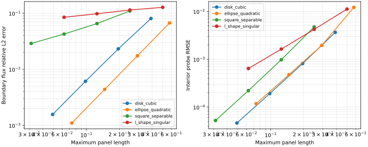

# 二维 Laplace 边界元的多几何解析验证：光滑场、角点与凹角奇异场

## 摘要

为避免仅用单位圆线性场和圆柱附加质量边界迹判断边界元程序的正确性，本文建立四类补充解析算例：单位圆域三阶调和场、椭圆域二次调和场、方形域分离变量解及 L 形域凹角奇异解。采用常数直线面元、中点配点和解析面元积分，在 16、32、64、128 面元下比较实际多边形边界上的解析通量及固定内部测点上的势函数。128 面元时，四例的边界通量相对离散加权 L2 误差分别为 0.157%、0.110%、2.90% 和 8.48%；内部测点 RMSE 分别为 4.65e-5、1.18e-4、5.25e-5 和 6.41e-4。光滑圆域与椭圆域算例的通量观测阶接近 2，而凹角算例的通量观测阶仅约 0.21，且最大点值误差随加密增大。结果说明，光滑域验证不能替代角点及奇异场验证。本报告提供可复现实验与回归标准，属于代码验证而非工程试验确认；尚不足以单独构成完整可发表论文。

**关键词：** 边界元；Laplace 方程；解析解；网格收敛；凹角奇异性；可复现计算

## 1. 背景与算例选取

BEM 的典型验证对象包括势流、稳态导热、静电场、弹性力学及声学散射。应先按程序实际支持的控制方程和边界条件选择算例，再逐步增加几何、奇异性及物理复杂度。当前 TensorBEM 求解二维有界、单连通域的 Laplace Dirichlet 问题；另有一个独立的三维三角形面元 Laplace 求解器，可处理有界与外域 Dirichlet 问题。本报告的四例只针对二维情形；三维球体附加质量、内域线性调和场与常值 Dirichlet 的验证见[三维验证报告](three_dimensional_bem.md)。不应把尚未实现的自由液面、Helmholtz、弹性或一般船体水动力问题写成已完成验证。

| 典型算例 | 核心验证目标 | 本次状态 |
|---|---|---|
| 圆域高阶调和/Fourier 模态 | 超出原有一次模态，检验角向变化与场重构 | 实现三阶模态 |
| 椭圆域调和多项式 | 非圆几何、变面元长度及法向计算 | 实现二次场 |
| 方形域稳态导热/静电势 | 分离变量解析解、直边及凸角 | 已实现 |
| L 形域 270° 凹角 | 可积奇异通量及均匀网格局限 | 已实现 |
| 圆环径向导热，\(u=A\log r+B\) | 多连通边界、内外法向 | 后续：需多边界组件 |
| 混合边界方形导热、纯 Neumann 问题 | 未知迹分块、兼容条件、常数零空间 | 后续：需相应边界条件求解器 |
| 外域圆柱、三维球体附加质量 | 远场条件、维度及积分工程量 | 二维圆柱已实现；三维球体附加质量已实现，见[三维报告](three_dimensional_bem.md) |
| 圆柱/球体声散射、Kirsch 圆孔板 | 波数/辐射条件、弹性张量核 | 后续：需新的控制方程与核 |

船海方向的进一步分级及参考文献见[船海 BEM 基准报告](marine_bem_benchmarks.md)。本次选择四例的原因是它们具有直接可微的解析解，无需引入另一离散求解器作为“真值”，且能够区分光滑几何、非圆几何、凸角和凹角的影响。

## 2. 数学模型与数值方法

所有长度、势函数及误差均采用无量纲量。求解

\[
\nabla^2u=0\quad\text{in }\Omega,\qquad u=g\quad\text{on }\Gamma,
\qquad q=\nabla u\cdot n.
\]

取逆时针边界和域外法向，基本解及边界积分方程为

\[
G(x,y)=-\frac{1}{2\pi}\log\frac{|x-y|}{2},\qquad
-\nabla_y^2G=\delta(x-y),
\]
\[
c(x)u(x)=\int_\Gamma Gq\,ds-\int_\Gamma\frac{\partial G}{\partial n_y}u\,ds.
\]

基本解中的参考长度为 2，以避免单位圆单层算子的容量退化；这并不保证任意几何和尺度下矩阵都良态。常数面元的配点位于直线面元中点而非角点，因此取 \(c=1/2\)，无需把顶点的内角系数直接代入中点方程：

\[
\mathbf S\mathbf q=(\tfrac12\mathbf I+\mathbf H)\mathbf g.
\]

单层与双层面元积分均使用解析直线面元公式，包括非对角项和内部场重构；直线面元的自身双层主值为零。**中点配点不等于中点核积分**。边界势和未知通量仍为面元常数，这一近似不会因核积分解析化而消失。使用 NumPy 稠密直接求解，并报告单层矩阵的 2-范数条件数。

内部点采用相同的 Green 表示式，解析解不参与数值场重构。凹角通量不连续/无界时仍只在面元中点比较，不在奇异顶点求值。

## 3. 四类算例定义

### 3.1 单位圆域三阶调和场

目标几何为 \(x^2+y^2<1\)，解析解为

\[
u=x^3-3xy^2=r^3\cos3\theta,\qquad
\nabla u=(3x^2-3y^2,-6xy).
\]

边界用顶点在单位圆上的正 \(N\) 边形近似。在**实际面元中点坐标**上给定 \(g_i=u(x_i,y_i)\)，参考通量为 \(\nabla u(x_i,y_i)\cdot n_i\)，而不是直接套用圆周的 \(3\cos3\theta\)。由于该多项式在整个平面调和，它也是实际多边形域的精确连续解。这样不会把圆周迹与弦中点迹混用，但也未单独测量圆几何逼近误差。

### 3.2 椭圆域二次调和场

目标几何为 \(x^2/1.5^2+y^2/0.75^2<1\)。将正多边形顶点按 \((1.5,0.75)\) 缩放，保持相同角参数间隔，面元长度并不相等。取

\[
u=x^2-y^2,\qquad \nabla u=(2x,-2y).
\]

同样在实际弦中点和实际法向上计算解析边界迹。该例检验非圆法向、长度加权误差和变面元长度，而不是椭圆坐标特殊函数的实现。

### 3.3 单位方形域分离变量解

在 \(\Omega=(0,1)^2\) 上取

\[
u(x,y)=\sin(\pi x)\frac{\sinh(\pi y)}{\sinh\pi},
\]
\[
\nabla u=\frac{\pi}{\sinh\pi}
\left(\cos(\pi x)\sinh(\pi y),\ \sin(\pi x)\cosh(\pi y)\right).
\]

底边及左右边为零势，顶边为 \(\sin(\pi x)\)。因此也可解释为常导热系数的稳态温度场，但此处 \(q=\partial u/\partial n\)，并非带有负号和导热系数的物理热流 \(-kq\)。四条边等分，\(N/4\) 个面元/边，几何无曲边逼近误差。解在角点仍光滑，但边界法向及分片通量发生变化。

### 3.4 L 形域凹角奇异解

逆时针顶点依次为 \((0,0),(1,0),(1,1),(-1,1),(-1,-1),(0,-1)\)，即在 \([-1,1]^2\) 中去除右下象限，原点内角为 \(3\pi/2\)。取

\[
u=r^\alpha\sin(\alpha\theta),\qquad
\alpha=\frac23,\qquad 0\leq\theta\leq\frac{3\pi}{2},
\]
\[
\nabla u=\alpha r^{\alpha-1}
\left(\sin((\alpha-1)\theta),\ \cos((\alpha-1)\theta)\right).
\]

该式来自极坐标 Laplace 方程的分离变量：角向函数在两条凹角射线上为零，故最小正指数为 \(\pi/(3\pi/2)=2/3\)。\(u\) 连续，但 \(|\nabla u|=(2/3)r^{-1/3}\) 无界，通量仍可积且平方可积。直线边界按弧长均匀细分，面元长度为 \(8/N\)，不做局部加密。所有边界均取上述解的 Dirichlet 迹，而不是假定整条外边界为零。

## 4. 实验设计、误差与复现

### 4.1 网格及测点

统一采用 \(N=16,32,64,128\)，接口要求至少两个不同的、为 8 的倍数且不小于 8 的面元数；自动排序。圆域取等角多边形，椭圆域取缩放后的等角多边形，方形和 L 形域取等弧长面元。网格尺度为 \(h_{\max}=\max_i\ell_i\)，并非对所有几何都用 \(1/N\) 替代。

内部测点不随网格改变，避免因采样区域变化而人为改善误差：

- 圆域：\([-0.6,0.6]^2\) 的 9×9 等距点，保留 \(r\leq0.6\) 的点；
- 椭圆域：同一 9×9 点集按 \((1.5,0.75)\) 缩放；
- 方形域：\([0.15,0.85]^2\) 的 9×9 等距点；
- L 形域：\([-0.6,0.6]^2\) 的 9×9 点，保留 \(y>0\) 或 \(x<0\) 的点，避开原点、凹角射线和被去除的象限。

这些是内部探针误差，不是整个区域的积分范数，也不覆盖靠近边界或任意接近奇异角的场精度。JSON 保存所有测点及其解析/数值势，便于独立复算。

### 4.2 评价指标

主要边界误差定义为

\[
E_q=\left[
\frac{\sum_i\ell_i(q_i-q_i^\ast)^2}
{\sum_i\ell_i(q_i^\ast)^2}
\right]^{1/2},
\qquad q_i^\ast=\nabla u(x_i)\cdot n_i.
\]

这是**中点采样的离散加权范数**，不是对面元上精确通量误差的解析积分；尤其对奇异场不可混为连续 L2 误差。内部场指标为

\[
E_u=\left[\frac1M\sum_{j=1}^M
(u_N(z_j)-u(z_j))^2\right]^{1/2}.
\]

相邻网格的观测阶为

\[
p=\frac{\log(E_{\rm coarse}/E_{\rm fine})}
{\log(h_{\rm coarse}/h_{\rm fine})}.
\]

首层无观测阶，JSON 中记录为 `null`；不将负观测阶截断或隐藏。此外报告通量及内部场的最大绝对误差、净通量、通量不平衡
\(\eta=|\sum_i\ell_iq_i|/\sum_i\ell_i|q_i^\ast|\)、
参考迹的中点求和 \(\sum_i\ell_iq_i^\ast\)、代数残差及相对残差
\(\|\mathbf S\mathbf q-\mathbf b\|_2/\|\mathbf b\|_2\)。

连续调和场应满足 \(\int_\Gamma q\,ds=0\)，但参考迹的**中点求和**也可能不为零，不能把它当作解析积分真值。尤其凹角例需要同时观察误差和守恒，而非只凭一项过关。

### 4.3 复现实验

在仓库根目录安装现有依赖后运行：

```bash
python -m pip install -e ".[dev,visualization]"
OPENBLAS_NUM_THREADS=1 python -m pytest -q
OPENBLAS_NUM_THREADS=1 python -m tensorbem.benchmarks.analytical_suite \
  --panels 16 32 64 128 --output artifacts/analytical-study.json \
  --plot artifacts/analytical-convergence.svg
```

不需绘图时不必安装 `visualization`，并省略 `--plot`。标准输出和 `--output` 文件内容一致，JSON 禁止非有限数值，记录 Python、NumPy 及平台信息。CI 运行四层网格并归档 JSON；绘图是可选步骤。

以下结果来自实际执行，环境为 Python 3.12.3、NumPy 2.5.4、Linux x86_64，设置 `OPENBLAS_NUM_THREADS=1`。不同 BLAS/平台可能改变末位数值，故表格仅保留适当有效数字。本次未进行计时/并行性能测试，也不对跨机器耗时作推断。

## 5. 计算结果

### 5.1 边界通量与内部场收敛

**表 1. 四类解析算例的网格收敛。** \(E_q\) 是相对量，\(E_u\) 是无量纲势的绝对 RMSE；观测阶使用实际 \(h_{\max}\)。

| 算例 | N | \(h_{\max}\) | \(E_q\) | \(p_q\) | \(E_u\) | \(p_u\) |
|---|---:|---:|---:|---:|---:|---:|
| 圆域三阶 | 16 | 0.39018 | 8.0591e-2 | — | 3.6524e-3 | — |
| | 32 | 0.19603 | 2.3166e-2 | 1.811 | 8.1324e-4 | 2.182 |
| | 64 | 0.098135 | 6.1137e-3 | 1.925 | 1.9190e-4 | 2.087 |
| | 128 | 0.049082 | 1.5674e-3 | 1.965 | 4.6547e-5 | 2.044 |
| 椭圆二次 | 16 | 0.57686 | 6.7147e-2 | — | 1.2190e-2 | — |
| | 32 | 0.29299 | 1.7399e-2 | 1.993 | 1.9474e-3 | 2.707 |
| | 64 | 0.14707 | 4.3905e-3 | 1.998 | 4.7816e-4 | 2.037 |
| | 128 | 0.073607 | 1.1027e-3 | 1.996 | 1.1842e-4 | 2.016 |
| 方形分离解 | 16 | 0.25 | 1.0988e-1 | — | 4.7368e-3 | — |
| | 32 | 0.125 | 6.5517e-2 | 0.746 | 9.7797e-4 | 2.276 |
| | 64 | 0.0625 | 4.2550e-2 | 0.623 | 2.2115e-4 | 2.145 |
| | 128 | 0.03125 | 2.8975e-2 | 0.554 | 5.2524e-5 | 2.074 |
| L 形奇异解 | 16 | 0.5 | 1.2765e-1 | — | 1.1203e-2 | — |
| | 32 | 0.25 | 1.1424e-1 | 0.160 | 4.2161e-3 | 1.410 |
| | 64 | 0.125 | 9.8097e-2 | 0.220 | 1.6326e-3 | 1.369 |
| | 128 | 0.0625 | 8.4803e-2 | 0.210 | 6.4097e-4 | 1.349 |



**图 1.** 横轴为最大面元长度，纵轴分别为相对离散通量误差和内部探针 RMSE。图中的点对应表 1；只连接计算点，不外推渐近阶。

### 5.2 条件数、守恒与代数残差

**表 2. 128 面元时的诊断。** \(\kappa_2\) 为单层矩阵条件数，\(\eta\) 为归一化通量不平衡。

| 算例 | \(\kappa_2(\mathbf S)\) | 相对残差 | \(\eta\) | 解析通量中点求和 |
|---|---:|---:|---:|---:|
| 圆域三阶 | 76.11 | 4.48e-16 | 5.18e-17 | 6.57e-17 |
| 椭圆二次 | 99.75 | 3.37e-16 | 2.20e-4 | -1.73e-16 |
| 方形分离解 | 141.58 | 3.28e-16 | 2.10e-4 | 1.47e-3 |
| L 形奇异解 | 76.55 | 2.54e-16 | 7.74e-5 | 5.31e-2 |

所有算例线性系统均求解至浮点舍入量级，但凹角例的通量误差仍达 8.48%。小代数残差不是连续问题准确性的证据。凹角例净通量很小而局部误差较大，也说明守恒不能代替场精度。

### 5.3 不应隐藏的局部误差

**表 3. L 形算例的最大通量点值误差。**

| N | \(\max_i|q_i-q_i^\ast|\) |
|---:|---:|
| 16 | 0.19666 |
| 32 | 0.26464 |
| 64 | 0.33821 |
| 128 | 0.42837 |

该指标不随加密下降。最近配点随网格加密趋向奇异角，解析通量幅值按 \(r^{-1/3}\) 增长；因此移动配点上的最大绝对误差不能当作固定光滑点的收敛误差，也不能要求无界通量获得统一点值收敛。加权误差下降与最大误差增大并不矛盾，报告必须同时说明。

## 6. 讨论、回归准则与论文要求

1. **光滑场与几何。** 圆域和椭圆域的当前结果呈近二阶的中点通量误差及内部测点误差。不能将这一特定离散范数和采样表现概括成“常数 BEM 对任意问题二阶”，亦未分离曲边几何误差与迹离散误差。
2. **凸角影响。** 方形解本身光滑，但边界法向在顶点跳变，常数迹表示及角点邻域误差仍会影响通量。当前数据表现为通量观测阶降至约 0.55，内部场仍接近二阶。这里报告观察事实，不声称已证明其渐近阶。
3. **凹角奇异性。** 均匀网格对奇异通量收敛缓慢。后续应比较几何分级加密、奇异函数富集和高阶面元，并增加更细网格和连续范数积分；本次并未实现或验证这些改进。
4. **回归门槛。** 自动测试要求 16→32 面元的两项主要误差下降，并设置算例特定的宽松上界；解析梯度由中心差分独立核对，散度数值检验为零，测试验证网格法向、固定点位于域内、阶数计算、严格 JSON、命令行和可选绘图。多层研究单独输出趋势布尔值，不把生成报告成功等同于所有趋势过关；现有线性场、积分核及附加质量测试继续保留。
5. **确认与验证不同。** 本报告没有实验数据，没有混合/Neumann 边界条件，没有多连通、自由液面、黏性或波动问题验证；二维四例均为有界域，三维球体附加质量另见[三维报告](three_dimensional_bem.md)。结论仅适用于这里明确给定的问题。

若以可发表论文为目标，当前结果可作为“数值方法验证”章节的可复现基础，但仍需：明确新的方法贡献；与独立高精度求解器或公开数据互证；对奇异角开展网格设计和误差范数研究；归档代码版本、原始 JSON、环境锁定及图件；必要时补充物理试验及测量不确定度。解析解无测量不确定度，但离散、几何、采样与舍入误差仍需区分。本报告不虚构文献对比、实验数据或发表结论。

## 7. 结论

新增四例覆盖了原有一次圆域模态未覆盖的高阶角向变化、非圆法向、凸角和凹角奇异性。四例的加权通量误差和固定内部探针误差均随四层网格加密下降，但不同几何与解正则性呈现显著不同的收敛行为。尤其凹角例揭示了“残差很小、净通量很小、局部误差却不小”的情形，应作为后续积分、加密和高阶离散开发的压力测试，而不是被光滑例的良好结果掩盖。

## 8. 三维扩展说明

本报告的二维四例不能直接证明三维实现正确。三维扩展使用二十面体递归细分、平面三角形常数面元、质心配点（\(c=1/2\)）、解析双层立体角积分和 Duffy 单层求积；验证算例包括：

- 内域线性调和场 \(u=x\)：在真实多面体上为精确解，1280 面元时通量相对 L2 误差 \(3.76\times10^{-3}\)；
- 外域球体横向平移附加质量：1280 面元时相对误差 \(4.47\times10^{-3}\)，观测阶约 2；
- 外域常值 Dirichlet 总通量：1280 面元时相对误差 \(3.32\times10^{-3}\)，趋近球体参考值 \(4\pi a\)。

详细方程、符号约定、结果表和限制见[三维验证报告](three_dimensional_bem.md)。三维逐面元外域通量仍呈近一阶误差，原因是多面体棱边处的解奇异性；积分量附加质量呈二阶收敛，不能据此声称任意三维外域问题均达到二阶精度。

## 参考资料

- Sauter S A, Schwab C. *Boundary Element Methods*. Springer, 2011. https://doi.org/10.1007/978-3-540-68093-2.（边界积分方法和误差分析背景，并非本报告表格的数据来源。）
- Grisvard P. *Elliptic Problems in Nonsmooth Domains*. Pitman, 1985.（非光滑域椭圆问题的正则性背景；本文凹角解由第 3.4 节直接推导。）
- 实现与原始数据生成入口：`src/tensorbem/benchmarks/analytical_suite.py`；回归测试：`tests/test_analytical_suite.py`。本文数值均由本仓库程序运行得到，不引用外部软件结果为解析真值。
