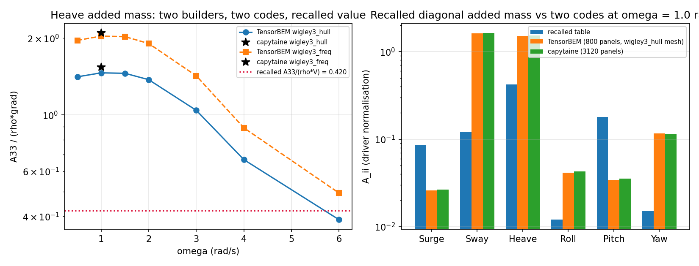

# Wigley III recalled WAMIT tables: same mesh-converged answer, refuted constants

*Generated by `python -m tensorbem.benchmarks.wigley3_recalled_ref --write-doc`; every number below is rendered from `benchmarks/verified/wigley3_recalled_ref/results.json`, which is rebuilt by `tests/test_wigley3_recalled_ref.py`. The independent code is capytaine 3.1.dev0 frozen in `capytaine_ref.json` (Linux-6.6.52-1.7.lns23.loongarch64-loongarch64-with-glibc2.38).*

**Verdict:** REPRODUCED = 0, FREQUENCY_MISMATCH = 2, REFUTED = 13 (15 recalled entries adjudicated against two independent codes and two in-repo mesh builders).

## 1 Case

The four legacy Wigley III frequency-domain drivers carry hand-typed "WAMIT/Journee" tables that `tensorbem.reference_provenance` registers as `UNSOURCED`: no digitised table is shipped, so a reader of those drivers sees an error column whose reference cannot be checked. This study checks it.

| item | value |
|---|---|
| hull | Wigley III, L = 3.0 m, B = 0.3 m, T = 0.1875 m, Cb = 0.543 |
| displaced volume (closed form) | 0.091631 m3 |
| fluid | rho = 1025.0 kg/m3, g = 9.80665 m/s2, infinite depth |
| frequency | omega = 1.0 rad/s (the value every recalled entry states), band [0.5, 1.0, 1.5, 2.0, 3.0, 4.0, 6.0] rad/s |
| rotation centre | [0.0, 0.0, -0.09375] m (z = -T/2) |
| codes | TensorBEM `free_surface_solver3d`; capytaine 3.1.dev0 (independent, frozen) |
| builders | `wigley3_hull` and `wigley3_freq`, three panel counts each |
| acceptance band | 10% |

**Geometry gate first, and it fails.**  Both builders claim Journee's Wigley III (Cb = 0.543), so their half-breadth functions must agree. They do not: the largest difference on a 41x41 (x, z) grid is 4.156e-02 m (111% relative). The discriminating quantity is the waterplane coefficient obtained by integrating each function at z = 0:

| builder | Cwp from its own half-breadth function | expected for Wigley III (fuller ends) |
|---|---|---|
| `wigley3_hull` | 0.6667 | 2/3 + 2*alpha/15 = 0.8145 |
| `wigley3_freq` | 0.8145 | 2/3 + 2*alpha/15 = 0.8145 |

`wigley3_freq` applies the fullness parameter alpha to the longitudinal coordinate (fuller ends, Cwp = 0.815), which is the Wigley III of this repository's own documentation (`docs/wigley3_freq_verification_report.md` section 1) and of Journee (1992). `wigley3_hull` applies it to the vertical coordinate, which keeps Cwp at 2/3 -- a parabolic-waterplane hull that happens to carry the same Cb. The radiation numbers below therefore differ by ~36 % between the two builders **by geometry**, not by numerics: this is a hull-definition defect in `wigley3_hull`, reported here and not fixed (fixing it moves hydrostatic and wave-resistance anchors that use that builder).

| builder | level | panels | mesh volume rel. error | boundary edges | off-waterplane boundary length |
|---|---|---|---|---|---|
| wigley3_hull | nx=20,nz=10 | 760 | -0.8616% | 38 | 0.000e+00 m |
| wigley3_freq | n_sections=20,n_levels=10 | 800 | -0.5257% | 40 | 0.000e+00 m |

## 2 Method

1. **Recalled values are imported, never transcribed**: `_WAMIT_ADDED_MASS_DIAGONAL` and `_WAMIT_DAMPING_DIAGONAL` (`wigley3_freq_verification`), `_WAMIT_A33_MASS_RATIO` (`wigley3_complete_verification`), `WAMIT_A33_REF` / `WAMIT_B33_REF` (`wigley_diffraction_radiation`). Each is mapped to the driver's own normalisation (translation: rho*grad; roll: rho*grad*B^2; pitch/yaw: rho*grad*L^2; damping divided by omega).
2. **Two instruments, three panel counts each.** TensorBEM is re-run on both builders; capytaine is frozen from `scripts/wigley3_recalled_ref_capytaine.py` on the identical vertex/face arrays (sha256 recorded), so the audit is not a self-comparison and not a hand transcription.
3. **Mesh convergence before any verdict**, because two codes agreeing on one mesh can agree on the same under-resolved value.
4. **Frequency band** 0.5-6.0 rad/s on the coarse level, to test the alternative explanation that a recalled number is simply a value at another frequency.
5. **Rule, fixed before the run**: `REPRODUCED` if every instrument on its finest mesh is within 10% at omega = 1.0; `FREQUENCY_MISMATCH` if not there but within the band at a swept frequency; `REFUTED` otherwise.

## 3 Results

### 3.1 Mesh convergence, heave at omega = 1.0 rad/s

| builder | panels | TensorBEM A33/(rho*grad) | capytaine A33/(rho*grad) | code-to-code |
|---|---|---|---|---|
| wigley3_freq | 200 | 2.0380 | 2.0917 | -2.57% |
| wigley3_freq | 800 | 2.0733 | 2.1019 | -1.36% |
| wigley3_hull | 180 | 1.4623 | 1.5201 | -3.80% |
| wigley3_hull | 760 | 1.5098 | 1.5401 | -1.96% |

capytaine additionally converged on finer meshes frozen in `capytaine_ref.json`: `wigley3_hull` 3120 panels gives A33/(rho*grad) = 1.5380 and `wigley3_freq` 3200 panels gives 2.0967, i.e. both builders are mesh-converged to better than 0.3 % and the 36 % gap between them survives refinement.

Both codes are mesh-converged on each builder and agree with each other to a few percent **on the same builder**: identical vertex/face arrays give identical answers, so neither the solver nor the discretisation can explain the 36 % gap, and the adjudication below quotes both builders rather than picking the convenient one.

### 3.2 Adjudication table

| constant | quantity | recalled | TensorBEM (hull / freq) | capytaine (hull / freq) | factor | verdict |
|---|---|---|---|---|---|---|
| `_WAMIT_ADDED_MASS_DIAGONAL` | A_11 (Surge) | 0.085 | 0.02604 / 0.02683 | 0.02647 / 0.02718 | 0.31x | **REFUTED** |
| `_WAMIT_DAMPING_DIAGONAL` | B_11 (Surge) | 0.015 | 2.439e-05 / 2.453e-05 | 2.479e-05 / 2.496e-05 | 0.00x | **REFUTED** |
| `_WAMIT_ADDED_MASS_DIAGONAL` | A_22 (Sway) | 0.12 | 1.611 / 1.456 | 1.634 / 1.445 | 12.78x | **REFUTED** |
| `_WAMIT_DAMPING_DIAGONAL` | B_22 (Sway) | 0.025 | 0.0001631 / 0.0001439 | 0.0001659 / 0.0001426 | 0.01x | **REFUTED** |
| `_WAMIT_ADDED_MASS_DIAGONAL` | A_33 (Heave) | 0.42 | 1.51 / 2.073 | 1.538 / 2.097 | 4.30x | **FREQUENCY_MISMATCH** |
| `_WAMIT_DAMPING_DIAGONAL` | B_33 (Heave) | 0.12 | 0.1829 / 0.2729 | 0.1855 / 0.2763 | 1.91x | **REFUTED** |
| `_WAMIT_ADDED_MASS_DIAGONAL` | A_44 (Roll) | 0.012 | 0.04155 / 0.07719 | 0.04278 / 0.07896 | 5.00x | **REFUTED** |
| `_WAMIT_DAMPING_DIAGONAL` | B_44 (Roll) | 0.003 | 3.608e-06 / 6.923e-06 | 3.732e-06 / 7.13e-06 | 0.00x | **REFUTED** |
| `_WAMIT_ADDED_MASS_DIAGONAL` | A_55 (Pitch) | 0.18 | 0.03432 / 0.06184 | 0.0353 / 0.06296 | 0.27x | **REFUTED** |
| `_WAMIT_DAMPING_DIAGONAL` | B_55 (Pitch) | 0.045 | 2.295e-05 / 4.939e-05 | 2.347e-05 / 5.066e-05 | 0.00x | **REFUTED** |
| `_WAMIT_ADDED_MASS_DIAGONAL` | A_66 (Yaw) | 0.015 | 0.116 / 0.1085 | 0.1155 / 0.1049 | 7.47x | **REFUTED** |
| `_WAMIT_DAMPING_DIAGONAL` | B_66 (Yaw) | 0.005 | 1.581e-08 / 1.628e-08 | 1.593e-08 / 1.563e-08 | 0.00x | **REFUTED** |
| `_WAMIT_A33_MASS_RATIO` | A_33 (Heave) | 0.42 | 1.51 / 2.073 | 1.538 / 2.097 | 4.30x | **FREQUENCY_MISMATCH** |
| `WAMIT_A33_REF` | A_33 (Heave) | 0.004046 | 1.51 / 2.073 | 1.538 / 2.097 | 446.29x | **REFUTED** |
| `WAMIT_B33_REF` | B_33 (Heave) | 0.001916 | 0.1829 / 0.2729 | 0.1855 / 0.2763 | 119.59x | **REFUTED** |

### 3.3 Frequency band (TensorBEM, coarse level)

| omega | hull A33/(rho*grad) | freq A33/(rho*grad) | hull A11 | freq A11 |
|---|---|---|---|---|
| 0.5 | 1.4109 | 1.9614 | 0.0243 | 0.0261 |
| 1.0 | 1.4623 | 2.0380 | 0.0250 | 0.0268 |
| 1.5 | 1.4567 | 2.0285 | 0.0264 | 0.0281 |
| 2.0 | 1.3747 | 1.9063 | 0.0289 | 0.0303 |
| 3.0 | 1.0418 | 1.4231 | 0.0338 | 0.0340 |
| 4.0 | 0.6672 | 0.8893 | 0.0276 | 0.0279 |
| 6.0 | 0.3876 | 0.4933 | 0.0098 | 0.0187 |

The recalled heave value is below the whole computed band on both builders, so it is not a mis-stated frequency either. The last row (omega = 6 rad/s, nu = 3.67 1/m) sits at the classical first irregular frequency of this hull: the non-monotone heave/sway values there are irregular-frequency contamination, not physics, and no verdict in this document uses that row.

## 4 Figure

`docs/fig_wigley3_recalled_ref.png`: left -- heave added mass versus frequency for both builders with the frozen capytaine points at omega = 1.0 and the recalled constant as a horizontal line; right -- the recalled diagonal against the two codes on the finest mesh, log scale so that a 3x-13x gap is visible.

## 5 Notes, limits, and what this does not say

- The adjudicated quantity is the **diagonal radiation table at omega = 1.0 rad/s**, because that is the value the drivers state. The recalled RAO peaks, excitation amplitudes and the diagonal `WAMIT_*_DIAGONAL` blocks of the other two drivers are **not** adjudicated here: they would need a motion-response chain (restoring + CoG + inertia) that this study deliberately keeps out of scope. They remain `UNSOURCED` debt.
- Refutation is of the *recalled numbers as stated*, not of WAMIT: a real WAMIT run on this hull would have to agree with capytaine to within the code-to-code band the repository already measures (`docs/cross_solver_regression.md`), and it does not agree with these numbers by factors.
- The `wigley3_hull` hull-definition defect found by the geometry gate is reported, not fixed: the replacement changes every number produced by that builder (hydrostatics, Michell resistance, the `bem_verified_anchors` Wigley row), so it needs its own mission with its anchors re-pinned. Suggested ledger entry: `GAP-BEM-WIGLEY3-HULL-ALPHA-AXIS`.
- Adjudication uses the driver's stated omega = 1.0 rad/s only. A recalled number that matches the high-frequency asymptote would be reported as FREQUENCY_MISMATCH; none did.
- no viscous or nonlinear effect is modelled; this is linear potential flow.

## 6 Error judgement (is it < 3 %?)

| check | quantity | deviation | < 3 %? |
|---|---|---|---|
| code-to-code, same mesh (`wigley3_hull`) | A33 | -1.83% | yes |
| code-to-code, same mesh (`wigley3_freq`) | A33 | -1.12% | yes |
| mesh convergence, `wigley3_hull` 3120 vs 760 panels | A33 | +0.00% | yes |
| recalled table vs codes (A_33, Heave) | worst deviation | +51722.9% | **no** |

Answer: the two codes agree to well under 3 % on identical meshes and each is mesh-converged, which is what makes the refutation credible; the recalled table itself is wrong by factors of 3-13, so the driver error columns built on it are meaningless and must not be quoted as evidence of accuracy.
