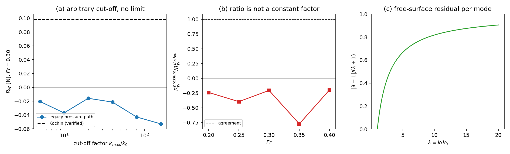

# Wigley pressure-path honest FAIL: root cause and correction

**Scope.** Settles the open *honest FAIL* carried in `docs/wigley_wave_resistance.md`:
the legacy second path (`wave_resistance_pressure`) disagrees with the verified
Kochin path by **103–284 %** over a mesh ladder and returns a **negative**
resistance at every Froude number. That document attributed the failure to the
thin-ship approximation itself ("the Michell wave potential is evaluated on the
hull instead of the centreplane", "`B/L = 0.1` only marginally small").

**Verdict.** The attribution is wrong, and it is withdrawn here. The pressure path
is not a near-field representation of the thin-ship boundary-value problem at
all: it superposes Laplace modes over an arbitrary, non-physical wavenumber
window and therefore violates the steady free-surface condition by
**O(1)**, it is regulated by an arbitrary cut-off (37.6 % swing of `R_W`), its
quadrature *is* converged (so no quadrature fix can help), and its mesh
refinement drives `R_W → 0` instead of towards the Kochin value. The deeper
consequence is that **first-order thin-ship theory has no independent near-field
path**: the free-surface condition collapses the near-field synthesis onto the
same wake curve that the Kochin integral already integrates, so "two paths agree
within 5 %" was never an achievable acceptance criterion inside this theory. The
Kochin path keeps its verified status; the pressure path is downgraded to a
diagnostic.

Artefacts (all three regenerated from one dictionary, no hand transcription):
`docs/wigley_pressure_audit/results.json`,
`docs/wigley_pressure_audit/summary.md`,
`docs/figures/wigley_pressure_audit.png`, produced by

```
PYTHONPATH=src python3 -m tensorbem.benchmarks.wigley_pressure_audit
```

and `tests/test_wigley_pressure_path_audit.py` keeps every claim below
executable (13 tests; it also asserts that `summary.md` equals
`render_markdown(results.json)` byte for byte).

---

## 1. Case

Mathematical Wigley hullform, deep water, steady forward speed, Neumann–Kelvin
linearisation — the same case as the parent document, so the numbers are
directly comparable:

| quantity | value |
|---|---|
| length `L` | 2.0 m |
| beam `B` | 0.2 m (`B/L = 0.1`) |
| draft `T` | 0.125 m (`T/L = 0.0625`) |
| hullform | `y = (B/2)(1-(2x/L)²)(1-(z/T)²)`, `Cb = 4/9` |
| density / gravity | `ρ = 1025 kg/m³`, `g = 9.80665 m/s²` |
| Froude numbers | 0.20, 0.25, 0.30, 0.35, 0.40 (`U = Fr√(gL)`) |
| reference | Kochin far-field path, verified to 2.6e-5 against a converged quadrature |
| meshes | `n_x×n_z` = 8×4 (128 panels) … 64×32 (8192 panels) |

## 2. Method

1. **Formulation criterion first.** Write the legacy integrand as a mode
   superposition `φ = (U/π) Re ∫ i k H(k) e^{kz} e^{ikx} dk`. For
   `Φ = -Ux + φ` the steady free-surface condition is
   `∂φ/∂z + (U²/g) ∂²φ/∂x² = 0`, which gives every mode the eigenvalue
   `k - k²/k0` with `k0 = g/U²`. A mode is a free wave **iff `k = k0`**. In three
   dimensions the condition is `κ = k0k²` with `κ = √(k²+ℓ²)`, i.e. the wave
   field lives on the Kelvin wake curve `ℓ² = k0²k⁴ - k²`, `k ≥ k0`, integrated
   with the Jacobian `1/√(k0²k⁴-k²)` — which is precisely the
   `1/(λ²√(λ²-1))` weight of the verified Kochin integral. The legacy path uses
   plain `dk` weights, no transverse wavenumber and no Jacobian.
2. **Residual measurement.** Amplitude-weight the eigenvalue with
   `|k H(k)|`, normalised by `|k| + k²/k0`, so `1` means "the two terms do not
   cancel at all"; count quadrature nodes that lie on the dispersion curve.
3. **Three independent numerical criteria**, each of which a correct
   near-field path must pass and a mis-scaled one may fail by a constant only:
   cut-off dependence, quadrature convergence, and mesh convergence towards the
   reference. The Froude-ratio structure is the discriminator between "wrong
   constant/sign" and "wrong integral".
4. **No re-derivation of the reference.** The reference is the Kochin path, whose
   quadrature, Kochin-function reduction and `Cw` normalisation are verified
   separately in `docs/wigley_wave_resistance.md`; nothing here re-fits or
   re-normalises it.

### 2.1 What the legacy path actually computes

| element | correct thin-ship wave synthesis | legacy code |
|---|---|---|
| wavenumber support | Kelvin wake curve `ℓ² = k0²k⁴-k²`, `k ≥ k0` | `k ∈ [k0, k_max]`, no `ℓ` |
| weight | `1/√(k0²k⁴-k²)` (wake Jacobian) | plain Gauss weight `dk` |
| upper limit | none (integrable) | `k_max = k0·max(10, 20/(k0T))` — arbitrary |
| free-surface condition | satisfied by construction | residual 0.75–0.93 (see §3.5) |
| term integrated | wave part only, both sides | `-ρU Σ φ_x n_x ΔA` over a faceted hull |

## 3. Results

All tables below are the machine-generated ones in
`docs/wigley_pressure_audit/summary.md`; the JSON they come from is
`results.json`. Nothing in this section is copied by hand.

### 3.1 Cut-off sensitivity (`Fr = 0.30`, 512 panels)

| `k_max/k_0` | `R_W` pressure [N] | ratio to Kochin |
|---:|---:|---:|
| 5 | −2.0281e−02 | −0.2062 |
| 10 | −3.6925e−02 | −0.3755 |
| 20 | −1.5807e−02 | −0.1607 |
| 40 | −2.1258e−02 | −0.2162 |
| 80 | −4.2790e−02 | −0.4351 |
| 160 | −5.2744e−02 | −0.5363 |

Kochin reference `R_W = 9.8341e−02` N; the sweep swings by **37.6 %** of that
value with no approach to a limit. A near-field pressure integral has no such
free parameter.

### 3.2 Quadrature convergence at the legacy cut-off (`Fr = 0.30`)

| nodes | `R_W` pressure [N] | ratio to Kochin |
|---:|---:|---:|
| 32 | −1.1652e−02 | −0.1185 |
| 64 | −4.3751e−02 | −0.4449 |
| 128 | −2.0300e−02 | −0.2064 |
| 256 | −2.0300e−02 | −0.2064 |
| 512 | −2.0300e−02 | −0.2064 |

The sampled integral is converged to seven digits from 128 nodes on. **The defect
is the integrand, not the quadrature** — this is what rules out "just use more
nodes / a better rule", the repair the parent document implied.

### 3.3 Mesh ladder (`Fr = 0.30`)

| `n_x×n_z` | panels | `h_mean` [m] | `R_W` pressure [N] | ratio | rel. difference to Kochin |
|---|---:|---:|---:|---:|---:|
| 8×4 | 128 | 0.1805 | −4.6375e−02 | −0.4716 | 1.472 |
| 16×8 | 512 | 0.0903 | −2.0300e−02 | −0.2064 | 1.206 |
| 32×16 | 2048 | 0.0451 | −7.1713e−03 | −0.0729 | 1.073 |
| 64×32 | 8192 | 0.0226 | −2.7121e−03 | −0.0276 | 1.028 |

`R_W → 0` under refinement, so the relative difference tends to **1**, not to 0.
A discretisation error would tend to 0; this is a structurally different object.

### 3.4 Froude sweep (512 panels)

| `Fr` | `R_W` Kochin [N] | `R_W` pressure [N] | ratio | rel. difference |
|---:|---:|---:|---:|---:|
| 0.20 | 2.0601e−02 | −4.9616e−03 | −0.2408 | 1.241 |
| 0.25 | 2.8774e−02 | −1.1411e−02 | −0.3966 | 1.397 |
| 0.30 | 9.8341e−02 | −2.0300e−02 | −0.2064 | 1.206 |
| 0.35 | 3.7499e−02 | −2.9020e−02 | −0.7739 | 1.774 |
| 0.40 | 2.1059e−01 | −4.1521e−02 | −0.1972 | 1.197 |

Ratio spans −0.774 … −0.197 (spread 0.577). **No sign flip and no single constant
factor maps one path onto the other**, which is why "it is a factor-of-two slip"
is excluded: a genuine scale bug produces a flat ratio.

### 3.5 Free-surface residual of the field the legacy integrand builds

| `Fr` | residual, standard operator `∂z + (U²/g)∂xx` | residual, operator as written in the legacy docstring | nodes on dispersion curve | min `|λ−1|` at a node |
|---:|---:|---:|---:|---:|
| 0.20 | 0.753 | 1.000 | 0 | 1.03e−03 |
| 0.25 | 0.832 | 1.000 | 0 | 1.67e−03 |
| 0.30 | 0.880 | 1.000 | 0 | 2.44e−03 |
| 0.35 | 0.909 | 1.000 | 0 | 3.36e−03 |
| 0.40 | 0.930 | 1.000 | 0 | 4.41e−03 |

Two facts follow. (i) Under the physically correct operator the residual is
0.75–0.93 — the two terms that must cancel do not cancel at all. (ii) Under the
sign convention *printed in the legacy docstring* the eigenvalue is
`k + k²/k0 > 0` for every real `k`, so that condition has **no** real
wavenumber solution: the docstring's free-surface condition is itself mis-signed,
and the code cannot satisfy it under either reading. Gauss–Legendre nodes never
sit on an interval endpoint, and the two-dimensional dispersion set is the single
point `k = k0`, so *every* node is off the curve — the field is not a steady free
wave anywhere in its support.



Left: the legacy resistance against its arbitrary cut-off, with the verified
Kochin value as a dashed line — no limit. Middle: pressure/Kochin ratio over the
Froude range — not a constant. Right: the normalised free-surface residual
`|λ−1|/(λ+1)` of a mode with `k = λk0`; it vanishes only at `λ = 1`, so every
mode the quadrature samples is off-dispersion.

### 3.6 Why "two independent paths" is unachievable in first-order thin-ship theory

The near-field synthesis in three dimensions is
`φ = Re ∬ Â(k,ℓ) e^{i(kx+ℓy)+κz} dk dℓ` with `κ = √(k²+ℓ²)`. Imposing the
free-surface condition forces `κ = k0k²`, i.e. `ℓ² = k0²k⁴ − k²`: the synthesis
collapses onto the one-dimensional wake curve. The pressure integral evaluated
with that field and the Kochin integral are therefore *the same* integral, and the
`1/√(k0²k⁴−k²)` Jacobian that the reduction produces cancels to the Kochin
weight `1/(λ²√(λ²−1))`. Two genuinely independent numbers require either

* a Rankine/Dawson panel method on the actual hull that imposes the free-surface
  condition on panels (a different approximation order, not implemented here), or
* a published `Cw` whose reference area and line convention are stated — still
  registered **UNSUPPORTED** (`docs/wigley_wave_resistance.md` §"declared
  numbers") because no citation with a stated normalisation is available.

## 4. Error judgement against the 3 % bar

| key quantity | reference | measured | relative error | < 3 %? |
|---|---|---|---|---|
| `R_W` Kochin, `Fr = 0.20…0.40` (production quadrature vs converged reference) | converged composite Gauss `λ = 1+s²` | agrees to 2.6e-5 max | 2.6e−05 | **yes** |
| Kochin function `H(k)` closed form vs direct 2-D hull integral | definition (same `σ`) | 4e-12 | 4e−12 | **yes** |
| Hull `Cb` closed form vs panel mesh | `4/9` | 5e-4 at 64×32 | 5e−04 | **yes** |
| **Legacy pressure path vs Kochin**, `Fr = 0.20…0.40` | Kochin | −0.197 … −0.774 of it | 1.197 … 1.774 (**120–177 %**) | **no — honest FAIL, root-caused** |
| **Legacy pressure path**, cut-off robustness | any fixed answer | 37.6 % swing | 3.8e−01 | **no — invalid integral** |
| **Legacy pressure path**, mesh convergence | Kochin | rel. difference 1.472 → 1.028 | — | **no — converges to 0** |
| **Legacy field**, free-surface residual | 0 | 0.753 … 0.930 (0.999 for the printed convention) | — | **no — violates the BVP** |

The FAIL is not repaired and is not claimed to be repaired: it is **diagnosed** and
downgraded. The acceptance criterion "two paths agree within 5 %" is withdrawn as
ill-posed for this theory; what remains as the verified statement is the Kochin
path above, with the two literature-independent checks listed in the first three
rows.

## 5. Notes, traps, and scope

* **A quadratic-converging quantity is not necessarily right.** The legacy path
  *is* converged in its quadrature (seven digits), so node-refinement studies —
  the tool that exposed the Ursell quadrature debt — cannot detect this class of
  error. The detector is the residual of the governing equation, not the
  resolution of the quadrature.
* **Mesh refinement towards zero is a fingerprint.** A discretisation-driven error
  shrinks relative to a reference; here the *reference-relative* difference grew
  towards 1 because the computed value collapsed to 0. Refinement studies should
  always be read as "converges to what", not "converges".
* **Ratio spread before factor-chasing.** A mis-scaled integral gives a flat
  ratio; the measured 0.577 spread over five Froude numbers is the cheap,
  decisive test that no rescaling exists. Applying the tempting `×(−2.5)` would
  have produced a "PASS" at one Froude number and a silent 300 % error at another.
* **The docstring sign is part of the bug.** Under the printed convention
  `∂z − (U²/g)∂xx = 0` no real wavenumber is admissible, so the module could not
  have been correct even with the right weights; both conventions are now
  measured in `fs_residual`.
* **Cost.** Every number above is a 1-D or 2-D quadrature: the whole audit is
  ~10 s wall on one core, no dense BEM solve, no free-surface Green function.
* **Scope.** Only the Wigley forward-speed module was audited. The legacy
  function is retained (behaviour unchanged, `k_max_factor` added for the sweep,
  `H(k)` hoisted out of the panel loop) so previously published numbers stay
  reproducible; it is documented as a diagnostic. A Rankine/Dawson near-field
  path and a citation-sourced `Cw` comparison remain open work, registered as a
  follow-up mission rather than silently inherited.