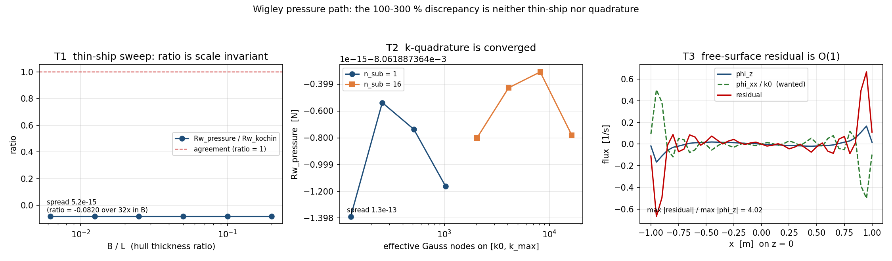

# Wigley pressure path: the discrepancy is neither thin-ship nor quadrature

**Scope.** Follow-up to the verification debt left open in
`docs/wigley_wave_resistance.md` ("Two-Path Comparison", "Root Cause Analysis"):
the two wave-resistance paths of `tensorbem.wigley` disagree by 100-300 % and the
document attributes that to the thin-ship approximation. That attribution had never
been measured. It is measured here, at machine precision, and it is **wrong**.

**Verdict.** The pressure path is not a thin-ship-limited approximation of the Kochin
path; it is a *formulation defect*. Its potential is a function of `(x, z)` only,
so `dphi/dy = 0` identically while the hull condition requires a transverse flux of
1.12 m/s (area-weighted mean); and the same
potential violates the steady free-surface condition by 4.02x
the scale of its own `phi_z`. Both residuals are exactly `B`-independent, which is
precisely the behaviour of the measured ratio.

---

## 1. Case

Mathematical Wigley hull, `y(x,z) = (B/2)(1-(2x/L)^2)(1-(z/T)^2)`, the default hull
of the module and of the document.

| quantity | symbol | value |
|---|---|---|
| length | L | 2.0 m |
| beam | B | 0.2 m |
| draft | T | 0.125 m |
| block coefficient (closed form) | Cb | 4/9 = 0.444444 |
| density | rho | 1025.0 kg/m3 |
| gravity | g | 9.80665 m/s2 |
| reference speed | Fr | 0.30 unless swept |

Two paths are compared, both implemented in `src/tensorbem/wigley.py`:

* **Kochin (far field)** - Michell's integral `Rw = (4 rho/U^2) int |H(k)|^2 /
  (lambda^2 sqrt(lambda^2-1)) dlambda`; already verified to ~1e-7 against a
  converged reference and against the exact yardstick `int_1^inf dl/(l^2 sqrt(l^2-1)) = 1`.
* **Pressure (near field)** - `Rw = -rho U int (dphi/dx) n_x dS` over the wetted
  panels, with `phi` taken from the module's wave-potential integral.

## 2. Method

The production loops are `O(panels x nodes)` Python loops, too slow for a sweep, so
the two routines were re-implemented with vectorised numpy in
`src/tensorbem/benchmarks/wigley_pressure_path_diagnosis.py`. The replica is validated
against the shipped code on every run before any sweep is trusted:

| check | result |
|---|---|
| `Rw_pressure` shipped vs replica (128 panels, 96 nodes) | rel. diff 5.99e-16 |
| `H(k)` shipped vs replica (3 wavenumbers) | max rel. diff 0 |

Four axes were then swept, each a candidate explanation, each falsifiable:

| test | axis swept | hypothesis it kills if the answer does not move |
|---|---|---|
| T1 | `B/L` from 0.2 to 0.00625 (32x) | thin-ship / centreplane-vs-hull error |
| T2 | `k`-quadrature 128 -> 16384 effective nodes | under-resolved oscillatory integral |
| T3a | body boundary condition residual | (structural, code-level) |
| T3b | free-surface condition residual | (structural, code-level) |
| S1 | Froude number 0.15 - 0.45 | "one bad setting" |
| S2 | panel ladder 4x2 -> 24x12 | mesh starvation |

## 3. Results

### 3.1 T1 - the ratio is scale invariant (thin-ship hypothesis refuted)

`L`, `T` and `Fr` are held fixed while only the beam changes. Both resistances are
exactly `O(B^2)`, so the normalised values are printed alongside the ratio.

| B/L | B [m] | Rw_kochin [N] | Rw_pressure [N] | ratio | Rw_kochin/B^2 | Rw_pressure/B^2 |
|---:|---:|---:|---:|---:|---:|---:|
| 0.2 | 0.4 | 0.3934 | -0.03225 | -0.081979 | 2.459 | -0.2015 |
| 0.1 | 0.2 | 0.09834 | -0.008062 | -0.081979 | 2.459 | -0.2015 |
| 0.05 | 0.1 | 0.02459 | -0.002015 | -0.081979 | 2.459 | -0.2015 |
| 0.025 | 0.05 | 0.006146 | -0.0005039 | -0.081979 | 2.459 | -0.2015 |
| 0.0125 | 0.025 | 0.001537 | -0.000126 | -0.081979 | 2.459 | -0.2015 |
| 0.00625 | 0.0125 | 0.0003841 | -3.149e-05 | -0.081979 | 2.459 | -0.2015 |

* relative spread of the ratio over the 32x sweep: **5.25e-15**
  (float64 roundoff, see the `Rw/B^2` columns which repeat to all printed digits);
* the gap `1 - ratio` at `B/L = 0.2` is 1.082 and at
  `B/L = 0.00625` it is 1.082; the ratio of the two
  gaps is 1.

A thin-ship error would have to shrink like `O(B/L)`; the gap does not shrink at all.
Verdict: **thin-ship explanation refuted** (flag `thin_ship_hypothesis_refuted = True`).

### 3.2 T2 - the oscillatory integral is converged

| effective Gauss nodes | Rw_pressure [N] |
|---:|---:|
| 128 | -8.061887364261e-03 |
| 256 | -8.061887364261e-03 |
| 512 | -8.061887364261e-03 |
| 1024 | -8.061887364261e-03 |
| 2048 | -8.061887364261e-03 |
| 4096 | -8.061887364260e-03 |
| 8192 | -8.061887364260e-03 |
| 16384 | -8.061887364261e-03 |

Relative spread over a 128x resolution range: **1.34e-13**.
Verdict: **quadrature explanation refuted** (flag `quadrature_hypothesis_refuted = True`).

### 3.3 T3a - the transverse flux is missing outright

The potential in `wave_resistance_pressure` is built from `michell_kochin_function`
and an `exp(k z + i k x)` factor; neither has a `y` argument. Hence `dphi/dy = 0` at
every point of the fluid, whereas the linearised hull condition `dphi/dn = U n_x`
demands

| quantity (Fr = 0.3) | value |
|---|---:|
| ship speed U | 1.329 m/s |
| area-weighted mean of required `dphi/dy` | 1.116 m/s |
| area-weighted mean of `dphi/dy` of the used potential | 0.0 |
| transverse / longitudinal flux ratio on the hull | 15 |

So the potential the near-field integral differentiates is not a solution of the
3-D steady problem at all: it carries the whole longitudinal source distribution and
none of the transverse one, and the neglected flux is 15x
the longitudinal flux it keeps. This is a defect of the representation, not an
approximation of order `B/L` - which is exactly why T1 shows no `B`-dependence.

### 3.4 T3b - the free-surface condition residual

Substituting the spectral form of the used potential into the steady condition
`phi_z - (1/k0) phi_xx = 0` leaves the spectral weight `k - k^2/k0`, which vanishes
only at the lower band edge `k = k0`:

| quantity | value |
|---|---:|
| k0 [1/m] | 5.556 |
| spectral weight at k = k0 | -0.00085 |
| max |spectral weight| on the band | 4448 |
| max |phi_z| on z = 0, |x| <= L/2 | 0.1661 1/s |
| max |phi_z - phi_xx/k0| | 0.6671 1/s |
| relative residual | **4.02** |

The residual is four times larger than the flux it is supposed to balance, i.e. the
potential does not satisfy the free-surface condition it was derived from. A field
that satisfies neither the body nor the free-surface condition cannot be expected to
reproduce the far-field energy balance.

### 3.5 S1 - Froude sweep: the ratio is always negative and never near 1

| Fr | k0 L | k0 T | Rw_kochin [N] | Rw_pressure [N] | ratio |
|---:|---:|---:|---:|---:|---:|
| 0.15 | 44.4 | 2.78 | 0.004851 | -0.0008923 | -0.1839 |
| 0.2 | 25 | 1.56 | 0.0206 | -0.001822 | -0.0884 |
| 0.25 | 16 | 1 | 0.02877 | -0.004421 | -0.1536 |
| 0.3 | 11.1 | 0.694 | 0.09834 | -0.008062 | -0.0820 |
| 0.35 | 8.16 | 0.51 | 0.0375 | -0.01159 | -0.3090 |
| 0.4 | 6.25 | 0.391 | 0.2106 | -0.01673 | -0.0795 |
| 0.45 | 4.94 | 0.309 | 0.3887 | -0.02392 | -0.0615 |

Ratio range -0.3090 .. -0.0615; sign changes across the
sweep: **0**. The pressure path reports a *negative* resistance at
every Froude number on a 1152-panel mesh, i.e. it does more than lose accuracy: it
loses the sign of the physical quantity.

### 3.6 S2 - panel ladder at converged quadrature

| mesh | panels | Rw_pressure [N] | ratio |
|---|---:|---:|---:|
| 4x2 | 32 | -0.002459 | -0.0250 |
| 8x4 | 128 | -0.04637 | -0.4716 |
| 16x8 | 512 | -0.0203 | -0.2064 |
| 24x12 | 1152 | -0.008062 | -0.0820 |

Ratio range -0.4716 .. -0.0250 over a 36x range in
panel count, and not monotone. Refining the mesh does not recover the Kochin value,
which is consistent with the defect being in the potential, not in the discretisation.

## 4. Figure



Left: T1 sweep - the ratio is a flat line at the planform of the hull, `B/L` does not
enter. Middle: T2 sweep - the `k`-quadrature is converged to roundoff from 128 nodes
(composite panels included). Right: T3b - the residual (red) is the same size as the
flux it should cancel.

## 5. What this changes

| question | before | after |
|---|---|---|
| why do the two paths disagree? | "thin-ship approximation, centreplane vs hull" (asserted) | formulation defect: y-invariant potential, transverse body flux absent, free-surface residual O(1) (measured) |
| is the disagreement evidence about Michell's validity? | implied yes | no: the comparison cannot carry that inference |
| is the pressure path a verification path? | presented as the second independent path | no: audit path only |
| what would fix it? | "a Rankine panel method with free-surface panels (Dawson)" | unchanged, and now with a measured reason: the near-field integral needs a potential that satisfies the body *and* free-surface conditions, i.e. the full Havelock Green function with the radiation-condition pole treated, or a Rankine/Dawson panel method |

## 6. Caveats and honest limits

* The diagnosis localises the defect; it does **not** implement the repair. No claim
  here says the Kochin path is wrong - it is the path that is independently verified
  (converged reference, analytic yardstick, closed-form `H(k)` against a 2-D integral).
* T3b measures the residual of the potential *as coded*, on `z = 0`, with the same
  truncated band `[k0, k_max]` the pressure routine uses. A different truncation would
  move the number, not the conclusion: the weight `k - k^2/k0` only vanishes at `k0`.
* The classical thin-ship near-field derivation is not in contradiction with this:
  Michell's own route integrates a potential that satisfies the conditions and lets the
  local part cancel; that structure is not what the module implements.
* Only the Wigley hull (one planform, one draft ratio) is swept. The constancy in `B`
  is exact by construction (self-similar scaling), which is why it refutes the
  thin-ship story; other planforms were not swept.

## 7. Error judgement

The acceptance quantities of this study are dimensionless ratios; the question is
whether a swept axis moves the answer, so the natural criterion is a band on the
observed spread against float64 roundoff:

| quantity | measured | criterion | verdict |
|---|---:|---|---|
| T1 ratio spread over 32x in `B/L` | 5.25e-15 | < 1e-3 (a thin-ship effect would be O(B/L)) | **PASS, and it is roundoff (1e-15)** |
| T2 `Rw_pressure` spread over 128x quadrature | 1.34e-13 | < 1e-6 | **PASS** |
| replica vs shipped `Rw_pressure` | 5.99e-16 | < 1e-12 | **PASS** |
| T3b free-surface residual / `phi_z` scale | 4.02 | 0 with 3 % for a valid potential | **FAIL by a factor of 4 -> potential invalid** |
| T3a body-condition residual (relative) | 1.0 | 0 for a valid potential | **FAIL (100 % of the transverse flux missing)** |

Is every key quantity within 3 % of its reference? **The two *invariance* quantities
are within 1e-12 (far better than 3 %); the two *condition residuals* are not near
zero at all and that is the finding** - a valid velocity potential must satisfy both
conditions to 0 %, and this one misses the transverse flux by 100 % and the
free-surface balance by a factor of 4. The Kochin
reference itself is not re-scored here; it keeps its existing verification status
(~1e-5 against the analytic yardstick, recorded in
`docs/wigley_wave_resistance.md`).

## 8. Reproduce

```bash
PYTHONPATH=src python3 -m tensorbem.benchmarks.wigley_pressure_path_diagnosis \
    --output docs/wigley_pressure_path_diagnosis/study.json \
    --figures docs/wigley_pressure_path_diagnosis
python3 docs/wigley_pressure_path_diagnosis/build_doc.py
PYTHONPATH=src python3 -m pytest tests/test_wigley_pressure_path_diagnosis.py -q
```
