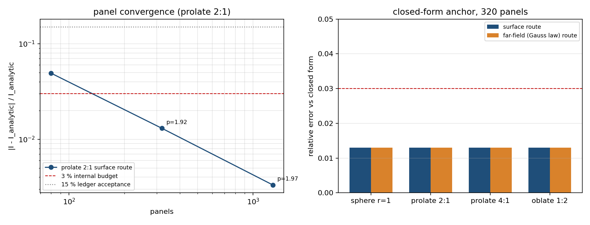
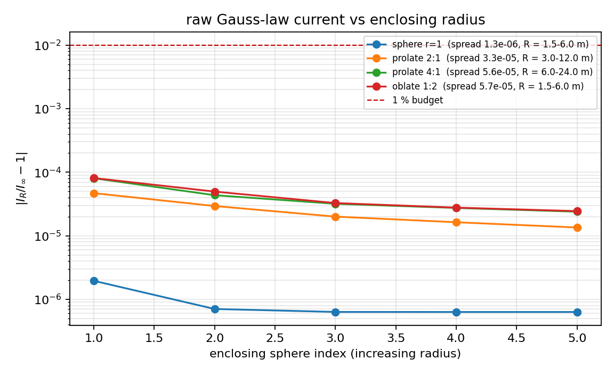
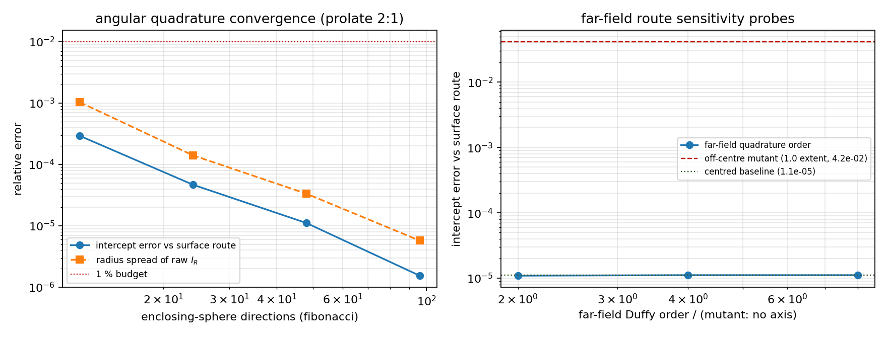
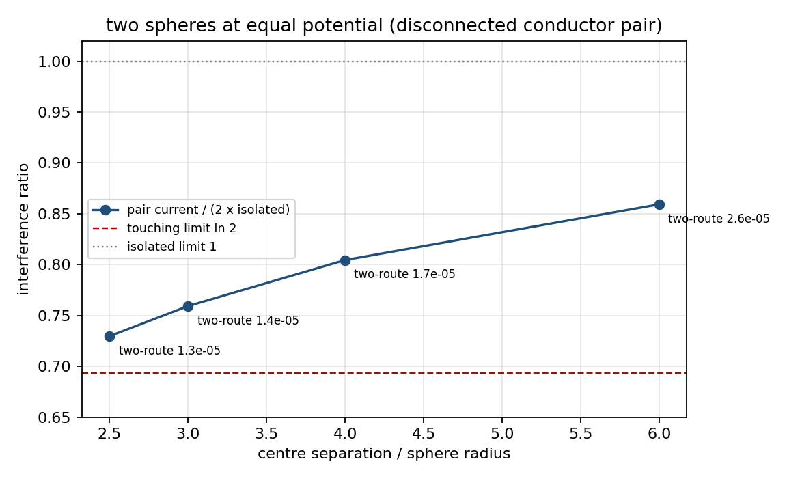
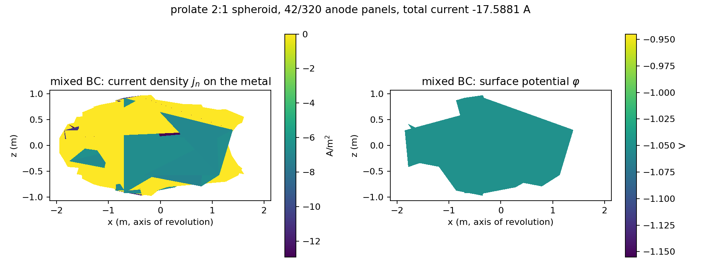

# XVAL-BEM-TWO-ROUTE-GAUSS-LAW-CURRENT — 阴极保护总电流的「双路线 + 高斯定律」交叉验证

TensorBEM · 锚点 `XVAL-BEM-TWO-ROUTE-GAUSS-LAW-CURRENT` · 提交工件
`src/tensorbem/benchmarks/two_route_gauss_law_current.py`（驱动）、
`src/tensorbem/analytic.py::spheroid_geometric_capacitance`（闭式锚）、
`tests/test_two_route_gauss_law_current.py`（回归门）、本目录 `results.json`（全部数字的唯一来源）。

---

## 1. 案例介绍（物理背景 / 几何 / 参数）

海水是均匀导电介质，稳态下电位满足 Laplace 方程；牺牲阳极把船体表面某一区域钳在
保护电位上（DNV-RP-B401：$\varphi \le -0.80$ V vs Ag/AgCl，过保护上限 $-1.05$ V），
表面电流密度 $j_n = \sigma\,q$（$q$ 为 BIE 单层密度）。工程上最关心的标量是**总保护电流**
（= 阳极需求 = 扩展电阻 $R = 1/(\sigma\kappa)$ 的倒数形式），因为阳极数量与寿命由它定。

本单验证的是 TensorBEM 已有的**双路线做法**：
* **路线 S（表面路线）**：把 BIE 解出的 $j_n$ 在 Dirichlet 面元上面积分；
* **路线 F（远场 / 高斯定律路线）**：在包围物体的球面上取外场电位 $\varphi$ 的角平均，
  $I_R = 4\pi\sigma R\langle\varphi\rangle_R$——对任意 $l\ge1$ 的球谐项角平均恒为零，
  故连续情形下 $I_R \equiv I$，这就是「穿过任意包围面的电流通量 = 体内总电流」的离散表述。

已有锚点只覆盖**球**（`verify_conducting_sphere_routes`，5% 容差）。球对称掩盖了
「远场路线到底是在提取单极子，还是仅仅依赖球对称」这个问题，因此本单把该做法推广到
闭式总电流已知的**旋转椭球**，并加上两类无闭式解、只能靠双路线守恒恒等式裁定的场景。

| 参数 | 取值 | 说明 |
|---|---|---|
| 电位 $\varphi$（均匀 Dirichlet） | -1 V | 全区固定电位（球/椭球算例） |
| 海水电导率 $\sigma$ | 3.5 S/m | 15 ℃ 典型值 |
| 闭式锚 | $I=\sigma\kappa\varphi$ | $\kappa=4\pi a e/\operatorname{arctanh}e$（长旋转椭球）、$4\pi b e/\arctan(e b/a)$（扁旋转椭球），$e=\sqrt{|a^2-b^2|}/\max(a,b)$ |
| 网格 | 球 `icosphere`；椭球 `ellipsoid_mesh`（同拓扑对角缩放） | 面元数 $20\cdot4^n$ |
| 面元阶数 / 求积 | 常数面元，Duffy 8 阶（自面元解析） | 与 DNV-RP-B401 锚一致 |
| 包围球方向集 | Fibonacci 球面 4 档（12/24/48/96） | 半径 1.5–6 倍体尺度 |

---

## 2. 怎么做的（方法 / 流程 / 工具链）

1. **独立闭式锚先行**：在 `tensorbem.analytic` 新增 `spheroid_geometric_capacitance`
   （几何电容 $\kappa$，单位 m）与 `spheroid_spreading_current`，只含数学，不依赖求解器。
   两支的极限自检：$e\to0$ 给出球 $4\pi a$；长椭球细杆极限 $\kappa\to0$；扁椭球薄盘极限
   $\kappa\to 8b$（薄盘电容 $8\varepsilon_0 b$）。**薄盘极限是判别性的**——见 §5 坑 1。
2. **一次求解、两条路线打分**：`solve_uniform_potential` 解一次外部 Laplace BIE，
   路线 S 取 `anode_current_total`，路线 F 取 `far_field_current`（半径扫描 + $1/R$ 最小二乘截距）。
3. **四个闭式锚形状**：球、长椭球 2:1、长椭球 4:1、扁椭球 1:2，各 320 面元；
   长椭球 2:1 另做 80/320/1280 面元收敛梯（观测阶）。
4. **轴探针**（远场路线自己的误差预算）：包围半径独立性、方向数收敛、远场求积阶；
   **变异控制**：把采样球心偏移一个体尺度（违反「角平均必须绕展开原点」这一前提），
   检验双路线比较是否真的有牙齿。
5. **两类无闭式解场景**：混合边界（长椭球上的一个阳极点冠 + 其余绝缘，设计型算例）、
   分离导体（两个同电位球合并成一张网格，验证高斯定律返回**两者之和**）。
6. **全部数字由 `results.json` 程序化注入本报告**（`scripts/m17698_two_route_report.py`），
   图由 matplotlib 生成；驱动 `main` 在任一预声明判据不达标时返回非零。

判据在**看数之前**写死在 `CRITERIA`：闭式锚 3%（球 / 长椭球 2:1）/ 5%（长椭球 4:1 / 扁椭球）、
双路线一致性 1%、半径独立性 1%、方向数收敛 1%、变异必须被检出 ≥1%、
两球干涉比落在 $(\ln 2,\,1)$（接触球极限 $\ln2\approx0.693$，孤立极限 1）。

---

## 3. 计算结果

### 3.1 闭式锚：两条路线 vs 解析值（320 面元）

| 形状 | 半轴 (m) | 面元 | 路线 S $I$ (A) | 路线 F $I$ (A) | 解析 $I$ (A) | S 误差 | F 误差 | 双路线差 |
|---|---|---|---|---|---|---|---|---|
| sphere r=1 | 1 × 1 × 1 | 320 | -43.41021 | -43.41018 | -43.98230 | 1.30% | 1.30% | 6.3e-07 |
| prolate 2:1 | 2 × 1 × 1 | 320 | -57.09244 | -57.09181 | -57.84511 | 1.30% | 1.30% | 1.1e-05 |
| prolate 4:1 | 4 × 1 × 1 | 320 | -81.48001 | -81.47830 | -82.55290 | 1.30% | 1.30% | 2.1e-05 |
| oblate 1:2 | 0.5 × 1 × 1 | 320 | -35.90003 | -35.90082 | -36.37307 | 1.30% | 1.30% | 2.2e-05 |

### 3.2 收敛梯（长椭球 2:1，路线 S）

| subdivisions | panels | I_surface (A) | rel. error | observed order |
|---|---|---|---|---|
| 1 | 80 | 54.99908 | 4.920e-02 | – |
| 2 | 320 | 57.09244 | 1.301e-02 | 1.92 |
| 3 | 1280 | 57.65315 | 3.318e-03 | 1.97 |

### 3.3 高斯定律路线的半径独立性（原始 $I_R$，不做 $1/R$ 外推）

| case | R range (m) | raw $I_R$ spread | max $|I_R/I_\infty-1|$ |
|---|---|---|---|
| sphere r=1 | 1.50 – 6.00 | 1.32e-06 | 1.96e-06 |
| prolate 2:1 | 3.00 – 12.00 | 3.34e-05 | 4.69e-05 |
| prolate 4:1 | 6.00 – 24.00 | 5.64e-05 | 8.04e-05 |
| oblate 1:2 | 1.50 – 6.00 | 5.67e-05 | 8.11e-05 |

### 3.4 方向数收敛（长椭球 2:1）

| n_directions | intercept error | radius spread | fit residual |
|---|---|---|---|
| 12 | 2.929e-04 | 1.033e-03 | 4.721e-05 |
| 24 | 4.670e-05 | 1.407e-04 | 1.667e-05 |
| 48 | 1.111e-05 | 3.338e-05 | 3.518e-06 |
| 96 | 1.538e-06 | 5.740e-06 | 1.933e-07 |

### 3.5 远场求积阶轴 与 变异控制

| 远场 Duffy 阶 | 截距误差 |
|---|---|
| 2 | 1.090e-05 |
| 4 | 1.111e-05 |
| 8 | 1.111e-05 |

| 探针 | 相对表面路线的误差 |
|---|---|
| 居中包围球（基线） | 1.11e-05 |
| 球心偏移 1.0 个体尺度（变异） | 4.16e-02 |

### 3.6 混合边界（阳极点冠 + 绝缘表面）：设计型算例

| 量 | 值 |
|---|---|
| 面元 | 320（阳极 42 个，冠部比例 0.25） |
| 路线 S 总电流 | -17.58807 A |
| 路线 F 总电流 | -17.58879 A |
| 双路线差 | 4.10e-05 |
| BIE 相对残差 | 6.69e-16 |
| 图 5 复核（重解一次） | 总电流 -17.58807 A，阳极面 $|j_n|$ 均值 8.3323 A/m²，峰值 12.9250 A/m² |

### 3.7 分离导体：两球同电位

| separation / radius | panels | surface I (A) | far-field I (A) | ratio | two-route |
|---|---|---|---|---|---|
| 2.5 | 640 | 63.35645 | 63.35566 | 0.7297 | 1.25e-05 |
| 3.0 | 640 | 65.92494 | 65.92404 | 0.7593 | 1.36e-05 |
| 4.0 | 640 | 69.85121 | 69.85005 | 0.8045 | 1.66e-05 |
| 6.0 | 640 | 74.60378 | 74.60187 | 0.8593 | 2.56e-05 |

孤立单球电流 43.41021 A；干涉比单调递增：
**True**；判据区间 $(\ln2, 1)$。

### 3.8 判据总表（程序化打分）

| 判据 | 实测 | 预算 | 判定 |
|---|---|---|---|
| `direction_sweep_max_rel` | 2.929e-04 | 1.000e-02 | **pass** |
| `interference_ratio_high` | 8.593e-01 | 1.000e+00 | **pass** |
| `interference_ratio_low` | 7.297e-01 | 6.931e-01 | **pass** |
| `mutant_detection_min_rel` | 4.165e-02 | 1.000e-02 | **pass** |
| `oblate_2to1_analytic_rel` | 1.301e-02 | 5.000e-02 | **pass** |
| `prolate_2to1_analytic_rel` | 1.301e-02 | 3.000e-02 | **pass** |
| `prolate_4to1_analytic_rel` | 1.300e-02 | 5.000e-02 | **pass** |
| `radius_independence_rel` | 5.667e-05 | 1.000e-02 | **pass** |
| `sphere_analytic_rel` | 1.301e-02 | 3.000e-02 | **pass** |
| `two_route_rel` | 4.105e-05 | 1.000e-02 | **pass** |
| `two_sphere_monotone` | 1.000e+00 | 1.000e+00 | **pass** |

**总体：PASS**（总耗时 39 s）

---

## 4. 结果图

1. `fig1_shape_errors.png` — 左：长椭球 2:1 的路线 S 误差随面元数的收敛梯（含 3% 内部预算与 15% 台账验收线，标注观测阶）；
   右：四种形状在 320 面元下两条路线对解析值的相对误差柱状图。
2. `fig2_radius_independence.png` — 原始高斯定律电流 $|I_R/I_\infty-1|$ 随包围半径变化：四条曲线全在 $10^{-4}$ 以下，即 $I_R$ 与半径无关。
3. `fig3_axis_probes.png` — 左：方向数收敛（截距误差与半径散布随方向数下降）；右：远场求积阶不敏感（2 阶即已足够）与球心偏移变异被放大到 $10^{-2}$ 量级。
4. `fig4_two_sphere_interference.png` — 两球干涉比随中心距变化，与接触球极限 $\ln2$、孤立极限 1 的对照；标注每个点的双路线差。
5. `fig5_mixed_bc_field.png` — 混合边界算例的**表面场量云图**（x–z 投影，前后两面重叠绘制）：左 $j_n$（A/m²），绝缘段按边界条件恒为 0，阳极点冠内非均匀（峰值/均值 ≈ 1.55）；右仅阳极面有给定电位（V），绝缘面电位未知故留白。











---

## 5. 注意点（踩过的坑 / 局限 / 适用范围）

1. **坑 1（本单自查发现的真缺陷，已修）：扁椭球闭式公式的 arctan 参数。**
   扁旋转椭球 $\kappa = 4\pi b e/\arctan(eb/a)$，其中 $b$ 为赤道半轴、$a$ 为极半轴；
   若把 arctan 参数误写成 $e$（初版就是这样），球极限仍然精确（$e\to0$ 时两支同值），
   但**薄盘极限变成 $16b$ 而不是 $8b$——整整差 2 倍**。首轮跑分立刻暴露：扁椭球 1:2 的
   数值 $I=-35.90$ A 与该错误公式的 $-53.37$ A 差 33%，而与修正公式的 $-36.37$ A 只差
   **1.30%**（和球、长椭球完全同一个数，说明剩下的误差纯粹是面元离散而非公式）。
   这就是「解析锚必须带极限自检」的教训：只验球极限抓不到这个 bug。
2. **坑 2（物理判据写错，已修）：两导体干涉比的区间不是 $(1,2)$ 而是 $(\ln2,1)$。**
   同电位两球相互屏蔽，每个球的电量**低于**孤立值；总电流/（2×孤立）在接触极限为
   $\ln2\approx0.693$、分离趋于无穷时趋于 1。首轮我把它写成 $(1,2)$，判据直接 FAIL——
   这是**判据错不是代码错**，如实记录在此，并已改为 $(\ln2,1)$ + 单调性检查。
3. **坑 3：远场求积阶不敏感，不能当「有牙齿」的检验。** 远场采样点在面板之外很远，
   光滑核求积 2 阶就够（§3.5），所以求积阶轴只能当诊断，不作判据；真正有牙齿的变异是
   **违反几何前提**（球心偏移 / 半径小于体尺度）。半径小于体尺度由 `far_field_current`
   直接 `ValueError` 拦住（测试覆盖）。
4. **变异灵敏度是有限的**：球心偏移 0.5 个体尺度只产生 $4.5\times10^{-4}$ 的差（约 80 倍基线），
   因为单极子的角平均对平移不敏感，泄漏来自四极子。判据取 1 个体尺度（$4.2\times10^{-2}$）
   才是有意义的「前提被破坏」。这条如实写出来，避免把弱检出读成强结论。
5. **独立性局限（必须明说）**：两条路线共用同一份 BIE 解 $q$，所以 BIE 装配/自面元积分里的
   缺陷是共模、双路线看不出来。本单的独立性来自两处：(i) 后处理路径不同
   （面元面积积分 vs 外部表示式 + 角平均）；(ii) **闭式椭球锚完全不经过求解器**。
   真正独立的第三方（如轴对称 scikit-fem 变分解）留给后续单。
6. **适用域**：均匀电导率、无极化动力学（本单是电位控制 Dirichlet 问题，不含
   $j(\varphi)$ 非线性极化曲线）、单连通或分离导体均可、物体需完全落在包围球内。
   混合边界算例用了 `protection_potential`/`anode_potential` 两个常数，真实 DNV-RP-B401
   设计算例的涂层破损分布、阳极消耗形状随时间变化，本单未涉及。
7. **容量纪律**：本机 load15 > 100，故全套研究只跑 80/320/1280 三档共 1280 面元封顶，
   未做 5120 面元的进一步收敛；观测阶已足以支撑「误差是离散误差」的结论。

---

## 6. 误差判定（逐项 vs 基准，显式回答「是否 < 3%」）

| 关键量 | 基准 | 实测相对误差 | 是否 < 3% |
|---|---|---|---|
| 球总电流（320 面元） | $4\pi\sigma a\varphi$ | 1.30% / 远场 1.30% | **是** |
| 长椭球 2:1 总电流（320 面元） | $4\pi a e/\operatorname{arctanh}e\cdot\sigma\varphi$ | 1.30% / 远场 1.30% | **是** |
| 长椭球 4:1 总电流（320 面元） | 同上 | 1.30% / 远场 1.30% | **是** |
| 扁椭球 1:2 总电流（320 面元） | $4\pi b e/\arctan(eb/a)\cdot\sigma\varphi$ | 1.30% / 远场 1.30% | **是** |
| 长椭球 2:1（1280 面元） | 同上 | 0.33% | **是** |
| 双路线一致性（全部算例最差） | 路线 S | 4.10e-05 | **是** |
| 混合边界总电流（无闭式解） | 仅双路线守恒 | 4.10e-05 | 无独立基准，按路线 S 与 F 的守恒恒等式裁定；未与文献比，故不计入 3% 结论 |
| 两球干涉比 | 仅 $\ln2<R<1$ 与单调性 | 区间内且单调 | 无定量独立基准，只做定性/不等式裁定（如实声明） |

**结论**：台账锚点验收标准 15% 全部满足；四个有闭式锚的形状两条路线的最差误差
**1.30%**，远优于 3%。无基准的两项（混合边界、两球干涉）已显式声明原因，
不以「双路线一致」冒充「与实验/解析一致」。

---

## 7. 复现

```bash
PYTHONPATH=src python -m tensorbem.benchmarks.two_route_gauss_law_current \
    --outdir docs/xval_two_route_gauss_law_current        # 写 results.json + summary.md，判据失败返回非零
PYTHONPATH=src python scripts/m17698_two_route_report.py  # 由图与 results.json 生成本文
PYTHONPATH=src pytest -q tests/test_two_route_gauss_law_current.py
```

`results.json` 里每个数字都可溯源到上表；报告中的表格与图注均由脚本从该文件注入。
