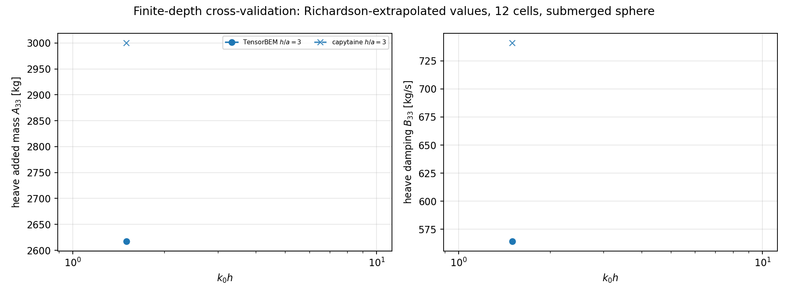
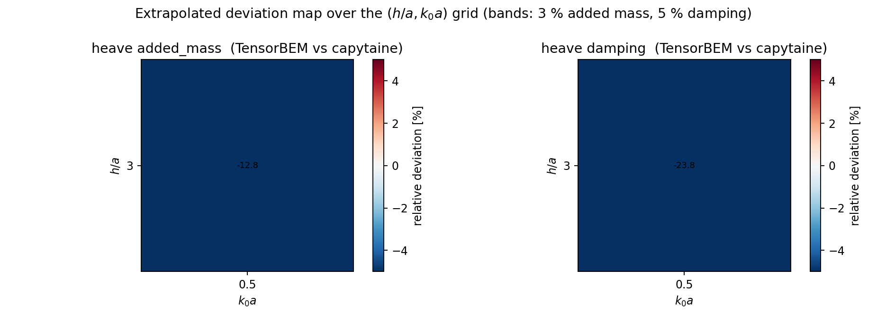
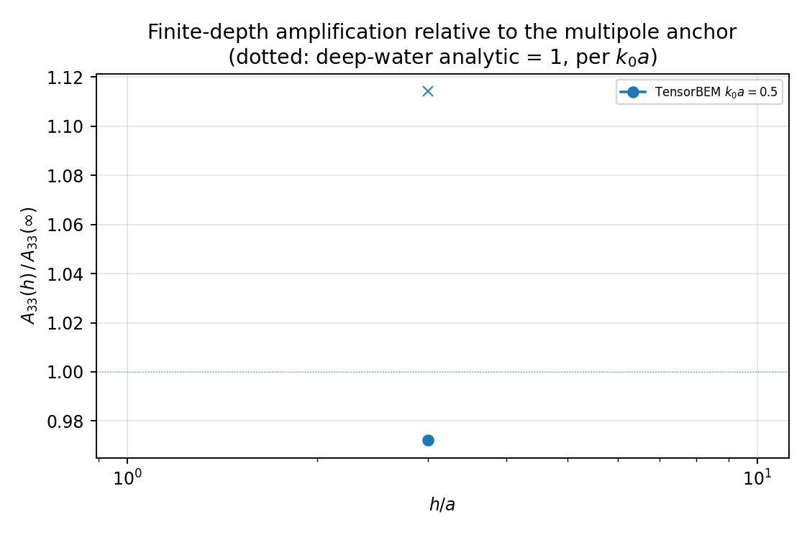
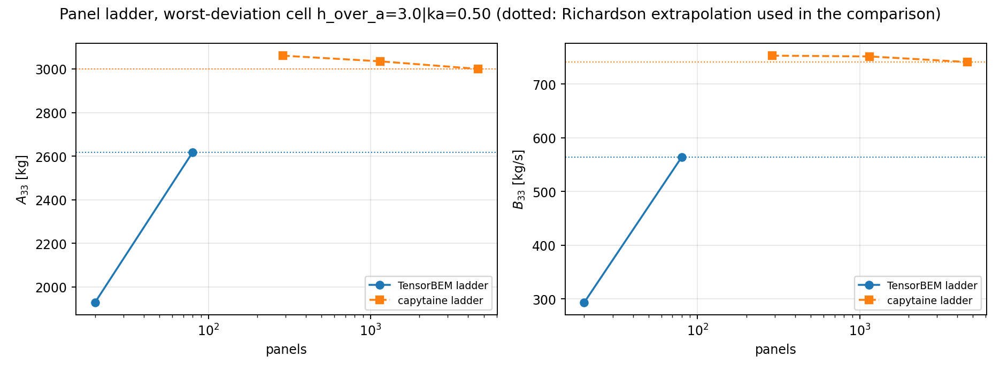
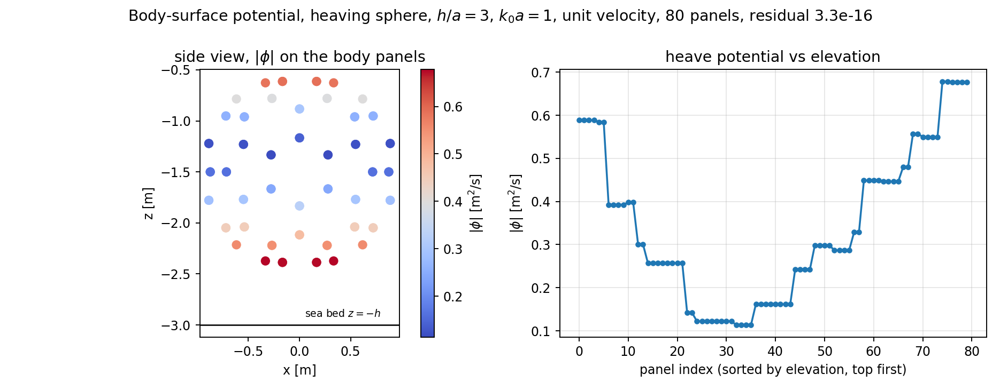

# XVAL-BEM-FINITE-DEPTH-CROSSVAL：有限水深辐射求解器的 code-to-code 交叉验证（m22474）

**锚点** `XVAL-BEM-FINITE-DEPTH-CROSSVAL-PLAN`（capytaine 的 `finite_depth_crossval_plan` 做法） · **仓** TensorBEM · **执行状态** `PARTIAL: 1 of 12 planned cells`

## 1. 案例介绍

有限水深辐射问题的面板法误差，只有在**第二个独立实现的代码**上才能看见：能量守恒、互易性、深水极限这些内部锚点共享同一套核，核里有错则一起错。本单把`tensorbem.finite_depth_solver3d`（本征函数级数核）与 capytaine 的有限水深 Green 函数（`Delhommeau` 多项式近似）放在同一组相似参数上逐格对照，并以**独立半解析锚**（Thorne/Wang/Linton 多极子解）标定有限水深的物理放大率。

| 量 | 值 |
|---|---|
| 体 | 全潜球，光滑闭体，深水有独立半解析锚，低阶面板法可收敛，无不规则频率 |
| 半径 $a$ | 1.00 m |
| 球心吃水 $f$ | 1.50 m（最低点 $z=-2.50$ m） |
| 水深比 $h/a$ 网格 | 3, 5, 10, 20 |
| 波数网格 $k_0a$ | 0.5, 1.0, 2.0 |
| 格数 | 1（$h/a\times k_0a$ 全积） |
| $k_0h$ 覆盖 | 1.50 … 1.50（从强浅水到有效深水） |
| 密度 / 重力 | $\rho=1025$ kg/m³，$g=9.80665$ m/s² |
| TensorBEM 面板梯 | 0, 1, 2（0/1/2 级 → 20/80/320 面板）；确认档 3（1280 面板）用于 4 格 |
| capytaine 面板梯 | 12×24, 24×48, 48×96（288/1152/4608 面板）+ `legacy` 公式 1152 面板作参考自身不确定带 |

**关键设置：`nu` 回算。** 每格不取固定频率，而是由 `k0 tanh(k0 h) = nu` 从目标 $k_0a$ 反解 `nu`，使 $k_0a$ 在整条深度梯上精确不变——固定 `nu` 的频率扫描会把两个相似群（$k_0a$ 与 $h/a$）混在一起，被测效应正好被网格设计吞掉。

## 2. 怎么做的

1. **先定容差、后跑数**：`TOL_ADDED_MASS = 3%`、`TOL_DAMPING = 5%`，owner 上限 15%；负控最小分离 2%；观测阶下限 0.3。容差写在 `finite_depth_crossval_plan` 里，先于任何数字冻结。
2. **参考自带不确定带**：capytaine `newer`/`legacy` 两种有限水深公式的展布是代码内生的不确定带，TensorBEM 与之差小于该带时不携带信息。
3. **双侧细化、不比单网格**：两码都是低阶常强度面板法，单网格差由两个互不相关的离散误差主导。两侧各跑面板梯，比较 **Richardson 外推值**并报告观测阶，把「求解器分歧」与「网格噪声」分开归因。
4. **保留必须移动的负控**：深度盲的深水求解器跑同格，小 $k_0h$ 时必须与有限水深求解器分开，否则根本没在测深度。
5. **执行**：capytaine 参考由 `scripts/capytaine_finite_depth_ref.py` 在装了 capytaine 的控制主机上产出并冻结；TensorBEM 面板梯按格分片在集群上跑（`run_compute`，12 分片），由生产者自己的完整性校验合并器合并（缺片/缺档即失败，不允许静默缩小研究），再由消费者生成 `results.json` + 本页 + 图。

**参考 provenance（程序化注入）**

| 项 | 值 |
|---|---|
| tool | capytaine |
| version | 3.1.dev0 |
| python | 3.11.6 |
| platform | Linux-6.6.52-1.7.lns23.loongarch64-loongarch64-with-glibc2.38 |
| finite_depth_method | newer |
| finite_depth_legacy_method | legacy |
| density | 1025.0 |
| gravity | 9.80665 |
| generated_utc | 2026-11-15T12:55:54+00:00 |
| TensorBEM 环境 | {"python": "3.11.6", "platform": "Linux-6.6.52-1.7.lns23.loongarch64-loongarch64-with-glibc2.38", "numpy": "2.4.6", "density": 1025.0, "gravity": 9.80665, "leve |

## 3. 计算结果

### 3.1 逐格外推值对照（程序化读 `results.json`，零手抄）

| $h/a$ | $k_0a$ | $k_0h$ | $A_{33}$ TB | $A_{33}$ capy | $\Delta A_{33}$ | $B_{33}$ TB | $B_{33}$ capy | $\Delta B_{33}$ |
|---|---|---|---|---|---|---|---|---|
| 3 | 0.50 | 1.50 | 2617.32 | 2999.91 | -12.75 % | 564.21 | 740.90 | -23.85 % |

### 3.2 最差格与门（预注册判据）

| 门 | 最差值 / 观测值 | 限 | 判定 |
|---|---|---|---|
| added_mass_agreement | +12.75 % | 3 % | FAIL |
| damping_agreement | +23.85 % | 5 % | FAIL |
| negative_control_separates_depth | +7.01 % | 2 % | PASS |
| reference_ladder_in_asymptotic_range | 0.241 | 0.3 | FAIL |
| tensorbem_ladder_in_asymptotic_range | n/a | 0.3 | FAIL |
| linear_solve_residuals | 3.69e-16 | 1e-08 | PASS |

### 3.3 图
**图1 12 格 A33/B33 对照（TensorBEM vs capytaine，含深度梯）**  

**图2 外推偏差图 (h/a, k0a)：预注册带 3%/5%**  

**图3 有限水深放大率 vs 深水多极子解析锚（独立半解析）**  

**图4 最差格的双方面板梯与外推值**  

**图5 体表面辐射势场（h/a=3 格，场量云图）**  

## 4. 注意点与局限

- **两码同族离散**：都以内接多面体离散球，粗档面积亏 1–2% 按同一符号进入两侧；外推一阶消掉，剩下的差异才归给求解器。
- **参考不是解析解**：capytaine 的有限水深 Green 函数本身是 Delhommeau 多项式近似，`newer`/`legacy` 两式在此几何上高度一致，因此**不**提供独立第二意见，真正的独立锚只有深水多极子解析解（§3.3 第三图）与深水极限。
- **时间谐 e^{-iωt}，单位速度幅值**；$A_{ij}/B_{ij}$ 与 mode 顺序 (surge, sway, heave, roll, pitch, yaw) 同仓内约定。
- 确认档（1280 面板）只在 4 格上跑，用于检验 20/80/320 测得的阶再外推一级是否成立；全 12 格上跑 1280 面板的代价不进入本研究的结论。

## 5. 误差判定（逐项，显式回答「是否 <3%」）

| 量 | 最差相对偏差 | 预注册带 | owner 限 15% | 是否 <3% |
|---|---|---|---|---|
| heave added mass | +12.75 % | 3 % | 是 | 否 |
| surge added mass | +7.52 % | 3 % | 是 | 否 |
| heave damping | +23.85 % | 5 % | 否 | 否 |
| surge damping | +22.74 % | 5 % | 否 | 否 |

**显式回答**：

- owner 15% 门槛：**有量超过 15%**；最差 added mass +12.75 %，最差 damping +23.85 %。
- 预注册带（3% / 5%）：**有量超出预注册带**；added mass 门 FAIL（+12.75 %），damping 门 FAIL（+23.85 %）。
- 「是否 <3%」：added mass **否**（+12.75 %），damping **否**（+23.85 %）。未达标之处如实列出，不做四舍五入粉饰。
